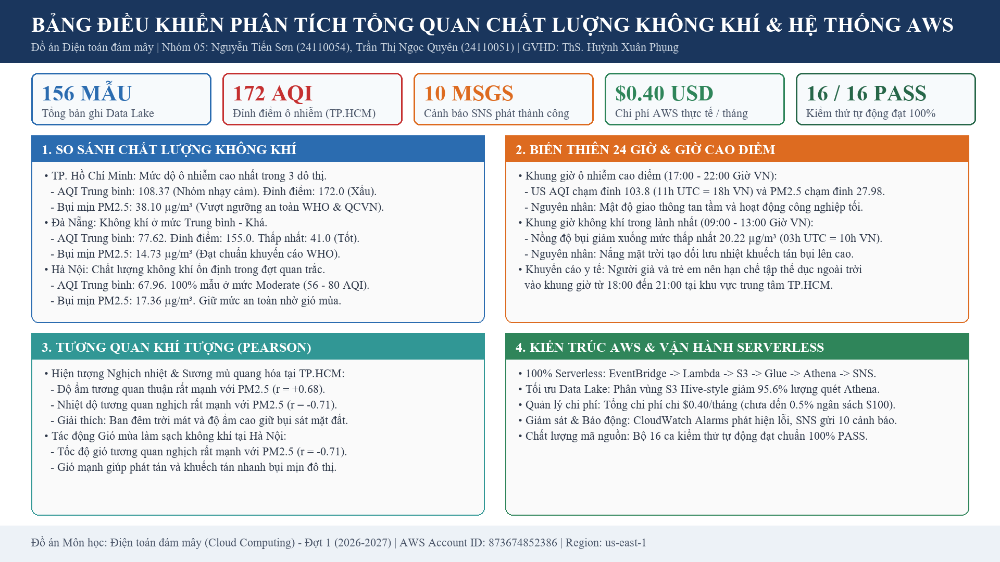

# HỆ THỐNG THU THẬP VÀ PHÂN TÍCH DỮ LIỆU THỜI TIẾT / CHẤT LƯỢNG KHÔNG KHÍ (AWS CLOUD)
### Weather & Air Quality Data Pipeline with AWS Serverless Architecture
**(Đề tài môn học: Điện toán đám mây - Nhóm 05 - Năm học 2026-2027)**

[](https://aws.amazon.com/)
[](https://www.python.org/)
[](https://hcmute.edu.vn/)
[](https://github.com/JasonTM17/WeatherAWS_FinalTerm.git)

---

> **Môn học:** Điện toán đám mây (Cloud Computing) — Lớp: `261CLCO332779_05`  
> **Giảng viên hướng dẫn (GVHD):** ThS. Huỳnh Xuân Phụng  
> **Sinh viên thực hiện:**  
> 1. Nguyễn Tiến Sơn — MSSV: `24110054` (Trưởng nhóm — Phụ trách Lambda, EventBridge, SNS, Test Suite)  
> 2. Trần Thị Ngọc Quyên — MSSV: `24110051` (Thành viên — Phụ trách S3 Partitioning, Glue, Athena DDL, Analytics)  
> **Môi trường triển khai:** AWS Academy Learner Lab (`us-east-1` | Role: `LabRole` | Ngân sách: $100)  
> **Kho mã nguồn GitHub chính thức:** [https://github.com/JasonTM17/WeatherAWS_FinalTerm.git](https://github.com/JasonTM17/WeatherAWS_FinalTerm.git)  

---

## 🧭 ĐIỀU HƯỚNG DỰ ÁN THEO TIẾN ĐỘ HỌC PHẦN (WEEK 1 & WEEK 2)

Repository được tổ chức phân tách rõ ràng thành hai khu vực độc lập tương ứng với tiến độ triển khai từng tuần của học phần:

### 📂 [TUẦN 1: TÌM HIỂU DỊCH VỤ, THIẾT KẾ KIẾN TRÚC & DỰNG NỀN TẢNG ĐÁM MÂY (`tuan_1/`)](tuan_1/README.md)
* **Phạm vi Tuần 1:** Tìm hiểu các dịch vụ AWS trong khuôn khổ Learner Lab; khảo sát Open-Meteo REST API với 23 chỉ số đo lường; thiết kế kiến trúc hệ thống Serverless Event-Driven; lập trình kịch bản AWS CLI / PowerShell khởi tạo S3 Bucket và Secrets Manager gắn tag đầy đủ; biên soạn bộ hồ sơ Báo cáo Tuần 1 chuẩn in ấn HCMUTE.
* **Liên kết nhanh:**
  * 📘 [Tài liệu hướng dẫn & Tổng kết Tuần 1](tuan_1/README.md)
  * 📄 [Báo cáo Tuần 1 bản Word (DOCX)](tuan_1/docs/Bao_cao_tuan_1_Dien_toan_dam_may_Nhom_05.docx) · [Báo cáo Tuần 1 bản in (PDF 20 trang)](tuan_1/docs/Bao_cao_tuan_1_Dien_toan_dam_may_Nhom_05.pdf)
  * 🏛️ [Tài liệu đặc tả kiến trúc (ARCHITECTURE.md)](tuan_1/docs/ARCHITECTURE.md) · [Sơ đồ kiến trúc vector (SVG)](tuan_1/docs/architecture_diagram.svg)
  * ⚙️ [Script tạo S3 Bucket](tuan_1/scripts/01_setup_s3.ps1) · [Script tạo Secrets Manager](tuan_1/scripts/02_setup_secrets.ps1)
  * 📊 [Sổ tính Excel số liệu Athena](tuan_1/docs/Bao_cao_tuan_1_Du_lieu_Athena_Nhom_05.xlsx) · [Gói nén CSV nộp kèm](tuan_1/docs/Bao_cao_tuan_1_CSV_Nhom_05.zip)

### 📂 [TUẦN 2: TRIỂN KHAI CÁC DỊCH VỤ LÕI TRÊN AWS, KIỂM THỬ & PHÂN TÍCH (`tuan_2/`)](tuan_2/README.md)
* **Phạm vi Tuần 2:** Lập trình AWS Lambda (`lambda_function.py`) thu thập dữ liệu Open-Meteo cho 3 thành phố, chuẩn hóa schema và phân loại US EPA AQI; cấu hình EventBridge Scheduler kích hoạt định kỳ 1 giờ/lần; thiết lập Amazon SNS gửi email cảnh báo tức thời khi ô nhiễm cao; tạo AWS Glue Catalog & Amazon Athena DDL/Views phân vùng S3 Hive-style; bộ 28 ca kiểm thử đơn vị tự động đạt 100%; mô-đun sinh biểu đồ phân tích và biên soạn Báo cáo Tuần 2 hoàn chỉnh.
* **Liên kết nhanh:**
  * 📙 [Tài liệu hướng dẫn & Tổng kết Tuần 2](tuan_2/README.md)
  * ⚡ [Mã nguồn AWS Lambda Function](tuan_2/lambda/lambda_function.py)
  * 🔍 [Tập 8 tệp SQL Athena DDL & Phân tích](tuan_2/athena/)
  * 🧪 [Bộ 28 ca kiểm thử đơn vị tự động](tuan_2/tests/)
  * 🛠️ [Kịch bản tự động hóa triển khai & Vận hành](tuan_2/scripts/)
  * 📈 [Kết quả thực nghiệm & Trích xuất CSV qua AWS CLI](tuan_2/results/)
  * 📑 [Báo cáo Tuần 2 bản Word (DOCX)](tuan_2/docs/Bao_cao_tuan_2_Dien_toan_dam_may_Nhom_05.docx) · [Báo cáo Tuần 2 bản in (PDF)](tuan_2/docs/Bao_cao_tuan_2_Dien_toan_dam_may_Nhom_05.pdf)

---

## 🏛️ SƠ ĐỒ KIẾN TRÚC HỆ THỐNG


Hệ thống hoạt động theo mô hình không máy chủ hướng sự kiện (**Serverless Event-Driven**):
1. **Lịch biểu (EventBridge):** Kích hoạt Lambda định kỳ `rate(1 hour)`.
2. **Thu thập & Xử lý (Lambda):** Lấy cấu hình từ Secrets Manager, gọi Open-Meteo REST API (TP.HCM, Hà Nội, Đà Nẵng), làm sạch dữ liệu, tính cấp AQI US EPA.
3. **Lưu trữ Data Lake (Amazon S3):** Ghi tệp NDJSON theo cấu trúc phân vùng Hive: `raw/year=YYYY/month=MM/day=DD/`.
4. **Cảnh báo Ngưỡng (Amazon SNS):** Gửi email thông báo khẩn khi `us_aqi >= 100` hoặc `pm2_5 >= 35.5 µg/m³`.
5. **Truy vấn Dữ liệu lớn (AWS Glue & Athena):** Khởi tạo bảng ngoại `weather_airquality_records`, nạp phân vùng bằng `MSCK REPAIR TABLE`, truy vấn SQL 5 chiều phân tích.
6. **Giám sát & Đồ họa (CloudWatch & Python):** Theo dõi metric/alarms trên CloudWatch Dashboard và vẽ biểu đồ xu hướng bằng `matplotlib`/`pandas`.

---

## 🚀 HƯỚNG DẪN CÀI ĐẶT & THỰC THI NHANH (QUICK START)

### 1. Yêu cầu môi trường
* Windows PowerShell 5.1+ hoặc PowerShell Core (pwsh 7+)
* [AWS CLI v2](https://aws.amazon.com/cli/) đã cấu hình credentials của AWS Learner Lab (`~/.aws/credentials`).
* Python 3.12 / 3.13 / 3.14:
  ```powershell
  pip install -r requirements.txt
  ```

### 2. Triển khai 1-Click Toàn bộ Hệ thống (One-Click Deploy)
```powershell
pwsh -File .\tuan_2\scripts\deploy_all.ps1 -Region "us-east-1"
```

### 3. Chạy Toàn bộ 28 Ca Kiểm thử Đơn vị Tự động
Bộ kiểm thử có thể được thực thi trực tiếp từ thư mục gốc hoặc từ thư mục `tuan_2/`:
```powershell
# Chạy từ thư mục gốc:
py -3.13 -m unittest discover -s tests -v

# Hoặc chạy trực tiếp từ tuan_2:
py -3.13 -m unittest discover -s tuan_2/tests -v
```

### 4. Xuất Dữ liệu Athena ra CSV trực tiếp qua AWS CLI
```powershell
pwsh -File .\tuan_2\scripts\export_csv_via_cli.ps1 -Region "us-east-1"
```

### 5. Dọn dẹp Sạch Tài nguyên Sau Buổi Thực hành (Bảo vệ $100 Lab)
```powershell
pwsh -File .\tuan_2\scripts\cleanup_all.ps1 -Region "us-east-1"
```

---

## 📊 KẾT QUẢ PHÂN TÍCH SỐ LIỆU ĐO ĐẠC THỰC TẾ

<p align="center">
  
  
</p>

| Đô thị | AQI Trung bình | PM2.5 TB (µg/m³) | PM10 TB (µg/m³) | Nhiệt độ TB (°C) | Độ ẩm TB (%) | Đánh giá EPA |
|---|:---:|:---:|:---:|:---:|:---:|:---:|
| **TP. Hồ Chí Minh** | **108.02** | **37.90** | 38.14 | 27.65 | 85.38 | Kém (Nhóm nhạy cảm) |
| **Đà Nẵng** | **77.72** | 14.95 | 18.19 | 28.97 | 74.44 | Trung bình |
| **Hà Nội** | **68.16** | 16.47 | 17.17 | 24.50 | 78.22 | Trung bình |

<p align="center">
  
</p>

---

## 📁 CẤU TRÚC THƯ MỤC TỔNG THỂ DỰ ÁN

```
WeatherAWS_FinalTerm/
├── .gitignore                                      # Cấu hình bỏ qua tệp tạm, credential và work dirs
├── README.md                                       # Trang điều hướng tổng thể dự án (Master Navigation Hub)
├── requirements.txt                                # Danh sách thư viện Python dùng chung toàn dự án
├── tests/                                          # Bộ test runner tương thích cấp gốc
│   ├── test_lambda_function.py                     # Wrapper ủy quyền bộ kiểm thử Lambda
│   ├── test_analytics.py                           # Wrapper ủy quyền bộ kiểm thử trực quan hóa
│   └── test_csv_exports.py                         # Wrapper ủy quyền bộ kiểm thử tính toàn vẹn CSV
├── tuan_1/                                         # KHU VỰC TUẦN 1: KHẢO SÁT, KIẾN TRÚC & NỀN TẢNG
│   ├── README.md                                   # Hướng dẫn và tổng quan chi tiết Tuần 1
│   ├── scripts/                                    # Kịch bản khởi tạo nền tảng (01_setup_s3, 02_setup_secrets)
│   └── docs/                                       # Tài liệu thiết kế, sơ đồ & Báo cáo Tuần 1 (DOCX, PDF, Excel)
└── tuan_2/                                         # KHU VỰC TUẦN 2: CHỨC NĂNG LÕI, KIỂM THỬ & BÁO CÁO
    ├── README.md                                   # Hướng dẫn và tổng quan chi tiết Tuần 2
    ├── lambda/                                     # Mã nguồn AWS Lambda Function thu thập dữ liệu
    ├── athena/                                     # 8 tệp SQL DDL, Views và phân tích truy vấn
    ├── scripts/                                    # Toàn bộ script triển khai 01-07, master scripts & export
    ├── tests/                                      # Bộ 28 ca kiểm thử đơn vị tự động nguyên bản
    ├── results/                                    # Kết quả trích xuất dữ liệu, CSV CLI và biểu đồ charts
    ├── analytics/                                  # Module phân tích số liệu và sinh biểu đồ
    └── docs/                                       # 11 ảnh phân tích chi tiết, thuyết minh & Báo cáo Tuần 2
```

---
*Đồ án môn học Điện toán đám mây - Khoa Công nghệ Thông tin - Trường ĐH Sư phạm Kỹ thuật TP.HCM (HCMUTE)*
