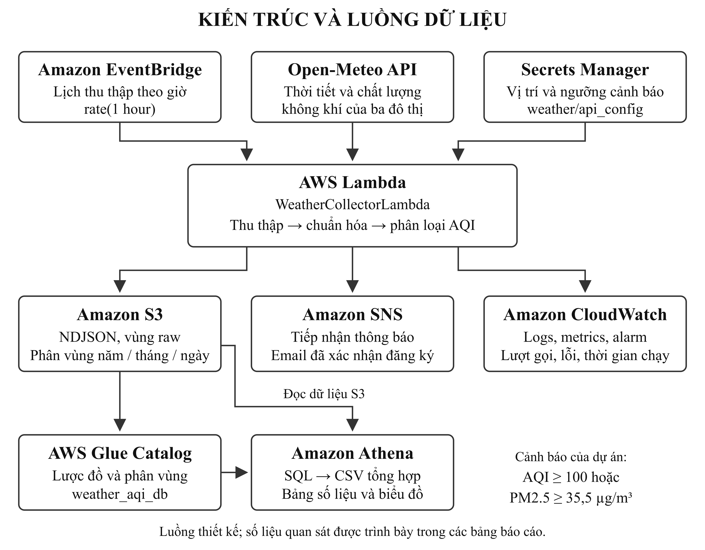
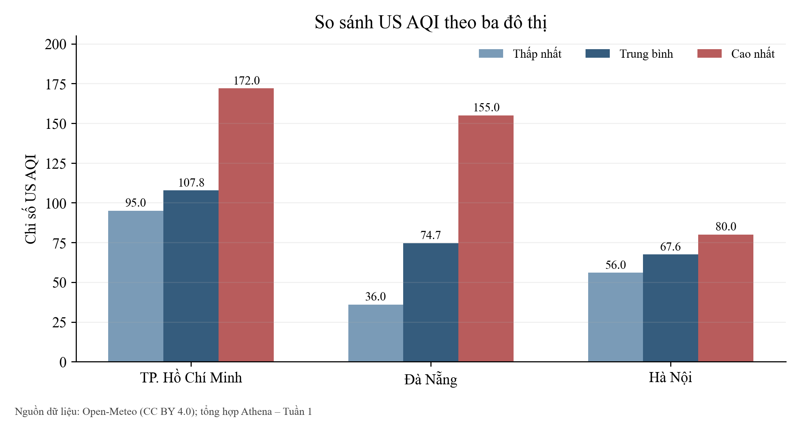
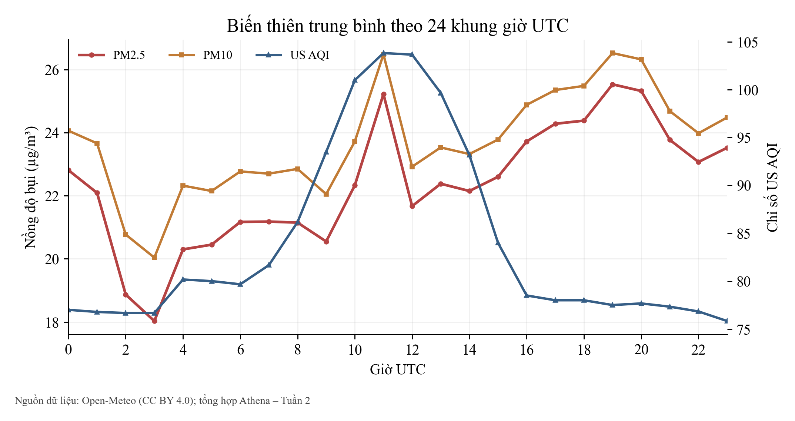
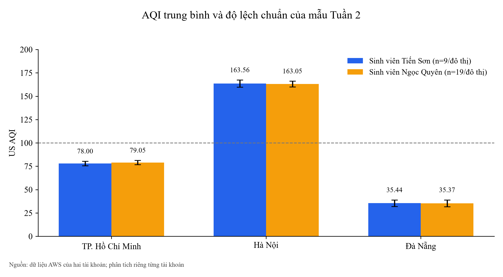
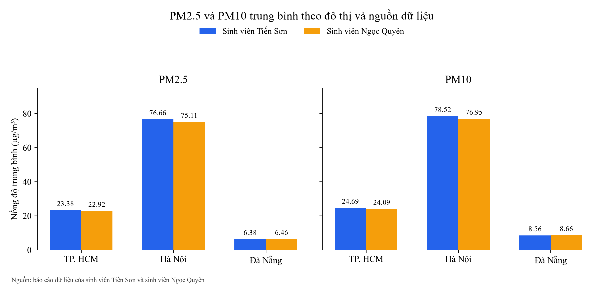
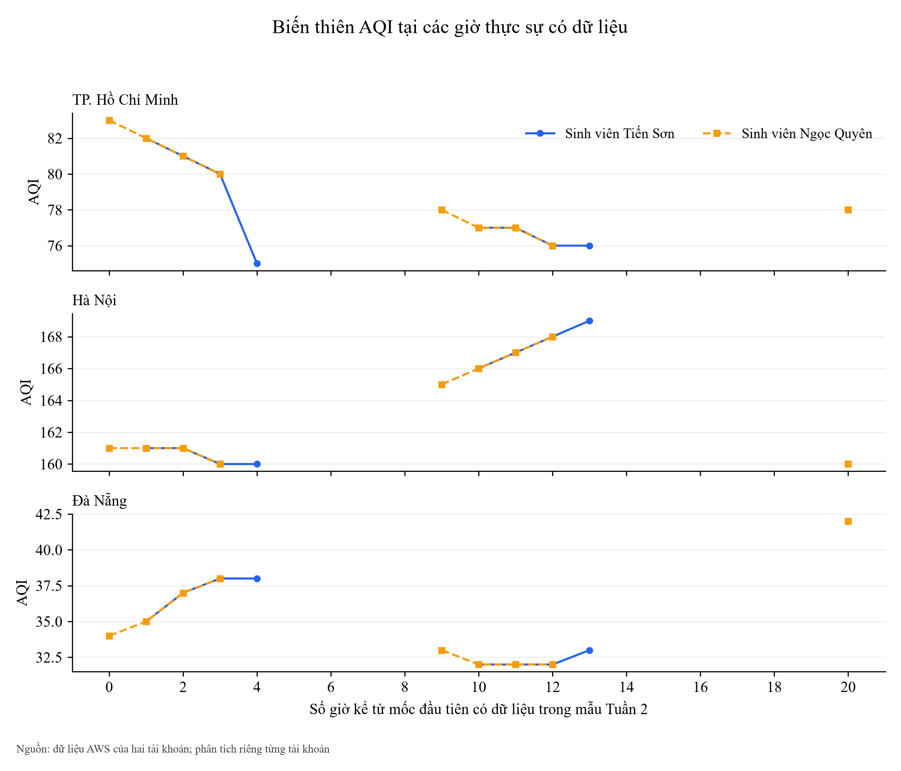
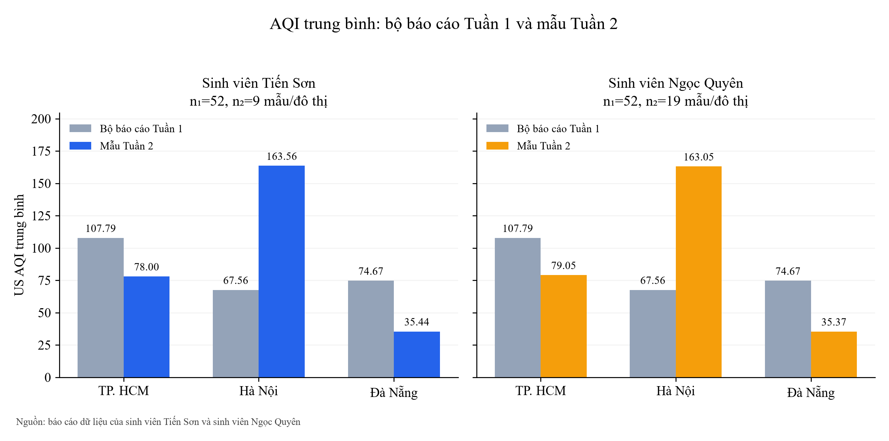
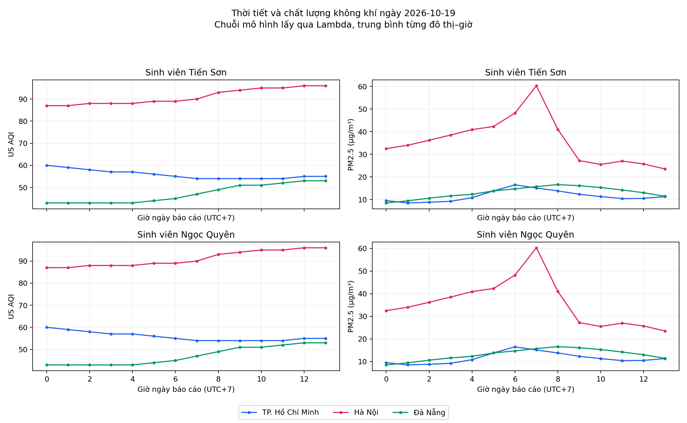
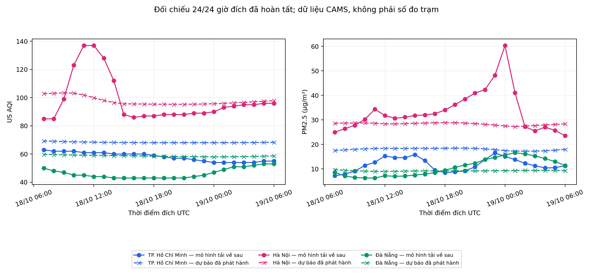

# Hệ thống thu thập và phân tích dữ liệu thời tiết, chất lượng không khí trên AWS

Đồ án thực hành học phần **Điện toán đám mây**: xây dựng luồng thu thập dữ liệu thời tiết và chất lượng không khí từ API công khai, lưu bản ghi thô trên Amazon S3, truy vấn bằng Amazon Athena, sau đó tổng hợp kết quả thành CSV và biểu đồ có thể đối chiếu với dữ liệu đầu vào.

Đề tài thuộc lĩnh vực **Domain Apps**, tập trung vào xử lý dữ liệu môi trường của TP. Hồ Chí Minh, Hà Nội và Đà Nẵng. Hồ sơ Tuần 1–4 gồm dữ liệu raw, Athena Partition Projection/Parquet, dự báo AQI/PM2.5, CloudWatch, cảnh báo SNS email, CI/CD và CloudFormation IaC. Phần tổng kết bổ sung kiểm chứng đầu-cuối, chi phí, bảo mật và quy trình quản lý cuối phiên.

**Cập nhật ngày 20/10/2026: đã tạo và chạy hai stack CloudFormation, thực hiện 18 truy vấn Athena mới và backtest ba cửa sổ lịch sử.** [Báo cáo tổng kết đồ án](docs/FINAL_PROJECT_REPORT.md) giải thích lựa chọn kỹ thuật, phương pháp đánh giá và sản phẩm bàn giao.

| Thông tin | Chi tiết |
| --- | --- |
| Học phần | Điện toán đám mây, Cloud – Đợt 1, năm học 2026–2027 |
| Lớp | 261CLCO332779_05 |
| Giảng viên hướng dẫn | ThS. Huỳnh Xuân Phụng |
| Sinh viên thực hiện | Nguyễn Tiến Sơn (24110054) và Trần Thị Ngọc Quyên (24110051) |
| Khu vực dữ liệu | TP. Hồ Chí Minh, Hà Nội và Đà Nẵng |
| Nguồn dữ liệu | [Open-Meteo Weather API](https://open-meteo.com/en/docs) và [Air Quality API](https://open-meteo.com/en/docs/air-quality-api) |
| Môi trường thực hành | AWS Learner Lab tại vùng `us-east-1`, dùng IAM LabRole có sẵn |

## Kết quả nổi bật và các nội dung nâng cao

| Nội dung | Kết quả và phạm vi đã kiểm chứng | Hồ sơ đối chiếu |
| --- | --- | --- |
| Dữ liệu raw có nguồn và hash | Bản xuất tích lũy Tuần 3 ngày 19/10 có **641 bản ghi, 95 JSON gốc**; CSV, object và SHA-256 được giữ cùng mốc | [Raw và provenance](tuan_3/results/daily_update_2026_10_19/README.md) |
| Athena Partition Projection và Parquet | **18 lượt thử nghiệm**, ba phương án × ba lần × hai môi trường; kết quả tương đương. Parquet giảm byte quét **80,59%** và **96,50%** trong từng bộ đối chứng | [Thực nghiệm và thống kê](tuan_3/results/integration_2026_10_18/benchmark/) · [Phân tích kết quả](docs/FINAL_PROJECT_REPORT.md) |
| Dự báo AQI và PM2.5 | Đối chiếu đủ **24 giờ đích, 144 giá trị** của một kỳ phát hành; giữ bản dự báo, nguồn mô hình tải về sau và MAE/RMSE/Bias | [CSV, biểu đồ và sai số](tuan_3/results/forecast_followup_2026_10_19/README.md) |
| CloudWatch và kiểm chứng đầu-cuối | Tuần 4 nối source → request → log → S3 → Athena; mỗi môi trường có một lượt realtime, ba bản ghi và một Invocation/0 Errors trong đúng chu kỳ kiểm chứng | [Báo cáo Tuần 4](tuan_4/docs/FINAL_REPORT.md) · [Đối chiếu vận hành](tuan_4/docs/LOG_METRIC_S3_RECONCILIATION.md) |
| Cảnh báo SNS email | Mỗi lượt kiểm chứng ngày 19/10 có một Publish được chấp nhận; cả hai người nhận xác nhận email mới | [Xác nhận email](tuan_4/results/verification_2026_10_19/recipient_confirmation.json) |
| CI/CD Lambda | Có workflow kiểm tra repository, đóng gói source và triển khai có xác nhận môi trường; hai lượt CD ngày 18/10 có minh chứng đối chiếu artifact | [GitHub Actions](https://github.com/JasonTM17/WeatherAWS_FinalTerm/actions) · [Minh chứng CD](tuan_3/results/cd_2026_10_18/) |
| CloudFormation IaC | Một template **17 tài nguyên**; hai stack đạt **CREATE_COMPLETE**, Lambda mới thu ba đô thị, SELECT trên database/workgroup mới và gói nguồn đúng hash | [Template](tuan_4/infrastructure/weather-stack.json) · [Triển khai thực tế](tuan_4/results/advanced_live_2026_10_20/README.md) |
| Rà soát bảo mật | Đối chiếu BPA, mã hóa và trạng thái truy cập công khai của S3; phân biệt cấu hình hiện hữu với thiết kế HTTPS/versioning và policy collector của stack mới | [Bảo mật](tuan_4/docs/SECURITY_AUDIT.md) · [Phạm vi quyền](tuan_4/docs/SECURITY_REVIEW.md) |
| Chi phí và quản lý phiên | Cost Explorer đúng kỳ 12–19/10, có Estimated; công cụ preview/pause/restore kèm kiểm tra target và trạng thái khôi phục | [Chi phí](tuan_4/docs/COST_REPORT.md) · [Checklist cuối Lab](tuan_4/docs/SESSION_CHECKLIST.md) |
| Hồ sơ bàn giao | Báo cáo Tuần 1–4, nội dung nộp có URL đầy đủ và **78 giờ công đã xác nhận** | [Nội dung nộp Tuần 4](tuan_4/docs/SUBMISSION.md) · [Worklog](docs/WORKLOG.md) |

**Bổ sung nâng cao ngày 20/10:** [700 bản ghi/115 JSON gốc](tuan_4/results/advanced_live_2026_10_20/snapshot/), [18 lượt Athena mới](tuan_4/results/advanced_live_2026_10_20/benchmark/), [432 dự đoán backtest và biểu đồ](tuan_4/results/backtest_2026_10_20/README.md), [SNS topic mới và xác nhận người nhận](tuan_4/results/advanced_live_2026_10_20/email/), [pause/restore thực tế](tuan_4/results/advanced_live_2026_10_20/session/). Mỗi đầu ra giữ ngày và phương pháp riêng.

Ba điểm vào để đọc hồ sơ: **[Tổng kết toàn đồ án](docs/FINAL_PROJECT_REPORT.md)** · **[Kiểm chứng Tuần 4](tuan_4/docs/FINAL_REPORT.md)** · **[Nội dung nộp thầy](tuan_4/docs/SUBMISSION.md)**.

## Điều hướng nhanh

| Nội dung | Tài liệu hoặc dữ liệu |
| --- | --- |
| Tổng kết toàn đồ án | [Mục tiêu, kiến trúc, phân tích chuyên sâu, kết luận và đối chiếu yêu cầu cuối kỳ](docs/FINAL_PROJECT_REPORT.md) |
| Danh mục minh chứng theo tuần | [Đầy đủ địa chỉ GitHub, dữ liệu, biểu đồ, mã nguồn và commit](docs/EVIDENCE_INDEX.md) |
| Tổng kết và chuẩn bị bảo vệ Tuần 4 | [Trang Tuần 4](tuan_4/README.md) · [Báo cáo](tuan_4/docs/FINAL_REPORT.md) · [Template](tuan_4/infrastructure/weather-stack.json) · [Bảo mật](tuan_4/docs/SECURITY_AUDIT.md) · [Chi phí](tuan_4/docs/COST_REPORT.md) |
| Nội dung nộp Tuần 4 | [Văn bản có liên kết đầy đủ để sao chép vào hệ thống của lớp](tuan_4/docs/SUBMISSION.md) |
| Hồ sơ Tuần 1 | [Trang Tuần 1](tuan_1/README.md) · [Markdown](tuan_1/docs/FINAL_REPORT.md) · [PDF](tuan_1/docs/Bao_cao_tuan_1_Dien_toan_dam_may_24110054_24110051.pdf) · [Word](tuan_1/docs/Bao_cao_tuan_1_Dien_toan_dam_may_24110054_24110051.docx) · [Excel](tuan_1/docs/Bao_cao_tuan_1_Du_lieu_Athena_24110054_24110051.xlsx) |
| CSV Tuần 1 | [Sáu CSV đã dùng trong báo cáo](tuan_1/docs/Bao_cao_tuan_1_CSV_24110054_24110051/) · [Chín biểu đồ](tuan_2/results/charts/) |
| Hồ sơ Tuần 2 | [Trang Tuần 2](tuan_2/README.md) · [Markdown](tuan_2/docs/FINAL_REPORT.md) · [PDF](tuan_2/docs/Bao_cao_Tuan_2_24110054_24110051.pdf) · [Word](tuan_2/docs/Bao_cao_Tuan_2_24110054_24110051.docx) · [Excel](tuan_2/docs/Du_lieu_phan_tich_Tuan_2_24110054_24110051.xlsx) |
| CSV và hình Tuần 2 | [CSV Athena đã lưu](tuan_2/results/week2_live/) · [27 bảng phân tích](tuan_2/results/week2_analysis/) · [20 biểu đồ](tuan_2/results/week2_charts/) · [Raw và metadata](tuan_2/results/week2_evidence/) |
| Mốc tích hợp Tuần 3 | [Trang Tuần 3 có biểu đồ](tuan_3/README.md) · [Báo cáo kỹ thuật](tuan_3/docs/FINAL_REPORT.md) · [Raw, Athena, metric và dự báo](tuan_3/results/integration_2026_10_18/) · [Lượt tự động sau sửa cấu hình](tuan_3/results/post_repair_2026_10_18/README.md) · [CI/CD và vận hành](tuan_3/docs/operation.md) |
| Dữ liệu Tuần 3 cập nhật ngày 19/10 | [45/42 dòng trong ngày, 302/339 dòng tích lũy và 95 JSON gốc](tuan_3/results/daily_update_2026_10_19/README.md) · [Đối chiếu đủ 24/24 giờ dự báo](tuan_3/results/forecast_followup_2026_10_19/README.md) |
| Snapshot raw ngày 18/10 | [246/288 bản ghi, 83 JSON, chất lượng và hash](tuan_3/results/raw_export_2026_10_18/README.md) |
| Snapshot phân tích ngày 18/10 | [246/285 bản ghi và thống kê mới](tuan_3/results/refresh_2026_10_18/README.md) · [CSV thống kê](tuan_3/results/refresh_2026_10_18/analysis/descriptive.csv) · [Đối chiếu dự báo với mô hình tải về sau](tuan_3/results/refresh_2026_10_18/analysis/later_model/comparison.csv) |
| Đối chiếu CloudWatch và dự báo bổ sung | [Số liệu và phương pháp đối chiếu](tuan_3/results/monitoring_followup_2026_10_18/README.md) · [Dashboard và kiểm chứng cấu hình](tuan_3/results/monitoring_dashboard_repair_2026_10_18/README.md) · [24 giá trị đối chiếu cho 4/24 giờ đích](tuan_3/results/forecast_followup_2026_10_18/README.md) |
| Phân công và thời gian | [Worklog và tổng hợp các tuần](docs/WORKLOG.md) · [CSV giờ công Tuần 1–4 đã xác nhận](worklog.csv) · [Nhật ký kỹ thuật và tổng giờ Tuần 3 đã xác nhận](tuan_3/docs/WORKLOG.md) |
| Kiến trúc và mã nguồn | [Sơ đồ kiến trúc](docs/architecture.md) · [Hướng dẫn đọc mã](docs/source-guide.md) · [Cấu trúc repository](docs/repository-layout.md) · [Chỉ mục thành phần và commit](docs/components.md) |
| Phương pháp và kiểm chứng | [Phân tích dữ liệu](docs/data-analysis.md) · [Vận hành](docs/operation.md) · [Minh chứng vận hành đã lưu](docs/saved-evidence.md) · [Danh mục CSV và SHA-256](docs/csv_catalog.csv) |
| AWS và kế hoạch tiếp theo | [Snapshot AWS ngày 16/10/2026](tuan_2/results/review_2026_10_16/README.md) · [Kết quả kế hoạch Tuần 3](docs/WEEK_3_PLAN.md) · [Kế hoạch Tuần 4](docs/WEEK_4_PLAN.md) |
| Triển khai đã kiểm chứng | [Mã Lambda, thu thập thực tế, Athena và email cảnh báo](docs/deployment-verification.md) |
| Chạy tự động sau triển khai | [EventBridge, log Lambda, dữ liệu mới và cảnh báo của hai lượt theo lịch](docs/scheduled-run-verification.md) |

[Nội dung nâng cao](#kết-quả-nổi-bật-và-các-nội-dung-nâng-cao) · [Phạm vi](#mục-tiêu-và-phạm-vi) · [Luồng xử lý](#luồng-xử-lý-dữ-liệu) · [Mô hình và phương pháp](#mô-hình-dữ-liệu-và-phương-pháp) · [Kết quả từng tuần](#kết-quả-theo-tuần) · [Đối chiếu hai tuần](#đối-chiếu-bộ-báo-cáo-tuần-1-và-mẫu-tuần-2) · [Mã nguồn](#cấu-trúc-mã-nguồn) · [Cài đặt và kiểm tra](#cài-đặt-và-kiểm-tra) · [Kế hoạch](#kế-hoạch-tiếp-theo)

Để xem toàn bộ kết quả, đọc báo cáo tổng kết, kiến trúc và các phần Tuần 1–4; mở CSV nguồn dưới mỗi hình hoặc bảng để đối chiếu. Các liên kết Word/PDF ở bảng trên dẫn tới bản báo cáo theo MSSV của từng tuần. Hồ sơ Tuần 3–4 trình bày trực tiếp trên GitHub; nhật ký liên kết giờ công với sản phẩm tương ứng.

## Mục tiêu và phạm vi

Dự án trình bày một quy trình xử lý dữ liệu đầu-cuối ở quy mô học phần:

- Thu thập các trường thời tiết và chất lượng không khí cho ba đô thị từ Open-Meteo.
- Lưu kết quả thu thập ở định dạng NDJSON trên S3, tổ chức theo ngày để có thể truy vấn theo phân vùng.
- Dùng Glue Data Catalog và Athena để đọc dữ liệu, lọc theo thời gian và xuất kết quả truy vấn.
- Dùng Python để kiểm tra dữ liệu, tính thống kê mô tả, ghép các khung giờ có thể so sánh và tạo biểu đồ.
- Ghi nhận cấu hình cảnh báo theo ngưỡng của đồ án bằng SNS và theo dõi các chỉ số Lambda bằng CloudWatch.

Repository gồm mã nguồn, truy vấn SQL, nhật ký công việc, các bộ dữ liệu đã lưu, báo cáo Word/PDF/Excel và biểu đồ. Các đầu ra được tách theo từng mốc để người đọc truy vết từ bản ghi gốc, qua kết quả truy vấn và bảng phân tích, đến CSV nguồn của từng biểu đồ.

Kết quả được diễn giải theo nguồn mô hình, thời điểm chốt và tập giờ của từng bộ dữ liệu. [Nguồn dữ liệu và phương pháp diễn giải](#nguồn-dữ-liệu-và-phương-pháp-diễn-giải) cùng [tài liệu phân tích](docs/data-analysis.md) trình bày các quy tắc tính và đối chiếu.

## Luồng xử lý dữ liệu



*Hình 1. Sơ đồ thiết kế luồng thu thập, lưu trữ, truy vấn và cảnh báo. [Giải thích kiến trúc](docs/architecture.md). Sơ đồ mô tả quan hệ giữa các thành phần; trạng thái dịch vụ được đối chiếu riêng trong snapshot AWS.*

| Bước | Thành phần | Trách nhiệm và đầu ra |
| --- | --- | --- |
| 1 | EventBridge | Phát sự kiện theo lịch để gọi hàm thu thập. Cấu hình trong mã nguồn dùng lịch định kỳ một giờ; trạng thái thực tế được ghi riêng trong snapshot AWS. |
| 2 | Secrets Manager | Cung cấp cấu hình cần cho tiến trình như danh sách đô thị và ngưỡng cảnh báo; giá trị Secret không được lưu trong repository. |
| 3 | Lambda và Open-Meteo | Gọi API thời tiết và API chất lượng không khí cho từng đô thị, kiểm tra cấu trúc phản hồi, chuẩn hóa trường dữ liệu và tính cấp AQI. |
| 4 | Amazon S3 | Lưu bản ghi JSON theo dòng (NDJSON). Khóa phân vùng năm/tháng/ngày được xác định theo UTC; thời gian Việt Nam được giữ riêng để trình bày. |
| 5 | Glue Data Catalog và Athena | Đăng ký lược đồ/phân vùng, chạy SQL trên dữ liệu gốc và trả kết quả truy vấn CSV. Truy vấn theo tuần dùng cả điều kiện phân vùng và mốc timestamp. |
| 6 | Các chương trình Python | Đọc dữ liệu gốc và kết quả truy vấn đã lưu, đối chiếu số dòng, tính thống kê, lưu CSV phân tích và tạo PNG. Manifest biểu đồ ghi nhận bảng đầu vào. |
| 7 | SNS và CloudWatch | SNS tiếp nhận thông điệp khi dữ liệu vượt ngưỡng cấu hình. CloudWatch lưu metric và trạng thái alarm; phản hồi Publish không tự xác nhận email đã được nhận. |

### Một số quyết định thiết kế

- **Phân vùng theo UTC:** giữ đường dẫn S3 ổn định giữa các môi trường. Khi báo cáo dùng tuần theo UTC+7, SQL chuyển mốc thời gian tương ứng và kiểm tra timestamp bên cạnh điều kiện partition.
- **Giữ dữ liệu gốc và bảng dẫn xuất riêng:** số lượt ghi ban đầu không bị thay bằng số liệu tổng hợp. Bảng theo giờ và biểu đồ là đầu ra dẫn xuất, có thể truy vết về CSV nguồn tương ứng.
- **Ghi nhận thu thập một phần:** nếu chỉ một số đô thị thất bại, phản hồi có trạng thái `partial` và danh sách đô thị lỗi; lỗi toàn bộ được báo riêng thay vì trình bày như một lần thu thập đủ.
- **Bảo vệ CSV cũ khi xuất lỗi:** Athena exporter chỉ thay tệp đích khi truy vấn thành công và kết quả đọc được; lỗi hoặc timeout không ghi đè bản CSV trước đó.
- **So sánh theo thời điểm ghép được:** với Tuần 2, mỗi bộ dữ liệu được gom theo đô thị và giờ UTC trước khi ghép. Cách này cho mỗi giờ cùng trọng số, trong khi vẫn giữ nguyên các lượt ghi ban đầu trong dữ liệu gốc.
- **Theo dõi nguồn của biểu đồ:** manifest ghi tên CSV và dữ liệu dùng cho từng hình, giúp so sánh hình trong Word với bảng CSV thay vì dựng hai kết quả độc lập.

Chi tiết về xử lý lỗi API, timeout theo thời gian Lambda còn lại, xuất CSV và các hàm tính thống kê nằm trong [hướng dẫn đọc mã nguồn](docs/source-guide.md).

### Các cấu hình chính và lý do lựa chọn

| Cấu hình trong mã nguồn | Giá trị hoặc cách tổ chức | Mục đích |
| --- | --- | --- |
| Lambda | Python 3.12, 256 MB, timeout 60 giây | Thực hiện thu thập theo lượt; runtime, bộ nhớ và thời hạn được đặt bởi mã cấu hình dịch vụ |
| Lịch thiết kế | `rate(1 hour)` | Tổ chức dữ liệu theo thời gian; số lịch thực tế phải kiểm tra từ cấu hình AWS |
| Thời gian chờ HTTP | Tối đa 15 giây mỗi yêu cầu; điều chỉnh theo thời gian còn lại | Hạn chế một API chậm sử dụng hết thời gian thực thi |
| Thời gian dành cho kết thúc | Trừ 10 giây khỏi thời gian còn lại khi tính timeout HTTP | Dành thời gian để kết thúc thu thập và yêu cầu ghi dữ liệu; không bảo đảm thời hạn tuyệt đối của mọi lời gọi dịch vụ |
| Lưu trữ | NDJSON tại `raw/year=YYYY/month=MM/day=DD/` | Giữ từng bản ghi JSON riêng, phù hợp lược đồ đọc trên S3 và truy vấn theo phân vùng |
| Ngưỡng cảnh báo | `AQI >= 100` hoặc `PM2.5 >= 35.5 µg/m³` | Quy tắc cấu hình của đồ án để yêu cầu phát thông báo; kiểm tra ngưỡng được tách khỏi việc xác nhận nhận thư |
| Định danh triển khai | `S3_BUCKET_NAME`, `SECRET_NAME`, `SNS_TOPIC_ARN` | Cấp cấu hình theo môi trường qua biến môi trường Lambda |

Nguồn cấu hình: [Lambda thu thập](tuan_2/lambda/lambda_function.py) và [Python SDK quản lý dịch vụ](tuan_2/scripts/aws_project.py). Các giá trị này giải thích thiết kế mã nguồn; [snapshot ngày 16/10](tuan_2/results/review_2026_10_16/README.md) xác định cấu hình đã đọc được trên AWS.

## Mô hình dữ liệu và phương pháp

### Trường dữ liệu và mốc thời gian

Bản ghi thu thập có 23 trường đầu ra. Lược đồ Athena gồm 20 cột dữ liệu cùng ba khóa phân vùng `year`, `month`, `day`. Các trường mô tả đô thị/tọa độ, timestamp UTC và giờ địa phương, chỉ số thời tiết, chất ô nhiễm, US AQI/cấp AQI và thông tin thu thập.

| Nhóm dữ liệu | Tên trường trong lược đồ | Cách sử dụng |
| --- | --- | --- |
| Nhận diện | `record_id`, `city`, `latitude`, `longitude` | Phân biệt bản ghi và xác định đô thị, vị trí API |
| Thời gian | `timestamp_utc`, `timestamp_vn`, `hour`, `collected_at` | Phân biệt thời điểm dữ liệu môi trường với thời điểm thu thập; tổng hợp giờ/ngày |
| Khí tượng | `temperature_2m`, `relative_humidity_2m`, `surface_pressure`, `wind_speed_10m` | Mô tả điều kiện thời tiết và phân tích mối liên hệ với bụi |
| Bụi | `pm2_5`, `pm10` | So sánh nồng độ bụi theo đô thị và thời điểm; đơn vị nồng độ µg/m³ |
| Khí ô nhiễm | `carbon_monoxide`, `nitrogen_dioxide`, `sulphur_dioxide`, `ozone` | Các biến môi trường bổ sung, giữ theo đơn vị của phản hồi nguồn |
| AQI | `us_aqi`, `aqi_category` | Mô tả chỉ số US AQI và cấp chất lượng không khí theo quy tắc trong mã |
| Phân vùng | `year`, `month`, `day` | Giới hạn vùng dữ liệu cần đọc trên S3 |

[DDL gốc](tuan_2/athena/create_table.sql) xác định kiểu dữ liệu. CSV gốc trong từng tuần giữ giá trị và thời điểm nguồn; bảng trong README chỉ trình bày các chỉ số đã tổng hợp, làm tròn để dễ đọc.

Mốc thời gian chất lượng không khí từ API không kèm múi giờ được diễn giải là UTC. Thời gian có offset trong metadata dịch vụ được đổi về UTC trước khi lọc. Phạm vi tuần dùng UTC+7: bộ Tuần 2 lọc từ **12/10/2026 00:00** đến trước **19/10/2026 00:00**, nhưng các bản ghi đã lưu trong mẫu chỉ nằm ở hai ngày 13–14/10.

### Quy tắc tổng hợp

- Thống kê mô tả theo lượt ghi tính trung bình và độ lệch chuẩn mẫu với mẫu số `n−1` trong từng đô thị và từng bộ dữ liệu.
- Bảng đối chiếu trực tiếp gộp theo đô thị–giờ UTC trước, sau đó so sánh các giờ cùng xuất hiện. Trong bộ Tuần 2 đã lưu, có 27 nhóm giờ ở mỗi sinh viên và 21 nhóm ghép được, tức bảy giờ cho mỗi đô thị.
- Nhiều lượt ghi trong cùng đô thị–giờ được giữ nguyên trong tệp dữ liệu gốc. Việc tính trung bình theo giờ chỉ áp dụng cho bảng đối chiếu theo giờ; không xóa hay làm giảm số dòng gốc.
- Các phân vị sử dụng nội suy tuyến tính. Tương quan Pearson/Spearman mô tả tập mẫu; kích thước mẫu và cách xử lý giá trị bằng nhau được lưu trong các bảng liên quan.
- Tỷ lệ vượt ngưỡng dùng số lượt trong cùng đô thị/bộ dữ liệu làm mẫu số. Tỷ lệ này không phải tỷ lệ thời gian của cả tuần.
- Giá trị không hợp lệ/không hữu hạn được xử lý theo chính sách chuẩn hóa của mã nguồn. Một số trường số có giá trị mặc định bằng 0; vì vậy số 0 trong dữ liệu dẫn xuất không tự chứng minh API đã trả về phép đo bằng 0.
- Nếu tổng Errors trong cửa sổ CloudWatch lớn hơn Invocations, tỷ lệ lỗi không được tính. Báo cáo giữ trạng thái chưa xác định thay vì tạo tỷ lệ vượt 100%.

### Chi phí

Mức dự kiến cho phần thực hành Tuần 2 được sinh viên xác nhận riêng: **0,05 USD** cho sinh viên Tiến Sơn và **0,03 USD** cho sinh viên Ngọc Quyên. Đây không phải kết quả do mã phân tích tự tính. Cost Explorer trả số ước tính hiển thị đến cent lần lượt **0,00 USD** và **0,03 USD**; CSV vẫn giữ giá trị gốc, đơn vị và cờ Estimated. Hai loại số liệu không được cộng gộp hay coi là cùng một nguồn. Xem [giải thích phương pháp và chi phí](docs/data-analysis.md).

## Kết quả theo tuần

### Tuần 1: nền tảng và bộ dữ liệu ban đầu

Bộ CSV dùng trong báo cáo có **156 dòng**, tương ứng **52 dòng cho mỗi đô thị**, cùng sáu CSV báo cáo và chín biểu đồ. Trong 156 dòng của snapshot này, **51 dòng là dữ liệu lịch sử trước ranh giới tuần** và **105 dòng nằm trong ranh giới Tuần 1 theo UTC+7**. Vì vậy, con số 156 mô tả bộ đầu vào đã nộp, không có nghĩa cả 156 lượt đều được thu trong tuần.

| Đô thị | Số bản ghi | AQI trung bình | AQI thấp nhất–cao nhất | PM2.5 trung bình (µg/m³) |
| --- | ---: | ---: | ---: | ---: |
| TP. Hồ Chí Minh | 52 | 107,79 | 95–172 | 37,03 |
| Hà Nội | 52 | 67,56 | 56–80 | 15,36 |
| Đà Nẵng | 52 | 74,67 | 36–155 | 14,23 |



*Hình 2. AQI theo ba đô thị trong bộ 156 bản ghi Tuần 1. Nguồn: [avg_aqi_by_city.csv](tuan_1/docs/Bao_cao_tuan_1_CSV_24110054_24110051/avg_aqi_by_city.csv). Nhãn trên hình được làm tròn một chữ số; bảng giữ hai chữ số.*

Trong bộ này, TP. Hồ Chí Minh có AQI trung bình cao nhất và khoảng giá trị 95–172. Hà Nội có AQI trung bình thấp nhất, trong khoảng 56–80. Kết quả mô tả tập mẫu đã lưu; vị trí tương đối giữa các đô thị ở Tuần 2 cần được xem lại trên đúng dữ liệu Tuần 2.



*Hình 3. Tổng hợp theo 24 nhóm giờ UTC. Nguồn: [peak_pollution_hours.csv](tuan_1/docs/Bao_cao_tuan_1_CSV_24110054_24110051/peak_pollution_hours.csv). Mỗi điểm là kết quả gom cùng giờ trong bộ dữ liệu; khi đổi sang giờ Việt Nam cần cộng bảy giờ và điều chỉnh ngày tương ứng.*

- [Trang hồ sơ Tuần 1](tuan_1/README.md) giải thích mục tiêu, phạm vi, bảng kết quả và nguồn CSV.
- [CSV gốc và bảng truy vấn](tuan_1/docs/Bao_cao_tuan_1_CSV_24110054_24110051/) là bộ được dùng để lập báo cáo.
- [Chín hình Tuần 1](tuan_2/results/charts/) có manifest và các bảng mở rộng tương ứng.
- Worklog ghi **9,5 giờ** cho sinh viên Tiến Sơn và **9,0 giờ** cho sinh viên Ngọc Quyên.

### Tuần 2: hai bộ báo cáo dữ liệu

Tuần 2 giữ riêng bộ dữ liệu của **sinh viên Tiến Sơn** và **sinh viên Ngọc Quyên**. Trong bộ báo cáo đã lưu, sinh viên Tiến Sơn có 204 dòng toàn bộ, trong đó 27 dòng thuộc phạm vi Tuần 2; sinh viên Ngọc Quyên có 231 dòng toàn bộ, trong đó 57 dòng thuộc phạm vi Tuần 2. Khi gom theo đô thị–giờ UTC, mỗi bộ có 27 nhóm. Các tệp dữ liệu gốc vẫn giữ nguyên cả 27 và 57 lượt ghi; phép so sánh trực tiếp dùng 21 nhóm giờ chung.

Kết quả dưới đây lấy từ **bộ báo cáo đã lưu 27/57**, không lấy từ lần đọc AWS mới ngày 16/10. Mỗi sinh viên có mẫu ở hai ngày và chín khung giờ; không suy rộng thành số liệu đủ bảy ngày.

| Đô thị | AQI trung bình – sinh viên Tiến Sơn | AQI trung bình – sinh viên Ngọc Quyên | PM2.5 trung bình – sinh viên Tiến Sơn (µg/m³) | PM2.5 trung bình – sinh viên Ngọc Quyên (µg/m³) |
| --- | ---: | ---: | ---: | ---: |
| TP. Hồ Chí Minh | 78,00 | 79,05 | 23,38 | 22,92 |
| Hà Nội | 163,56 | 163,05 | 76,66 | 75,11 |
| Đà Nẵng | 35,44 | 35,37 | 6,38 | 6,46 |

Nguồn: [city_statistics.csv](tuan_2/results/week2_analysis/city_statistics.csv). Trong mẫu đã lưu, AQI trung bình ở Hà Nội cao nhất; phân loại tương ứng trong bộ mẫu là Unhealthy ở Hà Nội, Moderate tại TP. Hồ Chí Minh và Good ở Đà Nẵng. Phân loại/tỷ lệ được tính trên mẫu từng đô thị, không phải tuyên bố về chất lượng không khí cả tuần.



*Hình 4. AQI trung bình và độ lệch chuẩn mẫu của từng bộ dữ liệu Tuần 2. Cỡ mẫu mỗi đô thị là 9 lượt ghi của sinh viên Tiến Sơn và 19 lượt ghi của sinh viên Ngọc Quyên. Nguồn: [city_statistics.csv](tuan_2/results/week2_analysis/city_statistics.csv). Thanh sai số là SD, không phải khoảng tin cậy.*



*Hình 5. Nồng độ PM2.5 và PM10 trung bình (µg/m³), cùng nguồn [city_statistics.csv](tuan_2/results/week2_analysis/city_statistics.csv). Hai bộ dữ liệu được trình bày riêng theo sinh viên.*

Hà Nội có PM2.5 trung bình 76,66 và 75,11 µg/m³ trong hai bộ mẫu, cao hơn TP. Hồ Chí Minh và Đà Nẵng. Kết quả vượt ngưỡng được lưu trong [threshold_exceedance.csv](tuan_2/results/week2_analysis/threshold_exceedance.csv); kết quả đó xác nhận điều kiện dữ liệu thỏa cấu hình, chưa xác nhận thư cảnh báo đã nhận.



*Hình 6. AQI theo giờ thực tế có trong mẫu. Nguồn: [hourly_city.csv](tuan_2/results/week2_analysis/hourly_city.csv). Trục ngang là số giờ kể từ mốc đầu tiên có dữ liệu; khoảng không có điểm không được coi là AQI bằng 0.*

Các điểm được tổng hợp theo đô thị–giờ UTC; mỗi sinh viên có 27 nhóm. Ở 21 nhóm giờ chung, các giá trị AQI tương ứng bằng nhau nên hai đường có thể chồng lên nhau. Các trung bình tính trên toàn bộ lượt ghi vẫn có thể khác do thời điểm và trọng số lượt ghi khác nhau. Xem [bảng đối chiếu giờ](tuan_2/results/week2_analysis/matched_account_hours.csv).

Các đầu ra chi tiết gồm [27 CSV phân tích](tuan_2/results/week2_analysis/), [20 biểu đồ có manifest nguồn](tuan_2/results/week2_charts/), [CSV truy vấn Athena](tuan_2/results/week2_live/) và [dữ liệu gốc/metadata](tuan_2/results/week2_evidence/). Báo cáo Tuần 2 có phụ lục **84 dòng dữ liệu gốc** trong phạm vi tuần, chia thành hai bảng theo từng sinh viên.

### Đối chiếu bộ báo cáo Tuần 1 và mẫu Tuần 2



*Hình 7. AQI trung bình của bộ 52 mẫu/đô thị Tuần 1 so với 9 mẫu/đô thị của sinh viên Tiến Sơn và 19 mẫu/đô thị của sinh viên Ngọc Quyên trong Tuần 2. Nguồn: [submitted_week1_comparison.csv](tuan_2/results/week2_analysis/submitted_week1_comparison.csv).*

Trong hai tập mẫu, AQI trung bình tại TP. Hồ Chí Minh và Đà Nẵng ở Tuần 2 thấp hơn mốc Tuần 1 đã nộp, trong khi Hà Nội cao hơn. Hai bộ có độ phủ thời gian và cỡ mẫu khác nhau, nên đây là so sánh trung bình của các tập dữ liệu báo cáo; không xem là mức tăng/giảm đại diện cho toàn bộ hai tuần hoặc bằng chứng nguyên nhân ô nhiễm.

Phép so sánh này dùng bộ 156 dòng Tuần 1 đã nộp. Bảng [weekly_comparison.csv](tuan_2/results/week2_analysis/weekly_comparison.csv) lọc lại hai tuần từ cùng lần xuất khác, có cỡ mẫu khác và được giải thích riêng trong [phương pháp phân tích](docs/data-analysis.md).

### Truy vết hình, bảng và dữ liệu gốc

| Bước đối chiếu | Tuần 1 | Tuần 2 |
| --- | --- | --- |
| Xem bản ghi đầu vào | [156 dòng raw](tuan_1/docs/Bao_cao_tuan_1_CSV_24110054_24110051/raw_weather_aqi_records.csv) | [27 dòng của sinh viên Tiến Sơn](tuan_2/results/week2_live/default/raw_week2.csv) · [57 dòng của sinh viên Ngọc Quyên](tuan_2/results/week2_live/quyen/raw_week2.csv) |
| Xem số liệu tổng hợp | [Sáu CSV báo cáo](tuan_1/docs/Bao_cao_tuan_1_CSV_24110054_24110051/) | [Các CSV phân tích](tuan_2/results/week2_analysis/) |
| Xem nguồn dựng hình | [Manifest Tuần 1](tuan_2/results/charts/week1_chart_manifest.json) | [Manifest Tuần 2](tuan_2/results/week2_charts/chart_manifest.json) |
| Kiểm tra đúng tệp | [Danh mục CSV và SHA-256](docs/csv_catalog.csv) | [Danh mục CSV và SHA-256](docs/csv_catalog.csv) |
| Đọc kết quả và giải thích đầy đủ | [Báo cáo Tuần 1](tuan_1/docs/FINAL_REPORT.md) | [Báo cáo Tuần 2](tuan_2/docs/FINAL_REPORT.md) |

Các ảnh trong README dùng trực tiếp những PNG đã lưu của bộ báo cáo. Người đọc có thể mở CSV ngay dưới hình để kiểm tra giá trị; sơ đồ kiến trúc là hình mô tả thiết kế, còn các biểu đồ là kết quả dựng từ dữ liệu đã lưu.

### Tuần 3: tích hợp, tối ưu truy vấn và đánh giá dự báo

Mốc cập nhật ngày 19/10 có **302 bản ghi/43 JSON** của sinh viên Tiến Sơn và **339 bản ghi/52 JSON** của sinh viên Ngọc Quyên. Riêng dữ liệu mang ngày 19/10 theo UTC+7 có 45/42 bản ghi; thống kê so sánh dùng cùng 14 giờ đã hoàn tất, tương ứng 42 bản ghi mỗi sinh viên. Bản xuất tích lũy được giữ riêng với tập đầu vào của thực nghiệm Athena và kỳ phát hành dự báo.



*Hình 8. Thống kê ngày 19/10 từ cùng tập giờ hoàn tất. [CSV, JSON và cách tổng hợp](tuan_3/results/daily_update_2026_10_19/README.md) giữ rõ nguồn dữ liệu thu bổ sung và mốc chốt.*

**Tối ưu Athena:** ba cách tổ chức dữ liệu gồm JSON đăng ký phân vùng, JSON projection và Parquet projection được đo trên cùng dữ liệu trong từng môi trường. Parquet giảm lượng quét nhưng không luôn có thời gian thấp nhất: ở bộ của sinh viên Ngọc Quyên, engine của JSON projection có trung vị 431 ms, còn Parquet là 515 ms. [Báo cáo tổng kết](docs/FINAL_PROJECT_REPORT.md) giải thích riêng byte quét, thời gian và phạm vi đối chứng.

**Dự báo:** mã nguồn đánh giá các phương pháp cơ sở; bản phát hành ngày 18/10 được giữ nguyên và đối chiếu đủ kỳ vào ngày 19/10. MAE, RMSE và Bias được tính riêng cho từng đô thị/chỉ số; dữ liệu đối chiếu là mô hình CAMS tải về sau.



*Hình 9. Đối chiếu đủ 144 giá trị của kỳ dự báo. Nguồn: [comparison.csv](tuan_3/results/forecast_followup_2026_10_19/comparison.csv) và [comparison_metrics.csv](tuan_3/results/forecast_followup_2026_10_19/comparison_metrics.csv). Kết quả áp dụng cho kỳ phát hành đã lưu, không thay thế đánh giá trên các kỳ mới.*

CloudWatch và quy trình phát hành tiếp tục được tích hợp trong Tuần 3. [Vận hành và CI/CD](tuan_3/docs/operation.md) dẫn tới workflow, source và bằng chứng triển khai. [Báo cáo Tuần 3](tuan_3/docs/FINAL_REPORT.md) trình bày đầy đủ raw, chất lượng, benchmark, dashboard và dự báo.

### Tuần 4: kiểm chứng hệ thống, hạ tầng và bàn giao

Đợt kiểm chứng ngày 19/10 xác nhận mã trên hai Lambda khớp source collector chính. Mỗi môi trường có một request realtime thu đủ ba đô thị, ba bản ghi; JSON tải lại từ S3, CSV và SELECT theo đúng record_id khớp nhau. Trong chu kỳ chứa request, mỗi môi trường ghi nhận một Invocation và không có Error. Nhánh cảnh báo có một Publish được SNS chấp nhận và email đã được người nhận xác nhận.

| Hạng mục | Kết quả và tài liệu |
| --- | --- |
| Dữ liệu và vận hành | [Sáu bản ghi raw, điều kiện cảnh báo, SELECT và log–metric–S3](tuan_4/docs/FINAL_REPORT.md) |
| CloudFormation | [Template 17 tài nguyên](tuan_4/infrastructure/weather-stack.json), [ValidateTemplate](tuan_4/results/template_validation_2026_10_19/README.md), [quy trình tạo stack](tuan_4/docs/INFRASTRUCTURE.md) |
| Bảo mật và chi phí | [Ma trận cấu hình](tuan_4/docs/SECURITY_AUDIT.md) và [Cost Explorer đúng kỳ](tuan_4/docs/COST_REPORT.md) |
| Quản lý tài nguyên | [Preview/pause/restore và checklist kết thúc Lab](tuan_4/docs/SESSION_CHECKLIST.md) |
| Nộp và bảo vệ | [Nội dung Tuần 4 có liên kết đầy đủ](tuan_4/docs/SUBMISSION.md), [tổng kết toàn đồ án](docs/FINAL_PROJECT_REPORT.md) |

Template đã được kiểm tra cấu trúc và API, chưa tạo stack mới trong đợt này. Video thực tế được bổ sung sau khi quay; thao tác kết thúc phiên thực hiện sau khi xuất minh chứng và hoàn tất sử dụng Lab. [Báo cáo tổng kết toàn đồ án](docs/FINAL_PROJECT_REPORT.md) đối chiếu các sản phẩm này với yêu cầu cuối kỳ.

### Phân công và thời gian đã xác nhận

| Sinh viên | Phần việc chính | Tuần 1 | Tuần 2 | Tổng |
| --- | --- | ---: | ---: | ---: |
| Nguyễn Tiến Sơn (24110054) | S3, Secrets Manager, Lambda và SNS; phối hợp lịch và giám sát | 9,5 giờ | 10,0 giờ | 19,5 giờ |
| Trần Thị Ngọc Quyên (24110051) | Glue, Athena, xuất CSV, biểu đồ và đối chiếu dữ liệu | 9,0 giờ | 9,5 giờ | 18,5 giờ |
| Cả hai sinh viên | Kiến trúc, tích hợp và hoàn thiện hồ sơ | 18,5 giờ | 19,5 giờ | 38,0 giờ |

Số giờ là tổng theo tuần đã được xác nhận; không chia ngược thành giờ từng ngày từ lịch sử commit. Đối chiếu công việc và sản phẩm tại [worklog có minh chứng](docs/WORKLOG.md).

## Snapshot AWS ngày 16/10/2026

Đây là lần đọc trạng thái riêng, không thay đầu vào của báo cáo và biểu đồ Tuần 2 đã lưu. Hồ sơ ghi 13 nhóm kiểm tra metadata cho mỗi sinh viên và **14/14 truy vấn SELECT thành công**.

| Hạng mục đọc được | Sinh viên Tiến Sơn | Sinh viên Ngọc Quyên |
| --- | --- | --- |
| CSV toàn bộ / thuộc Tuần 2 | 216 / 39 dòng | 249 / 75 dòng |
| Lambda | Active, Python 3.12, 256 MB, timeout 60 giây | Active, Python 3.12, 256 MB, timeout 60 giây |
| Mã Lambda trên AWS so với mã nguồn trong repository | Khác | Khác |
| S3 và Glue | AES256, chặn truy cập công khai; 6 phân vùng Glue | AES256, chặn truy cập công khai; 6 phân vùng Glue |
| Lịch EventBridge đang bật | 1 | 2 |
| SNS | 1 đăng ký email đã xác nhận | 2 đăng ký email đã xác nhận |
| CloudWatch Alarm | INSUFFICIENT_DATA | INSUFFICIENT_DATA |

Trong cửa sổ metric đã truy vấn, tổng Errors lớn hơn tổng Invocations; nguyên nhân chưa được kết luận và không tính tỷ lệ lỗi. Đợt đọc chỉ kiểm tra metadata và truy vấn SELECT, **không triển khai mã mới, không đổi lịch và không gọi thử Lambda**. Đăng ký email đã xác nhận không đồng nghĩa có minh chứng email cảnh báo đã đến hộp thư. Xem [manifest và kết quả chi tiết](tuan_2/results/review_2026_10_16/README.md).

**Cập nhật sau snapshot:** commit `36c9b39` đã được triển khai lên cả hai Lambda và đối chiếu hash module thành công. Bốn lượt gọi trực tiếp thu đủ 12 bản ghi; Athena đối chiếu khớp các dòng mới. Mỗi môi trường phát hai thông điệp SNS và người nhận xác nhận đã nhận email mới. Lịch dư của sinh viên Ngọc Quyên đã được tắt theo xác nhận, giữ một lịch một giờ ở mỗi môi trường. Xem [minh chứng triển khai và phạm vi kiểm chứng](docs/deployment-verification.md). Dữ liệu báo cáo đã lưu không bị thay thế.

**Lượt chạy tự động:** đã theo dõi thêm một lượt theo lịch ở mỗi môi trường. Log Lambda bắt đầu lúc 14:51:02 đối với sinh viên Ngọc Quyên và 15:15:44 đối với sinh viên Tiến Sơn ngày 16/10, giờ Việt Nam; mỗi lượt thu ba bản ghi, phát hai thông điệp SNS và có xác nhận nhận email mới. [Metric rule, log, S3, Athena và SNS](docs/scheduled-run-verification.md) được đối chiếu riêng với các lượt gọi trực tiếp.

## Cấu trúc mã nguồn

| Đường dẫn | Vai trò |
| --- | --- |
| [docs/](docs/README.md) | Kiến trúc, phương pháp, worklog, hướng dẫn mã nguồn, cấu trúc repo và kế hoạch |
| [tuan_1/](tuan_1/README.md) | Hồ sơ Tuần 1, báo cáo, CSV đã nộp và cách đọc các biểu đồ |
| [tuan_2/lambda/](tuan_2/lambda/lambda_function.py) | Lambda lấy dữ liệu, chuẩn hóa bản ghi, phân loại AQI, lưu S3 và yêu cầu phát cảnh báo |
| [tuan_2/scripts/](tuan_2/scripts/) | Python SDK cho cấu hình dịch vụ, Athena exporter, bộ thu thập snapshot và kiểm tra repository |
| [tuan_2/athena/](tuan_2/athena/README.md) | DDL, view và SQL phân tích dữ liệu gốc theo thành phố, giờ, ngày và phân vùng |
| [tuan_2/analytics/](tuan_2/analytics/) | Phân tích hai bộ dữ liệu, tạo bảng CSV và dựng biểu đồ theo manifest |
| [tuan_2/tests/](tuan_2/tests/) | Kiểm tra Lambda, SDK, CSV, dữ liệu và hồ sơ lưu cục bộ |
| [tuan_2/results/](tuan_2/results/README.md) | CSV gốc/tổng hợp, hình, metadata và phân tách các mốc dữ liệu |
| [tuan_3/scripts/](tuan_3/scripts/) | Snapshot, chất lượng, benchmark Projection/Parquet, dự báo, dashboard, đối chiếu và phát hành Lambda |
| [tuan_3/results/](tuan_3/results/) | Các bản raw, truy vấn thực nghiệm, dự báo, provenance và minh chứng CI/CD theo mốc |
| [tuan_4/infrastructure/](tuan_4/infrastructure/weather-stack.json) | Một template CloudFormation chính và policy collector tham khảo |
| [tuan_4/scripts/](tuan_4/scripts/) | Kiểm chứng môi trường, demo đầu-cuối, chuẩn bị artifact, phân tích chi phí/bảo mật và quản lý phiên |
| [tuan_4/docs/](tuan_4/docs/FINAL_REPORT.md) | Báo cáo kiểm chứng, nội dung nộp, worklog, chi phí, bảo mật và hạ tầng |
| [.github/workflows/](.github/workflows/verify-repository.yml) | Quy trình CI để kiểm tra tính nhất quán của repository |

Điểm vào phân tích và tệp có trách nhiệm chi tiết được liệt kê trong [chỉ mục mã nguồn](docs/components.md) và [hướng dẫn đọc mã nguồn](docs/source-guide.md).

### Thứ tự đọc mã nguồn

1. Đọc [lambda_function.py](tuan_2/lambda/lambda_function.py) để theo luồng từ cấu hình, gọi hai API, chuẩn hóa, đánh giá ngưỡng đến lưu dữ liệu. Chế độ lấy hiện tại và chế độ lịch sử có nhánh xử lý riêng.
2. Đọc [create_table.sql](tuan_2/athena/create_table.sql) và [raw_week2.sql](tuan_2/athena/week2_analysis/raw_week2.sql) để kiểm tra ánh xạ trường, phân vùng và ranh giới lọc tuần.
3. Đọc [athena_export.py](tuan_2/scripts/athena_export.py) để xem cách chờ truy vấn, xử lý kết quả, giữ vị trí cột và bảo vệ tệp đích khi xuất thất bại.
4. Đọc [analyze_week2_accounts.py](tuan_2/analytics/analyze_week2_accounts.py) để xem thống kê theo sinh viên, nhóm theo giờ, ghép thời điểm và cách tính tương quan trên các cặp giá trị hợp lệ.
5. Đọc [generate_week2_charts.py](tuan_2/analytics/generate_week2_charts.py) cùng manifest để xác định CSV nguồn của từng hình; phần [đối chiếu hai tuần](tuan_2/analytics/weekly_comparison_charts.py) kiểm tra phạm vi bộ mốc trước khi vẽ.
6. Đọc [benchmark.py](tuan_3/scripts/benchmark.py), [forecast.py](tuan_3/scripts/forecast.py) và [forecast_followup.py](tuan_3/scripts/forecast_followup.py) để theo dõi dữ liệu đóng băng, đối chứng truy vấn và đánh giá bản dự báo đã phát hành.
7. Đọc [weather-stack.json](tuan_4/infrastructure/weather-stack.json), [run_demo_check.py](tuan_4/scripts/run_demo_check.py) và [session_control.py](tuan_4/scripts/session_control.py) để hiểu hạ tầng, cách tạo bằng chứng một lượt và cơ chế pause/restore.

Các tệp PowerShell trong hồ sơ hai tuần chuyển tham số tới chương trình Python dùng chung. Phần triển khai và mã thu thập chính nằm tại `tuan_2/`; [sơ đồ repository](docs/repository-layout.md) giải thích các điểm vào dùng lại giữa hai tuần.

## Cài đặt và kiểm tra

Yêu cầu Python **3.12 trở lên**. Các kiểm tra cục bộ bên dưới dùng dữ liệu đã lưu; không cần thông tin đăng nhập AWS.

Tải mã nguồn và chuyển vào thư mục dự án:

```powershell
git clone https://github.com/JasonTM17/WeatherAWS_FinalTerm.git
cd WeatherAWS_FinalTerm
```

Cài dependencies từ gốc repository:

    python -m pip install -r tuan_3/requirements.txt cfn-lint==1.57.2

Tệp [requirements Tuần 3](tuan_3/requirements.txt) cung cấp Boto3, Matplotlib, NumPy và PyArrow cho các phần dữ liệu nâng cao; cfn-lint dùng kiểm tra template hạ tầng. [Dependencies phân tích Tuần 2](tuan_2/analytics/requirements.txt) tiếp tục được giữ cùng module gốc.

Tệp [tuan_2/lambda/requirements.txt](tuan_2/lambda/requirements.txt) chỉ phục vụ phát triển cục bộ cho Lambda; runtime Lambda Python 3.12 đã cung cấp sẵn boto3 và các thư viện chuẩn mà mã nguồn sử dụng.

Kiểm tra tính nhất quán của CSV catalog, worklog và các hồ sơ:

    python tuan_2/scripts/repository_audit.py --check

Chạy các bộ kiểm tra chức năng và phân tích:

    python -m unittest discover -s tuan_2/tests -v
    python -m unittest discover -s tuan_2/analytics -p "test_*.py" -v
    python -m unittest discover -s tuan_3/tests -v
    python -m unittest discover -s tuan_4/tests -v

Kiểm tra các bộ bằng chứng đã lưu và template chính:

    python tuan_3/scripts/verify_results.py
    python tuan_4/scripts/verify_results.py
    cfn-lint --template tuan_4/infrastructure/weather-stack.json --regions us-east-1

Các lệnh kiểm tra này không triển khai stack hoặc tạo lượt thu thập mới. Cách triển khai và kiểm chứng trực tiếp nằm trong [hướng dẫn hạ tầng Tuần 4](tuan_4/docs/INFRASTRUCTURE.md).

Xuất lại dữ liệu từ các CSV đã lưu trong chế độ offline vào thư mục riêng:

    python tuan_2/scripts/athena_export.py --offline --output output/csv

Để phân tích hoặc dựng biểu đồ từ đầu, xem [hướng dẫn tái lập và các điểm vào](docs/source-guide.md). Các chương trình tạo bảng/hình ghi vào thư mục kết quả có theo dõi bằng Git; hãy dùng bản sao làm việc và kiểm tra phần thay đổi trước khi thay thế các tệp kết quả đã lưu. Thao tác với dịch vụ AWS cần phiên Boto3 hợp lệ được cấu hình bên ngoài repository; xem [hướng dẫn vận hành](docs/operation.md). Quy trình CI được khai báo trong [.github/workflows/verify-repository.yml](.github/workflows/verify-repository.yml); trạng thái từng lần chạy xem tại [GitHub Actions](https://github.com/JasonTM17/WeatherAWS_FinalTerm/actions).

## Nguồn dữ liệu và phương pháp diễn giải

- Chất lượng không khí dùng nguồn mô hình CAMS qua Open-Meteo; mỗi bộ dữ liệu giữ phản hồi nguồn và thời điểm tải.
- Thống kê được trình bày theo bản chốt dữ liệu, đô thị và tập giờ tương ứng. Bộ Tuần 2 có dữ liệu ở hai ngày, chín khung giờ; bản cập nhật ngày 19/10 thống kê cùng 14 giờ hoàn tất cho mỗi sinh viên.
- Cảnh báo dùng ngưỡng cấu hình của đồ án. Hồ sơ theo dõi riêng dữ liệu vượt ngưỡng, SNS Publish, giao thông báo và xác nhận người nhận; [các lượt ngày 16/10](docs/scheduled-run-verification.md) đã có xác nhận email.
- Phiên bản triển khai, trạng thái dịch vụ và metric gắn với timestamp của từng lượt kiểm chứng. [Phương pháp vận hành](tuan_3/docs/operation.md) giải thích cách ghép bộ đếm và đối chiếu log–S3.
- Cost Explorer được báo kèm cờ Estimated, đơn vị và thời điểm truy vấn; mức dự kiến do sinh viên xác nhận có cột riêng.
- Bảng chất lượng ghi rõ giá trị thiếu và quy tắc chuẩn hóa; tương quan Pearson/Spearman mô tả liên hệ trong tập phân tích. Chi tiết nằm trong [tài liệu phương pháp](docs/data-analysis.md).

## Kế hoạch tiếp theo

**Đã hoàn thành kế hoạch công việc tích hợp Tuần 3 tại mốc 18/10, cập nhật dữ liệu ngày 19/10/2026.** [Bảng W3-01–W3-08](docs/WEEK_3_PLAN.md) liên kết các sản phẩm; [báo cáo Tuần 3](tuan_3/docs/FINAL_REPORT.md) trình bày số liệu và minh chứng.

**Mốc tổng kết ngày 19/10:** hồ sơ Tuần 4 đã bổ sung kiểm chứng realtime, đối chiếu log–metric–S3, chi phí, bảo mật và template hạ tầng. [Kế hoạch Tuần 4](docs/WEEK_4_PLAN.md) giữ các mục tiêu ban đầu; [báo cáo tổng kết](docs/FINAL_PROJECT_REPORT.md) đối chiếu sản phẩm thực tế với yêu cầu cuối kỳ.

| Nội dung bàn giao | Phụ trách | Sản phẩm và trạng thái |
| --- | --- | --- |
| Phiên bản, raw và giám sát | Sinh viên Tiến Sơn | Có JSON/CSV/hash, bảng đối chiếu log–metric–S3 và dashboard |
| Cảnh báo email | Sinh viên Tiến Sơn; sinh viên Ngọc Quyên rà soát | Có kiểm tra ngưỡng, SNS và xác nhận người nhận của lượt mới |
| Athena và thống kê | Sinh viên Ngọc Quyên | Có 18 lượt đo Tuần 3 trên đầu vào cố định, CSV và biểu đồ |
| Dự báo | Sinh viên Ngọc Quyên | Đã đối chiếu đủ 144 giá trị của một kỳ phát hành; mục tiêu nhiều kỳ được theo dõi riêng |
| Hạ tầng và vận hành cuối phiên | Hai sinh viên | Template 17 tài nguyên đã kiểm tra; có checklist tạo stack và kết thúc Lab |
| Hồ sơ nộp và video | Hai sinh viên | Có báo cáo và worklog; video thực tế được bổ sung sau khi quay và kiểm tra quyền xem |

## Kết luận toàn đồ án

Hồ sơ Tuần 1–4 kết nối dữ liệu gốc, truy vấn, bảng phân tích, biểu đồ và bằng chứng vận hành trên GitHub. Đợt kiểm chứng ngày 19/10 xác nhận luồng source–Lambda–S3–Athena và cảnh báo email ở hai môi trường. Báo cáo tổng kết giải thích lựa chọn kiến trúc, ý nghĩa thực nghiệm và sản phẩm bàn giao; trạng thái kiểm tra template, thao tác kết thúc phiên và video được ghi theo kết quả thực tế.

Tổng thời gian làm việc đã được hai sinh viên xác nhận là **78,0 giờ** (Tuần 1: 18,5 giờ; Tuần 2: 19,5 giờ; Tuần 3: 20,0 giờ; Tuần 4: 20,0 giờ). Nhật ký liên kết các tổng giờ với phân công và sản phẩm theo tuần.

## Tài liệu chi tiết

- [Hồ sơ và kết quả Tuần 1](tuan_1/README.md)
- [Hồ sơ và kết quả Tuần 2](tuan_2/README.md)
- [Mốc tích hợp Tuần 3](tuan_3/README.md)
- [Hồ sơ tổng kết Tuần 4](tuan_4/README.md)
- [Báo cáo kỹ thuật Tuần 4](tuan_4/docs/FINAL_REPORT.md)
- [Báo cáo tổng kết toàn đồ án](docs/FINAL_PROJECT_REPORT.md)
- [Nội dung nộp Tuần 4 với địa chỉ liên kết đầy đủ](tuan_4/docs/SUBMISSION.md)
- [Hạ tầng CloudFormation IaC](tuan_4/infrastructure/weather-stack.json)
- [Báo cáo Rà soát An toàn (Security Audit)](tuan_4/docs/SECURITY_AUDIT.md)
- [Báo cáo Chi phí AWS Cost Explorer](tuan_4/docs/COST_REPORT.md)
- [Đối chiếu Log – Metric – S3 Data Lake](tuan_4/docs/LOG_METRIC_S3_RECONCILIATION.md)
- [Kiến trúc hệ thống](docs/architecture.md)
- [Dữ liệu và phương pháp phân tích](docs/data-analysis.md)
- [Hướng dẫn đọc mã nguồn](docs/source-guide.md)
- [Cài đặt và vận hành](docs/operation.md)
- [Nhật ký công việc toàn khóa](docs/WORKLOG.md)
- [Danh mục CSV, số dòng và SHA-256](docs/csv_catalog.csv)
- [Kết quả kế hoạch Tuần 3](docs/WEEK_3_PLAN.md)
- [Kế hoạch Tuần 4](docs/WEEK_4_PLAN.md)
- [Commit hoàn thiện báo cáo Tuần 4 — 2548138](https://github.com/JasonTM17/WeatherAWS_FinalTerm/commit/25481381772288597af36e84093a89d41d080c64) — `docs(week4): expand raw evidence analysis and submission guide`
- [Commit tổng kết toàn đồ án — f6921e7](https://github.com/JasonTM17/WeatherAWS_FinalTerm/commit/f6921e7dc0e26245ca5d33dd0b7288dc11120f0d) — `docs(report): add final project synthesis and acceptance mapping`

Repository công khai: [JasonTM17/WeatherAWS_FinalTerm](https://github.com/JasonTM17/WeatherAWS_FinalTerm).
