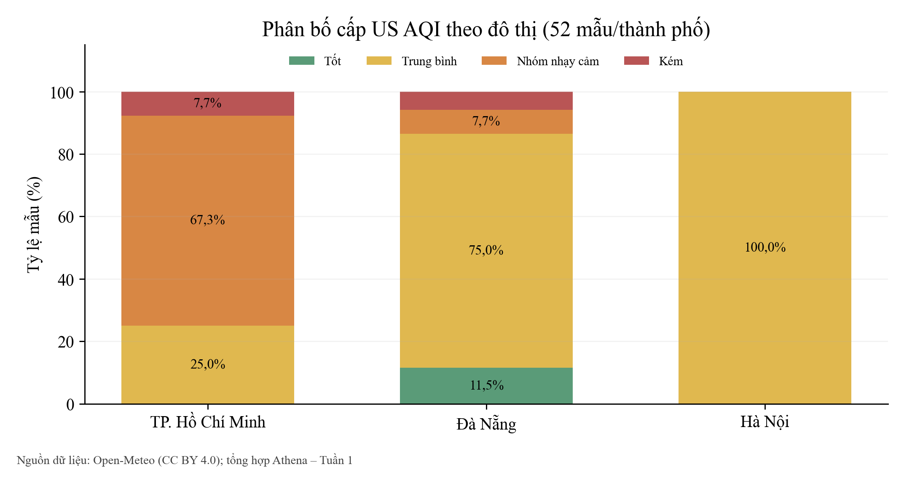
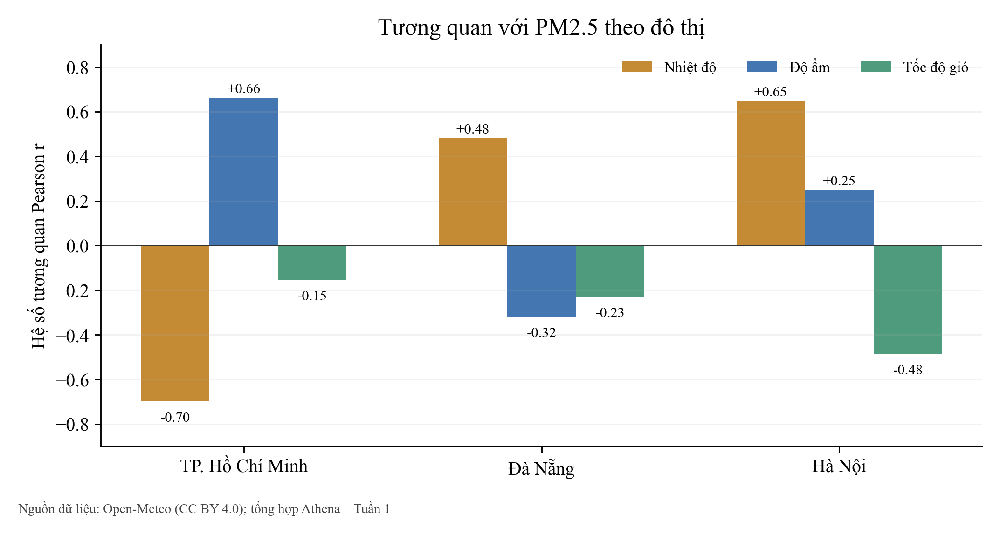

# Báo cáo tiến độ Tuần 1

## TÓM TẮT

Báo cáo trình bày kết quả Tuần 1 của đề tài Hệ thống thu thập và phân tích dữ liệu thời tiết và chất lượng không khí trên AWS. Hệ thống dùng Open-Meteo, EventBridge, Lambda, Secrets Manager, S3, Glue, Athena, SNS và CloudWatch để thu thập dữ liệu ba đô thị, lưu theo ngày, truy vấn AQI và PM2.5, đồng thời cảnh báo khi vượt ngưỡng.

Trong Tuần 1, Lambda ở trạng thái Active, lịch EventBridge đang Enabled, S3 có ba đối tượng raw với tổng 87.250 byte và Glue có ba phân vùng dữ liệu. Năm truy vấn Athena đều SUCCEEDED, gồm bốn truy vấn phân tích và một truy vấn xuất 156 bản ghi gốc; mỗi truy vấn quét 87.250 byte. Báo cáo trình bày bốn biểu đồ từ CSV, 24 nhóm giờ UTC, phân bố AQI và tương quan khí tượng.

Theo phân công nhóm xác nhận, Sơn phụ trách S3, Secrets Manager, Lambda và SNS; Quyên phụ trách Glue, Athena và phân tích biểu đồ. Hai thành viên cùng thực hiện kiến trúc, tích hợp và báo cáo. Các số liệu trong tài liệu thuộc tập dữ liệu và các lượt quan sát của Tuần 1.

## LỜI MỞ ĐẦU

Đề tài thuộc nhóm Domain Apps của học phần Điện toán đám mây, lớp 261CLCO332779_05. Hệ thống được triển khai trên AWS Learner Lab để thu thập dữ liệu môi trường công khai, lưu trữ theo ngày và phân tích bằng truy vấn SQL. Bài toán thời tiết và chất lượng không khí cho phép theo dõi trọn luồng dữ liệu từ nguồn API đến bảng và biểu đồ.

Toàn bộ mã nguồn triển khai, cấu hình dịch vụ AWS và tài liệu kỹ thuật của đề tài được công khai và quản lý tại kho mã nguồn GitHub: https://github.com/JasonTM17/WeatherAWS_FinalTerm.git.

Báo cáo đi từ mục tiêu và kiến trúc Tuần 1 đến các mốc triển khai, cấu hình chi tiết và kết quả đo được. Các số liệu gắn với từng lượt quan sát; dữ liệu môi trường có thể thay đổi ở lần chạy sau. Phần đánh giá phân biệt kết quả Publish của SNS với việc email được giao thực tế, và phân biệt cấu hình Alarm với trạng thái đã quan sát.

Phương pháp phân tích dùng các tệp CSV Athena, bảng metrics, số liệu lưu trữ và log vận hành của Tuần 1. Những đại lượng cùng đơn vị được đối chiếu bằng phép cộng, trung bình và tỷ lệ; mỗi bảng và biểu đồ đều gắn với tập dữ liệu được nêu rõ.

Bố cục gồm năm chương. Chương 1 trình bày mục tiêu và kiến trúc; Chương 2 ghi nhận tiến độ và phân công Tuần 1; Chương 3 phân tích cấu hình AWS; Chương 4 trình bày số liệu quan sát và kết quả phân tích; Chương 5 tổng hợp kết quả và chi phí Tuần 1.

## Chương 1 Tổng quan đề tài và yêu cầu học phần

### 1.1 Bối cảnh, mục tiêu và phạm vi

Hệ thống theo dõi TP. Hồ Chí Minh, Hà Nội và Đà Nẵng. Open-Meteo cung cấp các trường thời tiết và chất lượng không khí; Lambda chuẩn hóa thành bản ghi có thời gian UTC, giờ Việt Nam, vị trí, AQI, PM2.5, PM10 và các yếu tố khí tượng. Dữ liệu được lưu dưới dạng NDJSON trên S3 để Glue và Athena có thể đọc bằng lược đồ bảng ngoài.

- Thu thập theo lịch một giờ; hỗ trợ gọi thử trực tiếp và nạp chuỗi lịch sử 48 giờ.

- Lưu dữ liệu theo đường dẫn raw/year=YYYY/month=MM/day=DD; truy vấn bằng Athena.

- Cảnh báo theo điều kiện US AQI ≥ 100 hoặc PM2.5 ≥ 35,5 µg/m³ qua SNS (đúng phép so sánh trong mã nguồn).

- Giám sát lỗi Lambda bằng CloudWatch Alarm và xem tổng quan trên dashboard.

### 1.2 Yêu cầu chức năng và kết quả triển khai

Bảng 1.1. Cấu hình hệ thống và kết quả định lượng tại mốc kiểm tra

| Chức năng | Cấu hình hoặc kết quả | Nguồn dữ liệu |
| --- | --- | --- |
| Thu thập định kỳ | EventBridge rate(1 hour); Lambda xử lý ba đô thị; bốn lượt gọi ghi nhận | Rule và CloudWatch, Tuần 1 |
| Lưu trữ | NDJSON phân vùng year/month/day; 3 tệp raw, 87.250 byte | Amazon S3, Tuần 1 |
| Cấu hình | Secrets Manager lưu tọa độ và ngưỡng cảnh báo; Open-Meteo sử dụng API công khai. | Secret và mã Lambda |
| Phân tích | Glue có ba phân vùng; Athena có 5/5 truy vấn thành công, 156 dòng gốc | Glue, Athena CSV, Tuần 1 |
| Cảnh báo, giám sát | 6 MessageId trong log; CloudWatch Alarm ở trạng thái INSUFFICIENT_DATA | CloudWatch Logs/Alarm, Tuần 1 |
| Chi phí | Cost Explorer trả 0 USD tại các mốc đã quan sát | UnblendedCost tại lần đọc |

### 1.3 Kiến trúc tổng thể

Hình 1.1. Luồng xử lý của hệ thống theo mã nguồn và cấu hình AWS

Open-Meteo là nguồn dữ liệu bên ngoài AWS; các khối còn lại thuộc luồng xử lý trong Learner Lab tại us-east-1. EventBridge kích hoạt Lambda theo rate(1 hour). Lambda đọc cấu hình từ Secrets Manager, gọi API công khai, kiểm tra ngưỡng, ghi dữ liệu S3 và công bố cảnh báo qua SNS khi cần. Glue Catalog mô tả bảng ngoài trên vùng raw của S3, còn Athena đọc dữ liệu để tổng hợp và xuất kết quả. CloudWatch ghi chỉ số vận hành của Lambda. Secrets Manager quản lý tọa độ và ngưỡng cấu hình; các lời gọi Open-Meteo trong dự án sử dụng API công khai không yêu cầu khóa của nhà cung cấp.

### 1.4 Nguồn số liệu và mốc đo

Các bảng phân tích sử dụng bốn CSV tổng hợp, CSV chứa 156 bản ghi gốc và bảng chỉ số truy vấn đã lưu trong Tuần 1. Số liệu S3, Lambda và CloudWatch được đọc ở các mốc quan sát riêng. Báo cáo đối chiếu số dòng giữa bảng đô thị, bảng giờ, bảng cấp AQI và dữ liệu gốc. Dữ liệu chất lượng không khí được lấy từ Open-Meteo Air Quality API, dựa trên sản phẩm mô hình khí quyển CAMS, không phải phép đo trực tiếp tại một trạm. Nguồn dữ liệu: https://open-meteo.com/en/docs/air-quality-api. Bộ xuất dùng trong báo cáo bao gồm dữ liệu lịch sử được nạp bổ sung; phạm vi này được phân biệt với bộ lọc theo ranh giới tuần.

Bảng 1.2. Nguồn và đại lượng dùng trong phân tích

| Nguồn dữ liệu | Đại lượng sử dụng | Mốc của số liệu |
| --- | --- | --- |
| Athena CSV / metrics | 156 dòng gốc, năm truy vấn, thời gian và byte quét | Lượt xuất Tuần 1 |
| Amazon S3 | 3 tệp raw, tổng 87.250 byte | Lượt quan sát Tuần 1 |
| CloudWatch Logs / Metrics | 4 lượt gọi, 0 lỗi, 6 MessageId trong log | Log Tuần 1 |
| Biểu đồ | Bốn hình từ tập CSV Athena | Dữ liệu Tuần 1 |

Bảng 1.3. Đối chiếu từng luồng trong sơ đồ kiến trúc với bằng chứng

| Luồng trong Hình 1.1 | Trách nhiệm kỹ thuật | Bằng chứng và giới hạn |
| --- | --- | --- |
| EventBridge / Secret → Lambda | Lịch gọi theo giờ và cấu hình ngưỡng | Rule Enabled; Lambda Active trong Tuần 1. |
| Open-Meteo → Lambda → S3 | Lấy, chuẩn hóa NDJSON và phân vùng theo ngày | S3 có 3 tệp raw, 87.250 byte; CSV gốc có 156 dòng |
| S3 → Glue → Athena | Catalog bảng ngoài và tổng hợp bằng SQL | 20 cột, 3 phân vùng; 5 truy vấn SUCCEEDED, 156 dòng gốc |
| Lambda → SNS / CloudWatch | Phát cảnh báo và giám sát lỗi | 6 MessageId trong log; chưa xác nhận email đến, Alarm còn INSUFFICIENT_DATA |

## Chương 2 Báo cáo tiến độ Tuần 1

Báo cáo tập trung vào tập dữ liệu, kết quả quan sát và phần việc của hai thành viên trong Tuần 1 theo phân công chuyên môn đã xác nhận.

### 2.1 Mục tiêu và phân công thực hiện

Mục tiêu Tuần 1 là dựng luồng dữ liệu ban đầu cho ba đô thị, từ nguồn Open-Meteo đến vùng raw trên S3, lược đồ Glue và truy vấn Athena; đồng thời cấu hình lịch chạy, cảnh báo và trực quan hóa số liệu đầu tiên. Phân công bám theo các nhóm chức năng và sản phẩm đã thực hiện.

Bảng 2.1. Phân công công việc Tuần 1 do nhóm xác nhận

| Thành viên | Phần việc phụ trách | Phần phối hợp | Giờ |
| --- | --- | --- | --- |
| Nguyễn Tiến Sơn 24110054 | S3, Secrets Manager, Lambda và SNS. | Kiến trúc, tích hợp và báo cáo. | 9,5 |
| Trần Thị Ngọc Quyên 24110051 | Glue, Athena, biểu đồ và đối chiếu dữ liệu. | Kiến trúc, tích hợp và báo cáo. | 9,0 |

Hai thành viên cùng thiết kế kiến trúc, tích hợp các dịch vụ và rà soát báo cáo. Theo nhật ký nhóm xác nhận, Nguyễn Tiến Sơn thực hiện 9,5 giờ và Trần Thị Ngọc Quyên thực hiện 9,0 giờ trong Tuần 1, tổng cộng 18,5 giờ. Phần việc chính được trình bày tại Bảng 2.1.

### 2.2 Phạm vi và luồng dữ liệu đo

Mỗi lượt thu thập xử lý ba đô thị và hai nhóm chỉ số từ Open-Meteo: chất lượng không khí và thời tiết. Bản ghi có thời gian UTC, giờ Việt Nam, thành phố, AQI, bụi mịn và các biến khí tượng. Dữ liệu được ghi ở định dạng NDJSON theo ngày; Glue mô tả lược đồ để Athena tính các chỉ số tổng hợp.

Bảng 2.2. Phạm vi tập dữ liệu Tuần 1

| Nhóm dữ liệu | Phạm vi | Đại lượng phân tích |
| --- | --- | --- |
| Địa điểm | TP. Hồ Chí Minh, Hà Nội, Đà Nẵng | 52 mẫu/đô thị ở lượt xuất |
| Không khí | US AQI, PM2.5, PM10, CO, NO2, SO2, O3 | Trung bình, cực trị, cấp AQI |
| Khí tượng | Nhiệt độ, độ ẩm, áp suất, tốc độ gió | Trung bình và tương quan với PM2.5 |
| Thời gian | Ba phân vùng UTC của tập quan trắc | 24 nhóm giờ UTC; phân vùng theo ngày |

Bộ dữ liệu dùng cho báo cáo Tuần 1 có 156 dòng: 52 dòng cho mỗi đô thị và lần lượt 72, 72, 12 dòng ở ba phân vùng UTC. Mỗi đô thị có 52 mốc giờ quan trắc liên tiếp, được tổng hợp thành 24 nhóm giờ trong ngày. Trong bộ xuất này, 51 dòng là dữ liệu lịch sử trước ranh giới Tuần 1 và 105 dòng thuộc ranh giới Tuần 1 theo giờ Việt Nam. Các bảng và biểu đồ giữ đủ 156 dòng để thống nhất với bộ CSV đã lưu; chúng không mô tả toàn bộ bảy ngày của tuần.

### 2.3 Kết quả định lượng

Bảng 2.3. Sản phẩm và số liệu quan sát của Tuần 1

| Thành phần | Số liệu quan sát | Nguồn và giới hạn |
| --- | --- | --- |
| S3 / Secret | 3 tệp raw, 87.250 byte; 1 Secret cấu hình | S3 và Secrets Manager, Tuần 1 |
| Lambda / EventBridge | Lambda Active; Rule Enabled; 4 lượt gọi, 0 lỗi | Cấu hình và CloudWatch Metrics, Tuần 1 |
| Log / SNS | 6 MessageId riêng biệt trong log | Publish không chứng minh email đã tới |
| Glue / Athena | 3 phân vùng dữ liệu; 5/5 truy vấn SUCCEEDED; 87.250 byte/truy vấn | Glue, Athena QueryExecution, Tuần 1 |
| Phân tích dữ liệu | 156 dòng ở lượt xuất, 52 dòng/đô thị; 4 biểu đồ | CSV và metrics, Tuần 1 |

Lượt xuất Athena trong Tuần 1 có 156 dòng gốc và bốn bảng phân tích. Năm truy vấn gồm so sánh đô thị, nhóm giờ UTC, phân bố cấp AQI, tương quan khí tượng và xuất bản ghi gốc đều hoàn thành. Số dòng theo ba góc nhìn tổng hợp đều khớp dữ liệu gốc; Chương 4 trình bày chi tiết từng bảng và bốn biểu đồ từ CSV của lượt xuất này.

## Chương 3 Thiết kế và triển khai trên AWS Learner Lab

### 3.1 Danh mục dịch vụ và cấu hình thực tế

Bảng 3.1. Thành phần triển khai tại us-east-1

| Dịch vụ | Tên hoặc cấu hình | Vai trò |
| --- | --- | --- |
| Lambda | WeatherCollectorLambda, Python 3.12, 256 MB, 60 s; role LabRole | Thu thập và chuẩn hóa |
| EventBridge | rate(1 hour); kích hoạt Lambda theo giờ | Kích hoạt theo lịch |
| S3 | weather-aqi-<account>/raw | Lưu NDJSON phân vùng |
| Secrets Manager | weather/api_config | Lưu cấu hình thu thập |
| SNS | weather-airquality-alerts | Phát cảnh báo email |
| Glue | weather_aqi_db.weather_airquality_records | Lược đồ và phân vùng |
| Athena | Bốn truy vấn phân tích và một truy vấn raw | Đọc và tổng hợp dữ liệu |
| CloudWatch | WeatherCollector-Errors-Alarm; dashboard | Theo dõi vận hành |

### 3.2 Dữ liệu và phân vùng S3

Mỗi bản ghi gồm định danh, thành phố, tọa độ, thời gian UTC và Việt Nam, chỉ số chất lượng không khí, thời tiết, giờ thu thập cùng thời điểm ghi nhận. Hàm ghi S3 nhóm các bản ghi theo ngày UTC thành các tệp NDJSON; tiền tố year/month/day phù hợp khóa phân vùng của Glue. Cách tổ chức giúp truy vấn có bộ lọc theo ngày giới hạn miền đọc, nhưng mức tiết kiệm cụ thể chưa được đo so sánh với một bảng không phân vùng nên báo cáo không nêu phần trăm tiết kiệm.

| s3://weather-aqi-<account>/raw/   year=YYYY/month=MM/day=DD/   ba phân vùng dữ liệu trong Tuần 1 |
| --- |

### 3.3 An toàn cấu hình và vận hành

Lambda lấy tên bucket, secret và SNS topic từ biến môi trường; quyền thực thi sử dụng LabRole của Learner Lab. Mã nguồn không lưu khóa truy cập AWS trong repository. Secret quản lý các ngưỡng cảnh báo và tọa độ thu thập. Khi đọc secret thất bại, hàm ghi log và sử dụng cấu hình dự phòng đã định nghĩa trong mã nguồn.

### 3.4 Trình tự xử lý của Lambda

Khi được kích hoạt, Lambda đọc cấu hình, duyệt danh sách ba thành phố, yêu cầu dữ liệu chất lượng không khí và thời tiết qua HTTPS, rồi ghép các trường từ hai nguồn vào một bản ghi thống nhất. Các hàm safe_float và safe_int chặn lỗi kiểu dữ liệu khi API trả null hoặc chuỗi không hợp lệ; hàm get_aqi_category chia US AQI thành sáu mức từ Good đến Hazardous. Sau bước chuẩn hóa, logic so sánh từng bản ghi với ngưỡng; các bản ghi vượt ngưỡng được chuyển thành thông điệp SNS có địa điểm, thời gian và chỉ số đo.

Phiên bản Tuần 1 nạp dữ liệu lịch sử với past_hours=48, tính số ngày cần truy vấn rồi lấy tối đa 48 mốc cuối trong mảng thời gian. Hàm dùng chỉ số gốc của mảng khi nguồn trả ít mốc hơn dự kiến để giữ thời gian cùng vị trí với giá trị cảm biến. Mỗi bản ghi được gắn record_id có phần ngẫu nhiên; vì vậy một lần chạy lặp có thể tạo bản ghi trùng ý nghĩa dữ liệu.

Đường dẫn phân vùng dùng ngày UTC lấy từ bản ghi. Trường timestamp_vn là giờ hiển thị cho người đọc ở Việt Nam; vì vậy một quan trắc gần nửa đêm có thể mang ngày Việt Nam khác với ngày trong thư mục S3. Đây là lựa chọn nhất quán của mã hiện tại, cần giải thích rõ khi lọc dữ liệu theo ngày địa phương trong Athena.

### 3.5 Truy vấn Athena và khả năng tái lập

Bảng ngoài weather_airquality_records sử dụng JSON SerDe, LOCATION trỏ tới raw và khai báo khóa phân vùng year, month, day. Glue Data Catalog giữ metadata của bảng, còn Athena dựa trên LOCATION để đọc tệp tại S3; sơ đồ vì vậy không mô tả Glue như nơi chứa bản ghi. Sau khi có dữ liệu, MSCK REPAIR TABLE hoặc thao tác tương đương cập nhật phân vùng để Athena nhìn thấy tệp mới. Truy vấn so sánh thành phố nhóm theo city, đếm số dòng và tính AVG, MIN, MAX cho AQI cùng trung bình PM2.5, PM10, nhiệt độ, độ ẩm. Các truy vấn còn lại tổng hợp theo hour, aqi_category và hàm corr() cho từng thành phố.

| Nội dung truy vấn | Cách tổng hợp |
| --- | --- |
| Phạm vi | Bảng weather_airquality_records trong database weather_aqi_db. |
| Nhóm dữ liệu | Gom các bản ghi theo thành phố. |
| Đại lượng | Số mẫu; AQI trung bình, nhỏ nhất, lớn nhất; PM2.5, PM10, nhiệt độ và độ ẩm trung bình. |
| Thứ tự hiển thị | Sắp xếp thành phố theo AQI trung bình giảm dần. |

Kết quả truy vấn được lưu trong results/athena_queries để báo cáo có thể đối chiếu lại mà không cần thực thi truy vấn mới. Tệp JSON metrics giữ QueryExecutionId, trạng thái, số byte quét và dữ liệu trả về. Khi chạy lại pipeline, số bản ghi có thể tăng vì EventBridge tiếp tục kích hoạt Lambda; do đó mọi bảng trong báo cáo đều gắn với lượt xuất số liệu Tuần 1.

### 3.6 Lược đồ bản ghi và chất lượng dữ liệu

DDL của bảng Athena khai báo 20 cột thường và ba khóa phân vùng year, month, day. Phần mã Lambda tạo bản ghi trước khi ghi NDJSON; mỗi dòng JSON là một quan trắc của một thành phố tại một thời điểm. Bảng dưới đối chiếu các nhóm trường quan trọng với nguồn hình thành và phép xử lý thật trong lambda_function.py.

Bảng 3.2. Đường đi của trường dữ liệu từ API tới Athena

| Nhóm trường | Nguồn và phép biến đổi | Lưu ý khi phân tích |
| --- | --- | --- |
| city, latitude, longitude | Danh sách ba vị trí trong Secret hoặc cấu hình mặc định | Tên thành phố là khóa nhóm của bốn truy vấn |
| timestamp_utc, timestamp_vn | Realtime lấy đồng hồ UTC; backfill lấy thời gian mảng AQI rồi cộng 7 giờ | Không đồng nhất ngày UTC với ngày Việt Nam |
| year, month, day, hour | Tách từ thời gian UTC của bản ghi | Ba trường đầu là khóa phân vùng; hour dùng trong Bảng 4.4 |
| us_aqi, aqi_category | AQI từ Open-Meteo; safe_int và get_aqi_category | Giá trị thiếu có thể thành AQI 0 nhưng cấp Unknown |
| pm2_5, pm10, CO, NO2, SO2, O3 | Air Quality API; safe_float trước khi ghi JSON | Giá trị thiếu/không hợp lệ bị đổi thành 0, có thể lệch trung bình |
| nhiệt độ, độ ẩm, áp suất, gió | Weather Forecast API; safe_float | Phiên bản Tuần 1 ghép theo vị trí trong mảng; phiên bản Tuần 2 ghép theo timestamp. |
| record_id, collected_at | ID có hậu tố ngẫu nhiên; collected_at gắn thời điểm trong bản ghi | Chưa có cơ chế chống ghi lặp theo city + timestamp |

Việc đổi null thành 0 giúp hàm không lỗi kiểu dữ liệu nhưng khiến AVG coi số 0 là một phép đo thật. Chưa có thống kê tỷ lệ giá trị thiếu trong toàn bộ đối tượng S3, nên các kết luận khí tượng ở Chương 4 chỉ mô tả tệp CSV đã xuất. Phiên bản được đối chiếu ở Tuần 1 ghép hai chuỗi lịch sử theo vị trí trong mảng; bộ source hoàn thiện ở Tuần 2 đã ghép theo timestamp. Sự thay đổi mã nguồn này không làm thay đổi các giá trị trong bộ CSV đã lưu dùng cho hai báo cáo.

### 3.7 Tần suất gọi Open-Meteo và yêu cầu khóa API

Mỗi lượt realtime duyệt ba đô thị và gọi hai endpoint (Air Quality, Weather Forecast) cho mỗi đô thị: tối đa 6 HTTP GET/lượt thành công. Lịch rate(1 hour) tương ứng 24 lượt/ngày và ước tính 144 yêu cầu/ngày nếu không tính gọi thử, backfill hoặc lần chạy lại. Đây là phép tính từ cấu hình, không phải số yêu cầu đã được nhà cung cấp đo. Theo điều khoản Free API phi thương mại của Open-Meteo tại https://open-meteo.com/en/terms, giới hạn công bố là 10.000 yêu cầu/ngày, 5.000/giờ và 600/phút; nhịp thiết kế nằm dưới các ngưỡng đó.

Các lời gọi Open-Meteo trong dự án sử dụng API công khai không yêu cầu khóa của nhà cung cấp. Secret weather/api_config quản lý tọa độ ba đô thị và ngưỡng cảnh báo; cấu hình này được Lambda đọc khi xử lý dữ liệu. Báo cáo phân biệt cấu hình của hệ thống với bộ số liệu được lưu để phân tích.

## Chương 4 Kết quả kiểm tra và phân tích dữ liệu

### 4.1 Mốc dữ liệu và số đo vận hành AWS

Nguồn định lượng của chương này là bốn CSV tổng hợp, CSV gốc 156 dòng và bảng metrics của năm truy vấn Athena trong Tuần 1. Cả năm truy vấn có trạng thái SUCCEEDED. Các giá trị vận hành S3, Lambda, SNS, Glue và CloudWatch trong Bảng 4.1 được quan sát riêng; bảng phân tích dùng cùng một tập CSV đã lưu.

Bảng 4.1. Số đo thực từ AWS Lab trong Tuần 1

| Nguồn | Giá trị quan sát | Ý nghĩa và mốc đo |
| --- | --- | --- |
| Amazon S3 | 3 tệp raw; tổng 87.250 byte | Ba tệp ở ba phân vùng UTC |
| AWS Lambda | 4 lượt gọi, 0 lỗi | CloudWatch Invocations và Errors trong Tuần 1 |
| CloudWatch Logs | 6 MessageId riêng biệt | Chứng minh Publish được chấp nhận; chưa chứng minh email tới |
| Amazon SNS | 6 thông điệp được ghi trong log | Không đồng nhất với số email giao thành công |
| AWS Glue | 3 phân vùng dữ liệu | Tổ chức theo year/month/day |
| Amazon Athena | 5/5 truy vấn SUCCEEDED | Mỗi truy vấn quét 87.250 byte; gồm một truy vấn raw |

CSV gốc có 156 dòng, đúng bằng 52 dòng cho mỗi đô thị. S3 có ba đối tượng raw ở ba phân vùng và tổng dung lượng 87.250 byte; đây cũng là lượng dữ liệu được mỗi truy vấn Athena quét trong lượt xuất quan sát. Hai đại lượng cùng giá trị tại mốc này nhưng mang ý nghĩa khác nhau: kích thước đối tượng và bytes scanned.

#### Phép đối chiếu bốn tập kết quả

Tổng total_records theo đô thị là 52 + 52 + 52 = 156. Tổng sample_count của 24 nhóm giờ và tổng occurrence_count của các cấp AQI đều bằng 156. CSV gốc cũng có đúng 156 dòng và 156 record_id riêng biệt. Bốn phép kiểm tra số dòng độc lập cho thấy các bảng tổng hợp dùng cùng quy mô mẫu của lượt xuất Tuần 1.

| 52 + 52 + 52 = 156 dòng theo đô thị Tổng 24 nhóm giờ = tổng các cấp AQI = 156 CSV raw = 156 dòng, 156 record_id riêng biệt |
| --- |

### 4.2 So sánh ba đô thị từ Athena

Bảng 4.2. AQI và bụi mịn theo đô thị từ truy vấn Athena

| Thành phố | Mẫu | AQI TB | AQI nhỏ nhất | AQI lớn nhất | PM2.5 TB |
| --- | --- | --- | --- | --- | --- |
| TP. Hồ Chí Minh | 52 | 107,79 | 95 | 172 | 37,03 |
| Đà Nẵng | 52 | 74,67 | 36 | 155 | 14,23 |
| Hà Nội | 52 | 67,56 | 56 | 80 | 15,36 |

Bảng 4.3. PM10 và khí tượng trung bình trên cùng tập mẫu

| Thành phố | PM10 (µg/m³) | Nhiệt độ (°C) | Độ ẩm (%) |
| --- | --- | --- | --- |
| TP. Hồ Chí Minh | 37,35 | 27,79 | 84,71 |
| Đà Nẵng | 17,28 | 28,85 | 74,87 |
| Hà Nội | 16,11 | 24,54 | 76,65 |

Hình 4.1. AQI trung bình, thấp nhất và cao nhất theo thành phố từ Athena CSV

Trong 52 mẫu của mỗi đô thị, TP. Hồ Chí Minh có AQI trung bình 107,79 và cực đại 172; Đà Nẵng lần lượt 74,67 và 155; Hà Nội 67,56 và 80. PM2.5 trung bình của TP. Hồ Chí Minh là 37,03 µg/m³, so với 14,23 ở Đà Nẵng và 15,36 ở Hà Nội. Hình 4.1 được dựng từ CSV của cùng lượt truy vấn.

Hiệu AQI trung bình giữa TP. Hồ Chí Minh và Đà Nẵng là 33,12 điểm; giữa TP. Hồ Chí Minh và Hà Nội là 40,23 điểm. Tỷ số PM2.5 tương ứng là 2,60 và 2,41. Đây là so sánh mô tả của 52 dòng mỗi nơi, không phải ước lượng dài hạn; Bảng 4.5 thể hiện phân bố từng cấp AQI.

### 4.3 Biến thiên theo 24 giờ UTC

Hình 4.2. AQI, PM2.5 và PM10 trung bình theo giờ UTC từ Athena

Truy vấn theo hour có đủ 24 nhóm từ 00 đến 23 UTC. AQI trung bình cao nhất tại giờ 11 (103,83) và thấp nhất tại giờ 23 (75,83). PM2.5 cao nhất tại giờ 19 (25,53 µg/m³) và thấp nhất tại giờ 03 (18,03 µg/m³). Có 20 nhóm sáu mẫu và bốn nhóm chín mẫu; do cỡ mẫu không đều, đồ thị chỉ mô tả tập dữ liệu Tuần 1 và không đủ để suy ra chu kỳ ô nhiễm điển hình.

Bảng 4.4. Toàn bộ 24 nhóm giờ từ peak_pollution_hours.csv

| Giờ UTC | AQI TB | PM2.5 TB | PM10 TB | Mẫu |
| --- | --- | --- | --- | --- |
| 00 | 77,00 | 22,81 | 24,06 | 9 |
| 01 | 76,78 | 22,09 | 23,66 | 9 |
| 02 | 76,67 | 18,87 | 20,77 | 9 |
| 03 | 76,67 | 18,03 | 20,04 | 9 |
| 04 | 80,17 | 20,30 | 22,32 | 6 |
| 05 | 80,00 | 20,45 | 22,15 | 6 |
| 06 | 79,67 | 21,17 | 22,77 | 6 |
| 07 | 81,67 | 21,18 | 22,70 | 6 |
| 08 | 86,17 | 21,15 | 22,85 | 6 |
| 09 | 93,50 | 20,55 | 22,05 | 6 |
| 10 | 101,00 | 22,33 | 23,72 | 6 |
| 11 | 103,83 | 25,22 | 26,48 | 6 |
| 12 | 103,67 | 21,67 | 22,92 | 6 |
| 13 | 99,67 | 22,38 | 23,53 | 6 |
| 14 | 93,17 | 22,15 | 23,32 | 6 |
| 15 | 84,00 | 22,60 | 23,78 | 6 |
| 16 | 78,50 | 23,72 | 24,88 | 6 |
| 17 | 78,00 | 24,28 | 25,35 | 6 |
| 18 | 78,00 | 24,38 | 25,48 | 6 |
| 19 | 77,50 | 25,53 | 26,52 | 6 |
| 20 | 77,67 | 25,32 | 26,32 | 6 |
| 21 | 77,33 | 23,77 | 24,68 | 6 |
| 22 | 76,83 | 23,07 | 23,98 | 6 |
| 23 | 75,83 | 23,52 | 24,48 | 6 |

### 4.4 Phân bố cấp chất lượng không khí

Hình 4.3. Tỷ lệ cấp AQI theo thành phố từ Athena CSV

Bảng 4.5. Số mẫu và tỷ lệ từng cấp AQI

| Thành phố | Tốt | Trung bình | Nhạy cảm | Kém |
| --- | --- | --- | --- | --- |
| TP. Hồ Chí Minh | 0 (0,0%) | 13 (25,0%) | 35 (67,3%) | 4 (7,7%) |
| Đà Nẵng | 6 (11,5%) | 39 (75,0%) | 4 (7,7%) | 3 (5,8%) |
| Hà Nội | 0 (0,0%) | 52 (100,0%) | 0 (0,0%) | 0 (0,0%) |

TP. Hồ Chí Minh có 35/52 mẫu (67,3%) ở mức không tốt cho nhóm nhạy cảm và 4/52 mẫu (7,7%) ở mức kém. Đà Nẵng có 39/52 mẫu (75,0%) ở mức trung bình và 6/52 mẫu (11,5%) ở mức tốt; Hà Nội có 52/52 mẫu ở mức trung bình. Các tỷ lệ cộng lại có thể lệch 0,1 điểm phần trăm do làm tròn một chữ số thập phân.

### 4.5 Tương quan PM2.5 với yếu tố khí tượng

Hình 4.4. Hệ số tương quan Pearson theo thành phố từ Athena CSV

Bảng 4.6. Hệ số tương quan r với PM2.5

| Thành phố | Nhiệt độ | Độ ẩm | Tốc độ gió |
| --- | --- | --- | --- |
| Hà Nội | 0,6462 | 0,2486 | -0,4846 |
| Đà Nẵng | 0,4798 | -0,3183 | -0,2291 |
| TP. Hồ Chí Minh | -0,6977 | 0,6627 | -0,1536 |

Tại TP. Hồ Chí Minh, r(nhiệt độ, PM2.5) = -0,6977 và r(độ ẩm, PM2.5) = 0,6627; ở Hà Nội, r(tốc độ gió, PM2.5) = -0,4846. Các hệ số mô tả 52 mẫu mỗi đô thị, không chứng minh quan hệ nhân quả.

### 4.6 Thời gian và dung lượng quét của năm truy vấn

Bảng 4.7. Thống kê QueryExecution do Athena trả về

| Truy vấn | Trạng thái | Kết quả | Thời gian | Byte quét |
| --- | --- | --- | --- | --- |
| avg aqi by city | SUCCEEDED | 3 | 744 ms | 87.250 |
| peak pollution hours | SUCCEEDED | 24 | 936 ms | 87.250 |
| aqi category distribution | SUCCEEDED | 8 | 776 ms | 87.250 |
| weather correlation | SUCCEEDED | 3 | 930 ms | 87.250 |
| raw weather aqi records | SUCCEEDED | 156 | 1192 ms | 87.250 |

Trong bộ kết quả này, truy vấn trung bình theo thành phố có thời gian 744 ms, phân bố cấp AQI 776 ms, tương quan 930 ms, nhóm giờ 936 ms và xuất bản ghi gốc 1.192 ms. Khoảng chênh giữa lượt nhanh nhất và chậm nhất là 448 ms; các đại lượng được ghi nhận cho từng lượt thực thi riêng.

Mỗi lượt có cùng dung lượng quét 87.250 byte dù số dòng trả về khác nhau: truy vấn đô thị và tương quan trả 3 dòng, nhóm giờ trả 24 dòng, phân bố cấp AQI trả 8 dòng và dữ liệu gốc trả 156 dòng. Số dòng kết quả mô tả cách tổng hợp; nó không trực tiếp phản ánh số byte phải đọc từ S3.

Các truy vấn phân tích trong bộ này không có điều kiện lọc một phân vùng ngày cụ thể. Vì vậy, cùng đọc tập dữ liệu hiện có không chứng minh mức tiết kiệm nhờ phân vùng. Để so sánh hiệu năng ở những lần quan sát khác, cần sử dụng cùng câu hỏi phân tích, phạm vi dữ liệu và điều kiện thực thi.

## Chương 5 Tổng hợp kết quả và chi phí Tuần 1

### 5.1 Mức độ hoàn thành theo sản phẩm

Pipeline gồm các khối thu thập, lưu trữ, lập catalog, truy vấn, trực quan hóa, cảnh báo và giám sát. Trong Tuần 1, Lambda Active và lịch EventBridge Enabled; CloudWatch ghi bốn lượt gọi và không ghi lỗi. S3 có ba tệp raw với tổng 87.250 byte, Glue có ba phân vùng dữ liệu, còn năm truy vấn Athena đều SUCCEEDED. Tập CSV gốc có 156 dòng để phân tích AQI, bụi mịn và tương quan khí tượng. Log ghi sáu MessageId riêng biệt; Alarm ở trạng thái INSUFFICIENT_DATA.

### 5.2 Quản lý chi phí

Thiết kế sử dụng các dịch vụ tính theo lượt gọi, lượng lưu trữ hoặc dung lượng quét; lịch một giờ và dữ liệu ba địa điểm tạo mức sử dụng nhỏ trong Tuần 1. Số liệu Cost Explorer theo chỉ số UnblendedCost là 0 USD tại các mốc đã quan sát của Tuần 1. Đây là ảnh chụp chi phí tại lần đo, có thể cập nhật trễ và không tương đương ngân sách còn lại trong Learner Lab.

Bảng 5.1. Đại lượng đã đo dùng để theo dõi mức tiêu thụ

| Dịch vụ | Lượng quan sát | Nguồn / giới hạn |
| --- | --- | --- |
| S3 | 3 tệp raw; 87.250 byte | Số liệu vùng raw Tuần 1 |
| Lambda | 4 lượt gọi, 0 lỗi | CloudWatch Invocations và Errors |
| SNS | 6 MessageId | Log Publish; không phải số email giao thành công |
| Athena | 5 × 87.250 = 436.250 byte quét | QueryExecution của năm truy vấn |
| Cost Explorer | 0 USD tại các mốc đã quan sát | UnblendedCost lúc đọc; có thể cập nhật trễ |

Dung lượng lưu trữ và số lượt gọi ở mốc quan sát đều nhỏ. Cost Explorer chưa ghi nhận khoản trừ tại các mốc đã quan sát của Tuần 1, nhưng giá trị này không cho phép kết luận tổng chi phí thực tế bằng 0. Số dư Learner Lab không có trong phép đo Cost Explorer.

### 5.3 Kết luận

Trong Tuần 1, bộ kết quả Athena dùng trong báo cáo gồm 156 bản ghi gốc, năm truy vấn thành công và bốn biểu đồ từ CSV. Chúng em đã xây dựng kiến trúc, cấu hình các dịch vụ nền tảng và phân tích số liệu của ba đô thị. Phân công của chúng em được trình bày tại Bảng 2.1; các kết quả được đánh giá trong phạm vi bộ dữ liệu đã lưu.
