# Báo cáo Tuần 2 Phân tích dữ liệu trên hai tài khoản AWS

## TÓM TẮT

Báo cáo Tuần 2 trình bày dữ liệu thời tiết và chất lượng không khí cùng kết quả vận hành trên hai tài khoản AWS Learner Lab của nhóm. Chúng em đối chiếu trực tiếp các tệp raw trên S3, truy vấn Athena và chỉ số dịch vụ để phân tích đầy đủ tập dữ liệu hiện có.

Tổng dữ liệu tải về gồm 435 bản ghi: 204 từ tài khoản Sơn và 231 từ tài khoản Quyên. Theo thời gian UTC quy đổi đúng ranh giới tuần ở Việt Nam, mẫu Tuần 2 gồm 27 và 57 bản ghi, tương ứng 9 và 19 mẫu cho mỗi đô thị. Hai tài khoản có 144 quan trắc lịch sử trùng thành phố và thời điểm với giá trị cảm biến giống nhau, nên được phân tích riêng.

Hà Nội có AQI trung bình Tuần 2 đạt 163,56 và 163,05; TP. Hồ Chí Minh đạt 78,00 và 79,05; Đà Nẵng đạt 35,44 và 35,37. Báo cáo trình bày 16 biểu đồ từ dữ liệu thực tế, 24 truy vấn Athena mới thành công, phân bố mẫu, biến thiên theo giờ, ngưỡng cảnh báo, tương quan khí tượng và mức sử dụng tài nguyên. Các kết luận giới hạn trong mẫu đã thu thập.

## LỜI MỞ ĐẦU

Học phần Điện toán đám mây giúp chúng em vận dụng các dịch vụ quản lý trên AWS vào một luồng dữ liệu cụ thể. Bài toán thời tiết và chất lượng không khí cho phép theo dõi quá trình từ thu thập qua API, chuẩn hóa bản ghi, lưu trữ đến truy vấn và trình bày kết quả.

Báo cáo trình bày chức năng hệ thống, dữ liệu và kết quả phân tích của Tuần 2 trên hai tài khoản. Các bảng, biểu đồ và tệp Excel cùng sử dụng một bộ CSV đã đối chiếu. Kho dự án: https://github.com/JasonTM17/WeatherAWS_FinalTerm.git

Đề tài được thực hiện bởi nhóm sinh viên:

- Nguyễn Tiến Sơn — MSSV 24110054: S3, Secrets Manager, Lambda và SNS.

- Trần Thị Ngọc Quyên — MSSV 24110051: Glue, Athena, biểu đồ và đối chiếu dữ liệu.

Các chương lần lượt trình bày mục tiêu và kiến trúc, chức năng Lambda, lịch thu thập và cảnh báo, mô hình dữ liệu và phân tích, kiểm tra kết quả, sử dụng tài nguyên và tổng hợp công việc của nhóm.

## Chương 1 Phạm vi và hệ thống thực hành Tuần 2

### 1.1 Mục tiêu và phạm vi số liệu

Chúng em tiếp tục phân tích luồng thu thập thời tiết và chất lượng không khí cho TP. Hồ Chí Minh, Hà Nội và Đà Nẵng. Tuần 2 tập trung vào hoạt động của các dịch vụ, dữ liệu mới theo thời gian quan trắc và các phép phân tích có thể tái lập từ tệp xuất. Dữ liệu Open-Meteo là dữ liệu API mô hình, không được coi là phép đo trực tiếp của một trạm.

Chúng em sử dụng hai tài khoản riêng tại us-east-1. Toàn bộ tệp raw có thể đọc được của dự án được tải về, sau đó thực thi 12 truy vấn SELECT trên mỗi tài khoản. Bộ dữ liệu Tuần 1 đã nộp được giữ nguyên; số liệu trong báo cáo này lấy từ lần đọc dịch vụ và truy vấn mới. Thời điểm xuất và mã truy vấn được lưu cùng dữ liệu để đối chiếu.

### 1.2 Phân công và thời gian thực hiện

Bảng 1.1 Phân công và số giờ đã được nhóm xác nhận

| Thành viên | Phụ trách chính | Phối hợp | Giờ |
| --- | --- | --- | --- |
| Nguyễn Tiến Sơn 24110054 | S3, Secrets Manager, Lambda và SNS. | Kiến trúc, tích hợp, phân tích và báo cáo. | 10,0 |
| Trần Thị Ngọc Quyên 24110051 | Glue, Athena, biểu đồ và đối chiếu dữ liệu. | Kiến trúc, tích hợp, phân tích và báo cáo. | 9,5 |

Tổng thời gian nhóm đã xác nhận cho Tuần 2 là 19,5 giờ. Hai thành viên cùng đối chiếu nguồn dữ liệu, cách tính thống kê và các sản phẩm báo cáo. Phân công này thống nhất với nhật ký công việc của nhóm.

### 1.3 Kiến trúc và luồng xử lý

Hình 1.1 Kiến trúc và luồng dữ liệu của hệ thống

EventBridge kích hoạt Lambda. Hàm đọc cấu hình, gọi hai nguồn Open-Meteo, chuẩn hóa các trường và ghi NDJSON vào S3 theo phân vùng. SNS tiếp nhận thông báo khi thỏa ngưỡng cấu hình. Glue quản lý lược đồ và phân vùng; Athena đọc S3 để tạo các bảng phân tích. CloudWatch lưu chỉ số và log thời gian thực thi.

### 1.4 Trạng thái dịch vụ tại lần đọc hiện tại

Bảng 1.2 Cấu hình và trạng thái đọc từ hai tài khoản

| Nội dung | Tài khoản Sơn | Tài khoản Quyên |
| --- | --- | --- |
| Lambda | Active; Python 3.12; 256 MB; 60 giây. | Active; Python 3.12; 256 MB; 60 giây. |
| Lịch mỗi giờ | 1 quy tắc ENABLED. | 2 quy tắc ENABLED. |
| Đăng ký email SNS | 1 đăng ký đã xác nhận. | 2 đăng ký đã xác nhận. |
| CloudWatch Alarm | OK tại thời điểm đọc. | OK tại thời điểm đọc. |
| Glue Catalog | 6 phân vùng trong bảng raw. | 6 phân vùng trong bảng raw. |
| Mã đang triển khai | Khác mã source hiện tại trên máy. | Khác mã source hiện tại trên máy. |

Tài khoản Quyên có cả WeatherCollectionHourlyRule và WeatherCollectionSchedule đang bật, cùng chu kỳ rate(1 hour); tài khoản Sơn có WeatherCollectionSchedule. Trạng thái bật không chứng minh chạy liên tục khi phiên lab bị dừng. Danh sách lịch và số mẫu được giữ trong dữ liệu để giải thích khác biệt mật độ thu thập.

Hash của gói Lambda và mã đang triển khai đã được đọc riêng cho từng tài khoản. Cả hai khác phiên bản source đã chỉnh sửa trên máy, vì vậy báo cáo tách kết quả đang vận hành khỏi các lần sửa source sau đó. Chúng em chỉ đọc tài nguyên và chạy truy vấn phân tích trong lần xuất này.

## Chương 2 Nguồn dữ liệu và phương pháp phân tích

### 2.1 Toàn bộ dữ liệu và mẫu thuộc Tuần 2

Bảng 2.1 Quy mô nguồn dữ liệu đã tải

| Tài khoản | Tệp raw | Byte raw | Tổng dòng | Dòng Tuần 2 | Giờ có mẫu |
| --- | --- | --- | --- | --- | --- |
| Sơn | 22 | 114.736 | 204 | 27 | 9 |
| Quyên | 28 | 129.715 | 231 | 57 | 9 |

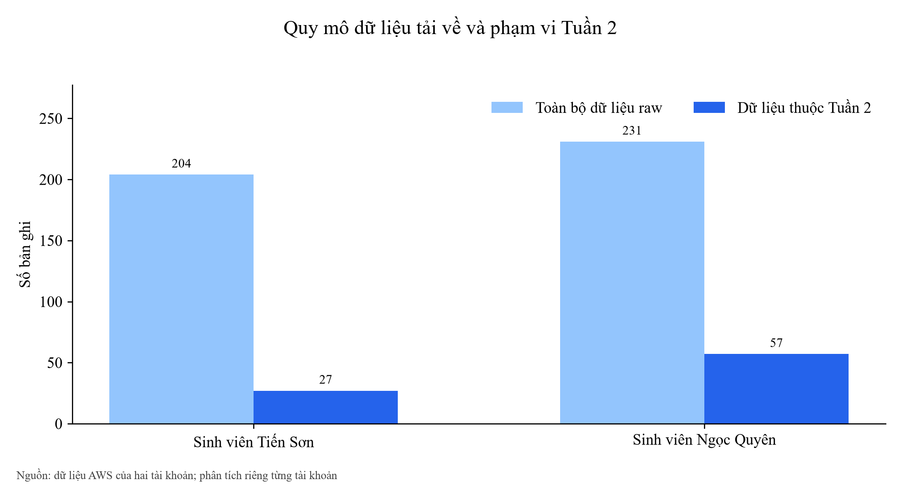

Hình 2.1 Quy mô dữ liệu tải về và phạm vi Tuần 2

Tổng 435 dòng nguồn không được cộng thành 435 quan trắc độc lập. Hai tài khoản chứa các tệp lịch sử tương đồng; khi tách theo Tuần 2, còn 84 dòng nguồn gồm 27 dòng của Sơn và 57 dòng của Quyên. Các dòng này vẫn giữ nhãn tài khoản, mã bản ghi và thời gian gốc.

Ranh giới tuần được xác định theo UTC+7, sau đó đổi sang UTC để lọc timestamp_utc. Các thời điểm AWS có múi giờ được chuẩn hóa về UTC trước khi so sánh. Phân vùng S3 dùng ngày UTC, nên điều kiện trên phân vùng được kết hợp với điều kiện timestamp để giữ đúng phạm vi.

### 2.2 Cấu trúc và chất lượng bản ghi

Mỗi bản ghi có 23 trường: nhận diện, tọa độ, thời gian UTC và Việt Nam, các yếu tố khí tượng, nồng độ ô nhiễm, chỉ số AQI, cấp AQI và ba khóa phân vùng. CSV giữ một dòng cho một bản ghi; không thêm tiêu đề trang trí hoặc thay đổi giá trị raw.

Bảng 2.2 Đối chiếu chất lượng trong tập Tuần 2

| Tài khoản | Bản ghi | Trường số | NULL hoặc không hữu hạn | Giá trị 0 | Trùng ID |
| --- | --- | --- | --- | --- | --- |
| Sơn | 27 | 11 | 0 | 0 | 0 |
| Quyên | 57 | 11 | 0 | 0 | 0 |

Trong 11 trường số kiểm tra của mẫu Tuần 2, không có NULL, giá trị không hữu hạn hoặc số 0. Kết quả này mô tả giá trị đã lưu; nó không chứng minh nguồn API chưa từng thiếu dữ liệu, vì source có nhánh chuyển đầu vào không hợp lệ sang giá trị mặc định. Không ghi đè bản ghi gốc trong quá trình phân tích.

### 2.3 Trùng dữ liệu và cách so sánh hai tài khoản

Có 144 cặp lịch sử trùng thành phố và timestamp giữa hai tài khoản; tất cả các trường cảm biến được đối chiếu đều giống nhau. Không có trùng record_id trong từng tài khoản và không có trùng khóa thành phố cộng timestamp trong từng bộ raw. Các ID ngẫu nhiên khác nhau không làm hai dòng cùng quan trắc trở thành hai mẫu độc lập.

Khi so sánh Tuần 2, chúng em gom riêng mỗi tài khoản theo thành phố và giờ UTC. Sau đó ghép các nhóm có cùng khóa để tính chênh lệch Quyên trừ Sơn. Có 21 nhóm ghép, tương ứng 7 giờ chung cho mỗi đô thị. Mỗi giờ có trọng số như nhau trong phép so sánh ghép; các thống kê riêng tài khoản vẫn mô tả toàn bộ bản ghi của tài khoản đó.

### 2.4 Các đại lượng và cách diễn giải

Bảng 2.3 Cách tính các nhóm chỉ số

| Chỉ số | Cách tính và phạm vi |
| --- | --- |
| Trung bình, cực trị | Tính riêng từng tài khoản và đô thị trên mẫu Tuần 2. |
| Độ lệch chuẩn | Độ lệch chuẩn mẫu với mẫu số n−1; không phải khoảng tin cậy. |
| Trung vị, Q1, Q3, P95 | Nội suy tuyến tính trên các giá trị đã sắp xếp. |
| Tỷ lệ cấp và vượt ngưỡng | Số mẫu thỏa điều kiện chia tổng mẫu của cùng đô thị và tài khoản. |
| Pearson và Spearman | Liên hệ tuyến tính và liên hệ thứ hạng; không suy ra quan hệ nhân quả. |
| Chi phí và chỉ số dịch vụ | Giữ đúng nguồn AWS, phạm vi thời gian, đơn vị và trạng thái Estimated. |

### 2.5 Thiết kế chức năng thu thập bằng Lambda

Source Lambda được tổ chức thành các nhóm chức năng: đọc cấu hình, chuyển đổi kiểu, gọi API, phân loại AQI, thu thập hiện tại hoặc lịch sử, kiểm tra ngưỡng, gửi SNS và ghi S3. Mỗi đô thị có hai lượt gọi API: chất lượng không khí và thời tiết. Các biến môi trường chỉ định bucket, tên secret và topic; LabRole cung cấp quyền thực thi trong Learner Lab.

Cấu hình weather/api_config quản lý tọa độ ba đô thị và ngưỡng cảnh báo. Khi đọc cấu hình thất bại, source có nhánh dự phòng và ghi log. Các hàm chuyển đổi dùng mặc định khi dữ liệu không hợp lệ; vì thế việc đánh giá chất lượng CSV phân biệt số 0 với dữ liệu thiếu. Các khoảng phân loại AQI được xác định trong source; nhãn cấp AQI đi cùng chỉ số trong bản ghi.

Phiên bản source hiện tại ghép chuỗi lịch sử khí tượng và AQI theo timestamp, kiểm tra độ dài mảng trước khi đọc, phát sinh lỗi khi không thu được bản ghi và ghi rõ trạng thái thu thập một phần khi chỉ một số đô thị thất bại. Các logic này được mô tả theo source hiện tại; hash ở mục 1.4 cho thấy bản đang triển khai chưa đồng nhất với bản đó.

Bảng 2.4 Đầu vào và đầu ra của các nhóm xử lý

| Nhóm chức năng | Đầu vào | Đầu ra |
| --- | --- | --- |
| Cấu hình | Secret và biến môi trường. | Vị trí, ngưỡng và đích lưu/gửi. |
| Thu thập hiện tại | Hai API cho từng đô thị. | Giá trị AQI, khí tượng và nồng độ khí. |
| Chuỗi lịch sử | Các mảng có timestamp của hai API. | Bản ghi ghép theo thời điểm. |
| Cảnh báo | AQI ≥ 100 hoặc PM2.5 ≥ 35,5. | Phản hồi gửi thông điệp SNS. |
| Lưu trữ | Bản ghi 23 trường. | NDJSON trong phân vùng ngày UTC. |

### 2.6 Lược đồ bản ghi và truy vấn dữ liệu

Bảng 2.5 Lược đồ 23 trường của bản ghi

| Trường | Kiểu | Đơn vị | Ý nghĩa |
| --- | --- | --- | --- |
| record_id | string | — | Mã bản ghi |
| city | string | — | Thành phố |
| latitude | double | ° | Vĩ độ |
| longitude | double | ° | Kinh độ |
| timestamp_utc | string | UTC | Thời điểm quan trắc |
| timestamp_vn | string | UTC+7 | Thời điểm ở Việt Nam |
| temperature_2m | double | °C | Nhiệt độ |
| relative_humidity_2m | double | % | Độ ẩm tương đối |
| surface_pressure | double | hPa | Áp suất bề mặt |
| wind_speed_10m | double | km/h | Tốc độ gió |
| pm2_5 | double | µg/m³ | Bụi PM2.5 |
| pm10 | double | µg/m³ | Bụi PM10 |
| carbon_monoxide | double | µg/m³ | CO |
| nitrogen_dioxide | double | µg/m³ | NO₂ |
| sulphur_dioxide | double | µg/m³ | SO₂ |
| ozone | double | µg/m³ | O₃ |
| us_aqi | int | AQI | Chỉ số chất lượng không khí |
| aqi_category | string | — | Nhãn phân loại AQI |
| hour | int | 0–23 | Giờ UTC |
| collected_at | string | ISO 8601 | Mốc ghi nhận |
| year | string | — | Phân vùng năm |
| month | string | — | Phân vùng tháng |
| day | string | — | Phân vùng ngày |

Athena dùng bảng ngoài weather_airquality_records và view vietnam_weather_aqi trong weather_aqi_db. Lược đồ khai báo 20 cột thường và 3 khóa phân vùng; Glue giữ metadata, còn các bản ghi nằm trên S3. Truy vấn hiện tại đọc các phân vùng đã có và kết hợp điều kiện timestamp để lọc đúng ranh giới tuần.

### 2.7 Quyền kích hoạt và điều kiện gửi thông báo

Quy tắc EventBridge trỏ đến WeatherCollectorLambda; chính sách tài nguyên của Lambda cho phép events.amazonaws.com thực hiện lambda:InvokeFunction với giới hạn ARN nguồn. Trong dữ liệu hiện tại, tài khoản Sơn có một lịch đang bật, tài khoản Quyên có hai. Báo cáo giữ trạng thái thực tế này và không sửa cấu hình trong quá trình thu thập minh chứng.

SNS topic weather-airquality-alerts nhận thông điệp có thành phố, thời điểm, AQI, cấp phân loại, PM2.5, PM10 và các yếu tố khí tượng. Người nhận xác nhận đăng ký trước khi email subscription có hiệu lực. Hai tài khoản hiện có một và hai đăng ký email đã xác nhận; chỉ số Delivered mô tả giao tới đích dịch vụ, không chứng minh người nhận đã đọc thư.

## Chương 3 Phân tích dữ liệu môi trường Tuần 2

### 3.1 So sánh AQI theo đô thị

Bảng 3.1 AQI trung bình và độ phân tán

| Đô thị | Tài khoản | n | TB | SD | Min | Max |
| --- | --- | --- | --- | --- | --- | --- |
| TP. Hồ Chí Minh | Sơn | 9 | 78,00 | 2,45 | 75 | 82 |
| TP. Hồ Chí Minh | Quyên | 19 | 79,05 | 2,34 | 76 | 83 |
| Hà Nội | Sơn | 9 | 163,56 | 3,84 | 160 | 169 |
| Hà Nội | Quyên | 19 | 163,05 | 3,14 | 160 | 168 |
| Đà Nẵng | Sơn | 9 | 35,44 | 3,54 | 32 | 42 |
| Đà Nẵng | Quyên | 19 | 35,37 | 3,61 | 32 | 42 |

Hình 3.1 AQI trung bình và độ lệch chuẩn của mẫu Tuần 2

Hà Nội có AQI trung bình cao nhất: 163,56 ở nguồn Sơn và 163,05 ở nguồn Quyên; Đà Nẵng thấp nhất. Thanh sai số biểu diễn SD của mẫu. Mỗi đô thị có 9 và 19 bản ghi, nhưng mỗi nguồn chỉ gồm 9 nhóm giờ; các dòng gần nhau có thể phản ánh cùng trạng thái API, nên không mặc nhiên xem là mẫu độc lập.

### 3.2 Nồng độ PM2.5 và PM10

Bảng 3.2 Bụi và khí tượng trung bình

| Đô thị | Tài khoản | PM2.5 | PM10 | Nhiệt độ °C | Độ ẩm % |
| --- | --- | --- | --- | --- | --- |
| TP. Hồ Chí Minh | Sơn | 23,38 | 24,69 | 26,71 | 87,89 |
| TP. Hồ Chí Minh | Quyên | 22,92 | 24,09 | 26,92 | 86,68 |
| Hà Nội | Sơn | 76,66 | 78,52 | 28,06 | 74,22 |
| Hà Nội | Quyên | 75,11 | 76,95 | 28,35 | 72,89 |
| Đà Nẵng | Sơn | 6,38 | 8,56 | 25,50 | 90,56 |
| Đà Nẵng | Quyên | 6,46 | 8,66 | 25,86 | 88,53 |

Hình 3.2 PM2.5 và PM10 trung bình theo đô thị và tài khoản

PM2.5 trung bình tại Hà Nội là 76,66 và 75,11 µg/m³, trong khi TP. Hồ Chí Minh khoảng 23 µg/m³ và Đà Nẵng khoảng 6,4 µg/m³. PM10 cao hơn PM2.5 trong cả sáu nhóm. Các đơn vị nồng độ được giữ riêng với chỉ số AQI; không so sánh chiều cao cột của hai đại lượng khác đơn vị trên cùng trục.

### 3.3 Trung vị tứ phân vị và P95

Bảng 3.3 Các phân vị AQI trong từng tập mẫu

| Đô thị | Tài khoản | Q1 | Trung vị | Q3 | P95 | IQR |
| --- | --- | --- | --- | --- | --- | --- |
| Đà Nẵng | Sơn | 32,00 | 35,00 | 38,00 | 40,40 | 6,00 |
| Hà Nội | Sơn | 160,00 | 161,00 | 167,00 | 168,60 | 7,00 |
| TP. Hồ Chí Minh | Sơn | 76,00 | 77,00 | 80,00 | 81,60 | 4,00 |
| Đà Nẵng | Quyên | 32,00 | 34,00 | 37,50 | 42,00 | 5,50 |
| Hà Nội | Quyên | 160,50 | 161,00 | 166,00 | 168,00 | 5,50 |
| TP. Hồ Chí Minh | Quyên | 77,00 | 78,00 | 81,00 | 83,00 | 4,00 |

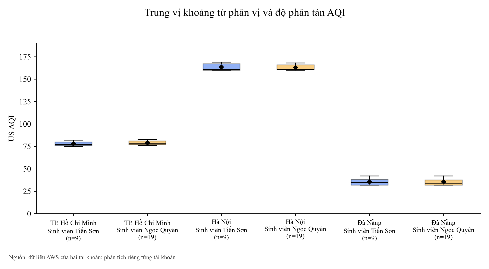

Hình 3.3 Trung vị khoảng tứ phân vị và độ phân tán AQI

Biểu đồ hộp giúp tách trung vị, độ rộng 50% mẫu ở giữa và các cực trị khỏi chỉ số trung bình. P95 dùng nội suy tuyến tính nên có thể không trùng một bản ghi quan trắc. Với n nhỏ và chuỗi lấy mẫu ngắn, P95 chỉ mô tả mẫu hiện có, chưa đại diện cho phân vị dài hạn của đô thị.

### 3.4 Diễn biến tại các giờ có quan trắc

Hình 3.4 Biến thiên AQI tại các giờ thực sự có dữ liệu

Chuỗi thời gian chỉ vẽ ở những giờ có dữ liệu; khoảng thiếu giờ được ngắt đường để không tạo cảm giác có phép đo liên tục. Tài khoản Sơn có 9 giờ quan trắc với một mẫu mỗi đô thị trong mỗi giờ. Tài khoản Quyên có 9 giờ, phần lớn hai mẫu mỗi đô thị trong giờ và có một giờ ba mẫu.

Bảng 3.4 Giờ có AQI trung bình lớn nhất trong mỗi tài khoản

| Đô thị | Tài khoản | Giờ UTC | AQI TB | Mẫu trong giờ |
| --- | --- | --- | --- | --- |
| TP. Hồ Chí Minh | Sơn | 07 | 82,00 | 1 |
| TP. Hồ Chí Minh | Quyên | 06 | 83,00 | 2 |
| Hà Nội | Sơn | 19 | 169,00 | 1 |
| Hà Nội | Quyên | 18 | 168,00 | 2 |
| Đà Nẵng | Sơn | 02 | 42,00 | 1 |
| Đà Nẵng | Quyên | 02 | 42,00 | 3 |

Giờ UTC được trình bày để đối chiếu cùng trường hour trong dữ liệu. Bảng chọn cực đại trong các giờ đã quan trắc, không xác nhận một khung giờ cao điểm ô nhiễm điển hình trong ngày.

### 3.5 Độ phủ và mật độ lấy mẫu

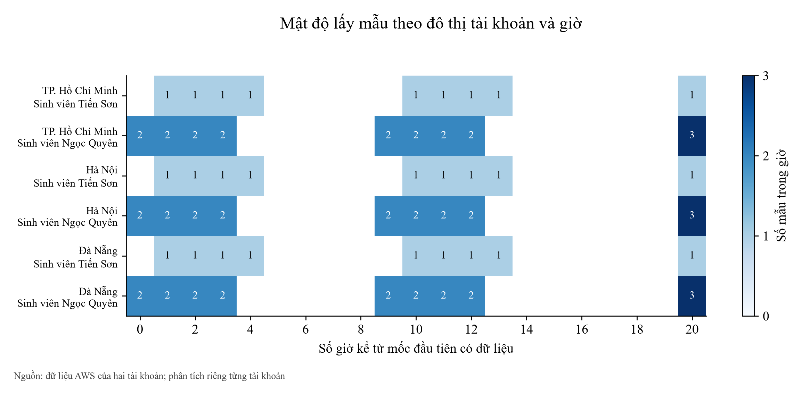

Hình 3.5 Mật độ lấy mẫu theo đô thị tài khoản và giờ

Các ô có số cho biết lượng mẫu thật của đô thị trong một giờ; ô trắng là giờ chưa có mẫu trong phạm vi hình. Hai tài khoản có 7 giờ chung và mỗi tài khoản có 2 giờ không trùng nguồn kia. Chênh lệch tổng 27 so với 57 dòng phản ánh mật độ lấy mẫu, không phải số đô thị khác nhau.

Bộ Tuần 2 mới chỉ có dữ liệu ở hai ngày trong tuần và không đủ 24 nhóm giờ cho từng nguồn. Chúng em giữ các giờ thiếu dưới dạng thiếu dữ liệu, không điền số 0 và không lấy trung bình từ một chuỗi ngày giả định đầy đủ.

### 3.6 Phân bố các cấp chất lượng không khí

Bảng 3.5 Cấp AQI xuất hiện và tỷ lệ mẫu

| Đô thị | Tài khoản | Cấp AQI | Số mẫu | Tỷ lệ % |
| --- | --- | --- | --- | --- |
| Đà Nẵng | Sơn | Good | 9 | 100,0 |
| Hà Nội | Sơn | Unhealthy | 9 | 100,0 |
| TP. Hồ Chí Minh | Sơn | Moderate | 9 | 100,0 |
| Đà Nẵng | Quyên | Good | 19 | 100,0 |
| Hà Nội | Quyên | Unhealthy | 19 | 100,0 |
| TP. Hồ Chí Minh | Quyên | Moderate | 19 | 100,0 |

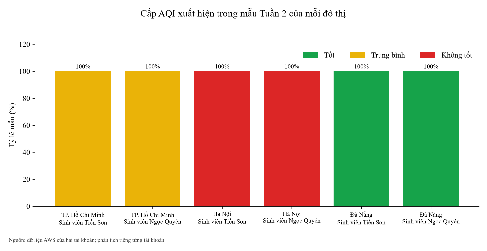

Hình 3.6 Cấp AQI xuất hiện trong mẫu Tuần 2 của mỗi đô thị

Toàn bộ mẫu Đà Nẵng thuộc Good, TP. Hồ Chí Minh thuộc Moderate và Hà Nội thuộc Unhealthy trên cả hai nguồn. Đây là tỷ lệ bản ghi trong tập mẫu. Không diễn giải 100% mẫu thành 100% thời gian trong tuần, vì còn các giờ chưa có dữ liệu.

### 3.7 Tần suất vượt ngưỡng cấu hình cảnh báo

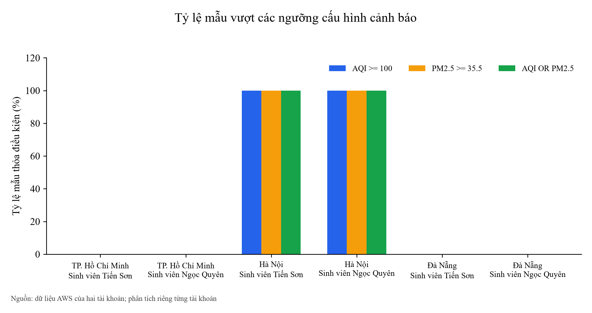

Hình 3.7 Tỷ lệ mẫu vượt các ngưỡng cấu hình cảnh báo

Bảng 3.6 Mẫu thỏa ít nhất một điều kiện cảnh báo

| Đô thị | Tài khoản | Tổng mẫu | Mẫu vượt | Tỷ lệ % |
| --- | --- | --- | --- | --- |
| Đà Nẵng | Sơn | 9 | 0 | 0,0 |
| Hà Nội | Sơn | 9 | 9 | 100,0 |
| TP. Hồ Chí Minh | Sơn | 9 | 0 | 0,0 |
| Đà Nẵng | Quyên | 19 | 0 | 0,0 |
| Hà Nội | Quyên | 19 | 19 | 100,0 |
| TP. Hồ Chí Minh | Quyên | 19 | 0 | 0,0 |

Điều kiện cấu hình là AQI ≥ 100 hoặc PM2.5 ≥ 35,5 µg/m³. Cả 9 và 19 mẫu Hà Nội đồng thời vượt hai ngưỡng; hai đô thị còn lại không có mẫu vượt trong tập Tuần 2. Các ngưỡng là tham số cảnh báo của dự án, không được gọi là giới hạn an toàn của một quy chuẩn y tế.

Số mẫu vượt điều kiện và số thông điệp SNS là hai đại lượng khác nhau: một lần gọi có thể tạo nhiều thông báo, số mẫu phân tích còn phụ thuộc phạm vi thời gian và tệp lưu. Báo cáo không dùng số bản ghi vượt để suy ra số email đã nhận hoặc đã đọc.

### 3.8 So sánh hai tài khoản tại cùng đô thị và giờ

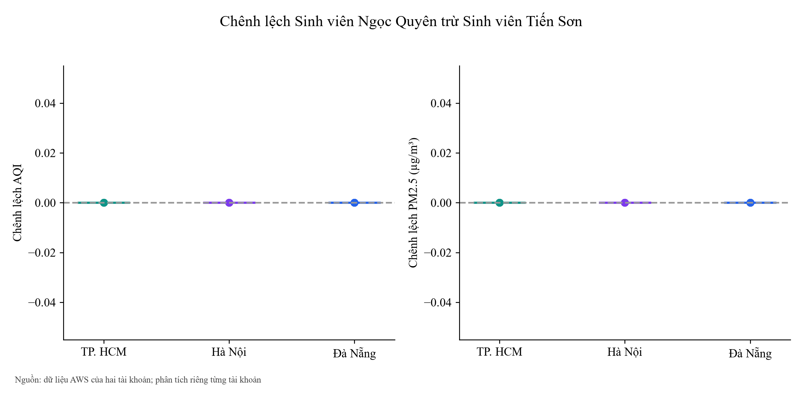

Hình 3.8 Chênh lệch Sinh viên Ngọc Quyên trừ Sinh viên Tiến Sơn

Bảng 3.7 Chênh lệch Quyên trừ Sơn trên các giờ ghép

| Đô thị | Giờ ghép | ΔAQI TB | ΔPM2.5 TB | \|ΔAQI\| max |
| --- | --- | --- | --- | --- |
| TP. Hồ Chí Minh | 7 | 0,00 | 0,00 | 0,00 |
| Hà Nội | 7 | 0,00 | 0,00 | 0,00 |
| Đà Nẵng | 7 | 0,00 | 0,00 | 0,00 |

Mỗi giờ ghép có trọng số như nhau. Cách này tránh để tài khoản có hai hoặc ba dòng trong một giờ tự động có trọng số lớn hơn trong phép đối chiếu. Chênh lệch có thể gắn với thời điểm gọi API khác nhau trong giờ; không coi một tài khoản là phép đo chuẩn để chấm độ chính xác của tài khoản còn lại.

### 3.9 Tương quan Pearson và Spearman

Bảng 3.8 Pearson giữa PM2.5 và khí tượng

| Đô thị | Tài khoản | n | Nhiệt độ | Độ ẩm | Gió |
| --- | --- | --- | --- | --- | --- |
| TP. Hồ Chí Minh | Sơn | 9 | -0,7893 | 0,7744 | -0,4588 |
| TP. Hồ Chí Minh | Quyên | 19 | -0,7462 | 0,7263 | -0,6262 |
| Hà Nội | Sơn | 9 | -0,9918 | 0,9857 | -0,5904 |
| Hà Nội | Quyên | 19 | -0,9685 | 0,9601 | -0,4373 |
| Đà Nẵng | Sơn | 9 | 0,8074 | -0,7121 | 0,1220 |
| Đà Nẵng | Quyên | 19 | 0,8227 | -0,6787 | 0,2080 |

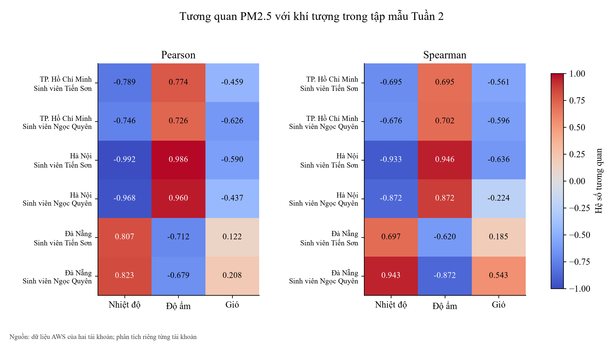

Hình 3.9 Tương quan PM2.5 với khí tượng trong tập mẫu Tuần 2

Tại Hà Nội, Pearson PM2.5 với nhiệt độ lần lượt là −0,9918 và −0,9685; với độ ẩm là 0,9857 và 0,9601. Đà Nẵng có chiều liên hệ nhiệt độ dương trong cả hai nguồn. Spearman kiểm tra sự đồng biến thứ hạng và được tính với hạng trung bình khi có giá trị trùng.

Chuỗi ngắn, mẫu gần nhau theo thời gian và các biến cùng đổi theo giờ có thể tạo hệ số lớn. Chúng em không dùng các hệ số này để chứng minh cơ chế khí quyển, kiểm định nhân quả hoặc khả năng dự báo. CSV giữ cả Pearson, Spearman và n để người đọc đối chiếu.

### 3.10 Quan sát trực tiếp quan hệ nhiệt độ và PM2.5

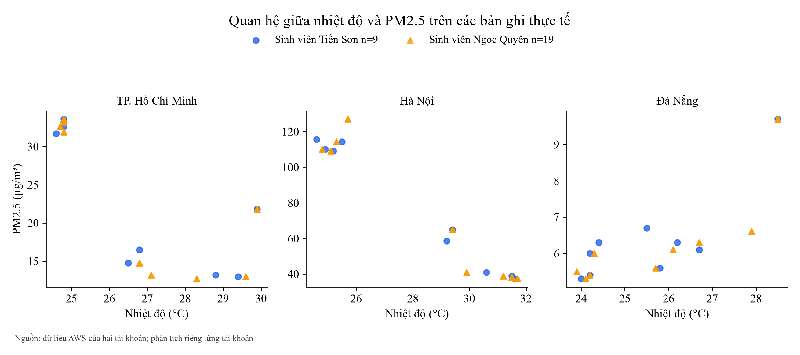

Hình 3.10 Quan hệ giữa nhiệt độ và PM2.5 trên các bản ghi thực tế

Biểu đồ phân tán sử dụng từng bản ghi gốc và tách ba đô thị bằng ba khung. Vị trí điểm giúp nhìn thấy độ phủ nhiệt độ nhỏ của mẫu và các điểm gần nhau trong nguồn Quyên. Trục PM2.5 của các khung được ghi rõ; các khung dùng thang riêng để giữ khả năng đọc từng đô thị.

Việc quan sát điểm gần nhau bổ sung cho hệ số tương quan. Nhiều điểm gần trùng không tạo thêm nhiều trạng thái môi trường khác biệt, do đó số mẫu lớn hơn không tự động chứng minh một nguồn có độ phủ tốt hơn.

### 3.11 Các khí ô nhiễm còn lại

Bảng 3.9 Nồng độ khí trung bình µg/m³

| Đô thị | Tài khoản | CO | NO₂ | SO₂ | O₃ |
| --- | --- | --- | --- | --- | --- |
| TP. Hồ Chí Minh | Sơn | 1.292,22 | 37,74 | 27,18 | 49,89 |
| TP. Hồ Chí Minh | Quyên | 1.248,37 | 35,31 | 27,64 | 56,53 |
| Hà Nội | Sơn | 936,44 | 51,20 | 51,16 | 99,78 |
| Hà Nội | Quyên | 927,16 | 47,71 | 51,44 | 107,21 |
| Đà Nẵng | Sơn | 432,22 | 6,08 | 3,66 | 71,11 |
| Đà Nẵng | Quyên | 461,42 | 5,56 | 3,45 | 74,00 |

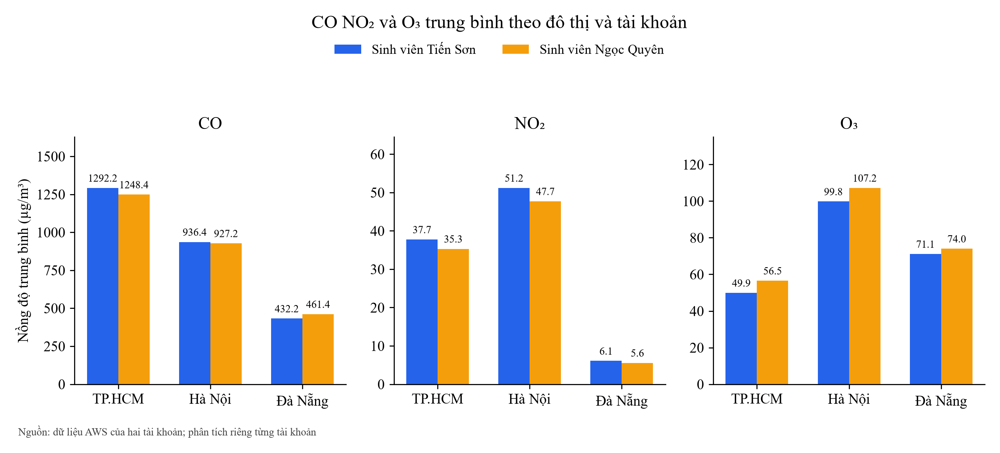

Hình 3.11 CO NO₂ và O₃ trung bình theo đô thị và tài khoản

CO, NO₂, SO₂ và O₃ được lưu với đơn vị µg/m³. Bảng đưa đủ bốn khí; hình lựa chọn CO, NO₂ và O₃ để so sánh mà không trộn các biến khác đơn vị. CSV phân bố thống kê còn chứa độ lệch chuẩn, trung vị, tứ phân vị và cực trị của từng khí cho mỗi tài khoản và đô thị.

### 3.12 So sánh mẫu hai tuần trong lần tải mới

Bảng 3.10 AQI trung bình theo ranh giới hai tuần

| Đô thị | Tài khoản | n Tuần 1 | n Tuần 2 | AQI Tuần 1 | AQI Tuần 2 |
| --- | --- | --- | --- | --- | --- |
| Đà Nẵng | Sơn | 42 | 9 | 65,60 | 35,44 |
| Hà Nội | Sơn | 42 | 9 | 65,74 | 163,56 |
| TP. Hồ Chí Minh | Sơn | 42 | 9 | 111,17 | 78,00 |
| Đà Nẵng | Quyên | 41 | 19 | 63,95 | 35,37 |
| Hà Nội | Quyên | 41 | 19 | 69,10 | 163,05 |
| TP. Hồ Chí Minh | Quyên | 41 | 19 | 112,27 | 79,05 |

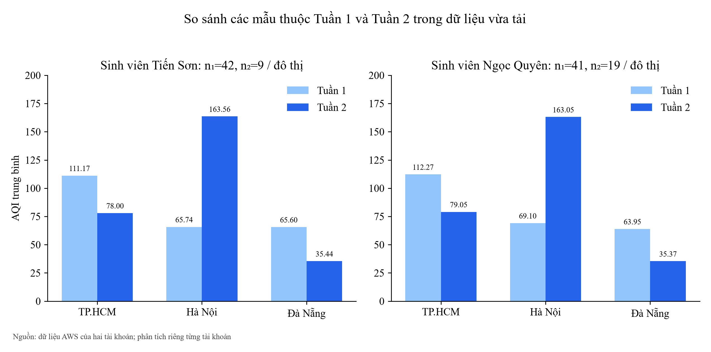

Hình 3.12 So sánh các mẫu thuộc Tuần 1 và Tuần 2 trong dữ liệu vừa tải

Các mẫu thuộc Tuần 1 trong dữ liệu vừa tải có 42 mẫu mỗi đô thị ở nguồn Sơn và 41 ở nguồn Quyên; Tuần 2 có 9 và 19. Mẫu Hà Nội tăng AQI trung bình, còn TP. Hồ Chí Minh và Đà Nẵng giảm trong cả hai nguồn. Đây là so sánh mô tả hai tập mẫu với độ phủ khác nhau, chưa xác lập xu hướng dài hạn.

Bảng này lọc trực tiếp thời gian từ lần tải mới. Nó không thay thế 156 bản ghi của bộ báo cáo Tuần 1 đã nộp, vì phạm vi thời gian và mốc xuất của bộ đó khác phép lọc hiện tại.

## Chương 4 Phân tích vận hành Lambda và SNS

### 4.1 Thời gian thực thi và bộ nhớ Lambda

Bảng 4.1 Thống kê các dòng REPORT thuộc Tuần 2

| Tài khoản | Lượt | Duration TB ms | P95 ms | Max ms | RAM max MB |
| --- | --- | --- | --- | --- | --- |
| Sơn | 9 | 2.638,08 | 3.073,78 | 3.077,11 | 101 |
| Quyên | 19 | 2.703,82 | 3.111,73 | 3.132,36 | 101 |

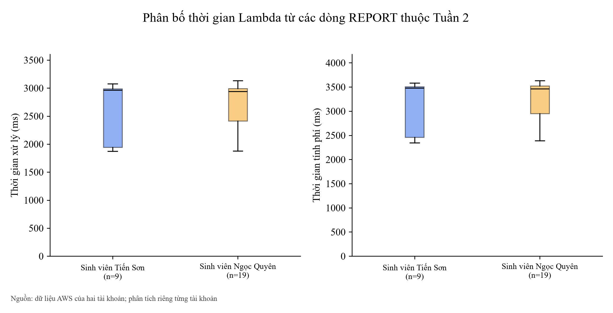

Hình 4.1 Phân bố thời gian Lambda từ các dòng REPORT thuộc Tuần 2

Các dòng REPORT đã đọc gồm 9 lượt của Sơn và 19 lượt của Quyên thuộc Tuần 2. Duration trung bình là 2.638,08 ms và 2.703,82 ms; P95 là 3.073,78 ms và 3.111,73 ms. Max Memory Used lớn nhất là 101 MB trên cấu hình 256 MB, tương ứng 39,45% dung lượng được cấp trong các lượt có log.

Billed Duration được phân tích riêng và không thay thế Duration. Log REPORT mô tả các lượt đã đọc, không chứng minh tất cả các khoảng thời gian của tuần đều có một lượt xử lý. Không nhân số giờ dự kiến với thời gian trung bình để tạo ra chi phí tháng giả định.

### 4.2 Lịch thu thập và thông báo SNS

Bảng 4.2 Số liệu SNS và đăng ký nhận thông báo

| Tài khoản | Đăng ký đã xác nhận | Published | Delivered | Failed |
| --- | --- | --- | --- | --- |
| Sơn | 1 | 59 | 59 | 0 |
| Quyên | 2 | 68 | 136 | 0 |

CloudWatch trả về Published là 59 và 68, Delivered là 59 và 136 trong phạm vi thời gian Tuần 2 đã chọn. Tài khoản Quyên có hai đăng ký email đã xác nhận; một thông điệp có thể có nhiều đích giao, nên Delivered không phải số thông điệp gốc. Chỉ số dịch vụ không xác nhận người nhận đã đọc email.

Các tổng chỉ số được giữ nguyên theo phản hồi AWS. Chúng không được dùng để suy ra số mẫu môi trường, vì phạm vi ghi nhận dịch vụ và thời điểm API thu thập không đồng nhất với từng tệp dữ liệu.

### 4.3 Đối chiếu sự nhất quán của chỉ số vận hành

Bảng 4.3 Invocations và Errors trong dữ liệu trả về

| Tài khoản | Invocations | Errors | Throttles | Tỷ lệ lỗi |
| --- | --- | --- | --- | --- |
| Sơn | 9 | 150 | 0 | Không tính: Errors > Invocations |
| Quyên | 19 | 294 | 0 | Không tính: Errors > Invocations |

AWS trả về Errors bằng 150 và 294, lớn hơn Invocations bằng 9 và 19 trong cùng phạm vi chọn. Các tổng này không thỏa điều kiện để diễn giải Errors/Invocations thành tỷ lệ lỗi của hàm. Báo cáo ghi rõ mâu thuẫn và để tỷ lệ lỗi không xác định, thay vì đưa một phần trăm vượt 100% hoặc tự thay Errors bằng 0.

Trạng thái Alarm hiện là OK, trong khi chuỗi Errors có vấn đề nhất quán. Trạng thái tại một thời điểm và tổng chỉ số qua nhiều giờ là hai nguồn riêng; không dùng một trong hai để suy diễn hệ thống vận hành không có lỗi. CSV giữ tất cả các điểm chỉ số, thống kê, thời gian UTC và tên metric để kiểm tra tiếp.

## Chương 5 Phân tích truy vấn và sử dụng tài nguyên

### 5.1 Đối chứng hiệu quả lọc phân vùng

Bảng 5.1 Dung lượng quét với cùng tập kết quả

| Tài khoản | Bản ghi | Chỉ lọc thời gian byte | Thêm phân vùng byte | Giảm quét % |
| --- | --- | --- | --- | --- |
| Sơn | 27 | 114.736 | 15.193 | 86,76 |
| Quyên | 57 | 129.715 | 32.067 | 75,28 |

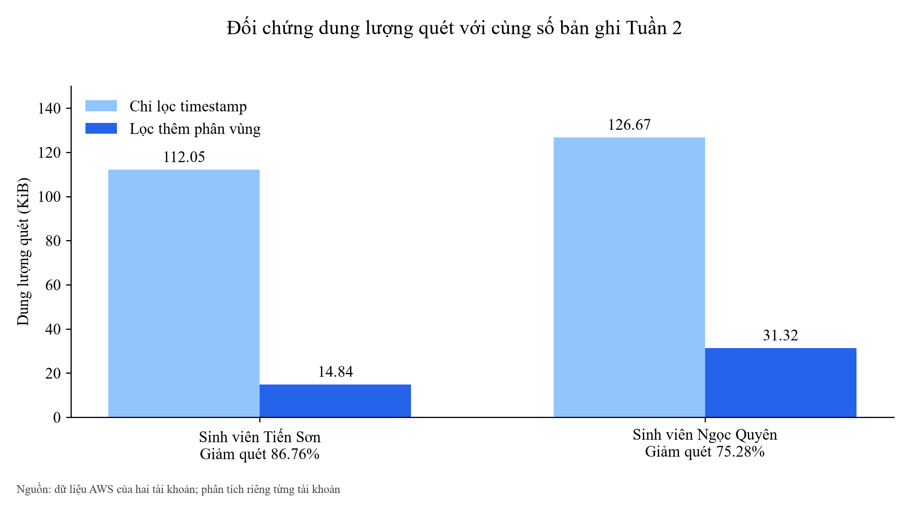

Hình 5.1 Đối chứng dung lượng quét với cùng số bản ghi Tuần 2

Hai truy vấn đối chứng trả cùng số bản ghi Tuần 2 trên từng tài khoản. Tài khoản Sơn giảm byte quét từ 114.736 xuống 15.193, tương ứng 86,76%; Quyên giảm từ 129.715 xuống 32.067, tương ứng 75,28%. Đây là phép đo từ các truy vấn mới có cùng điều kiện thời gian, khác điều kiện khóa phân vùng.

Thời gian engine của truy vấn có thêm phân vùng trong lần đo này là 1.402 ms và 1.194 ms, dài hơn truy vấn chỉ lọc thời gian 1.213 ms và 755 ms. Vì vậy giảm byte quét không đồng nghĩa giảm thời gian ở mọi lượt chạy; đây là một cặp đo trên tập dữ liệu nhỏ.

### 5.2 Hai mươi bốn truy vấn phân tích mới

Bảng 5.2 Kết quả thực thi 12 loại truy vấn trên mỗi tài khoản

| Truy vấn | Dòng Sơn | Dòng Quyên | ms Sơn | ms Quyên |
| --- | --- | --- | --- | --- |
| raw all | 204 | 231 | 953 | 1297 |
| raw week2 | 27 | 57 | 1458 | 1304 |
| city week2 | 3 | 3 | 1127 | 1196 |
| hour city week2 | 27 | 27 | 1513 | 1226 |
| day city week2 | 6 | 6 | 1709 | 1504 |
| category week2 | 3 | 3 | 1113 | 1380 |
| correlation week2 | 3 | 3 | 1326 | 1339 |
| partition all | 6 | 6 | 866 | 800 |
| quality all | 1 | 1 | 908 | 966 |
| scan all count | 1 | 1 | 777 | 898 |
| scan week2 time only | 1 | 1 | 1213 | 755 |
| scan week2 partition | 1 | 1 | 1402 | 1194 |

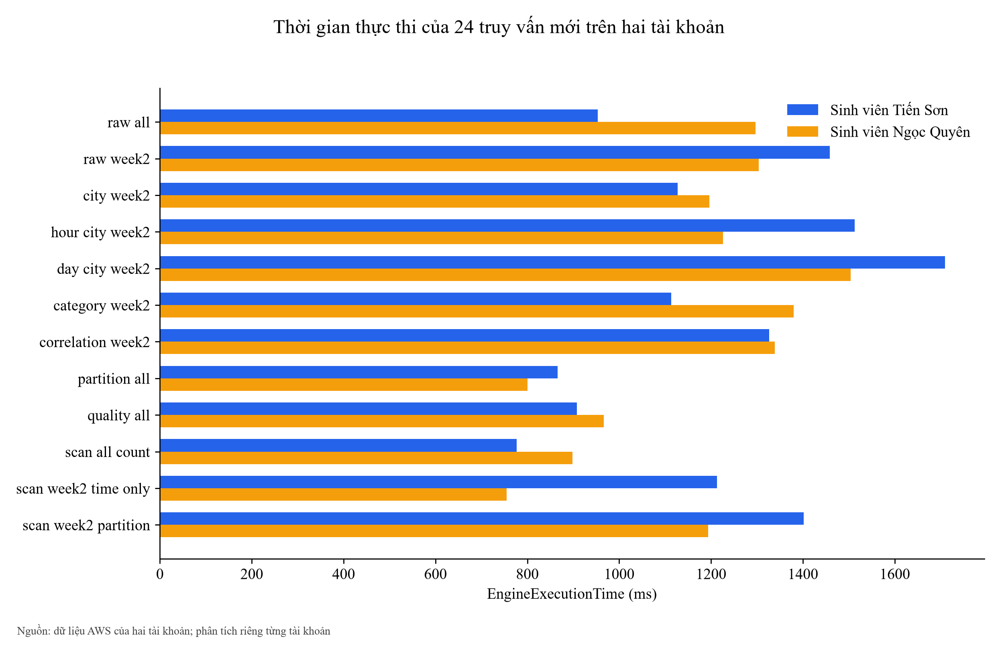

Hình 5.2 Thời gian thực thi của 24 truy vấn mới trên hai tài khoản

Tất cả 24 truy vấn mới đều SUCCEEDED. Các truy vấn bao phủ raw toàn bộ, raw Tuần 2, thống kê đô thị, nhóm giờ, nhóm ngày, cấp AQI, tương quan, phân vùng, chất lượng và ba phép đối chứng dung lượng quét. Mã thực thi và hash tệp CSV được lưu ở manifest của từng tài khoản; không tạo lại trạng thái thực thi giả khi sao chép dữ liệu.

### 5.3 Lịch sử truy vấn và phạm vi lỗi

Bảng 5.3 Lịch sử truy vấn của dự án trước đợt phân tích mới

| Tài khoản | Tổng lượt | SUCCEEDED | FAILED |
| --- | --- | --- | --- |
| Sơn | 52 | 31 | 21 |
| Quyên | 92 | 91 | 1 |

Lịch sử đã đọc gồm 52 lượt ở tài khoản Sơn và 92 ở tài khoản Quyên trước khi chạy 24 truy vấn phân tích mới. Tài khoản Sơn có 21 lượt FAILED, Quyên có 1. Lịch sử có cả truy vấn cấu hình và truy vấn phân tích nên không gọi tỷ lệ lịch sử thành tỷ lệ thành công của bộ truy vấn vừa xuất.

### 5.4 Chi phí từ Cost Explorer

Bảng 5.4 UnblendedCost do Cost Explorer trả về cho phạm vi Tuần 2

| Tài khoản | Giá trị gốc | Đơn vị | Estimated |
| --- | --- | --- | --- |
| Sơn | -0,0000000764 | USD | Có |
| Quyên | 0,0267146366 | USD | Có |

Cost Explorer trả về −0,0000000764 USD cho tài khoản Sơn và 0,0267146366 USD cho tài khoản Quyên trong phạm vi Tuần 2 của lần đọc. Giá trị âm rất nhỏ được giữ nguyên, không đổi thành chi phí dương hoặc bỏ đi. Khi trình bày làm tròn đến cent, cả hai lần lượt xấp xỉ 0,00 USD và 0,03 USD.

Kết quả có cờ Estimated và tổng hợp theo tài khoản, dịch vụ, ngày; không phải hóa đơn cuối cùng hay chi phí được phân bổ riêng bằng tag dự án. Dữ liệu chi tiết không bị thay thế bằng dự báo chi phí tháng. Các dịch vụ, đơn vị và cờ ước tính được giữ trong CSV để đối chiếu.

## Chương 6 Tổng hợp kết quả Tuần 2

### 6.1 Sản phẩm dữ liệu và phân tích

Bảng 6.1 Sản phẩm đi kèm và phạm vi

| Sản phẩm | Nội dung |
| --- | --- |
| Dữ liệu nguồn | 435 bản ghi raw từ hai tài khoản; CSV riêng mỗi nguồn và bản sao tệp NDJSON. |
| Mẫu Tuần 2 | 84 dòng nguồn: 27 của Sơn và 57 của Quyên; phân tích riêng tài khoản. |
| Kết quả truy vấn | 24 truy vấn mới thành công; CSV gốc, mã thực thi và metadata theo nguồn. |
| Phân tích | 24 CSV tổng hợp và đối chiếu về môi trường, chất lượng, dịch vụ, truy vấn và chi phí. |
| Trực quan hóa | 16 biểu đồ được dựng từ các CSV tương ứng; cùng dữ liệu trong Excel và báo cáo. |
| Báo cáo | Word có mục lục liên kết và bản PDF đã kiểm tra bố cục. |

### 6.2 Kết luận trong phạm vi mẫu đã thu thập

Dữ liệu Tuần 2 của cả hai tài khoản cùng cho thấy Hà Nội có AQI và PM2.5 cao nhất trong ba đô thị; các mẫu Hà Nội đều thỏa ngưỡng cảnh báo của dự án. Đà Nẵng có AQI thấp nhất, TP. Hồ Chí Minh nằm giữa. Phân bố, trung vị, biến thiên theo giờ và đối chiếu ghép giờ giúp giải thích kết quả trung bình mà không gộp trùng dữ liệu lịch sử.

Tập mẫu mới bao phủ hai ngày và 9 giờ quan trắc riêng mỗi tài khoản, vì vậy các kết quả được giới hạn trong phần dữ liệu đã có của Tuần 2. Các hệ số tương quan lớn không chứng minh quan hệ nhân quả. Lọc phân vùng đã giảm byte quét trong phép đối chứng, còn thời gian engine vẫn cần đọc theo từng lượt cụ thể.

Chúng em đã đối chiếu số liệu môi trường với S3 và Athena, đọc trạng thái lịch, SNS, Lambda và các chỉ số vận hành. Các mâu thuẫn giữa Errors và Invocations được giữ rõ trong báo cáo; mã source trên máy được phân biệt với mã đang triển khai. Phân công và thời gian 19,5 giờ của nhóm được ghi thống nhất trong nhật ký và báo cáo.
