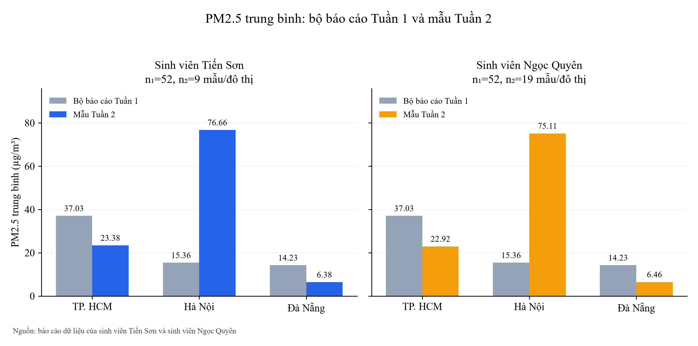
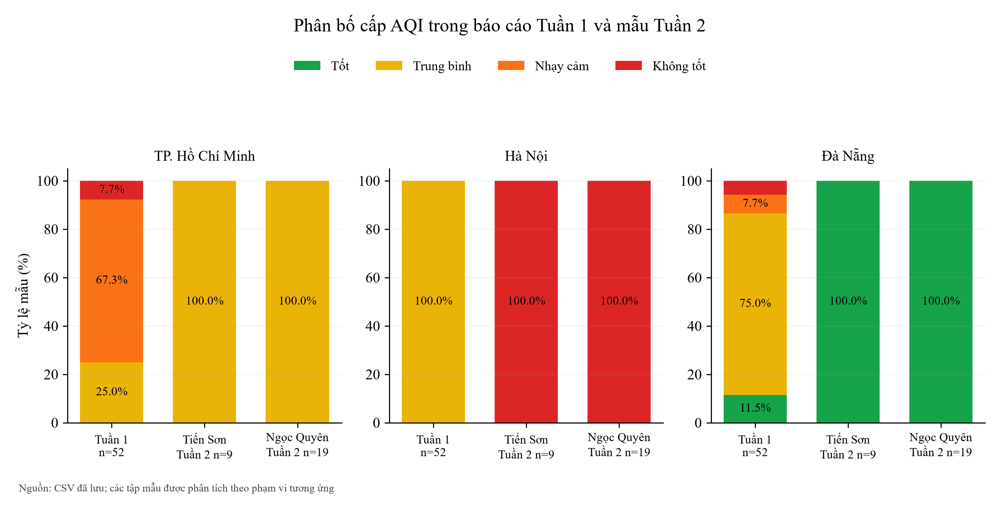
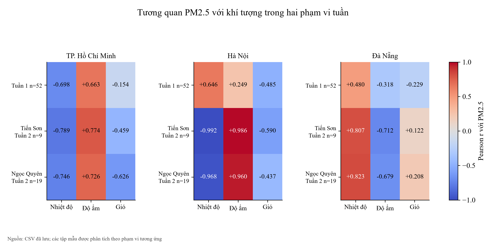

# Báo cáo Tuần 2 từ hai bộ báo cáo dữ liệu của nhóm

## TÓM TẮT

Báo cáo Tuần 2 tổng hợp hai bộ báo cáo dữ liệu do sinh viên Tiến Sơn và sinh viên Ngọc Quyên cung cấp về thời tiết, chất lượng không khí và kết quả vận hành hệ thống AWS Learner Lab. Chúng em sử dụng các tệp raw trên S3, kết quả truy vấn Athena và chỉ số dịch vụ để trình bày số liệu theo từng nguồn.

Hai bộ báo cáo dữ liệu gồm 435 bản ghi: 204 trong bộ của sinh viên Tiến Sơn và 231 trong bộ của sinh viên Ngọc Quyên. Theo ranh giới tuần ở Việt Nam quy đổi sang UTC, mẫu Tuần 2 có 27 và 57 lượt ghi gốc. Khi nhóm theo đô thị và giờ UTC, mỗi sinh viên có 27 nhóm, trong đó 21 nhóm cùng giờ được dùng để đối chiếu trực tiếp. Các thống kê theo lượt ghi gốc được trình bày riêng theo từng sinh viên.

Hà Nội có AQI trung bình Tuần 2 đạt 163,56 và 163,05; TP. Hồ Chí Minh đạt 78,00 và 79,05; Đà Nẵng đạt 35,44 và 35,37. Báo cáo trình bày 20 biểu đồ từ dữ liệu thực tế, 24 truy vấn Athena mới thành công, phân bố mẫu, biến thiên theo giờ, ngưỡng cảnh báo, tương quan khí tượng và mức sử dụng tài nguyên. Các kết luận giới hạn trong mẫu đã thu thập.

## LỜI MỞ ĐẦU

Học phần Điện toán đám mây giúp chúng em vận dụng các dịch vụ quản lý trên AWS vào một luồng dữ liệu cụ thể. Bài toán thời tiết và chất lượng không khí cho phép theo dõi quá trình từ thu thập qua API, chuẩn hóa bản ghi, lưu trữ đến truy vấn và trình bày kết quả.

Báo cáo trình bày chức năng hệ thống, dữ liệu và kết quả phân tích Tuần 2 từ hai bộ báo cáo dữ liệu của sinh viên Tiến Sơn và sinh viên Ngọc Quyên. Word, PDF, bảng và biểu đồ Excel sử dụng cùng các tệp CSV đã đối chiếu. Kho dự án: [https://github.com/JasonTM17/WeatherAWS_FinalTerm](https://github.com/JasonTM17/WeatherAWS_FinalTerm). Hồ sơ kèm theo: [Tuần 1](https://github.com/JasonTM17/WeatherAWS_FinalTerm/tree/main/tuan_1), [Tuần 2](https://github.com/JasonTM17/WeatherAWS_FinalTerm/tree/main/tuan_2) và [Nhật ký Tuần 2](https://github.com/JasonTM17/WeatherAWS_FinalTerm/blob/main/tuan_2/docs/WORKLOG.md).

Đề tài được thực hiện bởi nhóm sinh viên:

- Nguyễn Tiến Sơn — MSSV 24110054: S3, Secrets Manager, Lambda và SNS.

- Trần Thị Ngọc Quyên — MSSV 24110051: Glue, Athena, biểu đồ và đối chiếu dữ liệu.

Báo cáo gồm bảy chương: phạm vi hệ thống và phân công; nguồn dữ liệu và phương pháp phân tích; dữ liệu môi trường; vận hành Lambda và SNS; truy vấn và sử dụng tài nguyên; giải thích mã nguồn gắn với kết quả; tổng hợp kết quả Tuần 2.

## Chương 1 Phạm vi và hệ thống thực hành Tuần 2

### 1.1 Mục tiêu và phạm vi số liệu

Chúng em tiếp tục phân tích luồng thu thập thời tiết và chất lượng không khí cho TP. Hồ Chí Minh, Hà Nội và Đà Nẵng. Tuần 2 tập trung vào hoạt động của các dịch vụ, dữ liệu mới theo thời gian quan trắc và các phép phân tích có thể tái lập từ tệp xuất. Dữ liệu Open-Meteo được cung cấp qua API và dựa trên mô hình, không được coi là phép đo trực tiếp của một trạm.

Hai bộ báo cáo dữ liệu được thu thập trên hệ thống AWS tại us-east-1 của từng sinh viên. Mỗi bộ gồm các tệp raw của dự án và kết quả của 12 truy vấn SELECT. Bộ dữ liệu Tuần 1 đã lưu được giữ nguyên; số liệu Tuần 2 lấy từ lần đọc dịch vụ và truy vấn mới. Thời điểm xuất và mã truy vấn được lưu cùng dữ liệu để đối chiếu.

### 1.2 Phân công và thời gian thực hiện

Bảng 1.1 Phân công và số giờ đã được nhóm xác nhận

| Thành viên | Phụ trách chính | Phối hợp | Giờ |
| --- | --- | --- | --- |
| Nguyễn Tiến Sơn 24110054 | S3, Secrets Manager, Lambda và SNS. | Kiến trúc, tích hợp, phân tích và báo cáo. | 10,0 |
| Trần Thị Ngọc Quyên 24110051 | Glue, Athena, biểu đồ và đối chiếu dữ liệu. | Kiến trúc, tích hợp, phân tích và báo cáo. | 9,5 |

Tổng thời gian nhóm đã xác nhận cho Tuần 2 là 19,5 giờ. Hai thành viên cùng đối chiếu nguồn dữ liệu, cách tính thống kê và các sản phẩm báo cáo. Phân công này thống nhất với nhật ký công việc của nhóm.

### 1.3 Kiến trúc và luồng xử lý

Hình 1.1 Kiến trúc và luồng dữ liệu của hệ thống

EventBridge kích hoạt Lambda. Hàm đọc cấu hình, gọi hai nguồn Open-Meteo, chuẩn hóa các trường và ghi NDJSON vào S3 theo phân vùng. SNS tiếp nhận thông báo khi thỏa ngưỡng cấu hình. Glue quản lý lược đồ và phân vùng; Athena đọc S3 để tạo các bảng phân tích. CloudWatch lưu chỉ số và log thời gian thực thi.

### 1.4 Trạng thái dịch vụ trong dữ liệu Tuần 2

Bảng 1.2 Cấu hình và trạng thái hệ thống trong hai báo cáo dữ liệu

| Nội dung | Sinh viên Tiến Sơn | Sinh viên Ngọc Quyên |
| --- | --- | --- |
| Lambda | Active; Python 3.12; 256 MB; 60 giây. | Active; Python 3.12; 256 MB; 60 giây. |
| Lịch mỗi giờ | 1 quy tắc ENABLED. | 2 quy tắc ENABLED. |
| Đăng ký email SNS | 1 đăng ký đã xác nhận. | 2 đăng ký đã xác nhận. |
| CloudWatch Alarm | OK tại thời điểm đọc. | OK tại thời điểm đọc. |
| Glue Catalog | 6 phân vùng trong bảng raw. | 6 phân vùng trong bảng raw. |

Báo cáo dữ liệu của sinh viên Ngọc Quyên ghi nhận WeatherCollectionHourlyRule và WeatherCollectionSchedule cùng bật với chu kỳ rate(1 hour); báo cáo của sinh viên Tiến Sơn ghi nhận WeatherCollectionSchedule. Trạng thái bật chỉ mô tả cấu hình tại lần đọc. Danh sách lịch và số mẫu được dùng để giải thích mật độ thu thập của từng bộ dữ liệu.

## Chương 2 Nguồn dữ liệu và phương pháp phân tích

### 2.1 Toàn bộ dữ liệu và mẫu thuộc Tuần 2

Bảng 2.1 Quy mô dữ liệu gốc và số nhóm theo đô thị, giờ UTC

| Sinh viên | Tổng dòng raw | Lượt ghi Tuần 2 | Giờ có dữ liệu | Nhóm đô thị–giờ | Nhóm chung |
| --- | --- | --- | --- | --- | --- |
| Tiến Sơn | 204 | 27 | 9 | 27 | 21 |
| Ngọc Quyên | 231 | 57 | 9 | 27 | 21 |

Hình 2.1 Số lượt ghi gốc trong hai bộ dữ liệu

Trong Tuần 2, sinh viên Tiến Sơn có 27 lượt ghi gốc; sinh viên Ngọc Quyên có 57. Ở bộ của sinh viên Ngọc Quyên, 24 nhóm đô thị–giờ được ghi hai lần và ba nhóm được ghi ba lần. Các lượt cùng nhóm có 11 chỉ số môi trường dạng số và cấp AQI bằng nhau, dù mã và giây ghi nhận khác. Gộp theo đô thị–giờ còn 27 nhóm mỗi sinh viên, gồm 21 nhóm chung để đối chiếu. Hình 2.1 thể hiện lượt ghi gốc; Bảng 2.1 thể hiện cả số nhóm.

Ranh giới tuần được xác định theo UTC+7, sau đó đổi sang UTC để lọc timestamp_utc. Các thời điểm AWS có múi giờ được chuẩn hóa về UTC trước khi so sánh. Phân vùng S3 dùng ngày UTC, nên điều kiện trên phân vùng được kết hợp với điều kiện timestamp để giữ đúng phạm vi.

### 2.2 Cấu trúc và chất lượng bản ghi

Dữ liệu xuất từ Athena gồm 23 cột, tương ứng 20 cột thường và ba khóa phân vùng year, month, day. Các cột mô tả nhận diện, tọa độ, thời gian UTC và Việt Nam, yếu tố khí tượng, nồng độ ô nhiễm, chỉ số AQI và cấp AQI. CSV giữ một dòng cho một bản ghi; không thêm tiêu đề trang trí hoặc thay đổi giá trị raw.

Bảng 2.2 Đối chiếu chất lượng trong tập Tuần 2

| Sinh viên | Bản ghi | Trường số | NULL hoặc không hữu hạn | Giá trị 0 |
| --- | --- | --- | --- | --- |
| Tiến Sơn | 27 | 11 | 0 | 0 |
| Ngọc Quyên | 57 | 11 | 0 | 0 |

Trong 11 trường số kiểm tra của mẫu Tuần 2, không có NULL, giá trị không hữu hạn hoặc số 0. Kết quả này mô tả giá trị đã lưu; nó không chứng minh nguồn API chưa từng thiếu dữ liệu, vì mã nguồn có nhánh chuyển đầu vào không hợp lệ sang giá trị mặc định. Không ghi đè bản ghi gốc trong quá trình phân tích.

### 2.3 Hai bộ báo cáo dữ liệu của nhóm

Chúng em trình bày hai bộ báo cáo dữ liệu do sinh viên Tiến Sơn và sinh viên Ngọc Quyên cung cấp. Mỗi bộ giữ riêng mã bản ghi, đô thị, thời gian quan trắc và các chỉ số môi trường. Có 144 quan trắc lịch sử cùng đô thị và thời điểm xuất hiện trong cả hai bộ, với giá trị môi trường tương ứng bằng nhau; các thống kê được tính riêng cho từng bộ dữ liệu.

Đối chiếu số liệu Tuần 2 dựa trên bảng nhóm giờ gồm 27 dòng cho mỗi sinh viên tại hourly_city.csv. Trong đó có 21 nhóm cùng đô thị và giờ UTC, tương ứng bảy giờ chung cho mỗi đô thị. Chênh lệch được tính bằng giá trị của sinh viên Ngọc Quyên trừ giá trị của sinh viên Tiến Sơn, với trọng số mỗi giờ như nhau. Các thống kê mô tả theo lượt ghi gốc ở những bảng khác vẫn giữ riêng 27 và 57 dòng nguồn.

### 2.4 Các đại lượng và cách diễn giải

Bảng 2.3 Cách tính các nhóm chỉ số

| Chỉ số | Cách tính và phạm vi |
| --- | --- |
| Trung bình, cực trị | Tính riêng từng bộ dữ liệu và đô thị trên mẫu Tuần 2. |
| Độ lệch chuẩn | Độ lệch chuẩn mẫu với mẫu số n−1; không phải khoảng tin cậy. |
| Trung vị, Q1, Q3, P95 | Nội suy tuyến tính trên các giá trị đã sắp xếp. |
| Tỷ lệ cấp và vượt ngưỡng | Số mẫu thỏa điều kiện chia tổng mẫu của cùng đô thị và bộ dữ liệu. |
| Pearson và Spearman | Liên hệ tuyến tính và liên hệ thứ hạng; không suy ra quan hệ nhân quả. |
| Chi phí và chỉ số dịch vụ | Giữ đúng nguồn AWS, phạm vi thời gian, đơn vị và trạng thái Estimated. |

### 2.5 Thiết kế chức năng thu thập bằng Lambda

Mã nguồn Lambda được tổ chức thành các nhóm chức năng: đọc cấu hình, chuyển đổi kiểu, gọi API, phân loại AQI, thu thập hiện tại hoặc lịch sử, kiểm tra ngưỡng, gửi SNS và ghi S3. Mỗi đô thị có hai lượt gọi API: chất lượng không khí và thời tiết. Các biến môi trường chỉ định bucket, tên secret và topic; LabRole cung cấp quyền thực thi trong Learner Lab.

Cấu hình weather/api_config quản lý tọa độ ba đô thị và ngưỡng cảnh báo. Khi đọc cấu hình thất bại, mã nguồn có nhánh dự phòng và ghi log. Các hàm chuyển đổi dùng mặc định khi dữ liệu không hợp lệ; vì thế việc đánh giá chất lượng CSV phân biệt số 0 với dữ liệu thiếu. Các khoảng phân loại AQI được xác định trong mã nguồn; nhãn cấp AQI đi cùng chỉ số trong bản ghi.

Mã nguồn ghép chuỗi lịch sử khí tượng và AQI theo timestamp, kiểm tra độ dài mảng trước khi đọc, phát sinh lỗi khi không thu được bản ghi và ghi rõ trạng thái thu thập một phần khi chỉ một số đô thị thất bại.

Bảng 2.4 Đầu vào và đầu ra của các nhóm xử lý

| Nhóm chức năng | Đầu vào | Đầu ra |
| --- | --- | --- |
| Cấu hình | Secret và biến môi trường. | Vị trí, ngưỡng và đích lưu/gửi. |
| Thu thập hiện tại | Hai API cho từng đô thị. | Giá trị AQI, khí tượng và nồng độ khí. |
| Chuỗi lịch sử | Các mảng có timestamp của hai API. | Bản ghi ghép theo thời điểm. |
| Cảnh báo | AQI ≥ 100 hoặc PM2.5 ≥ 35,5. | Phản hồi gửi thông điệp SNS. |
| Lưu trữ | Bản ghi 23 trường. | NDJSON trong phân vùng ngày UTC. |

### 2.6 Lược đồ bản ghi và truy vấn dữ liệu

Bảng 2.5 Lược đồ 23 trường của bản ghi

| Trường | Kiểu | Đơn vị | Ý nghĩa |
| --- | --- | --- | --- |
| record_id | string | — | Mã bản ghi |
| city | string | — | Thành phố |
| latitude | double | ° | Vĩ độ |
| longitude | double | ° | Kinh độ |
| timestamp_utc | string | UTC | Thời điểm quan trắc |
| timestamp_vn | string | UTC+7 | Thời điểm ở Việt Nam |
| temperature_2m | double | °C | Nhiệt độ |
| relative_humidity_2m | double | % | Độ ẩm tương đối |
| surface_pressure | double | hPa | Áp suất bề mặt |
| wind_speed_10m | double | km/h | Tốc độ gió |
| pm2_5 | double | µg/m³ | Bụi PM2.5 |
| pm10 | double | µg/m³ | Bụi PM10 |
| carbon_monoxide | double | µg/m³ | CO |
| nitrogen_dioxide | double | µg/m³ | NO₂ |
| sulphur_dioxide | double | µg/m³ | SO₂ |
| ozone | double | µg/m³ | O₃ |
| us_aqi | int | AQI | Chỉ số chất lượng không khí |
| aqi_category | string | — | Nhãn phân loại AQI |
| hour | int | 0–23 | Giờ UTC |
| collected_at | string | ISO 8601 | Mốc ghi nhận |
| year | string | — | Phân vùng năm |
| month | string | — | Phân vùng tháng |
| day | string | — | Phân vùng ngày |

Athena dùng bảng ngoài weather_airquality_records và view vietnam_weather_aqi trong weather_aqi_db. Lược đồ khai báo 20 cột thường và 3 khóa phân vùng; Glue giữ metadata, còn các bản ghi nằm trên S3. Truy vấn hiện tại đọc các phân vùng đã có và kết hợp điều kiện timestamp để lọc đúng ranh giới tuần.

### 2.7 Quyền kích hoạt và điều kiện gửi thông báo

Quy tắc EventBridge trỏ đến WeatherCollectorLambda; chính sách tài nguyên cho phép events.amazonaws.com gọi lambda:InvokeFunction với giới hạn ARN nguồn. Báo cáo dữ liệu của sinh viên Tiến Sơn ghi nhận một lịch đang bật, báo cáo của sinh viên Ngọc Quyên ghi nhận hai lịch. Các cấu hình này được giữ theo trạng thái thực tế tại lần đọc.

SNS topic weather-airquality-alerts nhận thông điệp có đô thị, thời điểm, AQI, cấp phân loại, PM2.5, PM10 và yếu tố khí tượng. Đăng ký email cần được người nhận xác nhận. Hai báo cáo dữ liệu ghi nhận lần lượt một và hai đăng ký đã xác nhận trong môi trường AWS của sinh viên Tiến Sơn và sinh viên Ngọc Quyên. Delivered mô tả giao tới đích dịch vụ, không xác nhận người nhận đã đọc thư.

### 2.8 Dữ liệu gốc và đối chiếu bản ghi Tuần 2

Bộ dữ liệu gốc dùng cho phân tích Tuần 2 được lấy từ raw_week2.csv của từng sinh viên. Mỗi tệp giữ 23 trường và ba đô thị. Sinh viên Tiến Sơn có 27 bản ghi, sinh viên Ngọc Quyên có 57 bản ghi. Các tệp toàn bộ còn chứa dữ liệu lịch sử, nên số dòng toàn bộ được phân biệt với số dòng thuộc Tuần 2.

Bảng 2.6 Đối chiếu quy mô CSV dữ liệu gốc

| Sinh viên | CSV toàn bộ (dòng) | CSV Tuần 2 (dòng) | Mỗi đô thị Tuần 2 | Trường gốc |
| --- | --- | --- | --- | --- |
| Sinh viên Tiến Sơn | 204 | 27 | 9 | 23 |
| Sinh viên Ngọc Quyên | 231 | 57 | 19 | 23 |

Phép đối chiếu số dòng cho kết quả 27 = 9 + 9 + 9 và 57 = 19 + 19 + 19 theo ba đô thị, tổng cộng 84 bản ghi Tuần 2. Các bảng và biểu đồ Chương 3 sử dụng đúng 9 và 19 mẫu mỗi đô thị của từng sinh viên. Mã dòng TS-001 đến TS-027 và NQ-001 đến NQ-057 chỉ là số thứ tự trình bày, liên kết với record_id gốc trong phụ lục; không thay thế mã bản ghi.

Bảng 2.7 Trích sáu bản ghi gốc Tuần 2

| Mã dòng | Đô thị | Thời điểm UTC | Thời điểm Việt Nam | US AQI | PM2.5 µg/m³ | PM10 µg/m³ |
| --- | --- | --- | --- | --- | --- | --- |
| TS-019 | TP. Hồ Chí Minh | 2026-10-13 07:15:45 | 2026-10-13 14:15:45 | 82 | 13.0 | 13.3 |
| TS-010 | Hà Nội | 2026-10-13 07:15:45 | 2026-10-13 14:15:45 | 161 | 37.3 | 38.3 |
| TS-001 | Đà Nẵng | 2026-10-13 07:15:46 | 2026-10-13 14:15:46 | 35 | 6.3 | 8.6 |
| NQ-039 | TP. Hồ Chí Minh | 2026-10-13 06:51:03 | 2026-10-13 13:51:03 | 83 | 12.7 | 13.0 |
| NQ-020 | Hà Nội | 2026-10-13 06:51:03 | 2026-10-13 13:51:03 | 161 | 38.3 | 39.3 |
| NQ-001 | Đà Nẵng | 2026-10-13 06:51:04 | 2026-10-13 13:51:04 | 34 | 6.6 | 9.0 |

Bảng 2.7 trích bản ghi đầu tiên trong CSV của mỗi đô thị và mỗi sinh viên để minh họa cấu trúc dữ liệu. Phụ lục dữ liệu gốc cuối báo cáo trình bày đầy đủ 84 bản ghi và tất cả 23 trường, gồm định danh, tọa độ, thời gian, khí tượng, chất lượng không khí và phân vùng. Các giá trị được chép nguyên từ CSV, không lấy trung bình hoặc làm tròn lại. Giờ UTC, giờ Việt Nam và collected_at được giữ riêng để đối chiếu thời điểm quan trắc và thời điểm ghi nhận.

## Chương 3 Phân tích dữ liệu môi trường Tuần 2

### 3.1 So sánh AQI theo đô thị

Bảng 3.1 AQI trung bình và độ phân tán

| Đô thị | Sinh viên | n | TB | SD | Min | Max |
| --- | --- | --- | --- | --- | --- | --- |
| TP. Hồ Chí Minh | Tiến Sơn | 9 | 78,00 | 2,45 | 75 | 82 |
| TP. Hồ Chí Minh | Ngọc Quyên | 19 | 79,05 | 2,34 | 76 | 83 |
| Hà Nội | Tiến Sơn | 9 | 163,56 | 3,84 | 160 | 169 |
| Hà Nội | Ngọc Quyên | 19 | 163,05 | 3,14 | 160 | 168 |
| Đà Nẵng | Tiến Sơn | 9 | 35,44 | 3,54 | 32 | 42 |
| Đà Nẵng | Ngọc Quyên | 19 | 35,37 | 3,61 | 32 | 42 |

Hình 3.1 AQI trung bình và độ lệch chuẩn của mẫu Tuần 2

Hà Nội có AQI trung bình cao nhất: 163,56 ở bộ dữ liệu của sinh viên Tiến Sơn và 163,05 ở bộ dữ liệu của sinh viên Ngọc Quyên; Đà Nẵng thấp nhất. Thanh sai số biểu diễn SD của mẫu. Mỗi đô thị có 9 và 19 bản ghi, nhưng mỗi nguồn chỉ gồm 9 nhóm giờ; các dòng gần nhau có thể phản ánh cùng trạng thái API, nên không mặc nhiên xem là mẫu độc lập.

### 3.2 Nồng độ PM2.5 và PM10

Bảng 3.2 Bụi và khí tượng trung bình

| Đô thị | Sinh viên | PM2.5 | PM10 | Nhiệt độ °C | Độ ẩm % |
| --- | --- | --- | --- | --- | --- |
| TP. Hồ Chí Minh | Tiến Sơn | 23,38 | 24,69 | 26,71 | 87,89 |
| TP. Hồ Chí Minh | Ngọc Quyên | 22,92 | 24,09 | 26,92 | 86,68 |
| Hà Nội | Tiến Sơn | 76,66 | 78,52 | 28,06 | 74,22 |
| Hà Nội | Ngọc Quyên | 75,11 | 76,95 | 28,35 | 72,89 |
| Đà Nẵng | Tiến Sơn | 6,38 | 8,56 | 25,50 | 90,56 |
| Đà Nẵng | Ngọc Quyên | 6,46 | 8,66 | 25,86 | 88,53 |

Hình 3.2 PM2.5 và PM10 trung bình theo đô thị và nguồn dữ liệu

PM2.5 trung bình tại Hà Nội là 76,66 và 75,11 µg/m³, trong khi TP. Hồ Chí Minh khoảng 23 µg/m³ và Đà Nẵng khoảng 6,4 µg/m³. PM10 cao hơn PM2.5 trong cả sáu nhóm. Các đơn vị nồng độ được giữ riêng với chỉ số AQI; không so sánh chiều cao cột của hai đại lượng khác đơn vị trên cùng trục.

### 3.3 Trung vị, tứ phân vị và P95

Bảng 3.3 Các phân vị AQI trong từng tập mẫu

| Đô thị | Sinh viên | Q1 | Trung vị | Q3 | P95 | IQR |
| --- | --- | --- | --- | --- | --- | --- |
| Đà Nẵng | Tiến Sơn | 32,00 | 35,00 | 38,00 | 40,40 | 6,00 |
| Hà Nội | Tiến Sơn | 160,00 | 161,00 | 167,00 | 168,60 | 7,00 |
| TP. Hồ Chí Minh | Tiến Sơn | 76,00 | 77,00 | 80,00 | 81,60 | 4,00 |
| Đà Nẵng | Ngọc Quyên | 32,00 | 34,00 | 37,50 | 42,00 | 5,50 |
| Hà Nội | Ngọc Quyên | 160,50 | 161,00 | 166,00 | 168,00 | 5,50 |
| TP. Hồ Chí Minh | Ngọc Quyên | 77,00 | 78,00 | 81,00 | 83,00 | 4,00 |

Hình 3.3 Trung vị, khoảng tứ phân vị và độ phân tán AQI

Biểu đồ hộp thể hiện trung vị, khoảng tứ phân vị và cực trị của mẫu. P95 được tính bằng nội suy tuyến tính giữa các giá trị quan trắc. Với cỡ mẫu nhỏ và chuỗi lấy mẫu ngắn, P95 mô tả tập mẫu hiện có, chưa đại diện cho phân vị dài hạn của đô thị.

### 3.4 Diễn biến tại các giờ có quan trắc

Hình 3.4 Biến thiên AQI tại các giờ thực sự có dữ liệu

Chuỗi thời gian thể hiện các giờ có dữ liệu và ngắt đường tại khoảng thiếu giờ. Báo cáo dữ liệu của sinh viên Tiến Sơn có 9 giờ quan trắc, mỗi giờ một mẫu cho mỗi đô thị. Báo cáo của sinh viên Ngọc Quyên có 9 giờ, phần lớn hai mẫu mỗi đô thị trong giờ và một giờ ba mẫu.

Bảng 3.4 Giờ có AQI trung bình lớn nhất trong bộ dữ liệu của từng sinh viên

| Đô thị | Sinh viên | Giờ UTC | AQI TB | Mẫu trong giờ |
| --- | --- | --- | --- | --- |
| TP. Hồ Chí Minh | Tiến Sơn | 07 | 82,00 | 1 |
| TP. Hồ Chí Minh | Ngọc Quyên | 06 | 83,00 | 2 |
| Hà Nội | Tiến Sơn | 19 | 169,00 | 1 |
| Hà Nội | Ngọc Quyên | 18 | 168,00 | 2 |
| Đà Nẵng | Tiến Sơn | 02 | 42,00 | 1 |
| Đà Nẵng | Ngọc Quyên | 02 | 42,00 | 3 |

Giờ UTC được trình bày để đối chiếu cùng trường hour trong dữ liệu. Bảng chọn cực đại trong các giờ đã quan trắc, không xác nhận một khung giờ cao điểm ô nhiễm điển hình trong ngày.

### 3.5 Độ phủ và mật độ lấy mẫu

Hình 3.5 Mật độ lấy mẫu theo đô thị, sinh viên và giờ

Các ô có số thể hiện lượng mẫu của từng đô thị trong một giờ; ô trắng là giờ chưa có mẫu trong phạm vi hình. Hai báo cáo dữ liệu có 7 giờ quan trắc chung và mỗi bộ có thêm 2 giờ riêng. Tổng 27 và 57 dòng phản ánh mật độ lấy mẫu của từng sinh viên trên cùng ba đô thị.

Bộ Tuần 2 mới chỉ có dữ liệu ở hai ngày trong tuần và không đủ 24 nhóm giờ cho từng nguồn. Chúng em giữ các giờ thiếu dưới dạng thiếu dữ liệu, không điền số 0 và không lấy trung bình từ một chuỗi ngày giả định đầy đủ.

### 3.6 Phân bố các cấp chất lượng không khí

Bảng 3.5 Cấp AQI xuất hiện và tỷ lệ mẫu

| Đô thị | Sinh viên | Cấp AQI | Số mẫu | Tỷ lệ % |
| --- | --- | --- | --- | --- |
| Đà Nẵng | Tiến Sơn | Good | 9 | 100,0 |
| Hà Nội | Tiến Sơn | Unhealthy | 9 | 100,0 |
| TP. Hồ Chí Minh | Tiến Sơn | Moderate | 9 | 100,0 |
| Đà Nẵng | Ngọc Quyên | Good | 19 | 100,0 |
| Hà Nội | Ngọc Quyên | Unhealthy | 19 | 100,0 |
| TP. Hồ Chí Minh | Ngọc Quyên | Moderate | 19 | 100,0 |

Hình 3.6 Cấp AQI và số lượt ghi trong mẫu Tuần 2 của từng đô thị, sinh viên

Trong dữ liệu của cả hai sinh viên, toàn bộ lượt ghi tại Đà Nẵng thuộc Good, TP. Hồ Chí Minh thuộc Moderate và Hà Nội thuộc Unhealthy. Hình 3.6 ghi rõ 9/9 lượt của sinh viên Tiến Sơn và 19/19 lượt của sinh viên Ngọc Quyên tại mỗi đô thị; số lượt khác nhau do tần suất ghi nhận khác nhau. Tỷ lệ 100% trong Bảng 3.5 chỉ tính trên những bản ghi đã lưu, không đại diện cho toàn bộ thời gian của tuần vì còn các giờ chưa có dữ liệu.

### 3.7 Tần suất vượt ngưỡng cấu hình cảnh báo

Hình 3.7 Khoảng AQI và PM2.5 theo giờ so với ngưỡng cảnh báo của dự án

Đoạn màu là khoảng nhỏ nhất–lớn nhất của chín nhóm giờ theo đô thị và sinh viên; dấu tròn là trung vị, nét đứt đỏ là ngưỡng. Hà Nội có AQI thấp nhất 160 và PM2.5 thấp nhất 37,3 µg/m³; TP. Hồ Chí Minh cao nhất 83 và 33,6; Đà Nẵng cao nhất 42 và 9,7. Bảng 3.6 ghi số lượt ghi vượt ngưỡng trên tập mẫu đã lưu.

Bảng 3.6 Mẫu thỏa ít nhất một điều kiện cảnh báo

| Đô thị | Sinh viên | Tổng mẫu | Mẫu vượt | Tỷ lệ % |
| --- | --- | --- | --- | --- |
| Đà Nẵng | Tiến Sơn | 9 | 0 | 0,0 |
| Hà Nội | Tiến Sơn | 9 | 9 | 100,0 |
| TP. Hồ Chí Minh | Tiến Sơn | 9 | 0 | 0,0 |
| Đà Nẵng | Ngọc Quyên | 19 | 0 | 0,0 |
| Hà Nội | Ngọc Quyên | 19 | 19 | 100,0 |
| TP. Hồ Chí Minh | Ngọc Quyên | 19 | 0 | 0,0 |

Ngưỡng dự án là AQI ≥ 100 hoặc PM2.5 ≥ 35,5 µg/m³. Tại Hà Nội, 9/9 lượt của sinh viên Tiến Sơn và 19/19 lượt của sinh viên Ngọc Quyên thỏa cả hai điều kiện; Đà Nẵng và TP. Hồ Chí Minh không có lượt vượt trong tập mẫu. Các tỷ lệ 0% và 100% không biểu thị toàn bộ thời gian trong tuần; ngưỡng này không phải quy chuẩn y tế.

Số lượt vượt không bằng số thông điệp SNS; báo cáo không suy ra số email đã nhận từ Bảng 3.6.

### 3.8 Đối chiếu hai báo cáo dữ liệu theo đô thị và giờ

Hình 3.8 AQI và PM2.5 trung bình tại các giờ quan trắc chung

Bảng 3.7 Giá trị trung bình và chênh lệch tại bảy giờ quan trắc chung

| Đô thị | Giờ chung | AQI TB hai báo cáo | PM2.5 TB hai báo cáo | Δ nhiệt độ °C | Δ độ ẩm điểm % |
| --- | --- | --- | --- | --- | --- |
| TP. Hồ Chí Minh | 7 | 78,71 | 23,17 | -0,19 | +0,57 |
| Hà Nội | 7 | 163,29 | 73,66 | -0,19 | +1,29 |
| Đà Nẵng | 7 | 35,43 | 6,34 | 0,00 | -0,57 |

Sau khi gộp các lượt ghi trong cùng đô thị và giờ UTC, mỗi sinh viên có 27 nhóm. Hai bộ cùng có dữ liệu ở bảy giờ cho mỗi đô thị, tổng cộng 21 nhóm đối chiếu. Tại từng nhóm chung, AQI, PM2.5 và PM10 bằng nhau trước khi làm tròn; vì vậy chênh lệch của các chỉ số ô nhiễm bằng 0. Hình 3.8 trình bày giá trị thực trong phạm vi giờ chung. Các giá trị này khác trung bình tính theo toàn bộ lượt ghi Tuần 2 vì phạm vi giờ và trọng số mẫu khác nhau.

Nhiệt độ và độ ẩm vẫn có khác biệt. Chênh lệch được tính bằng giá trị của sinh viên Ngọc Quyên trừ giá trị của sinh viên Tiến Sơn, sau khi lấy trung bình riêng trong từng giờ và cho mỗi giờ cùng trọng số. Δ độ ẩm dùng điểm phần trăm; số gần 0 được hiển thị 0,00 ở độ chính xác hai chữ số thập phân. Số liệu gốc và số mẫu của từng giờ được giữ trong CSV đối chiếu.

### 3.9 Tương quan Pearson và Spearman

Bảng 3.8 Pearson giữa PM2.5 và khí tượng

| Đô thị | Sinh viên | n | Nhiệt độ | Độ ẩm | Gió |
| --- | --- | --- | --- | --- | --- |
| TP. Hồ Chí Minh | Tiến Sơn | 9 | -0,7893 | 0,7744 | -0,4588 |
| TP. Hồ Chí Minh | Ngọc Quyên | 19 | -0,7462 | 0,7263 | -0,6262 |
| Hà Nội | Tiến Sơn | 9 | -0,9918 | 0,9857 | -0,5904 |
| Hà Nội | Ngọc Quyên | 19 | -0,9685 | 0,9601 | -0,4373 |
| Đà Nẵng | Tiến Sơn | 9 | 0,8074 | -0,7121 | 0,1220 |
| Đà Nẵng | Ngọc Quyên | 19 | 0,8227 | -0,6787 | 0,2080 |

Hình 3.9 Tương quan PM2.5 với khí tượng trong tập mẫu Tuần 2

Tại Hà Nội, Pearson PM2.5 với nhiệt độ lần lượt là −0,9918 và −0,9685; với độ ẩm là 0,9857 và 0,9601. Đà Nẵng có chiều liên hệ nhiệt độ dương trong cả hai bộ dữ liệu. Spearman được tính trên thứ hạng, dùng hạng trung bình khi nhiều giá trị quan trắc bằng nhau.

Chuỗi ngắn, mẫu gần nhau theo thời gian và các biến cùng đổi theo giờ có thể tạo hệ số lớn. Chúng em không dùng các hệ số này để chứng minh cơ chế khí quyển, kiểm định nhân quả hoặc khả năng dự báo. CSV giữ cả Pearson, Spearman và n để người đọc đối chiếu.

### 3.10 Quan sát trực tiếp quan hệ nhiệt độ và PM2.5

Hình 3.10 Quan hệ giữa nhiệt độ và PM2.5 trên các bản ghi thực tế

Biểu đồ phân tán sử dụng từng bản ghi gốc và tách ba đô thị bằng ba khung. Vị trí điểm giúp nhìn thấy khoảng nhiệt độ hẹp của mẫu và các điểm gần nhau trong bộ dữ liệu của sinh viên Ngọc Quyên. Trục PM2.5 của các khung được ghi rõ; các khung dùng thang riêng để giữ khả năng đọc từng đô thị.

Biểu đồ phân tán bổ sung góc nhìn về khoảng biến thiên của các chỉ số trong từng bộ báo cáo dữ liệu. Nhiều điểm gần nhau có thể phản ánh các trạng thái môi trường tương tự; vì vậy cần xem cả số giờ quan trắc và độ phủ dữ liệu khi diễn giải cỡ mẫu.

### 3.11 Các khí ô nhiễm còn lại

Bảng 3.9 Nồng độ khí trung bình µg/m³

| Đô thị | Sinh viên | CO | NO₂ | SO₂ | O₃ |
| --- | --- | --- | --- | --- | --- |
| TP. Hồ Chí Minh | Tiến Sơn | 1.292,22 | 37,74 | 27,18 | 49,89 |
| TP. Hồ Chí Minh | Ngọc Quyên | 1.248,37 | 35,31 | 27,64 | 56,53 |
| Hà Nội | Tiến Sơn | 936,44 | 51,20 | 51,16 | 99,78 |
| Hà Nội | Ngọc Quyên | 927,16 | 47,71 | 51,44 | 107,21 |
| Đà Nẵng | Tiến Sơn | 432,22 | 6,08 | 3,66 | 71,11 |
| Đà Nẵng | Ngọc Quyên | 461,42 | 5,56 | 3,45 | 74,00 |

Hình 3.11 CO, NO₂ và O₃ trung bình theo đô thị và từng sinh viên

CO, NO₂, SO₂ và O₃ được lưu với đơn vị µg/m³. Bảng trình bày đủ bốn khí; hình thể hiện CO, NO₂ và O₃ trên các khung riêng. CSV thống kê giữ độ lệch chuẩn, trung vị, tứ phân vị và cực trị của từng khí theo đô thị và sinh viên.

### 3.12 Đối chiếu với báo cáo Tuần 1

a) Đối chiếu trực tiếp với bộ báo cáo Tuần 1 đã lưu

Bộ báo cáo Tuần 1 có 156 bản ghi, 52 mẫu mỗi đô thị, bao gồm dữ liệu lịch sử nạp bổ sung. Mẫu Tuần 2 có 9 mẫu mỗi đô thị của sinh viên Tiến Sơn và 19 mẫu của sinh viên Ngọc Quyên. Hai bảng dưới dùng đúng bộ 156 dòng làm mốc đối chiếu; Δ là trung bình Tuần 2 trừ trung bình trong bộ báo cáo Tuần 1, tính từ giá trị gốc trước khi làm tròn.

Bảng 3.10 Đối chiếu AQI trung bình với bộ báo cáo Tuần 1

| Đô thị | Bộ Tuần 1 (n=52) | Tiến Sơn Tuần 2 (n=9) | Ngọc Quyên Tuần 2 (n=19) | Δ Tiến Sơn | Δ Ngọc Quyên |
| --- | --- | --- | --- | --- | --- |
| TP. Hồ Chí Minh | 107,79 | 78,00 | 79,05 | -29,79 | -28,74 |
| Hà Nội | 67,56 | 163,56 | 163,05 | 96,00 | 95,49 |
| Đà Nẵng | 74,67 | 35,44 | 35,37 | -39,23 | -39,30 |

Bảng 3.11 Đối chiếu PM2.5 trung bình (µg/m³) với bộ báo cáo Tuần 1

| Đô thị | Bộ Tuần 1 (n=52) | Tiến Sơn Tuần 2 (n=9) | Ngọc Quyên Tuần 2 (n=19) | Δ Tiến Sơn | Δ Ngọc Quyên |
| --- | --- | --- | --- | --- | --- |
| TP. Hồ Chí Minh | 37,03 | 23,38 | 22,92 | -13,65 | -14,11 |
| Hà Nội | 15,36 | 76,66 | 75,11 | 61,29 | 59,74 |
| Đà Nẵng | 14,23 | 6,38 | 6,46 | -7,85 | -7,77 |

So với bộ báo cáo Tuần 1, AQI trung bình mẫu Hà Nội cao hơn 96,00 điểm trong bộ dữ liệu của sinh viên Tiến Sơn và 95,49 điểm trong bộ dữ liệu của sinh viên Ngọc Quyên; PM2.5 cao hơn 61,29 và 59,74 µg/m³. TP. Hồ Chí Minh và Đà Nẵng có trung bình AQI, PM2.5 thấp hơn trong mẫu Tuần 2. Thứ tự AQI trung bình đổi từ TP. Hồ Chí Minh – Đà Nẵng – Hà Nội sang Hà Nội – TP. Hồ Chí Minh – Đà Nẵng. Đây là khác biệt giữa các tập mẫu có độ phủ không bằng nhau, chưa đủ kết luận xu hướng của toàn bộ hai tuần.

Hình 3.12 AQI trung bình: bộ báo cáo Tuần 1 và mẫu Tuần 2

Hình 3.13 PM2.5 trung bình: bộ báo cáo Tuần 1 và mẫu Tuần 2

Hình 3.12 và Hình 3.13 sử dụng bộ 156 bản ghi của báo cáo Tuần 1 (52 mẫu mỗi đô thị) làm mốc chung. Mẫu Tuần 2 có 9 mẫu của sinh viên Tiến Sơn và 19 mẫu của sinh viên Ngọc Quyên cho mỗi đô thị. Hai nguồn được trình bày riêng; chênh lệch giữa các tập mẫu không đại diện cho xu hướng toàn bộ tuần.

Hình 3.14 Phân bố cấp AQI trong báo cáo Tuần 1 và mẫu Tuần 2

Bộ báo cáo Tuần 1 của TP. Hồ Chí Minh có 25,0% mẫu mức trung bình, 67,3% mức không tốt cho nhóm nhạy cảm và 7,7% mức không tốt. Trong mẫu Tuần 2, toàn bộ mẫu TP. Hồ Chí Minh ở mức trung bình; Hà Nội ở mức không tốt và Đà Nẵng ở mức tốt. Mẫu số là 52 cho Tuần 1, 9 cho sinh viên Tiến Sơn và 19 cho sinh viên Ngọc Quyên ở Tuần 2. Các tỷ lệ mô tả từng tập mẫu đã lưu.

Hình 3.15 Tương quan PM2.5 với khí tượng trong hai phạm vi tuần

Hình giữ cùng cách tính Pearson cho nhiệt độ, độ ẩm và tốc độ gió với PM2.5 trong từng đô thị. Bộ Tuần 1 dùng 52 cặp mỗi đô thị; hai bộ Tuần 2 lần lượt dùng 9 và 19 cặp. Các hệ số được đọc cùng cỡ mẫu và phạm vi thời gian; sự thay đổi dấu hoặc độ lớn của r chưa đủ kết luận một cơ chế tác động hay xu hướng dài hạn.

b) Đối chiếu theo ranh giới tuần trong cùng lần xuất mới

Phép đối chiếu tiếp theo lọc hai tuần từ cùng lần xuất mới trong bộ dữ liệu của từng sinh viên. Mẫu Tuần 1 có 42 dòng mỗi đô thị trong bộ của sinh viên Tiến Sơn và 41 trong bộ của sinh viên Ngọc Quyên. Phạm vi này khác mốc 52 mẫu trong hai bảng trên; Hình 3.16 minh họa riêng phép lọc này.

Bảng 3.12 AQI theo ranh giới tuần trong lần xuất mới

| Đô thị | Sinh viên | n Tuần 1 | n Tuần 2 | AQI Tuần 1 | AQI Tuần 2 |
| --- | --- | --- | --- | --- | --- |
| Đà Nẵng | Tiến Sơn | 42 | 9 | 65,60 | 35,44 |
| Hà Nội | Tiến Sơn | 42 | 9 | 65,74 | 163,56 |
| TP. Hồ Chí Minh | Tiến Sơn | 42 | 9 | 111,17 | 78,00 |
| Đà Nẵng | Ngọc Quyên | 41 | 19 | 63,95 | 35,37 |
| Hà Nội | Ngọc Quyên | 41 | 19 | 69,10 | 163,05 |
| TP. Hồ Chí Minh | Ngọc Quyên | 41 | 19 | 112,27 | 79,05 |

Hình 3.16 So sánh các mẫu thuộc Tuần 1 và Tuần 2 trong dữ liệu vừa tải

Các mẫu thuộc Tuần 1 trong dữ liệu vừa tải có 42 mẫu mỗi đô thị ở bộ dữ liệu của sinh viên Tiến Sơn và 41 ở bộ dữ liệu của sinh viên Ngọc Quyên; Tuần 2 có 9 và 19. Mẫu Hà Nội tăng AQI trung bình, còn TP. Hồ Chí Minh và Đà Nẵng giảm trong cả hai nguồn. Đây là so sánh mô tả hai tập mẫu với độ phủ khác nhau, chưa xác lập xu hướng dài hạn.

Bảng 3.12 và Hình 3.16 dùng mẫu lọc theo ranh giới tuần trong lần xuất mới. Bảng 3.10 và Bảng 3.11 dùng bộ báo cáo Tuần 1 đã lưu, bao gồm phần lịch sử nạp bổ sung. Hai phạm vi được giữ riêng để giải thích rõ sự khác biệt về số mẫu và giá trị trung bình.

## Chương 4 Phân tích vận hành Lambda và SNS

### 4.1 Thời gian thực thi và bộ nhớ Lambda

Bảng 4.1 Thống kê các dòng REPORT thuộc Tuần 2

| Sinh viên | Lượt | Duration TB ms | P95 ms | Max ms | RAM max MB |
| --- | --- | --- | --- | --- | --- |
| Tiến Sơn | 9 | 2.638,08 | 3.073,78 | 3.077,11 | 101 |
| Ngọc Quyên | 19 | 2.703,82 | 3.111,73 | 3.132,36 | 101 |

Hình 4.1 Phân bố thời gian Lambda từ các dòng REPORT thuộc Tuần 2

Các dòng REPORT đã đọc gồm 9 lượt trong báo cáo dữ liệu của sinh viên Tiến Sơn và 19 lượt trong báo cáo của sinh viên Ngọc Quyên thuộc Tuần 2. Duration trung bình là 2.638,08 ms và 2.703,82 ms; P95 là 3.073,78 ms và 3.111,73 ms. Max Memory Used lớn nhất là 101 MB trên cấu hình 256 MB, tương ứng 39,45% dung lượng được cấp trong các lượt có log.

Billed Duration được phân tích riêng và không thay thế Duration. Log REPORT mô tả các lượt đã đọc, không chứng minh tất cả các khoảng thời gian của tuần đều có một lượt xử lý. Không nhân số giờ dự kiến với thời gian trung bình để tạo ra chi phí tháng giả định.

### 4.2 Lịch thu thập và thông báo SNS

Bảng 4.2 Số liệu SNS và đăng ký nhận thông báo

| Sinh viên | Đăng ký đã xác nhận | Published | Delivered | Failed |
| --- | --- | --- | --- | --- |
| Tiến Sơn | 1 | 59 | 59 | 0 |
| Ngọc Quyên | 2 | 68 | 136 | 0 |

CloudWatch trả về Published là 59 và 68, Delivered là 59 và 136 trong phạm vi Tuần 2. Báo cáo dữ liệu của sinh viên Ngọc Quyên ghi nhận hai đăng ký email đã xác nhận, nên một thông điệp có thể được giao tới nhiều đích. Delivered là số lượt giao tới đích dịch vụ, không xác nhận người nhận đã đọc thư.

Các tổng chỉ số được giữ nguyên theo phản hồi AWS. Chúng không được dùng để suy ra số mẫu môi trường, vì phạm vi ghi nhận dịch vụ và thời điểm API thu thập không đồng nhất với từng tệp dữ liệu.

### 4.3 Đối chiếu sự nhất quán của chỉ số vận hành

Bảng 4.3 Invocations và Errors trong dữ liệu trả về

| Sinh viên | Invocations | Errors | Throttles | Tỷ lệ lỗi |
| --- | --- | --- | --- | --- |
| Tiến Sơn | 9 | 150 | 0 | Không tính: Errors > Invocations |
| Ngọc Quyên | 19 | 294 | 0 | Không tính: Errors > Invocations |

AWS trả về Errors bằng 150 và 294, lớn hơn Invocations bằng 9 và 19 trong cùng phạm vi chọn. Các tổng này không thỏa điều kiện để diễn giải Errors/Invocations thành tỷ lệ lỗi của hàm. Báo cáo ghi rõ mâu thuẫn và để tỷ lệ lỗi không xác định, thay vì đưa một phần trăm vượt 100% hoặc tự thay Errors bằng 0.

Trạng thái Alarm được ghi nhận là OK trong dữ liệu Tuần 2, trong khi chuỗi Errors có vấn đề nhất quán. Trạng thái tại một thời điểm và tổng chỉ số qua nhiều giờ là hai nguồn riêng; không dùng một trong hai để suy diễn hệ thống vận hành không có lỗi. CSV giữ tất cả các điểm chỉ số, thống kê, thời gian UTC và tên metric để kiểm tra tiếp.

## Chương 5 Phân tích truy vấn và sử dụng tài nguyên

### 5.1 Đối chứng hiệu quả lọc phân vùng

Bảng 5.1 Dung lượng quét với cùng tập kết quả

| Sinh viên | Bản ghi | Chỉ lọc thời gian byte | Thêm phân vùng byte | Giảm quét % |
| --- | --- | --- | --- | --- |
| Tiến Sơn | 27 | 114.736 | 15.193 | 86,76 |
| Ngọc Quyên | 57 | 129.715 | 32.067 | 75,28 |

Hình 5.1 Đối chứng dung lượng quét với cùng số bản ghi Tuần 2

Hai truy vấn đối chứng trả cùng số bản ghi Tuần 2 trong từng bộ báo cáo dữ liệu. Bộ của sinh viên Tiến Sơn giảm byte quét từ 114.736 xuống 15.193, tương ứng 86,76%; bộ của sinh viên Ngọc Quyên giảm từ 129.715 xuống 32.067, tương ứng 75,28%. Hai truy vấn dùng cùng điều kiện thời gian và khác điều kiện khóa phân vùng.

Thời gian engine của truy vấn có thêm phân vùng trong lần đo này là 1.402 ms và 1.194 ms, dài hơn truy vấn chỉ lọc thời gian 1.213 ms và 755 ms. Vì vậy giảm byte quét không đồng nghĩa giảm thời gian ở mọi lượt chạy; đây là một cặp đo trên tập dữ liệu nhỏ.

### 5.2 Hai mươi bốn truy vấn phân tích mới

Bảng 5.2 Kết quả thực thi 12 loại truy vấn trong bộ dữ liệu của từng sinh viên

| Truy vấn | Dòng Tiến Sơn | Dòng Ngọc Quyên | ms Tiến Sơn | ms Ngọc Quyên |
| --- | --- | --- | --- | --- |
| raw all | 204 | 231 | 953 | 1297 |
| raw week2 | 27 | 57 | 1458 | 1304 |
| city week2 | 3 | 3 | 1127 | 1196 |
| hour city week2 | 27 | 27 | 1513 | 1226 |
| day city week2 | 6 | 6 | 1709 | 1504 |
| category week2 | 3 | 3 | 1113 | 1380 |
| correlation week2 | 3 | 3 | 1326 | 1339 |
| partition all | 6 | 6 | 866 | 800 |
| quality all | 1 | 1 | 908 | 966 |
| scan all count | 1 | 1 | 777 | 898 |
| scan week2 time only | 1 | 1 | 1213 | 755 |
| scan week2 partition | 1 | 1 | 1402 | 1194 |

Hình 5.2 Thời gian thực thi 24 truy vấn trong hai báo cáo dữ liệu

Tất cả 24 truy vấn mới đều SUCCEEDED. Mỗi báo cáo dữ liệu có 12 truy vấn về raw toàn bộ, raw Tuần 2, đô thị, giờ, ngày, cấp AQI, tương quan, phân vùng, chất lượng và ba phép đối chứng dung lượng quét. Mã thực thi và hash CSV được lưu theo từng bộ dữ liệu để đối chiếu.

### 5.3 Lịch sử truy vấn và phạm vi lỗi

Bảng 5.3 Lịch sử truy vấn của dự án trước đợt phân tích mới

| Sinh viên | Tổng lượt | SUCCEEDED | FAILED |
| --- | --- | --- | --- |
| Tiến Sơn | 52 | 31 | 21 |
| Ngọc Quyên | 92 | 91 | 1 |

Lịch sử ghi nhận 52 lượt truy vấn trong báo cáo dữ liệu của sinh viên Tiến Sơn và 92 lượt trong báo cáo của sinh viên Ngọc Quyên, trước đợt 24 truy vấn mới. Số lượt FAILED tương ứng là 21 và 1. Lịch sử có cả truy vấn cấu hình và phân tích; các số này được trình bày riêng với kết quả của đợt truy vấn vừa xuất.

### 5.4 Chi phí cập nhật và dữ liệu Cost Explorer

Bảng 5.4. Chi phí cập nhật ngày 20/10/2026 cho phần tổng hợp toàn đồ án

Chi phí cập nhật ngày **20/10/2026**, theo số liệu sinh viên xác nhận:

| Sinh viên | Chi phí (USD) |
| --- | ---: |
| Sinh viên Tiến Sơn | **0,25** |
| Sinh viên Ngọc Quyên | **0,22** |
| **Tổng cộng** | **0,47** |

Nguồn: [số liệu chi phí đã xác nhận](../../tuan_4/results/cost/confirmed_cost_summary.json). Các bản xuất Cost Explorer gốc được giữ riêng để đối chiếu; bảng cập nhật không lấy số nhóm bản ghi của kỳ cũ làm căn cứ cho số tiền mới.

Số cập nhật phục vụ trình bày tổng hợp; dữ liệu Cost Explorer Tuần 2 giữ riêng theo kỳ trong [CSV gốc](../results/week2_analysis/cost_by_service_day.csv) và [JSON nguồn](../results/week2_evidence/). Các bản xuất lịch sử giữ nguyên số gốc, đơn vị và Estimated, chưa phải chi phí riêng của đồ án được phân bổ theo tag.

## Chương 6 Giải thích mã nguồn và cơ sở hình thành kết quả

Chương này đối chiếu các lựa chọn trong mã nguồn với dữ liệu Tuần 2 đã lưu. Mã nguồn cho biết hệ thống được thiết kế để xử lý dữ liệu như thế nào; các con số trong báo cáo được kiểm chứng từ CSV, JSON và metadata của từng sinh viên. Chúng em không suy ra số lần chạy hoặc chi phí chỉ từ một dòng cấu hình. Các tệp chính gồm `tuan_2/scripts/aws_project.py`, `tuan_2/lambda/lambda_function.py`, SQL trong `tuan_2/athena/`, `tuan_2/scripts/athena_export.py` và hai chương trình phân tích, dựng hình trong `tuan_2/analytics/`.

### 6.1 Thiết lập tài nguyên và lý do lựa chọn

Trong `aws_project.py`, lớp `AwsProject` tạo tên bucket từ định danh tài khoản, sau đó chặn truy cập công khai và bật mã hóa SSE-S3. Cách đặt tên giúp mỗi môi trường thực hành có một vùng lưu trữ riêng; chính sách truy cập và mã hóa bảo vệ tệp dữ liệu gốc. Cấu hình `weather/api_config` chứa tọa độ của TP. Hồ Chí Minh, Hà Nội, Đà Nẵng và các ngưỡng cảnh báo. Đưa các tham số này vào Secrets Manager giúp Lambda đọc chung một cấu hình thay vì sửa trực tiếp trong hàm khi đổi vị trí hoặc ngưỡng. Tọa độ trong 84 dòng CSV Tuần 2 tương ứng với ba đô thị được khai báo.

Hàm `deploy_lambda` đóng gói `lambda_function.py`, khai báo handler, Python 3.12, bộ nhớ 256 MB, giới hạn 60 giây và truyền tên bucket, tên secret, ARN SNS qua biến môi trường. Giới hạn tài nguyên làm rõ điều kiện thực thi để diễn giải chỉ số Duration và Max Memory Used; nó không tự bảo đảm từng lượt gọi API sẽ hoàn thành. Metadata đã lưu xác nhận cả hai môi trường có cấu hình 256 MB và 60 giây. Mã thiết lập EventBridge mặc định `rate(1 hour)` và cấp quyền cho đúng rule gọi Lambda. Trạng thái đã lưu ghi nhận một lịch bật ở môi trường sinh viên Tiến Sơn và hai lịch bật ở môi trường sinh viên Ngọc Quyên; vì vậy không suy số mẫu 9/19 chỉ từ lịch mặc định trong mã nguồn.

`setup_sns` tạo topic thông báo, còn `setup_cloudwatch` đặt Alarm cho tổng Errors của Lambda trong cửa sổ 5 phút và dựng dashboard Invocations, Errors, Duration. Thiết kế này tách việc thu thập dữ liệu, gửi thông báo và quan sát vận hành. Email chỉ nhận được thông báo sau khi đăng ký xác nhận; số dòng thỏa ngưỡng trong CSV không phải bằng chứng email đã tới người nhận. Một trạng thái Alarm OK tại thời điểm đọc cũng không giải thích được chuỗi Errors và Invocations bất nhất ở Bảng 4.3.

### 6.2 Thu thập, chuẩn hóa và cảnh báo trong Lambda

`lambda_handler` nhận sự kiện định kỳ để thu thập hiện tại, hoặc dùng `backfill_hours` khi cần nạp chuỗi lịch sử. Với dữ liệu hiện tại, `fetch_city_data` gọi hai endpoint Open-Meteo cho mỗi đô thị: một cho AQI và các chất ô nhiễm, một cho nhiệt độ, độ ẩm, áp suất và gió. Hàm `_api_section` từ chối phản hồi thiếu khối đo; `safe_float` và `safe_int` chuyển trường có tên nhưng null, rỗng hoặc không hợp lệ về giá trị mặc định. Vì mặc định số là 0, kết quả “không có số 0 trong mẫu” ở mục 2.2 chỉ nói về bản ghi đã lưu, không chứng minh nguồn API chưa từng thiếu dữ liệu.

Mỗi bản ghi có `record_id`, tọa độ, `timestamp_utc`, `timestamp_vn`, các chỉ số đo, giờ UTC và khóa ngày. `get_aqi_category` gán nhãn theo dải AQI; do đó AQI của các mẫu Hà Nội từ 160 đến 169 ở sinh viên Tiến Sơn và 160 đến 168 ở sinh viên Ngọc Quyên xuất hiện ở cấp Unhealthy. Trong chế độ thu thập hiện tại, điều kiện gửi SNS là AQI ≥ 100 hoặc PM2.5 ≥ 35,5 µg/m³. Cả 9 mẫu Hà Nội của sinh viên Tiến Sơn và 19 mẫu Hà Nội của sinh viên Ngọc Quyên thỏa điều kiện phân tích này; các đô thị còn lại không có mẫu thỏa. Đây là số bản ghi theo ngưỡng, không phải số thông báo SNS thực sự được giao.

Trước mỗi yêu cầu HTTP, `_fetch_api_json` lấy thời gian Lambda còn lại, giữ tối đa 15 giây cho yêu cầu và dự trữ 10 giây cho phần kết thúc. Khi một đô thị lỗi, handler giữ dữ liệu của các đô thị đã thu thập thành công và trả `collection_status=partial`; khi không có bản ghi nào, hàm báo lỗi. Cơ chế này giải thích vì sao chương trình có thể lưu một phần dữ liệu thay vì loại toàn bộ lần thu thập, song số mẫu thực tế vẫn phải đọc từ CSV. Chế độ `backfill_hours` ghép hai chuỗi hourly theo cùng timestamp để bổ sung dữ liệu lịch sử; phép phân tích Tuần 2 chỉ lấy các bản ghi nằm trong cửa sổ thời gian đã quy định.

### 6.3 Phân vùng S3, lược đồ và truy vấn Athena

`save_records_to_s3` nhóm bản ghi theo ngày UTC và ghi NDJSON vào khóa `raw/year=YYYY/month=MM/day=DD/`. Một dòng JSON tương ứng một bản ghi; khóa ngày giúp truy vấn loại bớt những vùng không liên quan. `create_table.sql` khai báo bảng ngoài với 20 cột dữ liệu và ba khóa phân vùng `year`, `month`, `day`; `setup_catalog` tạo database, dùng Athena thực thi DDL rồi đồng bộ phân vùng. Các tệp dữ liệu vẫn ở S3, còn Glue/Athena dùng lược đồ và vị trí lưu trữ để đọc chúng.

`raw_week2.sql` và các truy vấn tổng hợp chọn cả khóa phân vùng lẫn khoảng `timestamp_utc` từ 17:00 ngày 11/10 đến trước 17:00 ngày 18/10 theo UTC, tương ứng ranh giới tuần theo UTC+7. Khóa phân vùng giảm vùng phải đọc; điều kiện timestamp quyết định bản ghi có thật sự thuộc Tuần 2 hay không. Vì vậy 204/231 dòng toàn bộ được phân biệt với 27/57 dòng Tuần 2, đúng 9/19 mẫu mỗi đô thị. Hai truy vấn đối chứng ở mục 5.1 trả cùng 27 và 57 dòng; số byte quét giảm 86,76% và 75,28% khi thêm điều kiện phân vùng. Thời gian engine trong lần đo này không giảm, nên kết luận hiệu quả chỉ áp dụng cho dung lượng quét đã ghi nhận.

### 6.4 Xuất CSV và đối chiếu phép tính

`AthenaExporter` theo dõi trạng thái truy vấn đến khi `SUCCEEDED`, sau đó lấy CSV từ vị trí kết quả trên S3. Khi không lấy được đối tượng kết quả, nhánh `GetQueryResults` đọc đủ các trang và giữ ô NULL ở vị trí cột tương ứng. Tệp đích chỉ được thay sau khi có kết quả đọc được; lỗi hoặc quá hạn không được ghi đè một CSV cũ như thể đó là lần xuất thành công. Kết quả 24 truy vấn thành công ở mục 5.2 được xác nhận từ các tệp `query_metrics.csv` đã lưu của hai sinh viên, mỗi bên 12 loại truy vấn.

Để kiểm tra trực tiếp đầu vào của các phép tính, Phụ lục Dữ liệu gốc Tuần 2 ở cuối báo cáo chép đủ 27 bản ghi của sinh viên Tiến Sơn và 57 bản ghi của sinh viên Ngọc Quyên, mỗi bản ghi có 23 trường. Mỗi đô thị dùng hai bảng a/b nối bằng mã dòng TS hoặc NQ; ghép hai nửa của cùng mã dòng sẽ đọc được một bản ghi nguyên vẹn, gồm `record_id`, thời điểm, chỉ số đo và khóa phân vùng. Bản CSV riêng đi kèm bộ nộp nằm tại `CSV/Tuan_2/Son/raw_week2.csv` và `CSV/Tuan_2/Quyen/raw_week2.csv`; các giá trị trong phụ lục được giữ nguyên độ chính xác của hai tệp này.

`analyze_week2_accounts.py` giữ riêng hai bộ dữ liệu, so từng `record_id` và 11 trường đo giữa S3 và CSV Athena, rồi kiểm tra tập bản ghi Tuần 2 bằng ranh giới UTC. Chương trình nhóm theo đô thị, giờ và ngày; tính trung bình, độ lệch chuẩn mẫu với mẫu số n−1, phân vị nội suy tuyến tính và hệ số tương quan Pearson/Spearman. Trung bình AQI Hà Nội từ 9 mẫu của sinh viên Tiến Sơn là 163,555… nên trình bày 163,56; từ 19 mẫu của sinh viên Ngọc Quyên là 163,052… nên trình bày 163,05. Phép so với `city_week2.csv` và `correlation_week2.csv` kiểm tra lại các thống kê Python bằng kết quả SQL.

Phép tái tính trên bản sao dữ liệu đã lưu cho kết quả: 24 trong 25 CSV nền tảng trùng từng byte với bản công bố; CSV tương quan còn một chênh lệch 5×10⁻¹⁷ ở chữ số cuối của một hệ số, không làm thay đổi giá trị làm tròn trong báo cáo. Dữ liệu thô 84 dòng và các tổng hợp chính không thay đổi. Phép ghép theo đô thị và giờ tạo 21 nhóm cùng giờ quan trắc để so hai sinh viên; các trung bình AQI, PM2.5 và PM10 bằng nhau trong phạm vi ghép này, nhưng trung bình toàn bộ 9/19 mẫu vẫn khác do số mẫu ở các giờ khác nhau.

### 6.5 Tạo biểu đồ và liên hệ số liệu với mã nguồn

`generate_week2_charts.py` đọc trực tiếp các CSV phân tích, dùng nhãn đầy đủ của hai sinh viên, màu khác nhau và xuất hình 250 dpi. `chart_manifest.json` ghi tên CSV nguồn cho từng hình. Vì vậy Hình 3.1 lấy trung bình và độ lệch chuẩn từ `city_statistics.csv`; Hình 5.1 lấy số byte quét từ `partition_scan_comparison.csv`; Hình 5.2 lấy thời gian từ `query_metrics.csv`. Cách tổ chức này giữ cùng một bảng số liệu cho hình, Excel và phần diễn giải trong Word/PDF.

Bảng 6.1 Liên hệ lựa chọn mã nguồn với dữ liệu Tuần 2

| Lựa chọn trong mã nguồn | Lý do thiết lập | Kết quả đối chiếu trong báo cáo |
| --- | --- | --- |
| Ba đô thị trong secret và Lambda | Thu thập cùng bộ chỉ số theo vị trí xác định | Mỗi đô thị có 9 mẫu của sinh viên Tiến Sơn và 19 mẫu của sinh viên Ngọc Quyên. |
| Ngưỡng AQI 100 hoặc PM2.5 35,5 | Đánh dấu bản ghi cần cảnh báo theo một quy tắc cố định | Hà Nội có 9/9 và 19/19 mẫu thỏa điều kiện; không suy ra số email được nhận. |
| NDJSON và phân vùng S3 theo ngày UTC | Lưu nguyên bản ghi, giảm dung lượng đọc ngoài phạm vi | 84 dòng gốc giữ 23 trường; thêm điều kiện phân vùng giảm 86,76% và 75,28% byte quét. |
| Lọc timestamp sau lọc phân vùng | Cắt đúng ranh giới tuần UTC+7 | 27 và 57 dòng Tuần 2 được tách khỏi 204 và 231 dòng toàn bộ. |
| Tính thống kê riêng cho từng sinh viên | Giữ đúng mẫu số và tránh gộp hai bộ thành một mẫu độc lập | AQI trung bình Hà Nội là 163,56 và 163,05 với cỡ mẫu 9 và 19. |
| Dựng hình từ CSV có manifest | Giữ đường dẫn dữ liệu từ bảng số đến biểu đồ | 20 hình trong báo cáo có thể đối chiếu với CSV nguồn; chi phí hiện tại theo xác nhận ngày 20/10 là Tiến Sơn 0,25 USD và Ngọc Quyên 0,22 USD, không phải đầu ra của mã dựng hình. |

Mã trong repository mô tả thiết kế và phép phân tích; trạng thái dịch vụ và chi phí được xác nhận từ bộ bằng chứng đã lưu. Một cấu hình trong mã nguồn không tự chứng minh có bao nhiêu lịch, lượt chạy, email nhận được hoặc phí phải thanh toán trong từng môi trường. Vì vậy báo cáo nêu rõ số liệu quan sát, số liệu tính từ CSV và số chi phí cập nhật do sinh viên xác nhận ở những vị trí tương ứng.

## Chương 7 Tổng hợp kết quả Tuần 2

### 7.1 Sản phẩm dữ liệu và phân tích

Bảng 7.1 Sản phẩm đi kèm và phạm vi

| Sản phẩm | Nội dung |
| --- | --- |
| Dữ liệu nguồn | 435 bản ghi raw trong hai báo cáo dữ liệu; CSV và tệp NDJSON được lưu riêng theo sinh viên. |
| Mẫu Tuần 2 | 84 lượt ghi gốc: 27 của sinh viên Tiến Sơn và 57 của sinh viên Ngọc Quyên; sau nhóm theo đô thị và giờ còn 27 nhóm mỗi sinh viên, gồm 21 nhóm chung để đối chiếu. |
| Kết quả truy vấn | 24 truy vấn mới thành công; CSV gốc, mã thực thi và metadata theo nguồn. |
| Phân tích | 27 CSV tổng hợp và đối chiếu về môi trường, chất lượng, dịch vụ, truy vấn và chi phí. |
| Trực quan hóa | 20 biểu đồ được dựng từ các CSV tương ứng; cùng dữ liệu trong Excel và báo cáo. |
| Báo cáo | Word có mục lục liên kết và bản PDF đã kiểm tra bố cục. |

### 7.2 Kết luận trong phạm vi mẫu đã thu thập

Trong 84 lượt ghi gốc Tuần 2 (27 của sinh viên Tiến Sơn, 57 của sinh viên Ngọc Quyên), mỗi bộ có 27 nhóm đô thị–giờ sau khi gộp các lượt cùng giờ. Phép so sánh trực tiếp dùng 21 nhóm chung. AQI, PM2.5 và PM10 tại các nhóm chung bằng nhau trước khi làm tròn. Nếu tính riêng trên toàn bộ lượt ghi gốc, AQI trung bình Hà Nội lần lượt là 163,56 và 163,05; PM2.5 là 76,66 và 75,11 µg/m³. Cả 9/9 và 19/19 lượt ghi Hà Nội thỏa ngưỡng cảnh báo cấu hình. Đà Nẵng có AQI thấp nhất, TP. Hồ Chí Minh ở giữa.

So với bộ báo cáo Tuần 1 đã nộp (52 mẫu mỗi đô thị), AQI trung bình Hà Nội cao hơn lần lượt 96,00 và 95,49 điểm trong hai bộ Tuần 2. Tuy nhiên, mỗi bộ Tuần 2 chỉ bao phủ hai ngày và 9 giờ quan trắc; khác biệt này chưa chứng minh xu hướng toàn tuần. Hệ số tương quan khí tượng cũng không xác lập quan hệ nhân quả.

Phụ lục giữ đủ 84 bản ghi và 23 trường để đối chiếu CSV. Cả 24 truy vấn mới thành công; lọc phân vùng giảm 86,76% và 75,28% byte quét, nhưng thời gian engine trong lần đo không giảm. Errors và Invocations chưa nhất quán, nên không suy số lần xử lý chỉ từ một chỉ số. Chi phí tổng hợp cập nhật ngày 20/10 theo xác nhận của sinh viên là 0,25 USD của Tiến Sơn và 0,22 USD của Ngọc Quyên; dữ liệu Cost Explorer lịch sử giữ riêng theo kỳ.

## Phụ lục Dữ liệu gốc Tuần 2

Phụ lục gồm đủ 84 bản ghi thuộc Tuần 2: 27 của sinh viên Tiến Sơn và 57 của sinh viên Ngọc Quyên. Mỗi đô thị được trình bày qua hai bảng dùng cùng mã dòng: bảng a giữ định danh và thời điểm; bảng b giữ các chỉ số cùng khóa phân vùng. Giá trị city được ghi nguyên dạng trong tiêu đề từng nhóm. Các giá trị giữ nguyên độ chính xác của CSV; đơn vị đối chiếu Bảng 2.5.

### A Dữ liệu gốc của sinh viên Tiến Sơn

#### TP. Hồ Chí Minh (city = HoChiMinh; 9 bản ghi)

Tệp dữ liệu: default/raw_week2.csv. Mã dòng giữ số thứ tự của CSV; timestamp_utc là UTC, timestamp_vn là UTC+7, collected_at giữ chuỗi ISO 8601 gốc.

Bảng A.1a Định danh, tọa độ và thời điểm của bản ghi

| Mã dòng | record_id | latitude | longitude | timestamp_utc | timestamp_vn | collected_at |
| --- | --- | --- | --- | --- | --- | --- |
| TS-019 | HoChiMinh_20261013071545_4bfc66 | 10.8231 | 106.6297 | 2026-10-13 07:15:45 | 2026-10-13 14:15:45 | 2026-10-13T07:15:45.147326+00:00 |
| TS-020 | HoChiMinh_20261013081544_92e014 | 10.8231 | 106.6297 | 2026-10-13 08:15:44 | 2026-10-13 15:15:44 | 2026-10-13T08:15:44.743848+00:00 |
| TS-021 | HoChiMinh_20261013091544_bcfcc7 | 10.8231 | 106.6297 | 2026-10-13 09:15:44 | 2026-10-13 16:15:44 | 2026-10-13T09:15:44.735964+00:00 |
| TS-022 | HoChiMinh_20261013101544_393801 | 10.8231 | 106.6297 | 2026-10-13 10:15:44 | 2026-10-13 17:15:44 | 2026-10-13T10:15:44.746181+00:00 |
| TS-023 | HoChiMinh_20261013161545_c02138 | 10.8231 | 106.6297 | 2026-10-13 16:15:45 | 2026-10-13 23:15:45 | 2026-10-13T16:15:45.262884+00:00 |
| TS-024 | HoChiMinh_20261013171545_2f3dc9 | 10.8231 | 106.6297 | 2026-10-13 17:15:45 | 2026-10-14 00:15:45 | 2026-10-13T17:15:45.050493+00:00 |
| TS-025 | HoChiMinh_20261013181545_8f15bf | 10.8231 | 106.6297 | 2026-10-13 18:15:45 | 2026-10-14 01:15:45 | 2026-10-13T18:15:45.199646+00:00 |
| TS-026 | HoChiMinh_20261013191545_d1688a | 10.8231 | 106.6297 | 2026-10-13 19:15:45 | 2026-10-14 02:15:45 | 2026-10-13T19:15:45.126158+00:00 |
| TS-027 | HoChiMinh_20261014024747_9b3785 | 10.8231 | 106.6297 | 2026-10-14 02:47:47 | 2026-10-14 09:47:47 | 2026-10-14T02:47:47.126868+00:00 |

Bảng A.1b Giá trị khí tượng, chất lượng không khí và phân vùng

| Mã dòng | Nhiệt độ °C | Độ ẩm % | Áp suất hPa | Gió km/h | PM2.5 µg/m³ | PM10 µg/m³ | CO µg/m³ | NO₂ µg/m³ | SO₂ µg/m³ | O₃ µg/m³ | US AQI | Cấp AQI | Giờ UTC | Năm | Tháng | Ngày |
| --- | --- | --- | --- | --- | --- | --- | --- | --- | --- | --- | --- | --- | --- | --- | --- | --- |
| TS-019 | 29.4 | 77.0 | 1010.3 | 3.9 | 13.0 | 13.3 | 770.0 | 17.6 | 22.6 | 106.0 | 82 | Moderate | 7 | 2026 | 10 | 13 |
| TS-020 | 28.8 | 80.0 | 1010.1 | 5.0 | 13.2 | 13.4 | 1072.0 | 21.4 | 24.1 | 97.0 | 81 | Moderate | 8 | 2026 | 10 | 13 |
| TS-021 | 26.5 | 88.0 | 1010.5 | 6.5 | 14.8 | 15.8 | 1431.0 | 27.4 | 26.1 | 83.0 | 80 | Moderate | 9 | 2026 | 10 | 13 |
| TS-022 | 26.8 | 86.0 | 1010.9 | 4.6 | 16.5 | 18.2 | 1922.0 | 33.7 | 25.8 | 67.0 | 75 | Moderate | 10 | 2026 | 10 | 13 |
| TS-023 | 24.8 | 97.0 | 1013.4 | 3.6 | 33.6 | 35.3 | 1828.0 | 55.1 | 30.9 | 7.0 | 77 | Moderate | 16 | 2026 | 10 | 13 |
| TS-024 | 24.8 | 97.0 | 1013.1 | 3.6 | 33.2 | 34.8 | 1483.0 | 55.6 | 30.1 | 5.0 | 77 | Moderate | 17 | 2026 | 10 | 13 |
| TS-025 | 24.8 | 97.0 | 1012.6 | 3.2 | 32.6 | 34.2 | 1208.0 | 54.9 | 28.7 | 4.0 | 76 | Moderate | 18 | 2026 | 10 | 13 |
| TS-026 | 24.6 | 98.0 | 1012.1 | 2.7 | 31.7 | 33.3 | 1025.0 | 52.1 | 25.5 | 4.0 | 76 | Moderate | 19 | 2026 | 10 | 13 |
| TS-027 | 29.9 | 71.0 | 1013.6 | 9.2 | 21.8 | 23.9 | 891.0 | 21.9 | 30.8 | 76.0 | 78 | Moderate | 2 | 2026 | 10 | 14 |

#### Hà Nội (city = HaNoi; 9 bản ghi)

Tệp dữ liệu: default/raw_week2.csv. Mã dòng giữ số thứ tự của CSV; timestamp_utc là UTC, timestamp_vn là UTC+7, collected_at giữ chuỗi ISO 8601 gốc.

Bảng A.2a Định danh, tọa độ và thời điểm của bản ghi

| Mã dòng | record_id | latitude | longitude | timestamp_utc | timestamp_vn | collected_at |
| --- | --- | --- | --- | --- | --- | --- |
| TS-010 | HaNoi_20261013071545_da380d | 21.0285 | 105.8542 | 2026-10-13 07:15:45 | 2026-10-13 14:15:45 | 2026-10-13T07:15:45.988314+00:00 |
| TS-011 | HaNoi_20261013081545_6c0e5b | 21.0285 | 105.8542 | 2026-10-13 08:15:45 | 2026-10-13 15:15:45 | 2026-10-13T08:15:45.192184+00:00 |
| TS-012 | HaNoi_20261013091545_d1b43b | 21.0285 | 105.8542 | 2026-10-13 09:15:45 | 2026-10-13 16:15:45 | 2026-10-13T09:15:45.167159+00:00 |
| TS-013 | HaNoi_20261013101545_b2e891 | 21.0285 | 105.8542 | 2026-10-13 10:15:45 | 2026-10-13 17:15:45 | 2026-10-13T10:15:45.192523+00:00 |
| TS-014 | HaNoi_20261013161546_be0846 | 21.0285 | 105.8542 | 2026-10-13 16:15:46 | 2026-10-13 23:15:46 | 2026-10-13T16:15:46.041306+00:00 |
| TS-015 | HaNoi_20261013171545_dc6e84 | 21.0285 | 105.8542 | 2026-10-13 17:15:45 | 2026-10-14 00:15:45 | 2026-10-13T17:15:45.826274+00:00 |
| TS-016 | HaNoi_20261013181546_e45e17 | 21.0285 | 105.8542 | 2026-10-13 18:15:46 | 2026-10-14 01:15:46 | 2026-10-13T18:15:46.009014+00:00 |
| TS-017 | HaNoi_20261013191545_1cfcfc | 21.0285 | 105.8542 | 2026-10-13 19:15:45 | 2026-10-14 02:15:45 | 2026-10-13T19:15:45.902736+00:00 |
| TS-018 | HaNoi_20261014024747_18b3a8 | 21.0285 | 105.8542 | 2026-10-14 02:47:47 | 2026-10-14 09:47:47 | 2026-10-14T02:47:47.932000+00:00 |

Bảng A.2b Giá trị khí tượng, chất lượng không khí và phân vùng

| Mã dòng | Nhiệt độ °C | Độ ẩm % | Áp suất hPa | Gió km/h | PM2.5 µg/m³ | PM10 µg/m³ | CO µg/m³ | NO₂ µg/m³ | SO₂ µg/m³ | O₃ µg/m³ | US AQI | Cấp AQI | Giờ UTC | Năm | Tháng | Ngày |
| --- | --- | --- | --- | --- | --- | --- | --- | --- | --- | --- | --- | --- | --- | --- | --- | --- |
| TS-010 | 31.6 | 55.0 | 1012.6 | 4.9 | 37.3 | 38.3 | 428.0 | 3.2 | 32.4 | 201.0 | 161 | Unhealthy | 7 | 2026 | 10 | 13 |
| TS-011 | 31.5 | 55.0 | 1011.9 | 6.0 | 38.9 | 39.9 | 452.0 | 2.8 | 30.2 | 199.0 | 161 | Unhealthy | 8 | 2026 | 10 | 13 |
| TS-012 | 30.6 | 62.0 | 1011.6 | 8.3 | 41.0 | 42.1 | 513.0 | 10.2 | 31.7 | 184.0 | 160 | Unhealthy | 9 | 2026 | 10 | 13 |
| TS-013 | 29.2 | 70.0 | 1011.8 | 9.1 | 58.6 | 59.8 | 627.0 | 40.5 | 41.6 | 143.0 | 160 | Unhealthy | 10 | 2026 | 10 | 13 |
| TS-014 | 25.5 | 87.0 | 1015.7 | 4.7 | 114.3 | 115.5 | 1176.0 | 95.2 | 67.4 | 16.0 | 166 | Unhealthy | 16 | 2026 | 10 | 13 |
| TS-015 | 25.2 | 88.0 | 1015.3 | 4.0 | 109.2 | 110.8 | 1187.0 | 91.2 | 64.7 | 15.0 | 167 | Unhealthy | 17 | 2026 | 10 | 13 |
| TS-016 | 24.9 | 89.0 | 1014.9 | 4.1 | 109.9 | 112.2 | 1234.0 | 89.0 | 64.0 | 13.0 | 168 | Unhealthy | 18 | 2026 | 10 | 13 |
| TS-017 | 24.6 | 91.0 | 1014.3 | 3.6 | 115.7 | 118.5 | 1327.0 | 90.8 | 66.8 | 10.0 | 169 | Unhealthy | 19 | 2026 | 10 | 13 |
| TS-018 | 29.4 | 71.0 | 1015.6 | 3.6 | 65.0 | 69.6 | 1484.0 | 37.9 | 61.6 | 117.0 | 160 | Unhealthy | 2 | 2026 | 10 | 14 |

#### Đà Nẵng (city = DaNang; 9 bản ghi)

Tệp dữ liệu: default/raw_week2.csv. Mã dòng giữ số thứ tự của CSV; timestamp_utc là UTC, timestamp_vn là UTC+7, collected_at giữ chuỗi ISO 8601 gốc.

Bảng A.3a Định danh, tọa độ và thời điểm của bản ghi

| Mã dòng | record_id | latitude | longitude | timestamp_utc | timestamp_vn | collected_at |
| --- | --- | --- | --- | --- | --- | --- |
| TS-001 | DaNang_20261013071546_1c5ec6 | 16.0544 | 108.2022 | 2026-10-13 07:15:46 | 2026-10-13 14:15:46 | 2026-10-13T07:15:46.955342+00:00 |
| TS-002 | DaNang_20261013081545_5c997a | 16.0544 | 108.2022 | 2026-10-13 08:15:45 | 2026-10-13 15:15:45 | 2026-10-13T08:15:45.773222+00:00 |
| TS-003 | DaNang_20261013091545_a41029 | 16.0544 | 108.2022 | 2026-10-13 09:15:45 | 2026-10-13 16:15:45 | 2026-10-13T09:15:45.751214+00:00 |
| TS-004 | DaNang_20261013101545_707cf6 | 16.0544 | 108.2022 | 2026-10-13 10:15:45 | 2026-10-13 17:15:45 | 2026-10-13T10:15:45.767497+00:00 |
| TS-005 | DaNang_20261013161546_aa722c | 16.0544 | 108.2022 | 2026-10-13 16:15:46 | 2026-10-13 23:15:46 | 2026-10-13T16:15:46.965456+00:00 |
| TS-006 | DaNang_20261013171546_9dde40 | 16.0544 | 108.2022 | 2026-10-13 17:15:46 | 2026-10-14 00:15:46 | 2026-10-13T17:15:46.748226+00:00 |
| TS-007 | DaNang_20261013181546_8acc9d | 16.0544 | 108.2022 | 2026-10-13 18:15:46 | 2026-10-14 01:15:46 | 2026-10-13T18:15:46.944786+00:00 |
| TS-008 | DaNang_20261013191546_ac0d31 | 16.0544 | 108.2022 | 2026-10-13 19:15:46 | 2026-10-14 02:15:46 | 2026-10-13T19:15:46.825342+00:00 |
| TS-009 | DaNang_20261014024748_c17e48 | 16.0544 | 108.2022 | 2026-10-14 02:47:48 | 2026-10-14 09:47:48 | 2026-10-14T02:47:48.849035+00:00 |

Bảng A.3b Giá trị khí tượng, chất lượng không khí và phân vùng

| Mã dòng | Nhiệt độ °C | Độ ẩm % | Áp suất hPa | Gió km/h | PM2.5 µg/m³ | PM10 µg/m³ | CO µg/m³ | NO₂ µg/m³ | SO₂ µg/m³ | O₃ µg/m³ | US AQI | Cấp AQI | Giờ UTC | Năm | Tháng | Ngày |
| --- | --- | --- | --- | --- | --- | --- | --- | --- | --- | --- | --- | --- | --- | --- | --- | --- |
| TS-001 | 26.2 | 88.0 | 1013.8 | 10.7 | 6.3 | 8.6 | 180.0 | 2.7 | 1.3 | 87.0 | 35 | Good | 7 | 2026 | 10 | 13 |
| TS-002 | 26.7 | 84.0 | 1013.6 | 2.2 | 6.1 | 8.4 | 175.0 | 3.8 | 1.4 | 80.0 | 37 | Good | 8 | 2026 | 10 | 13 |
| TS-003 | 25.8 | 88.0 | 1013.5 | 4.8 | 5.6 | 7.7 | 220.0 | 4.7 | 1.6 | 75.0 | 38 | Good | 9 | 2026 | 10 | 13 |
| TS-004 | 25.5 | 89.0 | 1013.5 | 3.1 | 6.7 | 9.2 | 358.0 | 5.1 | 2.7 | 69.0 | 38 | Good | 10 | 2026 | 10 | 13 |
| TS-005 | 24.0 | 98.0 | 1016.3 | 4.7 | 5.3 | 7.2 | 862.0 | 6.9 | 5.1 | 64.0 | 32 | Good | 16 | 2026 | 10 | 13 |
| TS-006 | 24.2 | 96.0 | 1015.6 | 2.1 | 5.4 | 7.3 | 719.0 | 7.9 | 5.6 | 63.0 | 32 | Good | 17 | 2026 | 10 | 13 |
| TS-007 | 24.2 | 96.0 | 1014.9 | 2.4 | 6.0 | 7.8 | 580.0 | 8.5 | 5.8 | 62.0 | 32 | Good | 18 | 2026 | 10 | 13 |
| TS-008 | 24.4 | 96.0 | 1014.2 | 1.7 | 6.3 | 8.3 | 451.0 | 8.4 | 5.3 | 62.0 | 33 | Good | 19 | 2026 | 10 | 13 |
| TS-009 | 28.5 | 80.0 | 1016.2 | 4.8 | 9.7 | 12.5 | 345.0 | 6.7 | 4.1 | 78.0 | 42 | Good | 2 | 2026 | 10 | 14 |

### B Dữ liệu gốc của sinh viên Ngọc Quyên

#### TP. Hồ Chí Minh (city = HoChiMinh; 19 bản ghi)

Tệp dữ liệu: quyen/raw_week2.csv. Mã dòng giữ số thứ tự của CSV; timestamp_utc là UTC, timestamp_vn là UTC+7, collected_at giữ chuỗi ISO 8601 gốc.

Bảng B.1a Định danh, tọa độ và thời điểm của bản ghi

| Mã dòng | record_id | latitude | longitude | timestamp_utc | timestamp_vn | collected_at |
| --- | --- | --- | --- | --- | --- | --- |
| NQ-039 | HoChiMinh_20261013065103_c2a89b | 10.8231 | 106.6297 | 2026-10-13 06:51:03 | 2026-10-13 13:51:03 | 2026-10-13T06:51:03.214853+00:00 |
| NQ-040 | HoChiMinh_20261013065105_cc1877 | 10.8231 | 106.6297 | 2026-10-13 06:51:05 | 2026-10-13 13:51:05 | 2026-10-13T06:51:05.139481+00:00 |
| NQ-041 | HoChiMinh_20261013075103_4eba4a | 10.8231 | 106.6297 | 2026-10-13 07:51:03 | 2026-10-13 14:51:03 | 2026-10-13T07:51:03.159809+00:00 |
| NQ-042 | HoChiMinh_20261013075104_ef0636 | 10.8231 | 106.6297 | 2026-10-13 07:51:04 | 2026-10-13 14:51:04 | 2026-10-13T07:51:04.653314+00:00 |
| NQ-043 | HoChiMinh_20261013085103_0b127d | 10.8231 | 106.6297 | 2026-10-13 08:51:03 | 2026-10-13 15:51:03 | 2026-10-13T08:51:03.160427+00:00 |
| NQ-044 | HoChiMinh_20261013085105_acd7d8 | 10.8231 | 106.6297 | 2026-10-13 08:51:05 | 2026-10-13 15:51:05 | 2026-10-13T08:51:05.133419+00:00 |
| NQ-045 | HoChiMinh_20261013095103_edac74 | 10.8231 | 106.6297 | 2026-10-13 09:51:03 | 2026-10-13 16:51:03 | 2026-10-13T09:51:03.356614+00:00 |
| NQ-046 | HoChiMinh_20261013095104_f80086 | 10.8231 | 106.6297 | 2026-10-13 09:51:04 | 2026-10-13 16:51:04 | 2026-10-13T09:51:04.843593+00:00 |
| NQ-047 | HoChiMinh_20261013155103_ff5103 | 10.8231 | 106.6297 | 2026-10-13 15:51:03 | 2026-10-13 22:51:03 | 2026-10-13T15:51:03.326579+00:00 |
| NQ-048 | HoChiMinh_20261013155104_bdee03 | 10.8231 | 106.6297 | 2026-10-13 15:51:04 | 2026-10-13 22:51:04 | 2026-10-13T15:51:04.988367+00:00 |
| NQ-049 | HoChiMinh_20261013165102_dc7d49 | 10.8231 | 106.6297 | 2026-10-13 16:51:02 | 2026-10-13 23:51:02 | 2026-10-13T16:51:02.861891+00:00 |
| NQ-050 | HoChiMinh_20261013165105_6a1008 | 10.8231 | 106.6297 | 2026-10-13 16:51:05 | 2026-10-13 23:51:05 | 2026-10-13T16:51:05.164708+00:00 |
| NQ-051 | HoChiMinh_20261013175103_2b6a2c | 10.8231 | 106.6297 | 2026-10-13 17:51:03 | 2026-10-14 00:51:03 | 2026-10-13T17:51:03.139086+00:00 |
| NQ-052 | HoChiMinh_20261013175105_15c78b | 10.8231 | 106.6297 | 2026-10-13 17:51:05 | 2026-10-14 00:51:05 | 2026-10-13T17:51:05.081754+00:00 |
| NQ-053 | HoChiMinh_20261013185103_f56951 | 10.8231 | 106.6297 | 2026-10-13 18:51:03 | 2026-10-14 01:51:03 | 2026-10-13T18:51:03.193499+00:00 |
| NQ-054 | HoChiMinh_20261013185105_d9b1ae | 10.8231 | 106.6297 | 2026-10-13 18:51:05 | 2026-10-14 01:51:05 | 2026-10-13T18:51:05.078532+00:00 |
| NQ-055 | HoChiMinh_20261014024806_af9e41 | 10.8231 | 106.6297 | 2026-10-14 02:48:06 | 2026-10-14 09:48:06 | 2026-10-14T02:48:06.811541+00:00 |
| NQ-056 | HoChiMinh_20261014025103_58c3b3 | 10.8231 | 106.6297 | 2026-10-14 02:51:03 | 2026-10-14 09:51:03 | 2026-10-14T02:51:03.074076+00:00 |
| NQ-057 | HoChiMinh_20261014025104_486237 | 10.8231 | 106.6297 | 2026-10-14 02:51:04 | 2026-10-14 09:51:04 | 2026-10-14T02:51:04.668476+00:00 |

Bảng B.1b Giá trị khí tượng, chất lượng không khí và phân vùng

| Mã dòng | Nhiệt độ °C | Độ ẩm % | Áp suất hPa | Gió km/h | PM2.5 µg/m³ | PM10 µg/m³ | CO µg/m³ | NO₂ µg/m³ | SO₂ µg/m³ | O₃ µg/m³ | US AQI | Cấp AQI | Giờ UTC | Năm | Tháng | Ngày |
| --- | --- | --- | --- | --- | --- | --- | --- | --- | --- | --- | --- | --- | --- | --- | --- | --- |
| NQ-039 | 28.3 | 80.0 | 1010.7 | 8.9 | 12.7 | 13.0 | 589.0 | 15.5 | 22.2 | 111.0 | 83 | Moderate | 6 | 2026 | 10 | 13 |
| NQ-040 | 28.3 | 80.0 | 1010.7 | 8.9 | 12.7 | 13.0 | 589.0 | 15.5 | 22.2 | 111.0 | 83 | Moderate | 6 | 2026 | 10 | 13 |
| NQ-041 | 29.6 | 77.0 | 1010.1 | 4.9 | 13.0 | 13.3 | 770.0 | 17.6 | 22.6 | 106.0 | 82 | Moderate | 7 | 2026 | 10 | 13 |
| NQ-042 | 29.6 | 77.0 | 1010.1 | 4.9 | 13.0 | 13.3 | 770.0 | 17.6 | 22.6 | 106.0 | 82 | Moderate | 7 | 2026 | 10 | 13 |
| NQ-043 | 27.1 | 86.0 | 1010.3 | 5.9 | 13.2 | 13.4 | 1072.0 | 21.4 | 24.1 | 97.0 | 81 | Moderate | 8 | 2026 | 10 | 13 |
| NQ-044 | 27.1 | 86.0 | 1010.3 | 5.9 | 13.2 | 13.4 | 1072.0 | 21.4 | 24.1 | 97.0 | 81 | Moderate | 8 | 2026 | 10 | 13 |
| NQ-045 | 26.8 | 86.0 | 1010.6 | 5.3 | 14.8 | 15.8 | 1431.0 | 27.4 | 26.1 | 83.0 | 80 | Moderate | 9 | 2026 | 10 | 13 |
| NQ-046 | 26.8 | 86.0 | 1010.6 | 5.3 | 14.8 | 15.8 | 1431.0 | 27.4 | 26.1 | 83.0 | 80 | Moderate | 9 | 2026 | 10 | 13 |
| NQ-047 | 24.8 | 97.0 | 1013.5 | 3.3 | 31.9 | 33.2 | 2142.0 | 55.1 | 31.7 | 10.0 | 78 | Moderate | 15 | 2026 | 10 | 13 |
| NQ-048 | 24.8 | 97.0 | 1013.5 | 3.3 | 31.9 | 33.2 | 2142.0 | 55.1 | 31.7 | 10.0 | 78 | Moderate | 15 | 2026 | 10 | 13 |
| NQ-049 | 24.8 | 97.0 | 1013.3 | 3.6 | 33.6 | 35.3 | 1828.0 | 55.1 | 30.9 | 7.0 | 77 | Moderate | 16 | 2026 | 10 | 13 |
| NQ-050 | 24.8 | 97.0 | 1013.3 | 3.6 | 33.6 | 35.3 | 1828.0 | 55.1 | 30.9 | 7.0 | 77 | Moderate | 16 | 2026 | 10 | 13 |
| NQ-051 | 24.8 | 97.0 | 1012.8 | 3.4 | 33.2 | 34.8 | 1483.0 | 55.6 | 30.1 | 5.0 | 77 | Moderate | 17 | 2026 | 10 | 13 |
| NQ-052 | 24.8 | 97.0 | 1012.8 | 3.4 | 33.2 | 34.8 | 1483.0 | 55.6 | 30.1 | 5.0 | 77 | Moderate | 17 | 2026 | 10 | 13 |
| NQ-053 | 24.7 | 97.0 | 1012.3 | 2.7 | 32.6 | 34.2 | 1208.0 | 54.9 | 28.7 | 4.0 | 76 | Moderate | 18 | 2026 | 10 | 13 |
| NQ-054 | 24.7 | 97.0 | 1012.3 | 2.7 | 32.6 | 34.2 | 1208.0 | 54.9 | 28.7 | 4.0 | 76 | Moderate | 18 | 2026 | 10 | 13 |
| NQ-055 | 29.9 | 71.0 | 1013.6 | 9.2 | 21.8 | 23.9 | 891.0 | 21.9 | 30.8 | 76.0 | 78 | Moderate | 2 | 2026 | 10 | 14 |
| NQ-056 | 29.9 | 71.0 | 1013.6 | 9.2 | 21.8 | 23.9 | 891.0 | 21.9 | 30.8 | 76.0 | 78 | Moderate | 2 | 2026 | 10 | 14 |
| NQ-057 | 29.9 | 71.0 | 1013.6 | 9.2 | 21.8 | 23.9 | 891.0 | 21.9 | 30.8 | 76.0 | 78 | Moderate | 2 | 2026 | 10 | 14 |

#### Hà Nội (city = HaNoi; 19 bản ghi)

Tệp dữ liệu: quyen/raw_week2.csv. Mã dòng giữ số thứ tự của CSV; timestamp_utc là UTC, timestamp_vn là UTC+7, collected_at giữ chuỗi ISO 8601 gốc.

Bảng B.2a Định danh, tọa độ và thời điểm của bản ghi

| Mã dòng | record_id | latitude | longitude | timestamp_utc | timestamp_vn | collected_at |
| --- | --- | --- | --- | --- | --- | --- |
| NQ-020 | HaNoi_20261013065103_4384e4 | 21.0285 | 105.8542 | 2026-10-13 06:51:03 | 2026-10-13 13:51:03 | 2026-10-13T06:51:03.999981+00:00 |
| NQ-021 | HaNoi_20261013065105_ed8592 | 21.0285 | 105.8542 | 2026-10-13 06:51:05 | 2026-10-13 13:51:05 | 2026-10-13T06:51:05.923373+00:00 |
| NQ-022 | HaNoi_20261013075103_a9e118 | 21.0285 | 105.8542 | 2026-10-13 07:51:03 | 2026-10-13 14:51:03 | 2026-10-13T07:51:03.997735+00:00 |
| NQ-023 | HaNoi_20261013075105_08be99 | 21.0285 | 105.8542 | 2026-10-13 07:51:05 | 2026-10-13 14:51:05 | 2026-10-13T07:51:05.083943+00:00 |
| NQ-024 | HaNoi_20261013085103_826e03 | 21.0285 | 105.8542 | 2026-10-13 08:51:03 | 2026-10-13 15:51:03 | 2026-10-13T08:51:03.973071+00:00 |
| NQ-025 | HaNoi_20261013085105_40fe64 | 21.0285 | 105.8542 | 2026-10-13 08:51:05 | 2026-10-13 15:51:05 | 2026-10-13T08:51:05.893025+00:00 |
| NQ-026 | HaNoi_20261013095104_ab6986 | 21.0285 | 105.8542 | 2026-10-13 09:51:04 | 2026-10-13 16:51:04 | 2026-10-13T09:51:04.135540+00:00 |
| NQ-027 | HaNoi_20261013095105_22f657 | 21.0285 | 105.8542 | 2026-10-13 09:51:05 | 2026-10-13 16:51:05 | 2026-10-13T09:51:05.657666+00:00 |
| NQ-028 | HaNoi_20261013155104_88b684 | 21.0285 | 105.8542 | 2026-10-13 15:51:04 | 2026-10-13 22:51:04 | 2026-10-13T15:51:04.169801+00:00 |
| NQ-029 | HaNoi_20261013155105_af71af | 21.0285 | 105.8542 | 2026-10-13 15:51:05 | 2026-10-13 22:51:05 | 2026-10-13T15:51:05.435724+00:00 |
| NQ-030 | HaNoi_20261013165103_6c9dee | 21.0285 | 105.8542 | 2026-10-13 16:51:03 | 2026-10-13 23:51:03 | 2026-10-13T16:51:03.306896+00:00 |
| NQ-031 | HaNoi_20261013165105_98010e | 21.0285 | 105.8542 | 2026-10-13 16:51:05 | 2026-10-13 23:51:05 | 2026-10-13T16:51:05.949736+00:00 |
| NQ-032 | HaNoi_20261013175103_4af8d8 | 21.0285 | 105.8542 | 2026-10-13 17:51:03 | 2026-10-14 00:51:03 | 2026-10-13T17:51:03.924334+00:00 |
| NQ-033 | HaNoi_20261013175105_0bb656 | 21.0285 | 105.8542 | 2026-10-13 17:51:05 | 2026-10-14 00:51:05 | 2026-10-13T17:51:05.858667+00:00 |
| NQ-034 | HaNoi_20261013185104_a76cfe | 21.0285 | 105.8542 | 2026-10-13 18:51:04 | 2026-10-14 01:51:04 | 2026-10-13T18:51:04.010079+00:00 |
| NQ-035 | HaNoi_20261013185105_bea06e | 21.0285 | 105.8542 | 2026-10-13 18:51:05 | 2026-10-14 01:51:05 | 2026-10-13T18:51:05.882938+00:00 |
| NQ-036 | HaNoi_20261014024807_de6c1c | 21.0285 | 105.8542 | 2026-10-14 02:48:07 | 2026-10-14 09:48:07 | 2026-10-14T02:48:07.242359+00:00 |
| NQ-037 | HaNoi_20261014025103_2fc981 | 21.0285 | 105.8542 | 2026-10-14 02:51:03 | 2026-10-14 09:51:03 | 2026-10-14T02:51:03.862465+00:00 |
| NQ-038 | HaNoi_20261014025105_f9aea1 | 21.0285 | 105.8542 | 2026-10-14 02:51:05 | 2026-10-14 09:51:05 | 2026-10-14T02:51:05.116080+00:00 |

Bảng B.2b Giá trị khí tượng, chất lượng không khí và phân vùng

| Mã dòng | Nhiệt độ °C | Độ ẩm % | Áp suất hPa | Gió km/h | PM2.5 µg/m³ | PM10 µg/m³ | CO µg/m³ | NO₂ µg/m³ | SO₂ µg/m³ | O₃ µg/m³ | US AQI | Cấp AQI | Giờ UTC | Năm | Tháng | Ngày |
| --- | --- | --- | --- | --- | --- | --- | --- | --- | --- | --- | --- | --- | --- | --- | --- | --- |
| NQ-020 | 31.5 | 55.0 | 1013.1 | 4.3 | 38.3 | 39.3 | 444.0 | 5.5 | 36.7 | 195.0 | 161 | Unhealthy | 6 | 2026 | 10 | 13 |
| NQ-021 | 31.5 | 55.0 | 1013.1 | 4.3 | 38.3 | 39.3 | 444.0 | 5.5 | 36.7 | 195.0 | 161 | Unhealthy | 6 | 2026 | 10 | 13 |
| NQ-022 | 31.7 | 54.0 | 1012.2 | 5.2 | 37.3 | 38.3 | 428.0 | 3.2 | 32.4 | 201.0 | 161 | Unhealthy | 7 | 2026 | 10 | 13 |
| NQ-023 | 31.7 | 54.0 | 1012.2 | 5.2 | 37.3 | 38.3 | 428.0 | 3.2 | 32.4 | 201.0 | 161 | Unhealthy | 7 | 2026 | 10 | 13 |
| NQ-024 | 31.2 | 58.0 | 1011.6 | 7.2 | 38.9 | 39.9 | 452.0 | 2.8 | 30.2 | 199.0 | 161 | Unhealthy | 8 | 2026 | 10 | 13 |
| NQ-025 | 31.2 | 58.0 | 1011.6 | 7.2 | 38.9 | 39.9 | 452.0 | 2.8 | 30.2 | 199.0 | 161 | Unhealthy | 8 | 2026 | 10 | 13 |
| NQ-026 | 29.9 | 66.0 | 1011.7 | 9.6 | 41.0 | 42.1 | 513.0 | 10.2 | 31.7 | 184.0 | 160 | Unhealthy | 9 | 2026 | 10 | 13 |
| NQ-027 | 29.9 | 66.0 | 1011.7 | 9.6 | 41.0 | 42.1 | 513.0 | 10.2 | 31.7 | 184.0 | 160 | Unhealthy | 9 | 2026 | 10 | 13 |
| NQ-028 | 25.7 | 86.0 | 1015.7 | 5.4 | 127.1 | 128.5 | 1148.0 | 99.3 | 69.2 | 20.0 | 165 | Unhealthy | 15 | 2026 | 10 | 13 |
| NQ-029 | 25.7 | 86.0 | 1015.7 | 5.4 | 127.1 | 128.5 | 1148.0 | 99.3 | 69.2 | 20.0 | 165 | Unhealthy | 15 | 2026 | 10 | 13 |
| NQ-030 | 25.3 | 88.0 | 1015.5 | 4.3 | 114.3 | 115.5 | 1176.0 | 95.2 | 67.4 | 16.0 | 166 | Unhealthy | 16 | 2026 | 10 | 13 |
| NQ-031 | 25.3 | 88.0 | 1015.5 | 4.3 | 114.3 | 115.5 | 1176.0 | 95.2 | 67.4 | 16.0 | 166 | Unhealthy | 16 | 2026 | 10 | 13 |
| NQ-032 | 25.1 | 89.0 | 1015.1 | 4.0 | 109.2 | 110.8 | 1187.0 | 91.2 | 64.7 | 15.0 | 167 | Unhealthy | 17 | 2026 | 10 | 13 |
| NQ-033 | 25.1 | 89.0 | 1015.1 | 4.0 | 109.2 | 110.8 | 1187.0 | 91.2 | 64.7 | 15.0 | 167 | Unhealthy | 17 | 2026 | 10 | 13 |
| NQ-034 | 24.8 | 90.0 | 1014.5 | 4.1 | 109.9 | 112.2 | 1234.0 | 89.0 | 64.0 | 13.0 | 168 | Unhealthy | 18 | 2026 | 10 | 13 |
| NQ-035 | 24.8 | 90.0 | 1014.5 | 4.1 | 109.9 | 112.2 | 1234.0 | 89.0 | 64.0 | 13.0 | 168 | Unhealthy | 18 | 2026 | 10 | 13 |
| NQ-036 | 29.4 | 71.0 | 1015.6 | 3.6 | 65.0 | 69.6 | 1484.0 | 37.9 | 61.6 | 117.0 | 160 | Unhealthy | 2 | 2026 | 10 | 14 |
| NQ-037 | 29.4 | 71.0 | 1015.6 | 3.6 | 65.0 | 69.6 | 1484.0 | 37.9 | 61.6 | 117.0 | 160 | Unhealthy | 2 | 2026 | 10 | 14 |
| NQ-038 | 29.4 | 71.0 | 1015.6 | 3.6 | 65.0 | 69.6 | 1484.0 | 37.9 | 61.6 | 117.0 | 160 | Unhealthy | 2 | 2026 | 10 | 14 |

#### Đà Nẵng (city = DaNang; 19 bản ghi)

Tệp dữ liệu: quyen/raw_week2.csv. Mã dòng giữ số thứ tự của CSV; timestamp_utc là UTC, timestamp_vn là UTC+7, collected_at giữ chuỗi ISO 8601 gốc.

Bảng B.3a Định danh, tọa độ và thời điểm của bản ghi

| Mã dòng | record_id | latitude | longitude | timestamp_utc | timestamp_vn | collected_at |
| --- | --- | --- | --- | --- | --- | --- |
| NQ-001 | DaNang_20261013065104_8ed86a | 16.0544 | 108.2022 | 2026-10-13 06:51:04 | 2026-10-13 13:51:04 | 2026-10-13T06:51:04.922490+00:00 |
| NQ-002 | DaNang_20261013065106_17f9f6 | 16.0544 | 108.2022 | 2026-10-13 06:51:06 | 2026-10-13 13:51:06 | 2026-10-13T06:51:06.793515+00:00 |
| NQ-003 | DaNang_20261013075104_831565 | 16.0544 | 108.2022 | 2026-10-13 07:51:04 | 2026-10-13 14:51:04 | 2026-10-13T07:51:04.975434+00:00 |
| NQ-004 | DaNang_20261013075105_4c0e3a | 16.0544 | 108.2022 | 2026-10-13 07:51:05 | 2026-10-13 14:51:05 | 2026-10-13T07:51:05.645922+00:00 |
| NQ-005 | DaNang_20261013085104_cb3a99 | 16.0544 | 108.2022 | 2026-10-13 08:51:04 | 2026-10-13 15:51:04 | 2026-10-13T08:51:04.936909+00:00 |
| NQ-006 | DaNang_20261013085106_5f26aa | 16.0544 | 108.2022 | 2026-10-13 08:51:06 | 2026-10-13 15:51:06 | 2026-10-13T08:51:06.762334+00:00 |
| NQ-007 | DaNang_20261013095105_87247a | 16.0544 | 108.2022 | 2026-10-13 09:51:05 | 2026-10-13 16:51:05 | 2026-10-13T09:51:05.035087+00:00 |
| NQ-008 | DaNang_20261013095106_2dbc1c | 16.0544 | 108.2022 | 2026-10-13 09:51:06 | 2026-10-13 16:51:06 | 2026-10-13T09:51:06.561876+00:00 |
| NQ-009 | DaNang_20261013155105_55623b | 16.0544 | 108.2022 | 2026-10-13 15:51:05 | 2026-10-13 22:51:05 | 2026-10-13T15:51:05.148146+00:00 |
| NQ-010 | DaNang_20261013155106_e911f9 | 16.0544 | 108.2022 | 2026-10-13 15:51:06 | 2026-10-13 22:51:06 | 2026-10-13T15:51:06.001547+00:00 |
| NQ-011 | DaNang_20261013165103_1928d6 | 16.0544 | 108.2022 | 2026-10-13 16:51:03 | 2026-10-13 23:51:03 | 2026-10-13T16:51:03.876866+00:00 |
| NQ-012 | DaNang_20261013165106_f4b8f8 | 16.0544 | 108.2022 | 2026-10-13 16:51:06 | 2026-10-13 23:51:06 | 2026-10-13T16:51:06.867903+00:00 |
| NQ-013 | DaNang_20261013175104_0998ff | 16.0544 | 108.2022 | 2026-10-13 17:51:04 | 2026-10-14 00:51:04 | 2026-10-13T17:51:04.851638+00:00 |
| NQ-014 | DaNang_20261013175106_9b5407 | 16.0544 | 108.2022 | 2026-10-13 17:51:06 | 2026-10-14 00:51:06 | 2026-10-13T17:51:06.763375+00:00 |
| NQ-015 | DaNang_20261013185104_c025d7 | 16.0544 | 108.2022 | 2026-10-13 18:51:04 | 2026-10-14 01:51:04 | 2026-10-13T18:51:04.976249+00:00 |
| NQ-016 | DaNang_20261013185106_c18ffc | 16.0544 | 108.2022 | 2026-10-13 18:51:06 | 2026-10-14 01:51:06 | 2026-10-13T18:51:06.799482+00:00 |
| NQ-017 | DaNang_20261014024807_a41209 | 16.0544 | 108.2022 | 2026-10-14 02:48:07 | 2026-10-14 09:48:07 | 2026-10-14T02:48:07.800029+00:00 |
| NQ-018 | DaNang_20261014025104_75200f | 16.0544 | 108.2022 | 2026-10-14 02:51:04 | 2026-10-14 09:51:04 | 2026-10-14T02:51:04.772145+00:00 |
| NQ-019 | DaNang_20261014025105_bd146d | 16.0544 | 108.2022 | 2026-10-14 02:51:05 | 2026-10-14 09:51:05 | 2026-10-14T02:51:05.659264+00:00 |

Bảng B.3b Giá trị khí tượng, chất lượng không khí và phân vùng

| Mã dòng | Nhiệt độ °C | Độ ẩm % | Áp suất hPa | Gió km/h | PM2.5 µg/m³ | PM10 µg/m³ | CO µg/m³ | NO₂ µg/m³ | SO₂ µg/m³ | O₃ µg/m³ | US AQI | Cấp AQI | Giờ UTC | Năm | Tháng | Ngày |
| --- | --- | --- | --- | --- | --- | --- | --- | --- | --- | --- | --- | --- | --- | --- | --- | --- |
| NQ-001 | 27.9 | 77.0 | 1014.0 | 10.6 | 6.6 | 9.0 | 190.0 | 2.1 | 1.3 | 90.0 | 34 | Good | 6 | 2026 | 10 | 13 |
| NQ-002 | 27.9 | 77.0 | 1014.0 | 10.6 | 6.6 | 9.0 | 190.0 | 2.1 | 1.3 | 90.0 | 34 | Good | 6 | 2026 | 10 | 13 |
| NQ-003 | 26.7 | 84.0 | 1013.7 | 4.7 | 6.3 | 8.6 | 180.0 | 2.7 | 1.3 | 87.0 | 35 | Good | 7 | 2026 | 10 | 13 |
| NQ-004 | 26.7 | 84.0 | 1013.7 | 4.7 | 6.3 | 8.6 | 180.0 | 2.7 | 1.3 | 87.0 | 35 | Good | 7 | 2026 | 10 | 13 |
| NQ-005 | 26.1 | 86.0 | 1013.5 | 3.5 | 6.1 | 8.4 | 175.0 | 3.8 | 1.4 | 80.0 | 37 | Good | 8 | 2026 | 10 | 13 |
| NQ-006 | 26.1 | 86.0 | 1013.5 | 3.5 | 6.1 | 8.4 | 175.0 | 3.8 | 1.4 | 80.0 | 37 | Good | 8 | 2026 | 10 | 13 |
| NQ-007 | 25.7 | 88.0 | 1013.4 | 4.2 | 5.6 | 7.7 | 220.0 | 4.7 | 1.6 | 75.0 | 38 | Good | 9 | 2026 | 10 | 13 |
| NQ-008 | 25.7 | 88.0 | 1013.4 | 4.2 | 5.6 | 7.7 | 220.0 | 4.7 | 1.6 | 75.0 | 38 | Good | 9 | 2026 | 10 | 13 |
| NQ-009 | 23.9 | 98.0 | 1016.5 | 5.8 | 5.5 | 7.5 | 940.0 | 6.2 | 4.5 | 65.0 | 33 | Good | 15 | 2026 | 10 | 13 |
| NQ-010 | 23.9 | 98.0 | 1016.5 | 5.8 | 5.5 | 7.5 | 940.0 | 6.2 | 4.5 | 65.0 | 33 | Good | 15 | 2026 | 10 | 13 |
| NQ-011 | 24.1 | 96.0 | 1016.0 | 2.9 | 5.3 | 7.2 | 862.0 | 6.9 | 5.1 | 64.0 | 32 | Good | 16 | 2026 | 10 | 13 |
| NQ-012 | 24.1 | 96.0 | 1016.0 | 2.9 | 5.3 | 7.2 | 862.0 | 6.9 | 5.1 | 64.0 | 32 | Good | 16 | 2026 | 10 | 13 |
| NQ-013 | 24.2 | 96.0 | 1015.3 | 2.4 | 5.4 | 7.3 | 719.0 | 7.9 | 5.6 | 63.0 | 32 | Good | 17 | 2026 | 10 | 13 |
| NQ-014 | 24.2 | 96.0 | 1015.3 | 2.4 | 5.4 | 7.3 | 719.0 | 7.9 | 5.6 | 63.0 | 32 | Good | 17 | 2026 | 10 | 13 |
| NQ-015 | 24.3 | 96.0 | 1014.6 | 2.3 | 6.0 | 7.8 | 580.0 | 8.5 | 5.8 | 62.0 | 32 | Good | 18 | 2026 | 10 | 13 |
| NQ-016 | 24.3 | 96.0 | 1014.6 | 2.3 | 6.0 | 7.8 | 580.0 | 8.5 | 5.8 | 62.0 | 32 | Good | 18 | 2026 | 10 | 13 |
| NQ-017 | 28.5 | 80.0 | 1016.2 | 4.8 | 9.7 | 12.5 | 345.0 | 6.7 | 4.1 | 78.0 | 42 | Good | 2 | 2026 | 10 | 14 |
| NQ-018 | 28.5 | 80.0 | 1016.2 | 4.8 | 9.7 | 12.5 | 345.0 | 6.7 | 4.1 | 78.0 | 42 | Good | 2 | 2026 | 10 | 14 |
| NQ-019 | 28.5 | 80.0 | 1016.2 | 4.8 | 9.7 | 12.5 | 345.0 | 6.7 | 4.1 | 78.0 | 42 | Good | 2 | 2026 | 10 | 14 |

## Phụ lục C Liên kết minh chứng trực tiếp trên GitHub

Danh mục liên kết bổ sung ngày 19/10/2026 giúp đối chiếu kết quả Tuần 2 với dữ liệu và mã nguồn. Các đường dẫn hiển thị đầy đủ để có thể sao chép từ báo cáo.

- **Báo cáo đầy đủ Tuần 2:** [https://github.com/JasonTM17/WeatherAWS_FinalTerm/blob/main/tuan_2/docs/FINAL_REPORT.md](https://github.com/JasonTM17/WeatherAWS_FinalTerm/blob/main/tuan_2/docs/FINAL_REPORT.md).

- **Raw và metadata: 27/57 bản ghi thuộc Tuần 2:** [https://github.com/JasonTM17/WeatherAWS_FinalTerm/tree/main/tuan_2/results/week2_evidence](https://github.com/JasonTM17/WeatherAWS_FinalTerm/tree/main/tuan_2/results/week2_evidence).

- **24 CSV kết quả Athena của hai sinh viên:** [https://github.com/JasonTM17/WeatherAWS_FinalTerm/tree/main/tuan_2/results/week2_live](https://github.com/JasonTM17/WeatherAWS_FinalTerm/tree/main/tuan_2/results/week2_live).

- **27 CSV phân tích và đối chiếu theo giờ:** [https://github.com/JasonTM17/WeatherAWS_FinalTerm/tree/main/tuan_2/results/week2_analysis](https://github.com/JasonTM17/WeatherAWS_FinalTerm/tree/main/tuan_2/results/week2_analysis).

- **20 biểu đồ và dữ liệu dùng để dựng hình:** [https://github.com/JasonTM17/WeatherAWS_FinalTerm/tree/main/tuan_2/results/week2_charts](https://github.com/JasonTM17/WeatherAWS_FinalTerm/tree/main/tuan_2/results/week2_charts).

- **Mã nguồn Lambda hiện tại dùng chung:** [https://github.com/JasonTM17/WeatherAWS_FinalTerm/blob/main/tuan_2/lambda/lambda_function.py](https://github.com/JasonTM17/WeatherAWS_FinalTerm/blob/main/tuan_2/lambda/lambda_function.py).

- **Nhật ký và phân công Tuần 2: 19,5 giờ:** [https://github.com/JasonTM17/WeatherAWS_FinalTerm/blob/main/tuan_2/docs/WORKLOG.md](https://github.com/JasonTM17/WeatherAWS_FinalTerm/blob/main/tuan_2/docs/WORKLOG.md).

- **Các lượt theo lịch và xác nhận email ngày 16/10:** [https://github.com/JasonTM17/WeatherAWS_FinalTerm/blob/main/docs/scheduled-run-verification.md](https://github.com/JasonTM17/WeatherAWS_FinalTerm/blob/main/docs/scheduled-run-verification.md).

- **Commit khởi tạo triển khai Tuần 2 — 0166b40:** [https://github.com/JasonTM17/WeatherAWS_FinalTerm/commit/0166b402afbde753378718f2f847160b83c74a1a](https://github.com/JasonTM17/WeatherAWS_FinalTerm/commit/0166b402afbde753378718f2f847160b83c74a1a).

- **Commit báo cáo và phân tích hai bộ dữ liệu — 96ce0a3:** [https://github.com/JasonTM17/WeatherAWS_FinalTerm/commit/96ce0a34e4f7d1a253c387a5ffd1d7a53170dc6a](https://github.com/JasonTM17/WeatherAWS_FinalTerm/commit/96ce0a34e4f7d1a253c387a5ffd1d7a53170dc6a).

- **Commit chuẩn hóa thời gian thu thập/phân vùng — 36c9b39:** [https://github.com/JasonTM17/WeatherAWS_FinalTerm/commit/36c9b3966a8b6f645dc6bb1491ad6e2b40a78765](https://github.com/JasonTM17/WeatherAWS_FinalTerm/commit/36c9b3966a8b6f645dc6bb1491ad6e2b40a78765).

Các đường dẫn nhánh `main` mở phiên bản hiện tại; liên kết commit ghi mốc thay đổi cụ thể của mã nguồn hoặc hồ sơ. Dữ liệu và số giờ được trình bày theo tuần tương ứng.

Danh mục minh chứng Tuần 1–3: [https://github.com/JasonTM17/WeatherAWS_FinalTerm/blob/main/docs/EVIDENCE_INDEX.md](https://github.com/JasonTM17/WeatherAWS_FinalTerm/blob/main/docs/EVIDENCE_INDEX.md).
