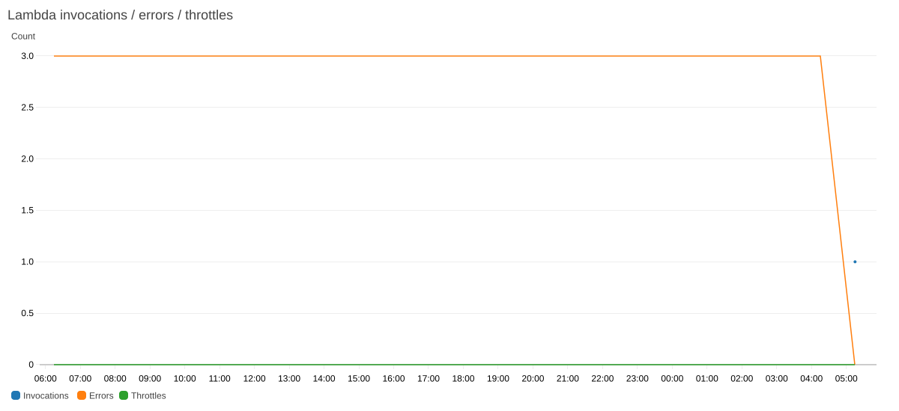

# Tuần 3 — Tích hợp, tối ưu truy vấn và giám sát

**Nguyễn Tiến Sơn — 24110054 · Trần Thị Ngọc Quyên — 24110051**

Học phần Điện toán đám mây · GVHD: ThS. Huỳnh Xuân Phụng

Hồ sơ này ghi nhận mốc tích hợp ngày **18/10/2026**, tiếp nối [Tuần 1](../tuan_1/README.md) và [Tuần 2](../tuan_2/README.md). Tuần 3 theo lịch báo cáo là **19–25/10/2026 (UTC+7)**. Vì thời điểm chụp dữ liệu còn trước tuần này, các kết quả dưới đây là kết quả triển khai và thử nghiệm chuẩn bị; chưa phải thống kê môi trường của toàn Tuần 3.

## Hồ sơ và minh chứng

| Nội dung | Liên kết |
| --- | --- |
| Báo cáo kỹ thuật, phương pháp và giới hạn | [Báo cáo chi tiết](docs/FINAL_REPORT.md) |
| Hướng dẫn chạy, kiểm chứng và khôi phục | [Vận hành và CI/CD](docs/operation.md) |
| Nhật ký có minh chứng, phân công và kế hoạch thời gian | [Nhật ký và kế hoạch Tuần 3](docs/WORKLOG.md) |
| Dữ liệu thô của từng sinh viên | [Sinh viên Tiến Sơn](results/integration_2026_10_18/snapshot/default/raw_all.csv) · [Sinh viên Ngọc Quyên](results/integration_2026_10_18/snapshot/quyen/raw_all.csv) |
| Chất lượng và thống kê theo giờ | [Sinh viên Tiến Sơn](results/integration_2026_10_18/snapshot/default/) · [Sinh viên Ngọc Quyên](results/integration_2026_10_18/snapshot/quyen/) |
| Truy vấn, số đo Athena và cấu hình Projection | [Thí nghiệm Athena](results/integration_2026_10_18/benchmark/) |
| Dashboard JSON, metric CSV và ảnh do AWS trả về | [Giám sát CloudWatch](results/integration_2026_10_18/dashboard/) |
| Dashboard cập nhật và đối chiếu bộ đếm | [Mốc giám sát bổ sung](results/monitoring_2026_10_18/) |
| Metric Filters, cấu hình JSON và đối chiếu log–S3 | [Hồ sơ vận hành bổ sung](results/operations_2026_10_18/) |
| CD thật, hash đọc lại từ AWS và dọn secrets | [Hồ sơ triển khai hai môi trường](results/cd_2026_10_18/) |
| Dữ liệu mô hình, dự báo và sai số | [Hồ sơ dự báo](results/integration_2026_10_18/forecast/) |
| Dự báo đã kiểm tra giờ đích sau phát hành | [Bản phát hành dự báo mới](results/forecast_issued_2026_10_18/) |
| Tính toàn vẹn các tệp kết quả | [Manifest SHA-256](results/integration_2026_10_18/manifest.json) |
| Kiểm tra tự động và triển khai | [CI](../.github/workflows/verify-repository.yml) · [Workflow triển khai Lambda](../.github/workflows/week3-release.yml) · [Các lượt Actions](https://github.com/JasonTM17/WeatherAWS_FinalTerm/actions) |

## Kết quả chính

- Chụp lại **237 bản ghi của sinh viên Tiến Sơn** và **273 bản ghi của sinh viên Ngọc Quyên**. Bộ kiểm tra không phát hiện lỗi trong bảy nhóm kiểm tra đã khai báo; giữ nguyên các lượt thu thập và các tệp lịch sử.
- Thực hiện **18 truy vấn Athena**, gồm ba lần đo cho mỗi định dạng trong mỗi môi trường. Kết quả tổng hợp theo đô thị khớp với dữ liệu đầu vào. Hai bảng Projection trong mỗi môi trường có **0 phân vùng đăng ký**.
- Tạo Dashboard `WeatherAirQuality-Week3` trong hai môi trường, đọc lại cấu hình khớp với cấu hình gửi đi; lưu CSV metric và **10 ảnh biểu đồ do CloudWatch trả về**.
- Đánh giá ba phương pháp dự báo trên cùng 24 giờ giữ lại cho mỗi đô thị/chỉ số. Bản bổ sung kiểm tra `issued_at_utc`, lưu **144 giá trị cho 24 giờ đích sau phát hành**; chưa đánh giá bằng dữ liệu tương lai. Bản đầu có sáu giờ đích sớm hơn thời điểm lấy nguồn và đã được ghi rõ giới hạn.
- Giữ cảnh báo **qua email** theo phạm vi đã thống nhất. Minh chứng nhận email của hai sinh viên được ghi tại [đợt chạy tự động ngày 16/10](../docs/scheduled-run-verification.md).
- Đã chạy CD thành công cho [sinh viên Tiến Sơn](https://github.com/JasonTM17/WeatherAWS_FinalTerm/actions/runs/39101930450) và [sinh viên Ngọc Quyên](https://github.com/JasonTM17/WeatherAWS_FinalTerm/actions/runs/39101934718) ở commit `c28da19`; gói tải lại từ AWS khớp artifact CI, cấu hình giữ nguyên. Secrets tạm đã được xóa sau kiểm chứng.

### Truy vấn Athena trên cùng dữ liệu


*Trung vị của ba lần đo, tắt sử dụng lại kết quả. CSV từng lượt: [sinh viên Tiến Sơn](results/integration_2026_10_18/benchmark/default/benchmark.csv), [sinh viên Ngọc Quyên](results/integration_2026_10_18/benchmark/quyen/benchmark.csv). Mỗi môi trường dùng ngày có dữ liệu gần nhất của chính môi trường đó; không dùng biểu đồ để so tốc độ giữa hai sinh viên.*

Parquet giảm byte quét trong thử nghiệm nhỏ này. Projection trên cùng NDJSON giữ nguyên byte quét. Thời gian thực thi không giảm đồng đều: trong báo cáo dữ liệu của sinh viên Ngọc Quyên, trung vị Parquet là 515 ms, cao hơn Projection NDJSON 431 ms. Các số đo này chưa đủ để kết luận tiết kiệm chi phí hoặc hiệu năng ở quy mô lớn.

### Giám sát dịch vụ thật



*Ảnh do API `GetMetricWidgetImage` của AWS tạo từ metric dịch vụ; đây là ảnh chụp số liệu tại cửa sổ đã lưu, không phải ảnh màn hình Console hay biểu đồ giả lập. [CSV metric](results/monitoring_2026_10_18/default/metrics.csv) · [Cấu hình Dashboard](results/monitoring_2026_10_18/default/dashboard.json).*

Metric còn điểm bất thường: tổng Errors cao hơn Invocations trong cả hai môi trường. Mốc bổ sung đã lưu trạng thái chưa tính được tỷ lệ và cập nhật biểu thức Dashboard để bỏ các điểm thiếu hoặc không nhất quán. Đây là vấn đề còn phải đối chiếu, không dùng Dashboard để tuyên bố hệ thống vận hành ổn định. [Giải thích và số liệu](docs/operation.md#5-giới-hạn-của-metric-vận-hành).

### Đối chiếu dự báo với dữ liệu giữ lại


*Dữ liệu mô hình Open-Meteo/CAMS; đường thực tế trong phép đánh giá là giá trị mô hình được giữ lại, không phải số đo trạm. Phương pháp trung bình trượt không thắng các phương pháp cơ sở ở mọi trường hợp. [Sai số đầy đủ](results/integration_2026_10_18/forecast/forecast_metrics.csv) · [Giá trị từng giờ](results/integration_2026_10_18/forecast/holdout_predictions.csv).*

## Mã nguồn và kiểm tra

| Chương trình | Trách nhiệm |
| --- | --- |
| [snapshot.py](scripts/snapshot.py), [quality.py](scripts/quality.py) | Đọc raw từ S3, kiểm tra lược đồ/số/thời gian, lưu thống kê theo đô thị–giờ |
| [benchmark.py](scripts/benchmark.py) | Tạo dữ liệu thử nghiệm NDJSON/Parquet riêng, cấu hình Projection, đo và đối chiếu truy vấn |
| [dashboard.py](scripts/dashboard.py) | Tạo Dashboard riêng, xuất metric và ảnh CloudWatch |
| [metric_filters.py](scripts/metric_filters.py), [check_operations.py](scripts/check_operations.py) | Kiểm tra mẫu và tạo bộ đếm log; đối chiếu kết quả với S3, lịch/quyền gọi và ngưỡng cảnh báo |
| [forecast.py](scripts/forecast.py) | Thu dữ liệu mô hình theo giờ, chia tập theo thời gian, dự báo và tính sai số |
| [release.py](scripts/release.py) | Đóng gói xác định, kiểm tra tài khoản, triển khai chỉ mã, xác minh và khôi phục có kiểm soát phiên bản |
| [verify_results.py](scripts/verify_results.py) | Đối chiếu hash, raw, kết quả Athena và sai số đã lưu mà không gọi AWS |
| [test_week3.py](tests/test_week3.py) | Các kiểm tra hồi quy về dữ liệu, thời gian, dự báo và an toàn triển khai |

```bash
python -m pip install -r tuan_3/requirements.txt
python -m unittest discover -s tuan_3/tests -v
python tuan_3/scripts/verify_results.py
```

Các lệnh trên kiểm tra tệp đã lưu, không chứng minh vận hành AWS hiện tại. Cách chạy các chương trình có thao tác AWS và điều kiện khôi phục được trình bày trong [hướng dẫn vận hành](docs/operation.md).

## Phần tiếp tục theo dõi

[Nhật ký Tuần 3](docs/WORKLOG.md) ghi chi tiết mốc chuẩn bị và kế hoạch **20,0 giờ dự kiến**, gồm **10,0 giờ cho sinh viên Tiến Sơn** và **10,0 giờ cho sinh viên Ngọc Quyên**. Giờ thực tế chờ xác nhận và chưa cộng vào tổng 38,0 giờ Tuần 1–2. Dữ liệu tại mốc này có **0 bản ghi thuộc lịch Tuần 3**. Cần tiếp tục lưu các lượt theo lịch trong phiên Learner Lab còn hiệu lực và cập nhật độ phủ theo ngày; không suy ra vận hành liên tục từ trạng thái lịch đang bật. Dữ liệu dự báo tương lai cũng cần được đối chiếu khi thời điểm đích đã qua.
