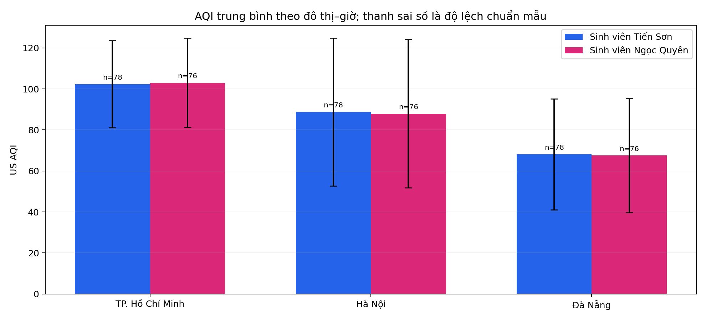
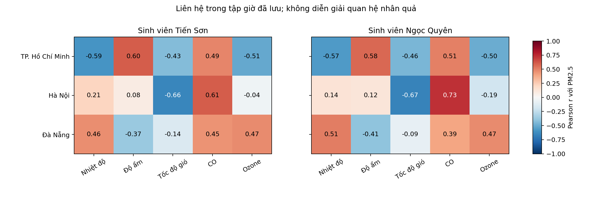
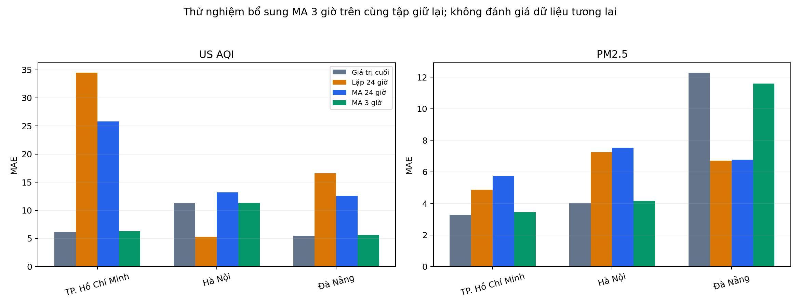

# Tuần 3 — Tích hợp, tối ưu truy vấn và giám sát

**Nguyễn Tiến Sơn — 24110054 · Trần Thị Ngọc Quyên — 24110051**

Học phần Điện toán đám mây · GVHD: ThS. Huỳnh Xuân Phụng

Hồ sơ ghi nhận các công việc tích hợp Tuần 3 hoàn thành tại mốc **18/10/2026**, tiếp nối [Tuần 1](../tuan_1/README.md) và [Tuần 2](../tuan_2/README.md). Kết quả gồm dữ liệu raw từ S3, tối ưu Athena, giám sát, dự báo và CI/CD; mỗi bộ dữ liệu giữ thời điểm và đầu vào tương ứng.

## Hồ sơ và minh chứng

| Nội dung | Liên kết |
| --- | --- |
| Báo cáo kỹ thuật, phương pháp và giới hạn | [Báo cáo chi tiết](docs/FINAL_REPORT.md) |
| Hướng dẫn chạy, kiểm chứng và khôi phục | [Vận hành và CI/CD](docs/operation.md) |
| Nhật ký kỹ thuật, phân công và tổng giờ đã xác nhận | [Nhật ký Tuần 3](docs/WORKLOG.md) · [CSV tổng giờ](worklog.csv) · [Bản CSV trong hồ sơ](docs/worklog.csv) |
| Raw dùng cho thống kê và biểu đồ đã lưu | [Sinh viên Tiến Sơn — 246 dòng](results/refresh_2026_10_18/snapshot/default/raw_all.csv) · [Sinh viên Ngọc Quyên — 285 dòng](results/refresh_2026_10_18/snapshot/quyen/raw_all.csv) |
| Bản xuất raw mới nhất: CSV và JSON gốc | [Sinh viên Tiến Sơn — 246 dòng](results/raw_export_2026_10_18/snapshot/default/raw_all.csv) · [Sinh viên Ngọc Quyên — 288 dòng](results/raw_export_2026_10_18/snapshot/quyen/raw_all.csv) · [83 JSON, chất lượng và SHA-256](results/raw_export_2026_10_18/README.md) |
| Raw của mốc tích hợp ban đầu | [Sinh viên Tiến Sơn](results/integration_2026_10_18/snapshot/default/raw_all.csv) · [Sinh viên Ngọc Quyên](results/integration_2026_10_18/snapshot/quyen/raw_all.csv) |
| Chất lượng và thống kê theo giờ của snapshot cập nhật | [Sinh viên Tiến Sơn](results/refresh_2026_10_18/snapshot/default/) · [Sinh viên Ngọc Quyên](results/refresh_2026_10_18/snapshot/quyen/) |
| Truy vấn, số đo Athena và cấu hình Projection | [Thí nghiệm Athena](results/integration_2026_10_18/benchmark/) |
| Dashboard JSON, metric CSV và ảnh do AWS trả về | [Giám sát CloudWatch](results/integration_2026_10_18/dashboard/) |
| Dashboard cập nhật và đối chiếu bộ đếm | [Mốc giám sát bổ sung](results/monitoring_2026_10_18/) |
| Metric Filters, cấu hình JSON và đối chiếu log–S3 | [Hồ sơ vận hành bổ sung](results/operations_2026_10_18/) |
| Lượt tự động sau sửa cấu hình của sinh viên Ngọc Quyên | [Log, ba bản ghi raw và metric lúc 13:51](results/post_repair_2026_10_18/README.md) |
| CD thật, hash đọc lại từ AWS và dọn secrets | [Hồ sơ triển khai hai môi trường](results/cd_2026_10_18/) |
| Dữ liệu mô hình, dự báo và sai số | [Hồ sơ dự báo](results/integration_2026_10_18/forecast/) |
| Dự báo đã kiểm tra giờ đích sau phát hành | [Bản phát hành dự báo mới](results/forecast_issued_2026_10_18/) |
| Tính toàn vẹn các tệp kết quả | [Manifest mốc đầu](results/integration_2026_10_18/manifest.json) · [Manifest snapshot cập nhật](results/refresh_2026_10_18/manifest.json) · [Kiểm tra toàn bộ các mốc](scripts/verify_results.py) |
| Kiểm tra tự động và triển khai | [CI](../.github/workflows/verify-repository.yml) · [Workflow triển khai Lambda](../.github/workflows/week3-release.yml) · [Các lượt Actions](https://github.com/JasonTM17/WeatherAWS_FinalTerm/actions) |

## Kết quả cập nhật mới nhất

**Đã hoàn thành kế hoạch công việc tích hợp Tuần 3 tại mốc ngày 18/10/2026.**

- **Bản xuất raw mới nhất: 246/288 dòng, tổng 534 bản ghi và 83 JSON gốc.** [CSV, JSON, hash và bảng raw mẫu](results/raw_export_2026_10_18/README.md). Các bảng thống kê đã lưu ở mốc trước vẫn dùng đúng 246/285 dòng.

- Snapshot phân tích đã lưu: **246 bản ghi của sinh viên Tiến Sơn** và **285 bản ghi của sinh viên Ngọc Quyên**; bảy nhóm kiểm tra chất lượng đều bằng 0.
- [Raw, thống kê, ba biểu đồ màu và đối chiếu dự báo mới](results/refresh_2026_10_18/README.md).
- MA 3 giờ đã có mã và CSV tính lại; chỉ 2/24 giờ đích của bản phát hành được đối chiếu với dữ liệu mô hình tải về sau.

## Kết quả chính tại mốc tích hợp ban đầu

- Chụp lại **237 bản ghi của sinh viên Tiến Sơn** và **273 bản ghi của sinh viên Ngọc Quyên**. Bộ kiểm tra không phát hiện lỗi trong bảy nhóm kiểm tra đã khai báo; giữ nguyên các lượt thu thập và các tệp lịch sử.
- Thực hiện **18 truy vấn Athena**, gồm ba lần đo cho mỗi định dạng trong mỗi môi trường. Kết quả tổng hợp theo đô thị khớp với dữ liệu đầu vào. Hai bảng Projection trong mỗi môi trường có **0 phân vùng đăng ký**.
- Tạo Dashboard `WeatherAirQuality-Week3` trong hai môi trường, đọc lại cấu hình khớp với cấu hình gửi đi; lưu CSV metric và **10 ảnh biểu đồ do CloudWatch trả về**.
- Đánh giá ba phương pháp dự báo trên cùng 24 giờ giữ lại cho mỗi đô thị/chỉ số. Bản bổ sung kiểm tra `issued_at_utc`, lưu **144 giá trị cho 24 giờ đích sau phát hành**; chưa đánh giá bằng dữ liệu tương lai. Bản đầu có sáu giờ đích sớm hơn thời điểm lấy nguồn và đã được ghi rõ giới hạn.
- Giữ cảnh báo **qua email** theo phạm vi đã thống nhất. Minh chứng nhận email của hai sinh viên được ghi tại [đợt chạy tự động ngày 16/10](../docs/scheduled-run-verification.md).
- Đã chạy CD thành công cho [sinh viên Tiến Sơn](https://github.com/JasonTM17/WeatherAWS_FinalTerm/actions/runs/39101930450) và [sinh viên Ngọc Quyên](https://github.com/JasonTM17/WeatherAWS_FinalTerm/actions/runs/39101934718) ở commit `c28da19`; gói tải lại từ AWS khớp artifact CI, cấu hình giữ nguyên. Secrets tạm đã được xóa sau kiểm chứng.
- Đã đối chiếu [lượt tự động 13:51 sau sửa cấu hình của sinh viên Ngọc Quyên](results/post_repair_2026_10_18/README.md): đủ ba đô thị, ba bản ghi khớp S3, một điểm metric log mới, không thấy thông báo đọc Secret thất bại trong cửa sổ đã kiểm tra. Ba mẫu dưới ngưỡng nên không phát cảnh báo mới.


### Thống kê snapshot cập nhật theo đô thị–giờ

Mỗi giờ có trọng số bằng nhau sau khi lấy trung bình các lượt thu trong cùng đô thị–giờ. Các giá trị dưới đây dùng snapshot mới 246/285 dòng; bộ đầu vào benchmark cũ được giữ riêng.

| Sinh viên | Đô thị | N giờ | AQI TB | ĐLC mẫu AQI | PM2.5 TB (µg/m³) |
| --- | --- | --- | --- | --- | --- |
| Sinh viên Tiến Sơn | TP. Hồ Chí Minh | 78 | 102,346 | 21,258 | 33,151 |
| Sinh viên Tiến Sơn | Hà Nội | 78 | 88,769 | 36,066 | 28,460 |
| Sinh viên Tiến Sơn | Đà Nẵng | 78 | 68,154 | 27,018 | 13,749 |
| Sinh viên Ngọc Quyên | TP. Hồ Chí Minh | 76 | 103,039 | 21,736 | 33,054 |
| Sinh viên Ngọc Quyên | Hà Nội | 76 | 87,947 | 36,102 | 30,005 |
| Sinh viên Ngọc Quyên | Đà Nẵng | 76 | 67,526 | 27,854 | 13,261 |

[Thống kê đủ tám biến, raw và theo giờ](results/refresh_2026_10_18/analysis/descriptive.csv).



#### Tương quan theo giờ với PM2.5

| Sinh viên | Đô thị | Pearson r: nhiệt độ | Pearson r: độ ẩm | Pearson r: gió |
| --- | --- | --- | --- | --- |
| Sinh viên Tiến Sơn | TP. Hồ Chí Minh | -0,589 | 0,604 | -0,433 |
| Sinh viên Tiến Sơn | Hà Nội | 0,214 | 0,079 | -0,656 |
| Sinh viên Tiến Sơn | Đà Nẵng | 0,465 | -0,371 | -0,141 |
| Sinh viên Ngọc Quyên | TP. Hồ Chí Minh | -0,567 | 0,577 | -0,459 |
| Sinh viên Ngọc Quyên | Hà Nội | 0,140 | 0,121 | -0,672 |
| Sinh viên Ngọc Quyên | Đà Nẵng | 0,510 | -0,406 | -0,086 |

Hệ số mô tả liên hệ trong mẫu, không chứng minh quan hệ nhân quả. [Đủ Pearson/Spearman và hai chỉ số đích](results/refresh_2026_10_18/analysis/correlations.csv).




### Truy vấn Athena trên cùng dữ liệu

| Cấu hình truy vấn Athena | Byte quét trung vị — sinh viên Tiến Sơn | Byte quét trung vị — sinh viên Ngọc Quyên | Engine trung vị — sinh viên Tiến Sơn (ms) | Engine trung vị — sinh viên Ngọc Quyên (ms) |
| --- | ---: | ---: | ---: | ---: |
| NDJSON, phân vùng đăng ký | 1.556 | 11.243 | 615 | 572 |
| NDJSON, Partition Projection | 1.556 | 11.243 | 537 | 431 |
| Parquet Snappy, Partition Projection | 302 | 393 | 452 | 515 |

Dấu chấm trong hai cột byte phân cách hàng nghìn. Số đo thuộc toàn truy vấn; không phải chi phí hóa đơn. Parquet giảm byte quét 80,59% trong báo cáo dữ liệu của sinh viên Tiến Sơn và 96,50% trong báo cáo dữ liệu của sinh viên Ngọc Quyên, nhưng chưa đủ căn cứ quy thành số tiền tiết kiệm. Các trung vị planning/total và từng lượt được lưu trong [bảng đo gốc](results/integration_2026_10_18/benchmark/).

#### Kết quả truy vấn tổng hợp ba đô thị

| Sinh viên | Đô thị | Số mẫu của truy vấn | AQI TB | PM2.5 TB |
| --- | --- | --- | --- | --- |
| Sinh viên Tiến Sơn | Đà Nẵng | 1 | 53,000 | 11,400 |
| Sinh viên Tiến Sơn | Hà Nội | 1 | 87,000 | 23,200 |
| Sinh viên Tiến Sơn | TP. Hồ Chí Minh | 1 | 66,000 | 9,800 |
| Sinh viên Ngọc Quyên | Đà Nẵng | 7 | 74,286 | 25,429 |
| Sinh viên Ngọc Quyên | Hà Nội | 7 | 104,000 | 28,871 |
| Sinh viên Ngọc Quyên | TP. Hồ Chí Minh | 7 | 131,143 | 26,043 |

Byte quét, thời gian và planning được đo cho cả truy vấn trả ba đô thị; không chia thành số đo hoặc chi phí riêng của mỗi đô thị. Nguồn: [CSV và query ID](results/integration_2026_10_18/benchmark/).


*Trung vị của ba lần đo, tắt sử dụng lại kết quả. CSV từng lượt: [sinh viên Tiến Sơn](results/integration_2026_10_18/benchmark/default/benchmark.csv), [sinh viên Ngọc Quyên](results/integration_2026_10_18/benchmark/quyen/benchmark.csv). Mỗi môi trường dùng ngày có dữ liệu gần nhất của chính môi trường đó; không dùng biểu đồ để so tốc độ giữa hai sinh viên.*

Parquet giảm byte quét trong thử nghiệm nhỏ này. Projection trên cùng NDJSON giữ nguyên byte quét. Thời gian thực thi không giảm đồng đều: trong báo cáo dữ liệu của sinh viên Ngọc Quyên, trung vị Parquet là 515 ms, cao hơn Projection NDJSON 431 ms. Các số đo này chưa đủ để kết luận tiết kiệm chi phí hoặc hiệu năng ở quy mô lớn.

### Giám sát dịch vụ thật


*Ảnh do API `GetMetricWidgetImage` của AWS tạo từ metric dịch vụ; đây là ảnh chụp số liệu tại cửa sổ đã lưu, không phải ảnh màn hình Console hay biểu đồ giả lập. [CSV metric](results/monitoring_2026_10_18/default/metrics.csv) · [Cấu hình Dashboard](results/monitoring_2026_10_18/default/dashboard.json).*

Metric còn điểm bất thường: tổng Errors cao hơn Invocations trong cả hai môi trường. Mốc bổ sung đã lưu trạng thái chưa tính được tỷ lệ và cập nhật biểu thức Dashboard để bỏ các điểm thiếu hoặc không nhất quán. Đây là vấn đề còn phải đối chiếu, không dùng Dashboard để tuyên bố hệ thống vận hành ổn định. [Giải thích và số liệu](docs/operation.md#5-giới-hạn-của-metric-vận-hành).

### Đối chiếu dự báo với dữ liệu giữ lại


*Dữ liệu mô hình Open-Meteo/CAMS; đường thực tế trong phép đánh giá là giá trị mô hình được giữ lại, không phải số đo trạm. Phương pháp trung bình trượt không thắng các phương pháp cơ sở ở mọi trường hợp. [Sai số đầy đủ](results/integration_2026_10_18/forecast/forecast_metrics.csv) · [Giá trị từng giờ](results/integration_2026_10_18/forecast/holdout_predictions.csv).*

#### Thử nghiệm MA 3 giờ bổ sung trên cùng tập giữ lại

| Đô thị | Chỉ số | MAE nhỏ nhất trong bốn phương pháp | MAE | RMSE của phương pháp đó | MAE MA 3 giờ | MAE MA 24 giờ |
| --- | --- | --- | --- | --- | --- | --- |
| TP. Hồ Chí Minh | US AQI | persistence | 6,125 | 6,674 | 6,296 | 25,781 |
| TP. Hồ Chí Minh | PM2.5 | persistence | 3,271 | 4,233 | 3,442 | 5,734 |
| Hà Nội | US AQI | seasonal_naive_24h | 5,292 | 6,228 | 11,333 | 13,204 |
| Hà Nội | PM2.5 | persistence | 4,025 | 5,306 | 4,168 | 7,535 |
| Đà Nẵng | US AQI | persistence | 5,458 | 6,201 | 5,630 | 12,598 |
| Đà Nẵng | PM2.5 | seasonal_naive_24h | 6,712 | 8,171 | 11,600 | 6,779 |

MA 3 giờ được tính bổ sung sau khi xem kết quả giữ lại; đây không phải tập đánh giá độc lập để lựa chọn mô hình triển khai. Không suy kết quả của 24 giờ thành độ chính xác dài hạn. [24 bộ sai số và nguồn](results/refresh_2026_10_18/analysis/ma_comparison_metrics.csv).



Đối với bản dự báo phát hành trước giờ đích, đã so được **2/24 giờ đích (12/144 dòng)** với dữ liệu CAMS tải về sau; các giá trị này không phải số đo trạm. [CSV đối chiếu từng giá trị](results/refresh_2026_10_18/analysis/later_model/comparison.csv).


## Mã nguồn và kiểm tra

| Chương trình | Trách nhiệm |
| --- | --- |
| [snapshot.py](scripts/snapshot.py), [quality.py](scripts/quality.py) | Đọc raw từ S3, kiểm tra lược đồ/số/thời gian, lưu thống kê theo đô thị–giờ |
| [benchmark.py](scripts/benchmark.py) | Tạo dữ liệu thử nghiệm NDJSON/Parquet riêng, cấu hình Projection, đo và đối chiếu truy vấn |
| [dashboard.py](scripts/dashboard.py) | Tạo Dashboard riêng, xuất metric và ảnh CloudWatch |
| [metric_filters.py](scripts/metric_filters.py), [check_operations.py](scripts/check_operations.py) | Kiểm tra mẫu và tạo bộ đếm log; đối chiếu kết quả với S3, lịch/quyền gọi và ngưỡng cảnh báo |
| [forecast.py](scripts/forecast.py) | Thu dữ liệu mô hình theo giờ, chia tập theo thời gian, dự báo và tính sai số |
| [release.py](scripts/release.py) | Đóng gói xác định, kiểm tra tài khoản, triển khai chỉ mã, xác minh và khôi phục có kiểm soát phiên bản |
| [verify_results.py](scripts/verify_results.py) | Đối chiếu hash, raw, kết quả Athena và sai số đã lưu mà không gọi AWS |
| [reconcile_analysis.py](scripts/reconcile_analysis.py) | Tính thống kê raw/theo giờ, tương quan, thử nghiệm MA 3 giờ và đối chiếu bản phát hành với dữ liệu mô hình tải về sau |
| [test_week3.py](tests/test_week3.py) | Các kiểm tra hồi quy về dữ liệu, thời gian, dự báo và an toàn triển khai |

```bash
python -m pip install -r tuan_3/requirements.txt
python -m unittest discover -s tuan_3/tests -v
python tuan_3/scripts/verify_results.py
```

Các lệnh trên kiểm tra tệp đã lưu, không chứng minh vận hành AWS hiện tại. Cách chạy các chương trình có thao tác AWS và điều kiện khôi phục được trình bày trong [hướng dẫn vận hành](docs/operation.md).


### Tổng giờ đã xác nhận

| Giai đoạn | Sinh viên Tiến Sơn | Sinh viên Ngọc Quyên | Tổng | Căn cứ |
| --- | --- | --- | --- | --- |
| Tuần 1 | 9,5 giờ | 9,0 giờ | 18,5 giờ | Tổng theo tuần đã xác nhận |
| Tuần 2 | 10,0 giờ | 9,5 giờ | 19,5 giờ | Tổng theo tuần đã xác nhận |
| Tuần 3 — công việc tích hợp | 10,0 giờ | 10,0 giờ | 20,0 giờ | Tổng theo tuần đã xác nhận |
| **Cộng dồn** | **29,5 giờ** | **28,5 giờ** | **58,0 giờ** | Không suy số giờ từ thời gian hệ thống chạy |

38,0 giờ thuộc hồ sơ Tuần 1–2; 20,0 giờ Tuần 3 là tổng theo tuần đã xác nhận, không phân bổ ngày. [Hai dòng CSV tổng giờ Tuần 3](worklog.csv) ghi căn cứ này riêng với các mốc kỹ thuật trong nhật ký.

## Phần tiếp tục theo dõi

[Nhật ký Tuần 3](docs/WORKLOG.md) ghi tổng giờ đã xác nhận và sản phẩm tích hợp đã hoàn thành. [Bản xuất raw mới nhất](results/raw_export_2026_10_18/README.md) có CSV, JSON nguyên bản và thời điểm đọc AWS. Các quan sát tiếp theo được lưu thành mốc riêng để theo dõi độ phủ theo thời gian, đối chiếu những giờ dự báo còn lại và làm rõ giới hạn của bộ đếm CloudWatch.
