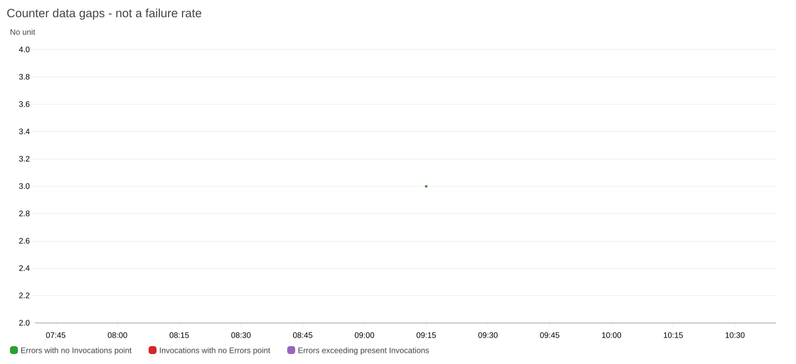
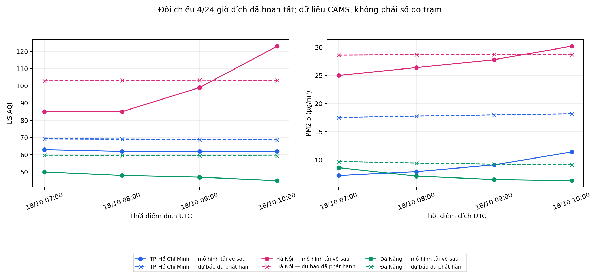

# Báo cáo mốc tích hợp phục vụ Tuần 3

**Sinh viên:** Nguyễn Tiến Sơn (24110054), Trần Thị Ngọc Quyên (24110051).

**Đề tài:** Hệ thống thu thập và phân tích dữ liệu thời tiết, chất lượng không khí trên AWS.

**Mốc kết quả:** 18/10/2026 — hoàn thành công việc tích hợp Tuần 3, múi giờ Việt Nam (UTC+7).

## 1. Mục tiêu và phạm vi

Mốc này bổ sung phần tối ưu Athena, kiểm tra chất lượng dữ liệu, CloudWatch Dashboard, thử nghiệm dự báo và đường triển khai Lambda qua GitHub Actions. Luồng thu thập hiện hành vẫn dùng mã [Lambda Tuần 2](../../tuan_2/lambda/lambda_function.py); phần mới nằm trong [các chương trình Tuần 3](../scripts/). Cảnh báo được giữ ở kênh email theo phạm vi đã thống nhất.

Các lần kiểm chứng triển khai và nhận thư ngày 16/10 được dẫn lại như minh chứng lịch sử tại [hồ sơ triển khai](../../docs/deployment-verification.md) và [hồ sơ chạy theo lịch](../../docs/scheduled-run-verification.md). Việc bổ sung chương trình và Dashboard ngày 18/10 không tự tạo ra một xác nhận nhận email mới.

## 2. Đầu vào, dữ liệu raw và chất lượng

### Bản xuất raw đầy đủ, cập nhật lúc 17:02 ngày 18/10

Đã trực tiếp xuất **246 bản ghi của sinh viên Tiến Sơn** và **288 bản ghi của sinh viên Ngọc Quyên** từ S3, tổng cộng **534 bản ghi và 83 tệp JSON nguyên bản**. Cả hai CSV giữ đủ 23 trường; toàn bộ 531 bản ghi của snapshot phân tích trước được bảo toàn và có thêm ba bản ghi của sinh viên Ngọc Quyên. Các bộ kiểm tra chất lượng đã khai báo không phát hiện lỗi trong bản xuất mới.

| Hồ sơ raw | Sinh viên Tiến Sơn | Sinh viên Ngọc Quyên |
| --- | --- | --- |
| CSV đầy đủ | [246 dòng](../results/raw_export_2026_10_18/snapshot/default/raw_all.csv) | [288 dòng](../results/raw_export_2026_10_18/snapshot/quyen/raw_all.csv) |
| JSON gốc từ S3 | [36 tệp](../results/raw_export_2026_10_18/snapshot/default/objects/raw/) | [47 tệp](../results/raw_export_2026_10_18/snapshot/quyen/objects/raw/) |
| Nhóm đô thị–giờ | 234 | 231 |
| Timestamp cuối UTC | 18/10/2026 08:15:46 | 18/10/2026 09:51:05 |
| Hoàn tất bản xuất (UTC+7) | 18/10/2026 17:01:39 | 18/10/2026 17:02:04 |

[Danh mục, SHA-256 và phương pháp xuất](../results/raw_export_2026_10_18/README.md) · [Thông tin xuất](../results/raw_export_2026_10_18/export.json) · [Manifest 96 tệp](../results/raw_export_2026_10_18/manifest.json).

**Trích raw mới nhất của mỗi đô thị:**

| Sinh viên | Đô thị | Timestamp UTC | AQI | PM2.5 (µg/m³) | Nhiệt độ (°C) | Độ ẩm (%) |
| --- | --- | --- | --- | --- | --- | --- |
| Sinh viên Tiến Sơn | TP. Hồ Chí Minh | 2026-10-18 08:15:45 | 65 | 11.7 | 28.0 | 83.0 |
| Sinh viên Tiến Sơn | Hà Nội | 2026-10-18 08:15:45 | 87 | 26.1 | 31.5 | 58.0 |
| Sinh viên Tiến Sơn | Đà Nẵng | 2026-10-18 08:15:46 | 51 | 8.2 | 28.5 | 80.0 |
| Sinh viên Ngọc Quyên | TP. Hồ Chí Minh | 2026-10-18 09:51:03 | 65 | 11.8 | 27.8 | 85.0 |
| Sinh viên Ngọc Quyên | Hà Nội | 2026-10-18 09:51:04 | 95 | 27.4 | 30.4 | 64.0 |
| Sinh viên Ngọc Quyên | Đà Nẵng | 2026-10-18 09:51:05 | 50 | 7.0 | 28.0 | 82.0 |

Các giá trị trên được trích trực tiếp từ CSV gốc. Đây là bản xuất riêng; các bảng thống kê và biểu đồ ở mục 2.1–2.3 tiếp tục dùng đúng snapshot 246/285 đã đóng băng để bảo đảm kết quả tái lập.

### Snapshot đầu vào của các bảng phân tích

| Chỉ tiêu | Sinh viên Tiến Sơn | Sinh viên Ngọc Quyên |
| --- | --- | --- |
| Raw dùng cho bảng phân tích | 246 | 285 |
| Nhóm đô thị–giờ UTC | 234 | 228 |
| Timestamp cuối UTC | 2026-10-18 08:15:46 | 2026-10-18 08:51:05 |
| Số nhóm kiểm tra chất lượng phát hiện lỗi | 0/7 | 0/7 |
| Mã Lambda khớp gói đã kiểm chứng | Có | Có |

Raw giữ đủ 23 trường. Bảy nhóm kiểm tra chất lượng đã khai báo đều bằng 0 trong hai bộ này; đây không phải xác nhận độ chính xác ngoài thực địa. [Raw sinh viên Tiến Sơn](../results/refresh_2026_10_18/snapshot/default/raw_all.csv) · [Raw sinh viên Ngọc Quyên](../results/refresh_2026_10_18/snapshot/quyen/raw_all.csv) · [Manifest](../results/refresh_2026_10_18/manifest.json).

### 2.1. Thống kê mô tả tính lại từ raw

Độ lệch chuẩn là độ lệch chuẩn mẫu (ddof=1); các phân vị dùng nội suy tuyến tính. Thống kê raw cho mỗi lượt thu trọng số bằng nhau. Thống kê theo đô thị–giờ trước hết lấy trung bình các lượt trong cùng giờ, sau đó cho mỗi giờ trọng số bằng nhau. CSV lưu cả hai cách để người đọc không nhầm số dòng với số giờ độc lập.

#### Sinh viên Tiến Sơn

| Đô thị | Biến | Đơn vị | N | TB | Trung vị | ĐLC mẫu | Min | Max | P25 | P75 | P90 | P95 |
| --- | --- | --- | --- | --- | --- | --- | --- | --- | --- | --- | --- | --- |
| TP. Hồ Chí Minh | US AQI | điểm | 82 | 103,24 | 101,00 | 21,16 | 65,00 | 172,00 | 96,00 | 108,75 | 130,90 | 141,50 |
| TP. Hồ Chí Minh | PM2.5 | µg/m³ | 82 | 33,41 | 33,25 | 12,52 | 9,80 | 64,00 | 26,47 | 40,10 | 48,79 | 55,19 |
| TP. Hồ Chí Minh | PM10 | µg/m³ | 82 | 33,82 | 34,50 | 12,34 | 10,40 | 64,00 | 26,75 | 40,30 | 49,09 | 55,29 |
| TP. Hồ Chí Minh | Nhiệt độ | °C | 82 | 27,80 | 27,20 | 2,46 | 24,30 | 33,30 | 25,70 | 29,55 | 31,70 | 32,29 |
| TP. Hồ Chí Minh | Độ ẩm | % | 82 | 84,20 | 87,50 | 12,55 | 57,00 | 99,00 | 73,25 | 96,00 | 97,90 | 98,00 |
| TP. Hồ Chí Minh | Tốc độ gió | km/h | 82 | 4,68 | 4,50 | 2,71 | 0,20 | 13,20 | 2,85 | 6,17 | 8,64 | 9,77 |
| TP. Hồ Chí Minh | CO | µg/m³ | 82 | 1297,23 | 1121,50 | 743,87 | 326,00 | 3161,00 | 655,75 | 1617,00 | 2581,70 | 2846,05 |
| TP. Hồ Chí Minh | Ozone | µg/m³ | 82 | 77,74 | 63,00 | 58,72 | 4,00 | 220,00 | 28,50 | 123,75 | 165,80 | 185,60 |
| Hà Nội | US AQI | điểm | 82 | 88,00 | 79,00 | 35,54 | 56,00 | 169,00 | 63,00 | 95,25 | 160,90 | 162,00 |
| Hà Nội | PM2.5 | µg/m³ | 82 | 28,88 | 22,25 | 23,82 | 7,50 | 115,70 | 11,72 | 39,42 | 53,85 | 64,70 |
| Hà Nội | PM10 | µg/m³ | 82 | 30,14 | 24,00 | 24,43 | 7,50 | 118,50 | 11,90 | 41,55 | 55,26 | 69,14 |
| Hà Nội | Nhiệt độ | °C | 82 | 25,75 | 24,80 | 3,25 | 20,80 | 31,60 | 23,10 | 27,93 | 31,10 | 31,40 |
| Hà Nội | Độ ẩm | % | 82 | 74,00 | 71,00 | 12,95 | 47,00 | 97,00 | 63,00 | 86,75 | 91,00 | 96,00 |
| Hà Nội | Tốc độ gió | km/h | 82 | 9,60 | 10,10 | 4,20 | 1,30 | 17,10 | 5,83 | 13,23 | 14,68 | 15,69 |
| Hà Nội | CO | µg/m³ | 82 | 704,99 | 629,50 | 312,09 | 300,00 | 1484,00 | 456,50 | 874,00 | 1233,50 | 1268,00 |
| Hà Nội | Ozone | µg/m³ | 82 | 90,52 | 68,50 | 56,39 | 10,00 | 234,00 | 52,50 | 123,25 | 183,70 | 194,60 |
| Đà Nẵng | US AQI | điểm | 82 | 68,52 | 68,00 | 26,40 | 32,00 | 155,00 | 51,00 | 77,00 | 89,50 | 136,10 |
| Đà Nẵng | PM2.5 | µg/m³ | 82 | 13,72 | 9,55 | 8,61 | 3,90 | 33,20 | 7,00 | 21,07 | 26,79 | 28,29 |
| Đà Nẵng | PM10 | µg/m³ | 82 | 17,23 | 12,50 | 9,79 | 4,80 | 37,80 | 9,35 | 25,30 | 32,08 | 34,16 |
| Đà Nẵng | Nhiệt độ | °C | 82 | 28,12 | 28,55 | 2,84 | 23,70 | 33,40 | 25,85 | 29,88 | 32,47 | 32,79 |
| Đà Nẵng | Độ ẩm | % | 82 | 78,38 | 79,00 | 13,99 | 51,00 | 99,00 | 69,00 | 89,00 | 96,00 | 97,00 |
| Đà Nẵng | Tốc độ gió | km/h | 82 | 8,28 | 7,90 | 4,30 | 0,20 | 20,10 | 5,25 | 10,70 | 13,36 | 16,94 |
| Đà Nẵng | CO | µg/m³ | 82 | 502,78 | 453,50 | 204,44 | 175,00 | 958,00 | 405,00 | 619,00 | 816,70 | 861,75 |
| Đà Nẵng | Ozone | µg/m³ | 82 | 101,35 | 94,50 | 33,77 | 55,00 | 197,00 | 77,00 | 125,50 | 151,00 | 168,25 |

#### Sinh viên Ngọc Quyên

| Đô thị | Biến | Đơn vị | N | TB | Trung vị | ĐLC mẫu | Min | Max | P25 | P75 | P90 | P95 |
| --- | --- | --- | --- | --- | --- | --- | --- | --- | --- | --- | --- | --- |
| TP. Hồ Chí Minh | US AQI | điểm | 95 | 101,26 | 101,00 | 22,38 | 65,00 | 172,00 | 81,00 | 108,50 | 131,60 | 144,00 |
| TP. Hồ Chí Minh | PM2.5 | µg/m³ | 95 | 31,47 | 32,00 | 12,60 | 9,80 | 64,00 | 22,60 | 39,00 | 46,70 | 53,69 |
| TP. Hồ Chí Minh | PM10 | µg/m³ | 95 | 31,99 | 33,10 | 12,40 | 10,40 | 64,00 | 23,90 | 39,10 | 46,84 | 53,79 |
| TP. Hồ Chí Minh | Nhiệt độ | °C | 95 | 27,94 | 27,40 | 2,53 | 24,30 | 33,30 | 25,80 | 29,90 | 31,92 | 32,40 |
| TP. Hồ Chí Minh | Độ ẩm | % | 95 | 83,52 | 86,00 | 12,68 | 57,00 | 99,00 | 72,50 | 96,00 | 97,00 | 98,00 |
| TP. Hồ Chí Minh | Tốc độ gió | km/h | 95 | 4,75 | 4,50 | 2,85 | 0,20 | 13,20 | 2,75 | 6,25 | 8,96 | 9,36 |
| TP. Hồ Chí Minh | CO | µg/m³ | 95 | 1263,04 | 1127,00 | 726,80 | 326,00 | 3161,00 | 650,00 | 1547,50 | 2503,00 | 2833,70 |
| TP. Hồ Chí Minh | Ozone | µg/m³ | 95 | 78,27 | 72,00 | 58,00 | 4,00 | 220,00 | 28,50 | 118,00 | 164,00 | 180,40 |
| Hà Nội | US AQI | điểm | 95 | 99,42 | 80,00 | 41,30 | 56,00 | 168,00 | 63,50 | 160,00 | 161,60 | 166,00 |
| Hà Nội | PM2.5 | µg/m³ | 95 | 38,47 | 23,10 | 37,05 | 7,50 | 143,90 | 12,25 | 42,55 | 109,62 | 127,10 |
| Hà Nội | PM10 | µg/m³ | 95 | 39,89 | 25,10 | 37,75 | 7,50 | 148,10 | 12,55 | 45,15 | 111,64 | 128,50 |
| Hà Nội | Nhiệt độ | °C | 95 | 26,38 | 25,30 | 3,25 | 21,90 | 31,70 | 23,55 | 29,90 | 31,20 | 31,50 |
| Hà Nội | Độ ẩm | % | 95 | 73,17 | 71,00 | 13,45 | 47,00 | 97,00 | 62,00 | 86,00 | 90,00 | 96,00 |
| Hà Nội | Tốc độ gió | km/h | 95 | 9,31 | 9,80 | 4,68 | 1,10 | 17,90 | 5,20 | 13,45 | 15,38 | 16,18 |
| Hà Nội | CO | µg/m³ | 95 | 951,91 | 617,00 | 1174,85 | 300,00 | 5865,00 | 436,00 | 876,50 | 1234,00 | 4618,00 |
| Hà Nội | Ozone | µg/m³ | 95 | 95,61 | 74,00 | 61,98 | 6,00 | 219,00 | 54,00 | 159,50 | 191,80 | 199,00 |
| Đà Nẵng | US AQI | điểm | 95 | 63,81 | 63,00 | 27,11 | 32,00 | 155,00 | 42,50 | 76,00 | 82,60 | 124,40 |
| Đà Nẵng | PM2.5 | µg/m³ | 95 | 12,67 | 8,50 | 8,89 | 2,60 | 33,20 | 6,05 | 20,00 | 26,70 | 28,09 |
| Đà Nẵng | PM10 | µg/m³ | 95 | 16,00 | 11,70 | 10,38 | 3,10 | 37,80 | 7,80 | 25,20 | 32,58 | 35,20 |
| Đà Nẵng | Nhiệt độ | °C | 95 | 28,01 | 28,50 | 2,75 | 23,70 | 33,40 | 25,70 | 29,55 | 32,08 | 32,73 |
| Đà Nẵng | Độ ẩm | % | 95 | 78,91 | 79,00 | 13,52 | 51,00 | 99,00 | 69,50 | 90,50 | 96,00 | 96,00 |
| Đà Nẵng | Tốc độ gió | km/h | 95 | 7,85 | 7,60 | 4,15 | 0,20 | 20,10 | 4,75 | 10,30 | 12,58 | 16,09 |
| Đà Nẵng | CO | µg/m³ | 95 | 496,53 | 457,00 | 222,01 | 175,00 | 958,00 | 309,00 | 624,00 | 826,60 | 887,70 |
| Đà Nẵng | Ozone | µg/m³ | 95 | 98,37 | 88,00 | 32,86 | 55,00 | 197,00 | 77,00 | 109,50 | 151,00 | 158,50 |

[CSV đủ 96 dòng thống kê raw/theo giờ](../results/refresh_2026_10_18/analysis/descriptive.csv).


Thanh sai số là độ lệch chuẩn giữa các giá trị giờ, không phải khoảng tin cậy. n trên hình là số nhóm đô thị–giờ; không phải số ngày hay tổng số raw.

### 2.2. Liên hệ Pearson và Spearman theo đô thị–giờ

Các hệ số mô tả liên hệ trong tập đã lưu. Không dùng tương quan để kết luận cơ chế phát thải, tác động của gió/mưa hay quan hệ nhân quả; nhiều biến khí tượng và thời gian có thể cùng thay đổi. Không kiểm định ý nghĩa thống kê hoặc suy rộng toàn tuần từ bảng này.

| Sinh viên | Đô thị | Biến | N giờ | r với PM2.5 | ρ với PM2.5 | r với AQI | ρ với AQI |
| --- | --- | --- | --- | --- | --- | --- | --- |
| Sinh viên Tiến Sơn | TP. Hồ Chí Minh | Nhiệt độ | 78 | -0,5891 | -0,6810 | -0,0679 | -0,1723 |
| Sinh viên Tiến Sơn | TP. Hồ Chí Minh | Độ ẩm | 78 | 0,6038 | 0,7029 | 0,1213 | 0,1804 |
| Sinh viên Tiến Sơn | TP. Hồ Chí Minh | Tốc độ gió | 78 | -0,4328 | -0,4235 | -0,1366 | -0,0897 |
| Sinh viên Tiến Sơn | TP. Hồ Chí Minh | CO | 78 | 0,4863 | 0,6592 | 0,3363 | 0,2217 |
| Sinh viên Tiến Sơn | TP. Hồ Chí Minh | Ozone | 78 | -0,5104 | -0,6505 | 0,1175 | 0,0331 |
| Sinh viên Tiến Sơn | Hà Nội | Nhiệt độ | 78 | 0,2140 | 0,4415 | 0,5809 | 0,6675 |
| Sinh viên Tiến Sơn | Hà Nội | Độ ẩm | 78 | 0,0790 | -0,1171 | -0,0764 | -0,0114 |
| Sinh viên Tiến Sơn | Hà Nội | Tốc độ gió | 78 | -0,6556 | -0,6838 | -0,6468 | -0,6523 |
| Sinh viên Tiến Sơn | Hà Nội | CO | 78 | 0,6086 | 0,4146 | 0,2245 | 0,0387 |
| Sinh viên Tiến Sơn | Hà Nội | Ozone | 78 | -0,0440 | 0,0828 | 0,4309 | 0,4082 |
| Sinh viên Tiến Sơn | Đà Nẵng | Nhiệt độ | 78 | 0,4647 | 0,5199 | 0,4610 | 0,4988 |
| Sinh viên Tiến Sơn | Đà Nẵng | Độ ẩm | 78 | -0,3714 | -0,4388 | -0,4573 | -0,4663 |
| Sinh viên Tiến Sơn | Đà Nẵng | Tốc độ gió | 78 | -0,1407 | -0,0067 | 0,0301 | -0,0183 |
| Sinh viên Tiến Sơn | Đà Nẵng | CO | 78 | 0,4454 | 0,3177 | 0,3455 | 0,4466 |
| Sinh viên Tiến Sơn | Đà Nẵng | Ozone | 78 | 0,4734 | 0,4495 | 0,4037 | 0,3951 |
| Sinh viên Ngọc Quyên | TP. Hồ Chí Minh | Nhiệt độ | 76 | -0,5667 | -0,6879 | -0,0547 | -0,1200 |
| Sinh viên Ngọc Quyên | TP. Hồ Chí Minh | Độ ẩm | 76 | 0,5772 | 0,7045 | 0,0978 | 0,1346 |
| Sinh viên Ngọc Quyên | TP. Hồ Chí Minh | Tốc độ gió | 76 | -0,4594 | -0,4662 | -0,1240 | -0,1263 |
| Sinh viên Ngọc Quyên | TP. Hồ Chí Minh | CO | 76 | 0,5076 | 0,6587 | 0,3189 | 0,2184 |
| Sinh viên Ngọc Quyên | TP. Hồ Chí Minh | Ozone | 76 | -0,4999 | -0,6470 | 0,1259 | 0,0492 |
| Sinh viên Ngọc Quyên | Hà Nội | Nhiệt độ | 76 | 0,1401 | 0,6000 | 0,5600 | 0,6590 |
| Sinh viên Ngọc Quyên | Hà Nội | Độ ẩm | 76 | 0,1213 | -0,0818 | 0,0020 | 0,1075 |
| Sinh viên Ngọc Quyên | Hà Nội | Tốc độ gió | 76 | -0,6715 | -0,6636 | -0,7241 | -0,7721 |
| Sinh viên Ngọc Quyên | Hà Nội | CO | 76 | 0,7290 | 0,3654 | 0,2166 | 0,1085 |
| Sinh viên Ngọc Quyên | Hà Nội | Ozone | 76 | -0,1895 | 0,1038 | 0,3485 | 0,3020 |
| Sinh viên Ngọc Quyên | Đà Nẵng | Nhiệt độ | 76 | 0,5104 | 0,6507 | 0,5059 | 0,5685 |
| Sinh viên Ngọc Quyên | Đà Nẵng | Độ ẩm | 76 | -0,4059 | -0,5571 | -0,4795 | -0,5081 |
| Sinh viên Ngọc Quyên | Đà Nẵng | Tốc độ gió | 76 | -0,0855 | 0,0807 | 0,0911 | 0,0775 |
| Sinh viên Ngọc Quyên | Đà Nẵng | CO | 76 | 0,3910 | 0,2809 | 0,2821 | 0,3945 |
| Sinh viên Ngọc Quyên | Đà Nẵng | Ozone | 76 | 0,4725 | 0,3539 | 0,4018 | 0,3686 |

[CSV đủ 120 dòng, gồm raw và theo giờ](../results/refresh_2026_10_18/analysis/correlations.csv).


### 2.3. Phân bố mức AQI trong các bản ghi

| Sinh viên | Đô thị | N bản ghi | ≤50 | >50–100 | >100–150 | >150–200 | >200–300 | >300 |
| --- | --- | --- | --- | --- | --- | --- | --- | --- |
| Sinh viên Tiến Sơn | TP. Hồ Chí Minh | 82 | 0 (0,00%) | 30 (36,59%) | 48 (58,54%) | 4 (4,88%) | 0 (0,00%) | 0 (0,00%) |
| Sinh viên Tiến Sơn | Hà Nội | 82 | 0 (0,00%) | 63 (76,83%) | 6 (7,32%) | 13 (15,85%) | 0 (0,00%) | 0 (0,00%) |
| Sinh viên Tiến Sơn | Đà Nẵng | 82 | 19 (23,17%) | 56 (68,29%) | 4 (4,88%) | 3 (3,66%) | 0 (0,00%) | 0 (0,00%) |
| Sinh viên Ngọc Quyên | TP. Hồ Chí Minh | 95 | 0 (0,00%) | 44 (46,32%) | 47 (49,47%) | 4 (4,21%) | 0 (0,00%) | 0 (0,00%) |
| Sinh viên Ngọc Quyên | Hà Nội | 95 | 0 (0,00%) | 56 (58,95%) | 14 (14,74%) | 25 (26,32%) | 0 (0,00%) | 0 (0,00%) |
| Sinh viên Ngọc Quyên | Đà Nẵng | 95 | 31 (32,63%) | 57 (60,00%) | 4 (4,21%) | 3 (3,16%) | 0 (0,00%) | 0 (0,00%) |

Tỷ lệ là tỷ lệ bản ghi trong mẫu, không phải tỷ lệ thời gian của cả tuần. AQI trung bình theo giờ và phân bố từng bản ghi là hai phép tổng hợp khác nhau. Các mức dùng để mô tả dữ liệu, không thay thế khuyến cáo y tế.

### 2.4. Kiểm soát thời gian và tính toàn vẹn

Đã đối chiếu UTC/UTC+7, khóa phân vùng UTC, lược đồ và các trường số theo bảy nhóm kiểm tra đã khai báo. Mỗi object S3 được đọc với điều kiện ETag và lưu SHA-256; toàn bộ trường JSON được đối chiếu với CSV. Thao tác này bảo vệ từng object tại lúc đọc, không tạo một giao dịch nguyên tử trên toàn bucket. Các giá trị Open-Meteo là dữ liệu mô hình, không phải số đo trực tiếp tại trạm. Raw ngày 18/10 được dùng cho công việc tích hợp Tuần 3 và giữ nguyên timestamp; độ phủ của khoảng lịch 19–25/10 được tính riêng theo thời điểm bản ghi.


## 3. Partition Projection và Parquet

### 3.1. Thiết kế đối chiếu

Mỗi môi trường dùng một bản raw đã đóng băng. Chương trình [benchmark.py](../scripts/benchmark.py) chuyển cùng 20 cột nội dung sang NDJSON và Parquet nén Snappy, tổ chức cùng cách: một object mỗi ngày, ba khóa phân vùng nằm trong đường dẫn. Ba bảng Glue thử nghiệm gồm:

- `registered_json`: NDJSON dùng các phân vùng đã đăng ký.
- `projected_json`: cùng NDJSON, bật Partition Projection.
- `projected_parquet`: Parquet, bật Partition Projection.

Đường dẫn riêng `week3/experiments/r20261018/` và tên bảng bắt đầu bằng `w3_r20261018_` giữ thử nghiệm tách khỏi raw và bảng sản xuất. Hai bảng Projection của mỗi môi trường có 0 partition đăng ký. Cấu hình giới hạn năm theo dữ liệu đóng băng, tháng/ngày có đệm hai chữ số; khi mở rộng sang năm khác phải cập nhật giới hạn năm.

Truy vấn lọc ngày gần nhất của mỗi bộ dữ liệu, nhóm theo đô thị, tính COUNT, AVG(AQI), AVG(PM2.5). Mỗi định dạng chạy ba lần, xoay thứ tự chạy và tắt sử dụng lại kết quả. Mỗi kết quả đều đối chiếu với phép tổng hợp từ CSV đầu vào.

### 3.2. Kết quả đo

| Báo cáo dữ liệu | Ngày UTC / số bản ghi được truy vấn | Định dạng | Byte quét, trung vị | Engine, trung vị (ms) | Tổng, trung vị (ms) |
| --- | --- | --- | ---: | ---: | ---: |
| Sinh viên Tiến Sơn | 18/10 / 3 | NDJSON đăng ký partition | 1.556 | 615 | 799 |
| Sinh viên Tiến Sơn | 18/10 / 3 | NDJSON Projection | 1.556 | 537 | 746 |
| Sinh viên Tiến Sơn | 18/10 / 3 | Parquet Projection | 302 | 452 | 619 |
| Sinh viên Ngọc Quyên | 16/10 / 21 | NDJSON đăng ký partition | 11.243 | 572 | 756 |
| Sinh viên Ngọc Quyên | 16/10 / 21 | NDJSON Projection | 11.243 | 431 | 606 |
| Sinh viên Ngọc Quyên | 16/10 / 21 | Parquet Projection | 393 | 515 | 722 |


Nguồn từng lần đo, QueryExecutionId, truy vấn SQL và cấu hình: [sinh viên Tiến Sơn](../results/integration_2026_10_18/benchmark/default/), [sinh viên Ngọc Quyên](../results/integration_2026_10_18/benchmark/quyen/).

**Diễn giải:** Projection không đổi lượng NDJSON được quét trong truy vấn này; lợi ích thiết kế nằm ở cách xác định phân vùng, giảm phụ thuộc việc đăng ký metadata. Parquet giảm byte quét khoảng 80,59% và 96,50% so với NDJSON tương ứng, nhưng không luôn nhanh hơn: số đo của sinh viên Ngọc Quyên cho thấy Parquet chậm hơn NDJSON Projection. Mẫu chỉ có ba lần đo và dữ liệu rất nhỏ; không suy ra tiết kiệm tiền hoặc tốc độ sản xuất. Hai môi trường có ngày/số dòng khác nhau, vì vậy chỉ so các định dạng **trong cùng môi trường**.

Chưa đổi lifecycle của raw sản xuất: thử nghiệm nhỏ này chưa cung cấp lịch truy cập dài hạn, yêu cầu lưu giữ hay số đo chi phí phù hợp để lựa chọn tầng lưu trữ. Chính sách vòng đời cần được quyết định sau khi có các đầu vào đó và dự toán phí chuyển tầng/khôi phục.

### 3.3. Kích thước object và đánh giá lifecycle

| Báo cáo dữ liệu | Số object mỗi định dạng | Tổng NDJSON (byte) | Tổng Parquet (byte) | Object lớn nhất trong hai định dạng (byte) |
| --- | ---: | ---: | ---: | ---: |
| Sinh viên Tiến Sơn | 9 | 123.172 | 75.947 | 37.393 |
| Sinh viên Ngọc Quyên | 8 | 141.734 | 69.721 | 37.321 |

Nguồn: [inventory sinh viên Tiến Sơn](../results/integration_2026_10_18/benchmark/default/storage_inventory.csv), [inventory sinh viên Ngọc Quyên](../results/integration_2026_10_18/benchmark/quyen/storage_inventory.csv). Đây là object thử nghiệm cùng 20 cột nội dung, không phải tổng dung lượng toàn bộ bucket sản xuất. Mọi object trong cả hai tập đều nhỏ hơn 128 KiB.

Theo [điều kiện chuyển tầng S3 Lifecycle](https://docs.aws.amazon.com/AmazonS3/latest/userguide/lifecycle-transition-general-considerations.html), cấu hình mới mặc định không chuyển các object dưới 128 KB; phí yêu cầu chuyển tầng có thể vượt lợi ích lưu trữ với object nhỏ. Glacier Flexible Retrieval còn cần khôi phục trước khi đọc và có thời hạn lưu tối thiểu. Vì vậy chưa áp dụng chuyển tầng cho raw đang được Athena đọc thường xuyên. Cần đánh giá gộp object, thời gian lưu và tần suất truy cập trước; chưa có căn cứ báo một khoản tiền tiết kiệm cụ thể.

### 3.4. Số đo từng lượt và kết quả theo đô thị

| Sinh viên | Bảng | Lần | Ngày lọc | Dòng vào | Byte quét | Engine ms | Total ms | Planning ms |
| --- | --- | --- | --- | --- | --- | --- | --- | --- |
| Sinh viên Tiến Sơn | registered_json | 1 | 2026-10-18 | 3 | 1556 | 610 | 795 | 174 |
| Sinh viên Tiến Sơn | projected_json | 1 | 2026-10-18 | 3 | 1556 | 537 | 746 | 125 |
| Sinh viên Tiến Sơn | projected_parquet | 1 | 2026-10-18 | 3 | 302 | 430 | 592 | 84 |
| Sinh viên Tiến Sơn | projected_json | 2 | 2026-10-18 | 3 | 1556 | 784 | 1114 | 0 |
| Sinh viên Tiến Sơn | projected_parquet | 2 | 2026-10-18 | 3 | 302 | 484 | 619 | 115 |
| Sinh viên Tiến Sơn | registered_json | 2 | 2026-10-18 | 3 | 1556 | 620 | 813 | 234 |
| Sinh viên Tiến Sơn | projected_parquet | 3 | 2026-10-18 | 3 | 302 | 452 | 627 | 78 |
| Sinh viên Tiến Sơn | registered_json | 3 | 2026-10-18 | 3 | 1556 | 615 | 799 | 246 |
| Sinh viên Tiến Sơn | projected_json | 3 | 2026-10-18 | 3 | 1556 | 448 | 637 | 79 |
| Sinh viên Ngọc Quyên | registered_json | 1 | 2026-10-16 | 21 | 11243 | 572 | 756 | 185 |
| Sinh viên Ngọc Quyên | projected_json | 1 | 2026-10-16 | 21 | 11243 | 391 | 511 | 71 |
| Sinh viên Ngọc Quyên | projected_parquet | 1 | 2026-10-16 | 21 | 393 | 515 | 722 | 129 |
| Sinh viên Ngọc Quyên | projected_json | 2 | 2026-10-16 | 21 | 11243 | 457 | 654 | 96 |
| Sinh viên Ngọc Quyên | projected_parquet | 2 | 2026-10-16 | 21 | 393 | 652 | 815 | 118 |
| Sinh viên Ngọc Quyên | registered_json | 2 | 2026-10-16 | 21 | 11243 | 580 | 779 | 215 |
| Sinh viên Ngọc Quyên | projected_parquet | 3 | 2026-10-16 | 21 | 393 | 496 | 659 | 84 |
| Sinh viên Ngọc Quyên | registered_json | 3 | 2026-10-16 | 21 | 11243 | 554 | 730 | 176 |
| Sinh viên Ngọc Quyên | projected_json | 3 | 2026-10-16 | 21 | 11243 | 431 | 606 | 98 |

Các trung vị ở mục 3.2 được tính từ ba lượt của cùng định dạng/môi trường. Parquet được ghi bằng PyArrow và Snappy trong [benchmark.py](../scripts/benchmark.py), không có lệnh CTAS trong thử nghiệm đã lưu. Truy vấn trả ba dòng đô thị nhưng số đo byte/thời gian thuộc **toàn bộ truy vấn**, không chia đều cho từng đô thị.

| Sinh viên | Đô thị | Số mẫu của truy vấn | AQI TB | PM2.5 TB |
| --- | --- | --- | --- | --- |
| Sinh viên Tiến Sơn | Đà Nẵng | 1 | 53,00 | 11,40 |
| Sinh viên Tiến Sơn | Hà Nội | 1 | 87,00 | 23,20 |
| Sinh viên Tiến Sơn | TP. Hồ Chí Minh | 1 | 66,00 | 9,80 |
| Sinh viên Ngọc Quyên | Đà Nẵng | 7 | 74,29 | 25,43 |
| Sinh viên Ngọc Quyên | Hà Nội | 7 | 104,00 | 28,87 |
| Sinh viên Ngọc Quyên | TP. Hồ Chí Minh | 7 | 131,14 | 26,04 |

Không quy đổi số byte nhỏ trong thử nghiệm thành hóa đơn thực trả hoặc phân bổ chi phí theo đô thị. CSV kết quả và query ID gốc vẫn được giữ tại [hồ sơ benchmark](../results/integration_2026_10_18/benchmark/).

## 4. Dashboard và cảnh báo email

[dashboard.py](../scripts/dashboard.py) tạo Dashboard riêng `WeatherAirQuality-Week3`, sao lưu cấu hình cũ cục bộ, kiểm tra thông báo hợp lệ từ PutDashboard rồi đọc lại GetDashboard để so toàn bộ nội dung. Hai môi trường đều đọc lại khớp và không có thông báo validation.

Dashboard gồm số lần gọi/lỗi/throttles Lambda, thời gian thực thi, tỷ lệ lỗi, metric SNS và metric lịch chuẩn. Tỷ lệ lỗi dùng `Errors / Invocations × 100` cùng hàm, cùng cửa sổ và chu kỳ 300 giây. Bản cập nhật thêm điều kiện đủ bộ đếm, Invocations > 0 và Errors ≤ Invocations; không lấp khoảng trống bằng số 0.

| Kết quả | Sinh viên Tiến Sơn | Sinh viên Ngọc Quyên |
| --- | ---: | ---: |
| Dòng metric đã lưu | 213 | 168 |
| Ảnh metric AWS đã lưu | 5 | 5 |
| Đọc lại Dashboard khớp cấu hình gửi | Có | Có |


Ảnh là đầu ra thật của [GetMetricWidgetImage](https://docs.aws.amazon.com/AmazonCloudWatch/latest/APIReference/API_GetMetricWidgetImage.html), không phải ảnh màn hình AWS Console. Cửa sổ và kết quả xác minh nằm trong [hồ sơ Dashboard](../results/integration_2026_10_18/dashboard/). Số metric giao SNS không đồng nghĩa thư đã được đọc. Hai sinh viên đã xác nhận nhận thư của các lượt theo lịch ngày 16/10; không dùng xác nhận cũ để khẳng định có thư mới ngày 18/10.

**Điểm còn phải đối chiếu:** các tổng metric trong [mốc giám sát bổ sung](../results/monitoring_2026_10_18/) là Errors 69/Invocations 1 với sinh viên Tiến Sơn và Errors 71/Invocations 1 với sinh viên Ngọc Quyên. Không tính tỷ lệ lỗi cho toàn cửa sổ từ các tổng không nhất quán này, không chuyển số thiếu thành 0, chưa xác định nguyên nhân. Dashboard đã được cập nhật và đọc lại thành công để bỏ các điểm có mẫu số không hợp lệ hoặc Errors vượt Invocations. Bộ metric này chưa đủ cho kết luận vận hành ổn định.

Mỗi môi trường giữ lịch chuẩn `WeatherCollectionSchedule`; lịch `WeatherCollectionHourlyRule` dư trong môi trường sinh viên Ngọc Quyên đã được tắt ở đợt trước. Snapshot ngày 18/10 tiếp tục kiểm tra rule/target. Log 24 giờ có ít lượt thành công như bảng mục 2; chưa đủ chứng minh chạy liên tục 24–48 giờ trong Learner Lab.

### 4.1. Bổ sung kiểm chứng vận hành

[Mốc khoảng 13:04 UTC+7](../results/operations_2026_10_18/) lưu 237/276 bản ghi; ba dòng mới trong báo cáo dữ liệu của sinh viên Ngọc Quyên được giữ riêng với mốc ban đầu 237/273. Các phép đo Athena và biểu đồ đã đóng băng vẫn dùng đúng bộ đầu vào ban đầu.

Đã tạo hai Metric Filters cho từng log group: đếm dòng `Result:` và dòng `[ERROR]`, không lấp khoảng trống bằng 0 và không tạo dimension theo từng request. Các mẫu complete/partial/error/WARN/INFO được AWS kiểm tra trước khi tạo; đọc lại cấu hình khớp. Dashboard có thêm widget thứ sáu. Bộ đếm dòng log không phải số lần Lambda thất bại và không hồi tố log cũ; cần ghi riêng bằng chứng nhận log mới.

Đợt này còn phát hiện Secret cấu hình của sinh viên Ngọc Quyên sai định dạng JSON, khiến mã dùng dự phòng. Đã chuẩn hóa định dạng, giữ nguyên các trường vận hành, đọc lại xác minh và giữ phiên bản cũ để khôi phục. [Biên bản loại thông tin bí mật](../results/operations_2026_10_18/configuration-format-repair.json) ghi các kiểm tra đã thực hiện. [CSV đối chiếu log và raw S3](../results/operations_2026_10_18/scheduled_followup/) cho phép xem từng lượt, số bản ghi và số cảnh báo phù hợp với ngưỡng.

### 4.2. Lượt tự động sau sửa cấu hình của sinh viên Ngọc Quyên

[Lượt 13:51:04 UTC+7 ngày 18/10](../results/post_repair_2026_10_18/README.md) phát sinh sau mốc sửa JSON 13:12:36. Log báo `complete`, ba đô thị và ba bản ghi; đọc S3 xác nhận đủ ba dòng với AQI lần lượt 66, 87, 52 và PM2.5 là 10,3; 22,8; 10,8 µg/m³. Cả ba mẫu dưới ngưỡng AQI 100/PM2.5 35,5, nên 0 cảnh báo dự kiến khớp 0 cảnh báo Lambda báo gửi.

Metric Filter nhận điểm `ResultLogLines = 1` tại 06:51 UTC; [CSV](../results/post_repair_2026_10_18/filter_observation/quyen/log_metrics.csv) và [ảnh do AWS trả về](../results/post_repair_2026_10_18/cloudwatch_log_metrics.png) được giữ cùng cửa sổ. Trong truy vấn log từ 60 giây trước đến 5 giây sau dòng kết quả không có sự kiện khớp thông báo đọc Secret thất bại. Không có điểm `ErrorLogLines` được giữ là `null`, không đổi thành 0.

Kết quả bổ sung hoàn tất kiểm chứng thu thập sau sửa định dạng và nhận metric log mới ở môi trường sinh viên Ngọc Quyên. Không có trace ID nối riêng từng sự kiện lịch, không có email mới để xác nhận vì không vượt ngưỡng, và chưa giải thích bất thường của bộ đếm native. Một lượt đạt không thay thế theo dõi dài ngày.

### 4.3. Sửa ghép bộ đếm và biểu thức Dashboard

Đã truy vấn cùng cửa sổ **07:40–10:40 UTC ngày 18/10**, chu kỳ 300 giây và statistic Sum. GetMetricStatistics và GetMetricData khớp từng điểm; dimension FunctionName và FunctionName + Resource khớp; tổng chu kỳ 60 giây khớp chu kỳ 300 giây.

| Chỉ tiêu | Sinh viên Tiến Sơn | Sinh viên Ngọc Quyên |
| --- | --- | --- |
| Invocations có điểm trả về | 2 | 3 |
| Errors có điểm trả về | 3 | 0 |
| Khoảng đủ cặp hợp lệ | 2 | 3 |
| Tỷ lệ trên khoảng đủ cặp | 0% | 0% |
| Tỷ lệ từ toàn bộ bộ đếm trong cửa sổ | Không tính: thiếu cặp | 0% trên các điểm đã phát đủ cặp |
| Request có đủ START/END/REPORT | 2 | 3 |

Sinh viên Tiến Sơn có Errors = 3 tại 09:15 nhưng không có điểm Invocations hoặc lifecycle log tương ứng trong phép đọc này. Vì vậy, không ghép Errors của khoảng đó với Invocations ở giờ khác và không suy nguyên nhân từ số dòng log. [Native CSV, log đã loại thông tin riêng và tổng hợp](../results/monitoring_followup_2026_10_18/README.md).

Đã sửa chương trình để ghép theo timestamp UTC, từ chối tỷ lệ toàn cửa sổ khi thiếu cặp hoặc khi một khoảng có Errors lớn hơn Invocations. Rà soát độc lập phát hiện IF lồng có thể làm điểm bị loại hiện lại thành 0 theo quy tắc metric math của AWS. Biểu thức cuối dùng một điều kiện kết hợp:

```text
IF((inv>0) AND (FILL(err,-1)>=0) AND (err<=inv),100*err/inv)
```

Đã kiểm tra sáu trường hợp chỉ đọc trên dịch vụ trong mỗi môi trường: thiếu Errors, thiếu Invocations, Errors lớn hơn Invocations, Invocations = 0, tỷ lệ hợp lệ 0% và 50%. Không ghi metric/log/sự kiện giả. Dashboard được sao lưu trước cập nhật và đọc lại khớp. [Cấu hình cuối, kết quả API và ảnh AWS](../results/monitoring_dashboard_repair_2026_10_18/README.md).



Ảnh giữ nguyên điểm Errors = 3 lúc 09:15. Đã sửa cách tính/hiển thị; nguyên nhân sâu hơn của điểm native thiếu cặp vẫn chưa xác định từ các bằng chứng hiện có. Không đổi số nguồn để tạo một tỷ lệ toàn cửa sổ bằng 0.

## 5. Dự báo theo giờ và đánh giá

### 5.1. Nguồn dữ liệu và cách chia tập

Dữ liệu dùng cho thử nghiệm này được lấy trực tiếp từ Air Quality API của Open-Meteo, lưu nguyên phản hồi tại [thư mục dự báo](../results/integration_2026_10_18/forecast/) cùng [nguồn và mốc thời gian](../results/integration_2026_10_18/forecast/provenance.json). Đây là **dữ liệu mô hình CAMS**, khác với tập các lượt Lambda đã lưu. Không ghép thêm dữ liệu này vào raw thu thập và không mô tả là số đo trạm.

Chương trình chỉ giữ các giờ đã kết thúc trước giờ thu thập hiện tại. Mỗi đô thị có 173 giờ liên tiếp: 149 giờ đầu làm đầu vào, 24 giờ cuối được giữ lại. Tập đánh giá chung là **17/10/2026 05:00 đến 18/10/2026 04:00 UTC**. Các giờ thiếu hoặc số không hữu hạn làm đứt chuỗi; không nội suy để che khoảng trống.

### 5.2. Phương pháp và lý do

[forecast.py](../scripts/forecast.py) áp dụng ba phương pháp cố định trước khi xem sai số:

- **Persistence:** giữ nguyên giá trị cuối của tập đầu vào cho cả 24 giờ; làm mốc so sánh đơn giản.
- **Seasonal naive 24 giờ:** dùng lại giá trị của từng giờ trong ngày trước; kiểm tra lợi ích của chu kỳ ngày.
- **Trung bình trượt 24 giờ:** lấy trung bình 24 giá trị gần nhất, sau đó đưa dự báo vừa tính vào cửa sổ để dự báo giờ kế tiếp. Không đưa giá trị thực của tập giữ lại vào vòng dự báo.

Kiểm tra hồi quy thay đổi toàn bộ giá trị đích vẫn giữ nguyên các dự báo, nhằm phát hiện rò rỉ tập đánh giá. MAE/RMSE/Bias được tính trên cùng 24 thời điểm; Bias = trung bình(dự báo − giá trị giữ lại). Đây là đánh giá hồi cứu trên dữ liệu mô hình được API trả về hiện tại, chưa phải đánh giá các bản dự báo lưu từ trước thời điểm đích.

### 5.3. Sai số MAE

| Đô thị | Chỉ số | Persistence | Seasonal naive | Trung bình trượt |
| --- | --- | ---: | ---: | ---: |
| TP. Hồ Chí Minh | AQI | 6,125 | 34,500 | 25,781 |
| Hà Nội | AQI | 11,333 | 5,292 | 13,204 |
| Đà Nẵng | AQI | 5,458 | 16,583 | 12,598 |
| TP. Hồ Chí Minh | PM2.5 (µg/m³) | 3,271 | 4,883 | 5,734 |
| Hà Nội | PM2.5 (µg/m³) | 4,025 | 7,258 | 7,535 |
| Đà Nẵng | PM2.5 (µg/m³) | 12,296 | 6,712 | 6,779 |


Trung bình trượt không có MAE tốt nhất trong sáu trường hợp. Vì vậy chưa có cơ sở xem đây là mô hình nên đưa vào cảnh báo thật. [CSV sai số](../results/integration_2026_10_18/forecast/forecast_metrics.csv) giữ cả RMSE và Bias; [432 dòng đánh giá](../results/integration_2026_10_18/forecast/holdout_predictions.csv) cho phép tính lại từng sai số.

Chương trình ban đầu xuất [144 giá trị tiếp diễn chuỗi](../results/integration_2026_10_18/forecast/forecast_24h.csv) sau mốc dữ liệu cuối 04:00 UTC. Khi đối chiếu với thời điểm lấy dữ liệu khoảng 05:32 UTC, có sáu dòng mang giờ đích 05:00 UTC. Vì vậy không coi toàn bộ tệp ban đầu là 24 giờ dự báo tương lai tại thời điểm phát hành. Tệp gốc được giữ nguyên; bản sửa thời gian nằm ở mục tiếp theo.

### 5.4. Bản dự báo có thời điểm phát hành

[Mốc dự báo bổ sung](../results/forecast_issued_2026_10_18/) dùng 522 dòng mô hình, 174 giờ mỗi đô thị; phần đánh giá mới chia 150 giờ đầu/24 giờ giữ lại. Dữ liệu và sai số của mốc mới nằm trong thư mục riêng, không thay các bảng và hình của phép đánh giá ban đầu.

Chương trình ghi `issued_at_utc`, lấy giờ đích đầu là đầu giờ kế tiếp sau phát hành và xuất 24 giờ đích. Giờ chưa quan sát giữa dữ liệu cuối và giờ đích đầu được tính đệ quy, không lấy giá trị tương lai làm đầu vào. Với mốc phát hành khoảng 18/10 06:24 UTC, các giờ đích là 18/10 07:00 đến 19/10 06:00 UTC; toàn bộ 144 dòng có timestamp lớn hơn thời điểm phát hành.

`forecast_hour` là thứ tự 1–24 sau phát hành, còn `horizon_hours` tính từ dữ liệu cuối nên bằng 2–25 trong trường hợp có một giờ trung gian. [CSV](../results/forecast_issued_2026_10_18/forecast_24h.csv), [biểu đồ AQI](../results/forecast_issued_2026_10_18/forecast_us_aqi.png) và [biểu đồ PM2.5](../results/forecast_issued_2026_10_18/forecast_pm2_5.png) dùng cùng dữ liệu. Bộ kiểm tra đối chiếu cả giờ đích, thời điểm phát hành và từng giá trị dự báo đệ quy; chưa tuyên bố độ chính xác của 24 giờ tương lai khi chưa có các giá trị đích tương ứng.

### 5.5. Thử nghiệm bổ sung MA 3 giờ có thể tính lại

[reconcile_analysis.py](../scripts/reconcile_analysis.py) bổ sung MA 3 giờ đệ quy trên cùng lịch sử và tập giữ lại ban đầu (149 giờ huấn luyện/24 giờ giữ lại). Giá trị dự báo được đưa trở lại cửa sổ; không dùng giá trị đích để dự báo bước tiếp theo. Đây là phân tích bổ sung sau khi đã xem kết quả giữ lại, không phải một tập đánh giá độc lập mới và không dùng để tuyên bố khả năng tổng quát hay thay mô hình cảnh báo đang chạy.

| Đô thị | Chỉ số | Phương pháp | MAE | RMSE | Bias |
| --- | --- | --- | --- | --- | --- |
| TP. Hồ Chí Minh | US AQI | persistence | 6,125 | 6,674 | 6,125 |
| TP. Hồ Chí Minh | US AQI | seasonal_naive_24h | 34,500 | 38,531 | 34,500 |
| TP. Hồ Chí Minh | US AQI | moving_average_24h | 25,781 | 25,846 | 25,781 |
| TP. Hồ Chí Minh | US AQI | moving_average_3h | 6,296 | 6,828 | 6,296 |
| TP. Hồ Chí Minh | PM2.5 | persistence | 3,271 | 4,233 | -0,579 |
| TP. Hồ Chí Minh | PM2.5 | seasonal_naive_24h | 4,883 | 5,602 | 4,850 |
| TP. Hồ Chí Minh | PM2.5 | moving_average_24h | 5,734 | 6,541 | 5,059 |
| TP. Hồ Chí Minh | PM2.5 | moving_average_3h | 3,442 | 4,378 | 1,166 |
| Hà Nội | US AQI | persistence | 11,333 | 19,272 | -6,083 |
| Hà Nội | US AQI | seasonal_naive_24h | 5,292 | 6,228 | 2,958 |
| Hà Nội | US AQI | moving_average_24h | 13,204 | 17,850 | -0,810 |
| Hà Nội | US AQI | moving_average_3h | 11,333 | 19,272 | -6,083 |
| Hà Nội | PM2.5 | persistence | 4,025 | 5,306 | -2,808 |
| Hà Nội | PM2.5 | seasonal_naive_24h | 7,258 | 9,334 | 5,375 |
| Hà Nội | PM2.5 | moving_average_24h | 7,535 | 8,632 | 7,518 |
| Hà Nội | PM2.5 | moving_average_3h | 4,168 | 5,452 | -3,079 |
| Đà Nẵng | US AQI | persistence | 5,458 | 6,201 | 5,458 |
| Đà Nẵng | US AQI | seasonal_naive_24h | 16,583 | 22,064 | 16,583 |
| Đà Nẵng | US AQI | moving_average_24h | 12,598 | 12,858 | 12,598 |
| Đà Nẵng | US AQI | moving_average_3h | 5,630 | 6,348 | 5,630 |
| Đà Nẵng | PM2.5 | persistence | 12,296 | 12,824 | 12,296 |
| Đà Nẵng | PM2.5 | seasonal_naive_24h | 6,712 | 8,171 | 6,712 |
| Đà Nẵng | PM2.5 | moving_average_24h | 6,779 | 7,262 | 6,210 |
| Đà Nẵng | PM2.5 | moving_average_3h | 11,600 | 12,171 | 11,600 |

[24 bộ sai số](../results/refresh_2026_10_18/analysis/ma_comparison_metrics.csv) · [576 dòng giá trị đích/dự báo](../results/refresh_2026_10_18/analysis/ma_comparison_predictions.csv). Bias = trung bình(dự báo − giá trị đích).


MA 3 giờ không tốt hơn ở mọi chỉ số/đô thị: với PM2.5 Đà Nẵng, MAE khoảng 11,600, cao hơn MA 24 giờ khoảng 6,779. Các giá trị trong bảng chỉ hỗ trợ nhận xét trên tập giữ lại này, không đủ kết luận hiệu quả theo mùa hay cả năm.

### 5.6. Đối chiếu một phần với dữ liệu mô hình tải về sau

Đã tải phản hồi API mới sau thời điểm phát hành bản dự báo 06:24 UTC. Chỉ giữ các giờ hoàn tất trước cutoff 09:00 UTC; đối chiếu được hai giờ đích 07:00 và 08:00 UTC (14:00 và 15:00 UTC+7), tương ứng **12/144 dòng dự báo** cho ba đô thị và hai chỉ số.

[CSV đối chiếu từng giá trị](../results/refresh_2026_10_18/analysis/later_model/comparison.csv) · [Lịch sử mô hình tải về sau](../results/refresh_2026_10_18/analysis/later_model/history.csv) · [Nguồn và thời điểm tải](../results/refresh_2026_10_18/analysis/later_model/provenance.json).

Đây là so sánh với giá trị CAMS tải về sau; dữ liệu mô hình có thể được tái dựng/cập nhật và không phải số đo trạm. Chưa đủ 24 giờ đích nên chưa tính một chỉ số độ chính xác đại diện cho toàn bộ kỳ dự báo. Không thay đổi các giá trị đã phát hành trong tệp gốc.

### 5.7. Cập nhật đối chiếu giờ đích đã hoàn tất

Mốc tải mới giữ dữ liệu mô hình hoàn tất trước **11:00 UTC ngày 18/10** và đối chiếu **4/24 giờ đích, 24/144 giá trị**, gồm 07:00–10:00 UTC (14:00–17:00 UTC+7). Không thay bản dự báo phát hành khoảng 06:24 UTC, không đưa giá trị tải về sau vào huấn luyện để làm lại dự báo. Snapshot 2/24 giờ ở mục 5.6 được giữ như mốc cũ.

| Đô thị | Chỉ số | Giờ đã đối chiếu | MAE | RMSE | Bias |
| --- | --- | --- | --- | --- | --- |
| TP. Hồ Chí Minh | US AQI | 4/24 | 6,727 | 6,734 | 6,727 |
| TP. Hồ Chí Minh | PM2.5 (µg/m³) | 4/24 | 8,960 | 9,063 | 8,960 |
| Hà Nội | US AQI | 4/24 | 15,061 | 16,285 | 5,167 |
| Hà Nội | PM2.5 (µg/m³) | 4/24 | 2,079 | 2,312 | 1,347 |
| Đà Nẵng | US AQI | 4/24 | 12,032 | 12,140 | 12,032 |
| Đà Nẵng | PM2.5 (µg/m³) | 4/24 | 2,235 | 2,335 | 2,235 |

MAE/RMSE cùng đơn vị với chỉ số; Bias = dự báo trừ giá trị mô hình tải về sau. Sai số mô tả bốn giờ đã đối chiếu, không phải toàn bộ 24 giờ hay hiệu năng trên số đo trạm. Phản hồi CAMS có thể được cập nhật hồi cứu.

[CSV 24 giá trị đối chiếu](../results/forecast_followup_2026_10_18/comparison.csv) · [Sáu bộ sai số](../results/forecast_followup_2026_10_18/comparison_metrics.csv) · [537 dòng lịch sử và nguồn API](../results/forecast_followup_2026_10_18/README.md).



## 6. Kiểm tra và triển khai

Mã và hồ sơ tích hợp nằm tại commit [0b26858](https://github.com/JasonTM17/WeatherAWS_FinalTerm/commit/0b2685883c92eba1f31e27c735fdc48c94a8a12e). Commit [c28da19](https://github.com/JasonTM17/WeatherAWS_FinalTerm/commit/c28da19568a7bbe4b5be60d844574ad2853bf356) sửa định dạng ZIP để gói dựng trên Windows và Linux có thể đối chiếu byte trực tiếp. Hai commit không thay đổi thuật toán trong module thu thập.

Workflow [Verify repository](../../.github/workflows/verify-repository.yml) kiểm tra hồ sơ cũ, các hồi quy chức năng/phân tích, bộ kiểm tra Tuần 3 và tính toàn vẹn các tệp kết quả đã lưu. Tại commit `cf05203`, có 32 hồi quy Tuần 3 và 184 tệp kết quả trong năm manifest được kiểm tra. Sau đó workflow đóng gói module Lambda thành ZIP có tên entry, timestamp và quyền tệp xác định; artifact được giữ bảy ngày trên Actions.

Bộ cập nhật [commit `9480d14`](https://github.com/JasonTM17/WeatherAWS_FinalTerm/commit/9480d1489906fc5a40b15482d6e5eb8e9aa4c561) có thêm snapshot 246/285 bản ghi, thống kê và phép so sánh MA 3 giờ; [CI tương ứng](https://github.com/JasonTM17/WeatherAWS_FinalTerm/actions/runs/39116618730) đã kiểm tra đạt 39 hồi quy Tuần 3 cùng 219 tệp trong bảy manifest. [Hồ sơ vận hành](operation.md#đối-chiếu-độc-lập-các-bảng-số-cập-nhật) ghi thêm phạm vi đối chiếu độc lập các bảng số. Các kết quả này bổ sung kiểm tra dữ liệu đã lưu, không phải một lần triển khai Lambda mới.

Workflow [Week 3 Lambda release](../../.github/workflows/week3-release.yml) chỉ chạy thủ công trên `main`, yêu cầu chọn môi trường và nhập lại tên để xác nhận. Khóa phiên được cấp qua GitHub Environment secrets, không đặt trong mã. STS phải khớp tài khoản của môi trường trước khi tải gói khôi phục hoặc cập nhật Lambda. Cập nhật chỉ thay mã và dùng RevisionId; xác minh hash, trạng thái và dấu vân tay cấu hình. Khi xác minh lỗi, chỉ thử khôi phục nếu RevisionId vẫn thuộc lượt cập nhật này, tránh ghi đè cập nhật của người khác.

Kết quả chạy thật: [CI `c28da19`](https://github.com/JasonTM17/WeatherAWS_FinalTerm/actions/runs/39101839037), [CD sinh viên Tiến Sơn](https://github.com/JasonTM17/WeatherAWS_FinalTerm/actions/runs/39101930450), [CD sinh viên Ngọc Quyên](https://github.com/JasonTM17/WeatherAWS_FinalTerm/actions/runs/39101934718) đều thành công. Gói tải lại từ cả hai Lambda khớp artifact CI, module khớp source, trạng thái Active/Successful và cấu hình giữ nguyên. [Hướng dẫn và hồ sơ triển khai](operation.md#4-kết-quả-thực-hiện) ghi cả sửa lỗi ZIP giữa hai nền tảng và xác nhận xóa secrets tạm.

## 7. Kết luận, phân công và phần tiếp tục

**Đã hoàn thành kế hoạch công việc tích hợp Tuần 3 tại mốc ngày 18/10/2026.** Hồ sơ đã có bản xuất raw mới 246/288 dòng kèm 83 JSON gốc, số liệu thống kê/biểu đồ truy vết được, 18 lượt Athena trên đầu vào đã đóng băng, giám sát, đánh giá dự báo và CI/CD hai môi trường. Bảng phân tích 246/285 và benchmark 237/273 được giữ nguyên đầu vào của từng thí nghiệm.

| Giai đoạn | Sinh viên Tiến Sơn | Sinh viên Ngọc Quyên | Tổng | Căn cứ |
| --- | --- | --- | --- | --- |
| Tuần 1 | 9,5 giờ | 9,0 giờ | 18,5 giờ | Tổng theo tuần đã xác nhận |
| Tuần 2 | 10,0 giờ | 9,5 giờ | 19,5 giờ | Tổng theo tuần đã xác nhận |
| Tuần 3 — công việc tích hợp | 10,0 giờ | 10,0 giờ | 20,0 giờ | Tổng theo tuần đã xác nhận |
| **Cộng dồn** | **29,5 giờ** | **28,5 giờ** | **58,0 giờ** | Không suy số giờ từ thời gian hệ thống chạy |

[Worklog Tuần 3](WORKLOG.md) và [CSV](../worklog.csv) ghi tổng giờ theo tuần đã xác nhận, không ghi ngày làm hoặc phân bổ giờ thực tế theo nhiệm vụ. 38,0 giờ Tuần 1–2 giữ nguyên; 20,0 giờ Tuần 3 được ghi bổ sung theo thông tin sinh viên.

Dữ liệu raw đã được xuất và gắn link tại mục 2. Các sản phẩm tích hợp, phân công và tổng giờ đã xác nhận được trình bày trong [Worklog](WORKLOG.md). Hồ sơ có các lượt chạy theo lịch được đối chiếu log–S3 và xác nhận email ngày 16/10. Bộ đếm dòng log đã có điểm mới sau cấu hình Metric Filters; bộ đếm CloudWatch native còn điểm chưa nhất quán nên tỷ lệ lỗi chỉ được tính khi các đầu vào hợp lệ. Bản đối chiếu mới bao phủ 4/24 giờ đích, 24/144 giá trị. Đã sửa ghép bộ đếm theo thời gian và IF phẳng, kiểm chứng lại Dashboard trong hai môi trường; điểm native thiếu cặp vẫn được trình bày riêng ở mục 4.3. [Bảng đối chiếu trước khi nộp](operation.md#8-đối-chiếu-hồ-sơ-trước-khi-nộp) tổng hợp phạm vi của từng kết quả.


## Tài liệu tham khảo

- [AWS — Partition Projection](https://docs.aws.amazon.com/athena/latest/ug/partition-projection.html), [cách cấu hình](https://docs.aws.amazon.com/athena/latest/ug/partition-projection-setting-up.html).
- [AWS — PutDashboard](https://docs.aws.amazon.com/AmazonCloudWatch/latest/APIReference/API_PutDashboard.html), [Metric Math](https://docs.aws.amazon.com/AmazonCloudWatch/latest/monitoring/using-metric-math.html).
- [Open-Meteo — Air Quality API, nguồn CAMS và điều khoản ghi nguồn](https://open-meteo.com/en/docs/air-quality-api).

[Trang Tuần 3](../README.md) · [Vận hành](operation.md) · [Nhật ký kỹ thuật](WORKLOG.md)
