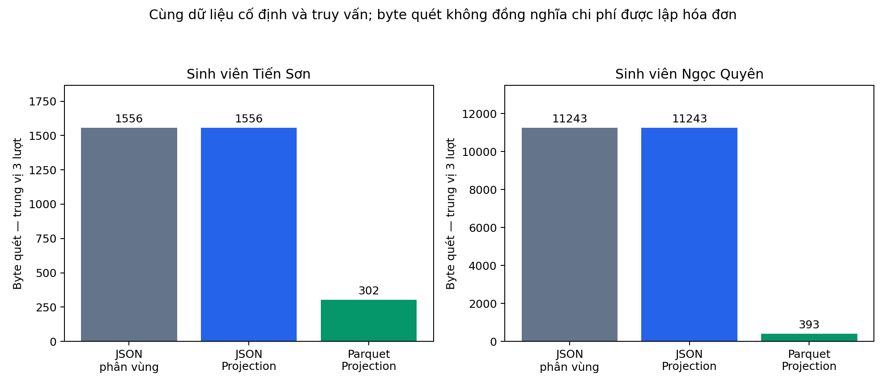
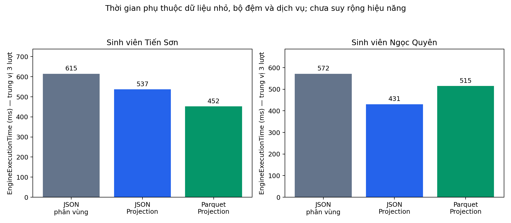
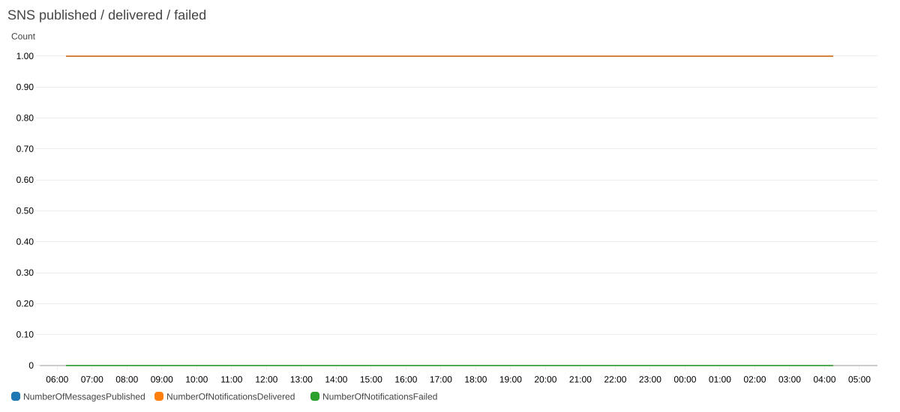
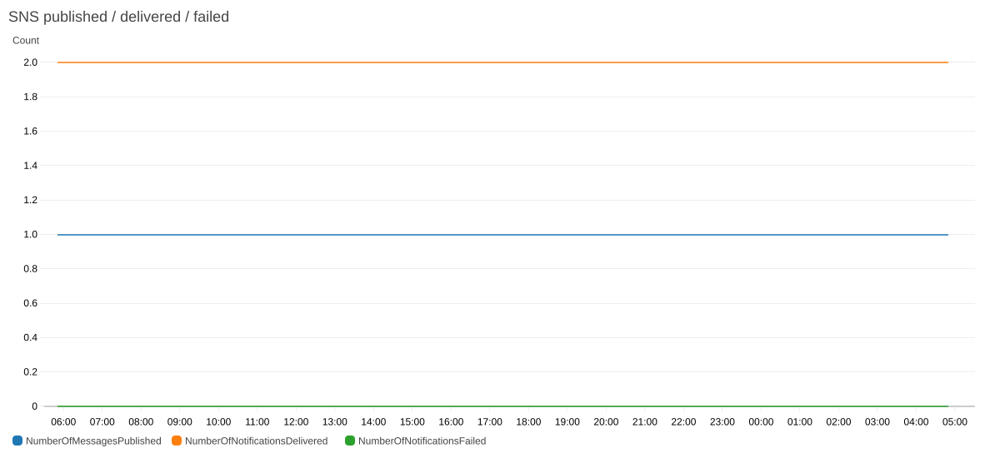
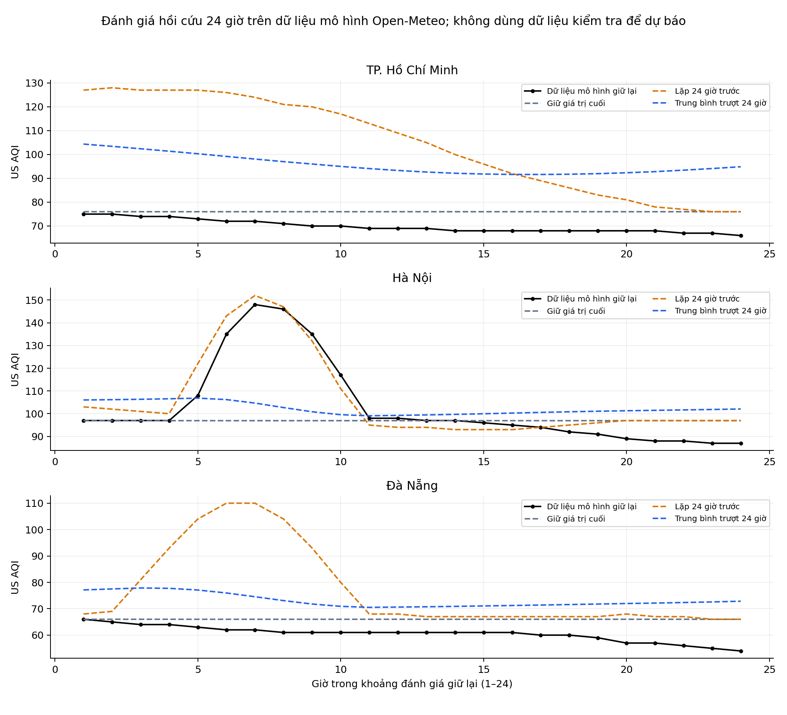
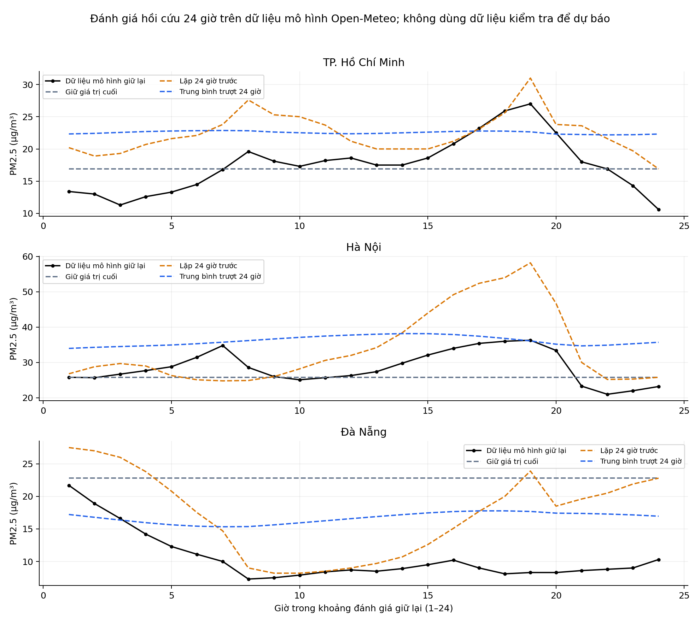

# Báo cáo mốc tích hợp phục vụ Tuần 3

**Sinh viên:** Nguyễn Tiến Sơn (24110054), Trần Thị Ngọc Quyên (24110051).

**Đề tài:** Hệ thống thu thập và phân tích dữ liệu thời tiết, chất lượng không khí trên AWS.

**Mốc kết quả:** 18/10/2026; lịch Tuần 3: 19–25/10/2026, UTC+7.

## 1. Mục tiêu và phạm vi

Mốc này bổ sung phần tối ưu Athena, kiểm tra chất lượng dữ liệu, CloudWatch Dashboard, thử nghiệm dự báo và đường triển khai Lambda qua GitHub Actions. Luồng thu thập hiện hành vẫn dùng mã [Lambda Tuần 2](../../tuan_2/lambda/lambda_function.py); phần mới nằm trong [các chương trình Tuần 3](../scripts/). Cảnh báo được giữ ở kênh email theo phạm vi đã thống nhất.

Các lần kiểm chứng triển khai và nhận thư ngày 16/10 được dẫn lại như minh chứng lịch sử tại [hồ sơ triển khai](../../docs/deployment-verification.md) và [hồ sơ chạy theo lịch](../../docs/scheduled-run-verification.md). Việc bổ sung chương trình và Dashboard ngày 18/10 không tự tạo ra một xác nhận nhận email mới.

## 2. Đầu vào, dữ liệu raw và chất lượng

| Nội dung | Sinh viên Tiến Sơn | Sinh viên Ngọc Quyên |
| --- | ---: | ---: |
| Bản ghi raw tại mốc chụp | 237 | 273 |
| Nhóm đô thị–giờ UTC | 225 | 216 |
| Nhóm đô thị–giờ có nhiều lượt thu | 6 | 54 |
| Bản ghi thuộc Tuần 3 theo UTC+7 | 0 | 0 |
| Các lượt thành công tìm thấy trong log 24 giờ gần mốc chụp | 1 | 0 |

Raw có 23 trường, gồm 20 cột nội dung và ba khóa phân vùng ngày. Các lượt cùng đô thị–giờ vẫn được giữ trong raw; bảng theo giờ sử dụng trung bình trên các giá trị hợp lệ cùng nhóm và ghi số mẫu. Số raw khác nhau phản ánh lịch sử thu thập khác nhau, không tự chứng minh chất lượng phân tích của sinh viên nào cao hơn.

Đầu vào và kết quả mở trực tiếp:

- Sinh viên Tiến Sơn: [raw đầy đủ](../results/integration_2026_10_18/snapshot/default/raw_all.csv), [bảng theo giờ](../results/integration_2026_10_18/snapshot/default/hourly_city.csv), [kết quả kiểm tra](../results/integration_2026_10_18/snapshot/default/snapshot.json).
- Sinh viên Ngọc Quyên: [raw đầy đủ](../results/integration_2026_10_18/snapshot/quyen/raw_all.csv), [bảng theo giờ](../results/integration_2026_10_18/snapshot/quyen/hourly_city.csv), [kết quả kiểm tra](../results/integration_2026_10_18/snapshot/quyen/snapshot.json).

Bảy nhóm kiểm tra gồm: record_id lặp, lược đồ khác bộ trường dự kiến, ô số thiếu, ô số không hữu hạn/không hợp lệ, sai quy đổi UTC+7, sai khóa phân vùng UTC và thời điểm thu trước thời điểm quan sát. Tất cả bộ đếm này bằng 0 trong hai bộ dữ liệu đã chụp. Kết quả đó chỉ phản ánh các quy tắc đã khai báo, không xác nhận độ chính xác ngoài thực địa hay tính đầy đủ theo cả tuần.

### Vì sao kiểm tra theo cách này?

[quality.py](../scripts/quality.py) tách NULL khỏi số 0 để tránh tính một ô thiếu như một phép đo bằng 0. Mốc tuần được chuyển từ UTC+7 sang UTC trước khi lọc. Khóa S3 vẫn theo UTC nên chương trình đối chiếu khóa năm/tháng/ngày với timestamp UTC, sau đó kiểm tra riêng timestamp Việt Nam. Cách này tránh đưa bản ghi sát nửa đêm sang sai tuần.

[snapshot.py](../scripts/snapshot.py) liệt kê các object raw và đọc có điều kiện theo ETag, lưu hash nội dung từng object. Đây là ảnh chụp từng object, **không phải giao dịch chụp nguyên tử toàn bucket**. Trường `source_commit` trong JSON là HEAD repository tại thời điểm chụp (`1cbc04b`); đó không phải commit của các chương trình Tuần 3 được bổ sung sau mốc chụp.

## 3. Partition Projection và Parquet

### 3.1. Thiết kế đối chiếu

Mỗi môi trường dùng một bản raw đã đóng băng. Chương trình [benchmark.py](../scripts/benchmark.py) chuyển cùng 20 cột nội dung sang NDJSON và Parquet nén Snappy, tổ chức cùng cách: một object mỗi ngày, ba khóa phân vùng nằm trong đường dẫn. Ba bảng Glue thử nghiệm gồm:

- `registered_json`: NDJSON dùng các phân vùng đã đăng ký.
- `projected_json`: cùng NDJSON, bật Partition Projection.
- `projected_parquet`: Parquet, bật Partition Projection.

Đường dẫn riêng `week3/experiments/r20261018/` và tên bảng bắt đầu bằng `w3_r20261018_` giữ thử nghiệm tách khỏi raw và bảng sản xuất. Hai bảng Projection của mỗi môi trường có 0 partition đăng ký. Cấu hình giới hạn năm theo dữ liệu đóng băng, tháng/ngày có đệm hai chữ số; khi mở rộng sang năm khác phải cập nhật giới hạn năm.

Truy vấn lọc ngày gần nhất của mỗi bộ dữ liệu, nhóm theo đô thị, tính COUNT, AVG(AQI), AVG(PM2.5). Mỗi định dạng chạy ba lần, xoay thứ tự chạy và tắt sử dụng lại kết quả. Mỗi kết quả đều đối chiếu với phép tổng hợp từ CSV đầu vào.

### 3.2. Kết quả đo

| Báo cáo dữ liệu | Ngày UTC / số bản ghi được truy vấn | Định dạng | Byte quét, trung vị | Engine, trung vị (ms) | Tổng, trung vị (ms) |
| --- | --- | --- | ---: | ---: | ---: |
| Sinh viên Tiến Sơn | 18/10 / 3 | NDJSON đăng ký partition | 1.556 | 615 | 799 |
| Sinh viên Tiến Sơn | 18/10 / 3 | NDJSON Projection | 1.556 | 537 | 746 |
| Sinh viên Tiến Sơn | 18/10 / 3 | Parquet Projection | 302 | 452 | 619 |
| Sinh viên Ngọc Quyên | 16/10 / 21 | NDJSON đăng ký partition | 11.243 | 572 | 756 |
| Sinh viên Ngọc Quyên | 16/10 / 21 | NDJSON Projection | 11.243 | 431 | 606 |
| Sinh viên Ngọc Quyên | 16/10 / 21 | Parquet Projection | 393 | 515 | 722 |

Nguồn từng lần đo, QueryExecutionId, truy vấn SQL và cấu hình: [sinh viên Tiến Sơn](../results/integration_2026_10_18/benchmark/default/), [sinh viên Ngọc Quyên](../results/integration_2026_10_18/benchmark/quyen/).

**Diễn giải:** Projection không đổi lượng NDJSON được quét trong truy vấn này; lợi ích thiết kế nằm ở cách xác định phân vùng, giảm phụ thuộc việc đăng ký metadata. Parquet giảm byte quét khoảng 80,59% và 96,50% so với NDJSON tương ứng, nhưng không luôn nhanh hơn: số đo của sinh viên Ngọc Quyên cho thấy Parquet chậm hơn NDJSON Projection. Mẫu chỉ có ba lần đo và dữ liệu rất nhỏ; không suy ra tiết kiệm tiền hoặc tốc độ sản xuất. Hai môi trường có ngày/số dòng khác nhau, vì vậy chỉ so các định dạng **trong cùng môi trường**.

Chưa đổi lifecycle của raw sản xuất: thử nghiệm nhỏ này chưa cung cấp lịch truy cập dài hạn, yêu cầu lưu giữ hay số đo chi phí phù hợp để lựa chọn tầng lưu trữ. Chính sách vòng đời cần được quyết định sau khi có các đầu vào đó và dự toán phí chuyển tầng/khôi phục.

## 4. Dashboard và cảnh báo email

[dashboard.py](../scripts/dashboard.py) tạo Dashboard riêng `WeatherAirQuality-Week3`, sao lưu cấu hình cũ cục bộ, kiểm tra thông báo hợp lệ từ PutDashboard rồi đọc lại GetDashboard để so toàn bộ nội dung. Hai môi trường đều đọc lại khớp và không có thông báo validation.

Dashboard gồm số lần gọi/lỗi/throttles Lambda, thời gian thực thi, tỷ lệ lỗi, metric SNS và metric lịch chuẩn. Tỷ lệ lỗi dùng `Errors / Invocations × 100` cùng hàm, cùng cửa sổ và chu kỳ 300 giây; không hiển thị tỷ lệ bằng 0 khi không có lượt gọi. CSV chỉ giữ điểm AWS trả về, không lấp khoảng trống bằng số 0.

| Kết quả | Sinh viên Tiến Sơn | Sinh viên Ngọc Quyên |
| --- | ---: | ---: |
| Dòng metric đã lưu | 213 | 168 |
| Ảnh metric AWS đã lưu | 5 | 5 |
| Đọc lại Dashboard khớp cấu hình gửi | Có | Có |

Ảnh là đầu ra thật của [GetMetricWidgetImage](https://docs.aws.amazon.com/AmazonCloudWatch/latest/APIReference/API_GetMetricWidgetImage.html), không phải ảnh màn hình AWS Console. Cửa sổ và kết quả xác minh nằm trong [hồ sơ Dashboard](../results/integration_2026_10_18/dashboard/). Số metric giao SNS không đồng nghĩa thư đã được đọc. Hai sinh viên đã xác nhận nhận thư của các lượt theo lịch ngày 16/10; không dùng xác nhận cũ để khẳng định có thư mới ngày 18/10.

Mỗi môi trường giữ lịch chuẩn `WeatherCollectionSchedule`; lịch `WeatherCollectionHourlyRule` dư trong môi trường sinh viên Ngọc Quyên đã được tắt ở đợt trước. Snapshot ngày 18/10 tiếp tục kiểm tra rule/target. Log 24 giờ có ít lượt thành công như bảng mục 2; chưa đủ chứng minh chạy liên tục 24–48 giờ trong Learner Lab.

## 5. Dự báo theo giờ và đánh giá

### 5.1. Nguồn dữ liệu và cách chia tập

Dữ liệu dùng cho thử nghiệm này được lấy trực tiếp từ Air Quality API của Open-Meteo, lưu nguyên phản hồi tại [thư mục dự báo](../results/integration_2026_10_18/forecast/) cùng [nguồn và mốc thời gian](../results/integration_2026_10_18/forecast/provenance.json). Đây là **dữ liệu mô hình CAMS**, khác với tập các lượt Lambda đã lưu. Không ghép thêm dữ liệu này vào raw thu thập và không mô tả là số đo trạm.

Chương trình chỉ giữ các giờ đã kết thúc trước giờ thu thập hiện tại. Mỗi đô thị có 173 giờ liên tiếp: 149 giờ đầu làm đầu vào, 24 giờ cuối được giữ lại. Tập đánh giá chung là **17/10/2026 05:00 đến 18/10/2026 04:00 UTC**. Các giờ thiếu hoặc số không hữu hạn làm đứt chuỗi; không nội suy để che khoảng trống.

### 5.2. Phương pháp và lý do

[forecast.py](../scripts/forecast.py) áp dụng ba phương pháp cố định trước khi xem sai số:

- **Persistence:** giữ nguyên giá trị cuối của tập đầu vào cho cả 24 giờ; làm mốc so sánh đơn giản.
- **Seasonal naive 24 giờ:** dùng lại giá trị của từng giờ trong ngày trước; kiểm tra lợi ích của chu kỳ ngày.
- **Trung bình trượt 24 giờ:** lấy trung bình 24 giá trị gần nhất, sau đó đưa dự báo vừa tính vào cửa sổ để dự báo giờ kế tiếp. Không đưa giá trị thực của tập giữ lại vào vòng dự báo.

Kiểm tra hồi quy thay đổi toàn bộ giá trị đích vẫn giữ nguyên các dự báo, nhằm phát hiện rò rỉ tập đánh giá. MAE/RMSE/Bias được tính trên cùng 24 thời điểm; Bias = trung bình(dự báo − giá trị giữ lại). Đây là đánh giá hồi cứu trên dữ liệu mô hình được API trả về hiện tại, chưa phải đánh giá các bản dự báo lưu từ trước thời điểm đích.

### 5.3. Sai số MAE

| Đô thị | Chỉ số | Persistence | Seasonal naive | Trung bình trượt |
| --- | --- | ---: | ---: | ---: |
| TP. Hồ Chí Minh | AQI | 6,125 | 34,500 | 25,781 |
| Hà Nội | AQI | 11,333 | 5,292 | 13,204 |
| Đà Nẵng | AQI | 5,458 | 16,583 | 12,598 |
| TP. Hồ Chí Minh | PM2.5 (µg/m³) | 3,271 | 4,883 | 5,734 |
| Hà Nội | PM2.5 (µg/m³) | 4,025 | 7,258 | 7,535 |
| Đà Nẵng | PM2.5 (µg/m³) | 12,296 | 6,712 | 6,779 |

Trung bình trượt không có MAE tốt nhất trong sáu trường hợp. Vì vậy chưa có cơ sở xem đây là mô hình nên đưa vào cảnh báo thật. [CSV sai số](../results/integration_2026_10_18/forecast/forecast_metrics.csv) giữ cả RMSE và Bias; [432 dòng đánh giá](../results/integration_2026_10_18/forecast/holdout_predictions.csv) cho phép tính lại từng sai số.

Chương trình vẫn xuất [144 giá trị dự báo](../results/integration_2026_10_18/forecast/forecast_24h.csv) cho ba đô thị, hai chỉ số, 24 giờ tiếp theo bằng phương pháp trung bình trượt đã định trước. Các dòng được đánh dấu chưa đánh giá bằng dữ liệu tương lai, không được dùng như kết quả quan sát.

## 6. Kiểm tra và triển khai

Workflow [Verify repository](../../.github/workflows/verify-repository.yml) kiểm tra hồ sơ cũ, các hồi quy chức năng/phân tích, bộ kiểm tra Tuần 3 và tính toàn vẹn 92 tệp kết quả. Sau đó workflow đóng gói module Lambda thành ZIP có tên entry, timestamp và quyền tệp xác định; artifact được giữ bảy ngày trên Actions.

Workflow [Week 3 Lambda release](../../.github/workflows/week3-release.yml) chỉ chạy thủ công trên `main`, yêu cầu chọn môi trường và nhập lại tên để xác nhận. Khóa phiên được cấp qua GitHub Environment secrets, không đặt trong mã. STS phải khớp tài khoản của môi trường trước khi tải gói khôi phục hoặc cập nhật Lambda. Cập nhật chỉ thay mã và dùng RevisionId; xác minh hash, trạng thái và dấu vân tay cấu hình. Khi xác minh lỗi, chỉ thử khôi phục nếu RevisionId vẫn thuộc lượt cập nhật này, tránh ghi đè cập nhật của người khác.

Kết quả chạy thật của CI/CD được cập nhật tại [hướng dẫn và hồ sơ triển khai](operation.md). Khai báo workflow hoặc kết quả kiểm tra giả lập không thay thế một lượt triển khai thành công trên GitHub.

## 7. Kết luận và phần còn lại

Mốc ngày 18/10 đã tạo bộ thử nghiệm có thể truy vết từ raw, truy vấn, CSV đến biểu đồ; triển khai Dashboard thật và xây dựng phép đánh giá dự báo có tập giữ lại, phương pháp cơ sở và giới hạn rõ ràng. Việc giảm byte quét đã quan sát được trong thử nghiệm Parquet, còn lợi ích thời gian và chi phí cần dữ liệu lớn hơn và nhiều lượt đo hơn.

Phần tiếp tục gồm thu dữ liệu theo lịch trong các phiên Lab của Tuần 3, đánh giá độ phủ theo ngày, đối chiếu dự báo khi có giá trị tương ứng và ghi số giờ thực tế của từng sinh viên. Chưa bổ sung số giờ Tuần 3; [nhật ký 38 giờ của Tuần 1–2](../../docs/WORKLOG.md) giữ nguyên.

## Tài liệu tham khảo

- [AWS — Partition Projection](https://docs.aws.amazon.com/athena/latest/ug/partition-projection.html), [cách cấu hình](https://docs.aws.amazon.com/athena/latest/ug/partition-projection-setting-up.html).
- [AWS — PutDashboard](https://docs.aws.amazon.com/AmazonCloudWatch/latest/APIReference/API_PutDashboard.html), [Metric Math](https://docs.aws.amazon.com/AmazonCloudWatch/latest/monitoring/using-metric-math.html).
- [Open-Meteo — Air Quality API, nguồn CAMS và điều khoản ghi nguồn](https://open-meteo.com/en/docs/air-quality-api).

[Trang Tuần 3](../README.md) · [Vận hành](operation.md) · [Nhật ký kỹ thuật](WORKLOG.md)
