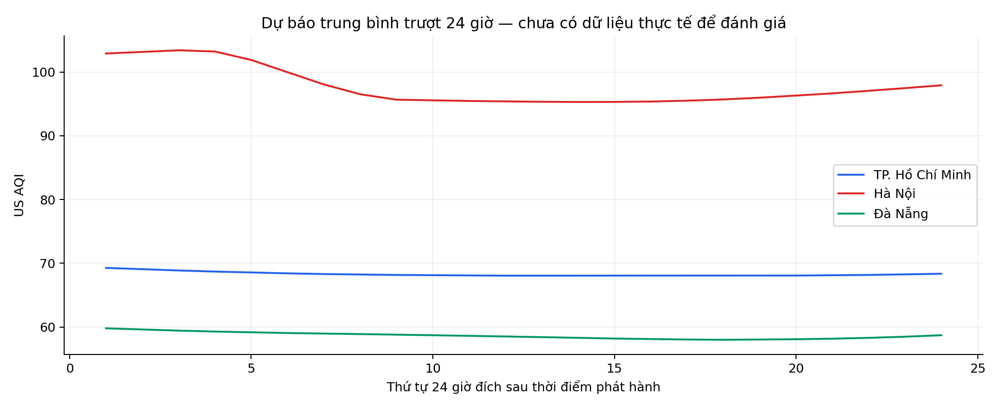
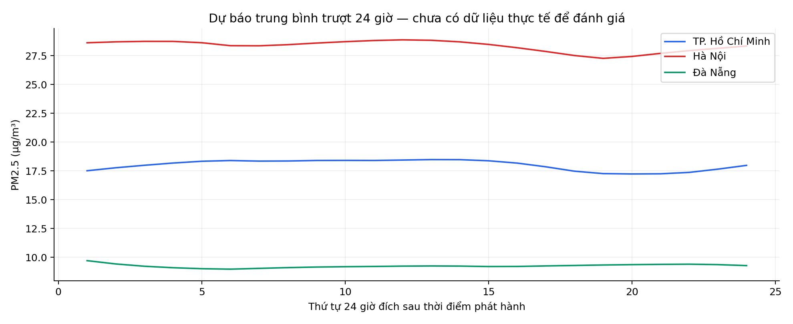
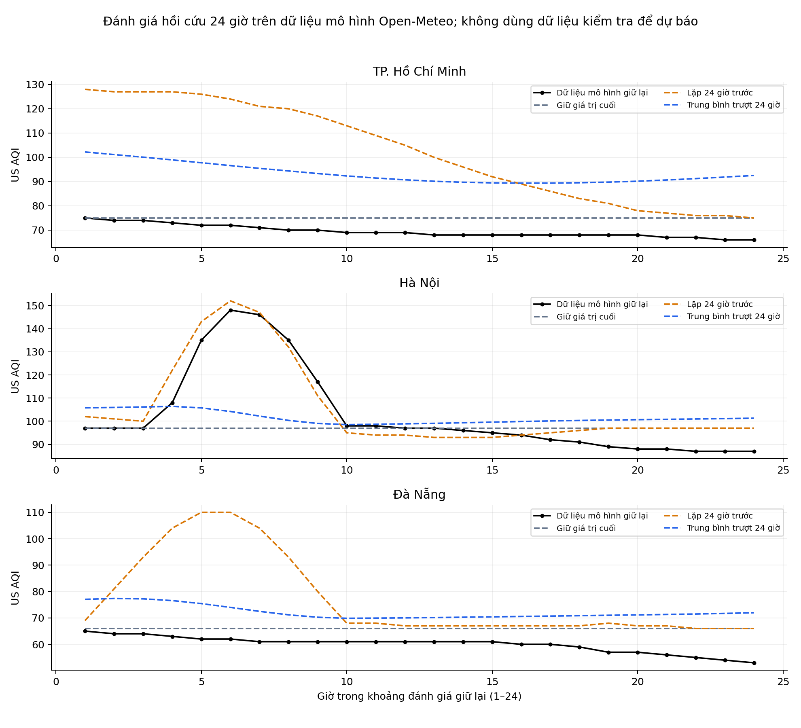

# Dự báo có kiểm tra thời điểm phát hành — 18/10/2026

Mốc này sửa điều kiện thời gian của [bản thử nghiệm ban đầu](../integration_2026_10_18/forecast/). Trong bản ban đầu, sáu dòng có giờ đích 05:00 UTC, sớm hơn lúc lấy dữ liệu khoảng 05:32 UTC; các dòng này không chứng minh dự báo tương lai tại thời điểm phát hành. Bản ban đầu được giữ nguyên để truy vết và phần đánh giá hồi cứu vẫn có nguồn riêng.

## Dữ liệu và kết quả mới

- Dữ liệu mô hình Open-Meteo/CAMS: **522 dòng, 174 giờ mỗi đô thị**, không phải số đo trạm hoặc raw Lambda.
- Đánh giá hồi cứu: 150 giờ đầu làm đầu vào, 24 giờ giữ lại từ 17/10 06:00 đến 18/10 05:00 UTC; ba phương pháp cố định, 18 bộ MAE/RMSE/Bias.
- Dự báo mới: **144 dòng**, gồm ba đô thị × hai chỉ số × 24 giờ đích, từ **18/10 07:00 đến 19/10 06:00 UTC**. Tất cả giờ đích đều sau `issued_at_utc` khoảng 18/10 06:24 UTC.
- Chưa có kết quả đánh giá đủ 24 giờ tương lai. Sai số trên tập giữ lại không thay thế sai số của bản dự báo mới khi các giờ đích chưa xảy ra.

[Nguồn và mốc thu thập](provenance.json) · [Lịch sử mô hình](hourly_model_history.csv) · [Sai số giữ lại](forecast_metrics.csv) · [Từng giá trị đánh giá](holdout_predictions.csv) · [144 giá trị dự báo](forecast_24h.csv) · [SHA-256](manifest.json).

## Cách xử lý khoảng trống đến giờ đích

Giờ dữ liệu cuối là 05:00 UTC. Khi chương trình phát hành khoảng 06:24, giờ 06:00 đang diễn ra nên không lấy làm đầu vào đã hoàn tất. Chương trình tính bước 06:00 bằng dự báo đệ quy, sau đó chỉ xuất 24 giờ đích bắt đầu từ 07:00. Bước trung gian không dùng giá trị thực tương lai.

- `origin_utc`: mốc dữ liệu cuối đã dùng, 05:00 UTC.
- `issued_at_utc`: thời điểm chương trình thực sự tạo các dòng dự báo.
- `forecast_hour`: thứ tự 1–24 của các giờ đích sau phát hành.
- `horizon_hours`: khoảng cách giờ từ dữ liệu cuối đến từng giờ đích; ở mốc này là 2–25 vì có một bước trung gian chưa quan sát.

Chương trình từ chối giờ dữ liệu đang diễn ra/tương lai, thời điểm phát hành không có múi giờ và khoảng cách đến giờ đích đầu vượt 24 giờ. Các kiểm tra không sửa phương pháp hoặc chọn mô hình dựa trên sai số của tập giữ lại.

## Biểu đồ từ dữ liệu mới

*Hai hình đọc đúng các giá trị của `forecast_24h.csv`; trục ngang là thứ tự giờ đích. Đây là giá trị dự báo chưa có đối chiếu tương lai.*

*Dữ liệu giữ lại là dữ liệu mô hình, không phải số đo thực địa hoặc bản dự báo được lưu từ trước thời điểm đích.*

[Mã nguồn](../../scripts/forecast.py) · [Báo cáo kỹ thuật](../../docs/FINAL_REPORT.md)
