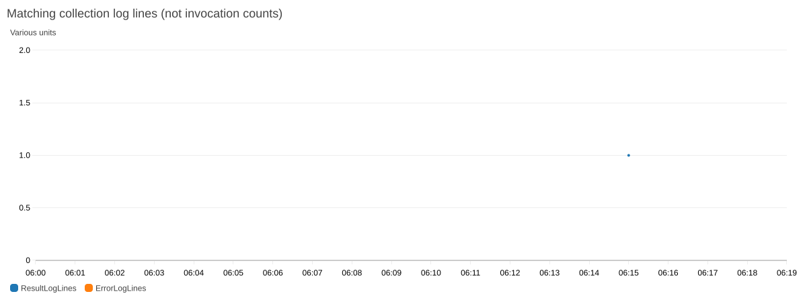

# Đối chiếu vận hành và bổ sung Metric Filters ngày 18/10/2026

Mốc này bổ sung cho [hồ sơ tích hợp](../../README.md), giữ nguyên dữ liệu và kết quả của các mốc trước cho giai đoạn vận hành Tuần 3.

## 1. Snapshot raw và phiên bản triển khai

| Nội dung | Sinh viên Tiến Sơn | Sinh viên Ngọc Quyên |
| --- | ---: | ---: |
| Raw tại snapshot khoảng 13:04, UTC+7 | 237 | 276 |
| Nhóm đô thị–giờ | 225 | 219 |
| Số nhóm kiểm tra chất lượng phát hiện lỗi | 0/7 | 0/7 |
| Gói Lambda khớp bản CD `c28da19` | Có | Có |

[Raw của sinh viên Tiến Sơn](snapshot/default/raw_all.csv) · [Raw của sinh viên Ngọc Quyên](snapshot/quyen/raw_all.csv). Các bộ đếm chất lượng đã khai báo đều bằng 0 tại snapshot; số liệu này không xác nhận đo đạc ngoài thực địa hoặc đầy đủ cả tuần.

Chương trình snapshot đã sửa cách chọn baseline: đọc hash từ hồ sơ CD được công bố thay cho phụ thuộc vào gói sao lưu riêng của ngày 16/10. Các trạng thái `complete` và `partial` cũng được đếm riêng để không coi một lượt thu thập một phần là thành công đầy đủ.

## 2. Đối chiếu hai API CloudWatch

Trong cùng cửa sổ hai giờ, cùng `FunctionName`, thống kê `Sum` và chu kỳ 300 giây, `GetMetricData` và `GetMetricStatistics` đều trả về Invocations = 1, Errors = 3 cho mỗi môi trường. Các điểm thời gian và giá trị khớp nhau giữa hai API; bằng chứng nằm tại [sinh viên Tiến Sơn](metric_cross_api/default.json) và [sinh viên Ngọc Quyên](metric_cross_api/quyen.json).

Kết quả này không hỗ trợ giả thuyết sai khác do hai cách xuất CSV. Theo [định nghĩa metric Lambda của AWS](https://docs.aws.amazon.com/lambda/latest/dg/monitoring-metrics-types.html), Invocations bao gồm các lần thực thi thành công và lỗi hàm. Bộ đếm hiện tại chưa nhất quán với cách tính tỷ lệ lỗi thông thường, nên báo cáo giữ trạng thái chưa xác định và chưa kết luận nguyên nhân.

## 3. Metric Filters và Dashboard

Đã tạo hai filter trong mỗi log group `/aws/lambda/WeatherCollectorLambda`, namespace `WeatherAWS/Collection`:

| Filter | Mẫu | Metric và ý nghĩa |
| --- | --- | --- |
| `Week3CollectionResultLines` | `"Result:"` | `ResultLogLines`: số dòng kết quả, có thể gồm cả lượt thu thập một phần |
| `Week3CollectionErrorLines` | `"[ERROR]"` | `ErrorLogLines`: số dòng ghi lỗi, có thể nhiều dòng trong một lượt Lambda |

AWS `TestMetricFilter` đã đối chiếu năm log mẫu: filter kết quả khớp đúng hai mẫu complete/partial; filter lỗi khớp đúng một mẫu lỗi và loại các mẫu WARN/INFO khác. Sau tạo, `DescribeMetricFilters` đọc lại đúng cấu hình. [Hồ sơ sinh viên Tiến Sơn](filters/default/configuration.json) · [Hồ sơ sinh viên Ngọc Quyên](filters/quyen/configuration.json).

Không đặt `defaultValue`, không dùng request ID làm dimension, không chèn log giả và không gọi trực tiếp Lambda để tạo dữ liệu thử. Đây là bộ đếm **dòng log**, không thay thế metric Invocations/Errors của Lambda. AWS chỉ tạo metric từ log mới phù hợp sau khi tạo filter; số liệu lịch sử không được tự hồi tố. [Tài liệu Metric Filters](https://docs.aws.amazon.com/AmazonCloudWatch/latest/logs/MonitoringLogData.html).

Dashboard đã bổ sung widget thứ sáu cho hai metric mới và được đọc lại khớp cấu hình ở cả hai môi trường. [Cấu hình và 12 ảnh AWS](dashboard/). Ảnh ban đầu có thể chưa có điểm của metric mới; không diễn giải khoảng trống thành không có lỗi. Custom metrics có thể phát sinh phí; chỉ dùng hai tên cố định mỗi môi trường, không tạo chuỗi metric theo định danh từng lượt. [API PutMetricFilter](https://docs.aws.amazon.com/AmazonCloudWatchLogs/latest/APIReference/API_PutMetricFilter.html).

Lượt bổ sung lúc **13:15:45 UTC+7** của sinh viên Tiến Sơn đã thu đủ ba đô thị, raw S3 khớp ba dòng và số cảnh báo bằng 0 phù hợp ngưỡng. Metric `ResultLogLines` đã có một điểm giá trị 1 sau khi tạo filter. Với sinh viên Ngọc Quyên, tại mốc đọc khoảng 13:16 chưa có điểm metric mới sau khi tạo filter; trạng thái vẫn chờ lượt tiếp theo. `ErrorLogLines` không có điểm trong cửa sổ này, được giữ là chưa có số liệu, không chuyển thành số 0.

**Kết quả cập nhật sau mốc này:** [lượt 13:51 của sinh viên Ngọc Quyên](../post_repair_2026_10_18/README.md) đã thu đủ ba đô thị, raw khớp ba dòng và có điểm metric mới sau sửa cấu hình. Nội dung phía trên vẫn mô tả đúng trạng thái lúc 13:16; CSV và JSON của snapshot này được giữ nguyên.

*Ảnh CloudWatch mới chụp từ API sau khi nhận log thật. [CSV metric](scheduled_followup/filters/default/log_metrics.csv) · [CSV kiểm tra từng lượt](scheduled_followup/collections/default/collection_checks.csv) · [Raw đã đọc lại từ S3](scheduled_followup/collections/default/raw_verified.csv).*

## 4. Cấu hình JSON và kiểm tra kết quả thu thập

Secret cấu hình của sinh viên Ngọc Quyên bị mất dấu nháy JSON, khiến `fetch_secrets()` dùng cấu hình dự phòng. Đã sửa định dạng sau khi kiểm tra có thể khôi phục chính xác các identifier, giữ nguyên các trường vận hành và ba đô thị; đọc lại JSON khớp nội dung đã chuẩn hóa. Phiên bản cũ vẫn tồn tại trong Secrets Manager để khôi phục. [Biên bản đã loại giá trị Secret](configuration-format-repair.json).

Chương trình [check_operations.py](../../scripts/check_operations.py) đọc log kết quả, kiểm tra từng object S3 được khai báo, số bản ghi và điều kiện `AQI >= 100 hoặc PM2.5 >= 35,5`. Các giá trị Secret khác không được ghi vào hồ sơ. Tại lượt kiểm tra đầu, cả hai môi trường có ba mẫu dưới ngưỡng và log ghi 0 cảnh báo; đây là kết quả phù hợp điều kiện cấu hình. [CSV đối chiếu ban đầu](collection_checks/).

Kiểm chứng bổ sung theo lịch, dữ liệu raw và quan sát metric mới được lưu trong [scheduled_followup/](scheduled_followup/). Cột `after_current_lambda_update` tách lượt sau triển khai khỏi lượt trước. Rule, target và quyền gọi đã được đọc; log hiện tại không chứa định danh sự kiện để chứng minh liên kết từng request EventBridge bằng trace ID. Kết quả dưới ngưỡng không thực hiện phép thử nhận email mới.

[Manifest SHA-256](manifest.json) · [Báo cáo kỹ thuật](../../docs/FINAL_REPORT.md)
