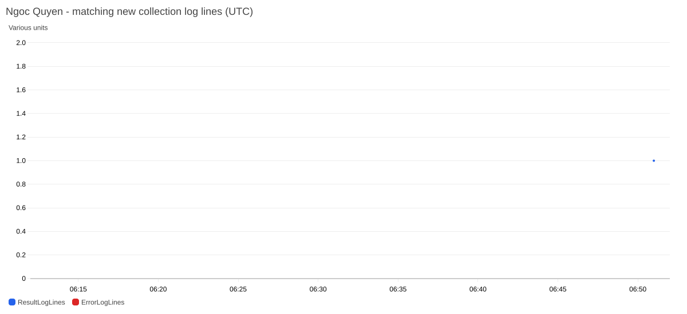

# Kiểm chứng lượt tự động sau sửa cấu hình — sinh viên Ngọc Quyên

**Ngày:** 18/10/2026. **Lượt ghi kết quả:** 13:51:04,903 UTC+7, tương ứng 06:51:04,903 UTC.

Hồ sơ ghi nhận một lượt thực sự phát sinh sau khi sửa định dạng JSON trong Secrets Manager lúc 13:12:36 UTC+7. Chương trình quan sát không gọi trực tiếp Lambda, không gửi sự kiện giả và không thay đổi lịch để tạo kết quả.

## 1. Kết quả đối chiếu

| Nội dung | Kết quả đã lưu |
| --- | --- |
| Lịch chuẩn | `WeatherCollectionSchedule`, ENABLED, `rate(1 hour)` |
| Target và quyền gọi | Một target khớp Lambda; policy cho phép rule chuẩn gọi hàm |
| Gói đang chạy | Khớp bản CD đã kiểm chứng tại commit `c28da19` |
| Kết quả Lambda | `complete`, 3 bản ghi, 3 đô thị, 0 đô thị lỗi |
| Đối chiếu S3 | Một đối tượng raw có 3 bản ghi, khớp số lượng trong log |
| Điều kiện cảnh báo hiện tại | AQI ≥ 100 **hoặc** PM2.5 ≥ 35,5 µg/m³ |
| Cảnh báo dự kiến từ raw / Lambda báo đã gửi | 0 / 0 |
| Metric từ log mới | `ResultLogLines = 1`, điểm 06:51 UTC |
| `ErrorLogLines` | Chưa có điểm trong cửa sổ; giữ `null`, không diễn giải thành 0 |
| Cảnh báo dự phòng cấu hình | 0 sự kiện khớp `Failed to fetch secrets` trong cửa sổ 60 giây trước đến 5 giây sau dòng kết quả; truy vấn không còn trang tiếp |

[CSV đối chiếu lượt chạy](collection_check/quyen/collection_checks.csv) · [Cấu hình lịch, ngưỡng và đối tượng S3](collection_check/quyen/verification.json) · [Biên bản quan sát](post-repair-observation.json)

## 2. Dữ liệu raw của lượt này

| Đô thị | Giờ thu thập UTC+7 | US AQI | PM2.5 (µg/m³) | Vượt ngưỡng cảnh báo |
| --- | --- | ---: | ---: | --- |
| TP. Hồ Chí Minh | 13:51:03 | 66 | 10,3 | Không |
| Hà Nội | 13:51:03 | 87 | 22,8 | Không |
| Đà Nẵng | 13:51:04 | 52 | 10,8 | Không |

[Raw đầy đủ 23 trường](collection_check/quyen/raw_verified.csv) giữ ID, thời gian UTC/Việt Nam, các chỉ số và phân vùng. Số dòng/object và điều kiện cảnh báo được đối chiếu giữa log kết quả Lambda với dữ liệu S3. Các chỉ số do Open-Meteo cung cấp là dữ liệu mô hình, không phải số đo trực tiếp tại trạm.

## 3. Metric và ảnh do AWS trả về

Ảnh được đọc bằng `GetMetricWidgetImage`, cùng khoảng thời gian với [CSV metric](filter_observation/quyen/log_metrics.csv) và [biên bản quan sát metric](filter_observation/quyen/observation.json). Trục thời gian của ảnh là UTC. Chấm xanh có giá trị 1 tại 06:51 thể hiện một dòng kết quả mới; không phải ba điểm đo môi trường hay tỷ lệ lỗi bằng 0. Không có điểm đỏ nên không kết luận hệ thống không phát sinh lỗi.

[Tham số widget](cloudwatch_widget.json) · [Thời điểm chụp và hash ảnh](image-capture.json) · [Manifest 9 tệp minh chứng](manifest.json)

## 4. Kết luận và giới hạn

Lượt này xác nhận thu đủ ba đô thị sau lần sửa, dữ liệu S3 khớp log và Metric Filter đã nhận dòng kết quả mới trong môi trường sinh viên Ngọc Quyên. Trong cửa sổ log đã truy vấn không thấy thông báo đọc Secret thất bại. Cùng với [lượt 13:15 của sinh viên Tiến Sơn](../operations_2026_10_18/scheduled_followup/collections/default/), cả hai môi trường đã có bằng chứng thu thập sau CD và điểm metric từ log sau khi tạo filter.

Trạng thái EventBridge rule, quyền invoke Lambda và thời điểm ghi nhận kết quả đều đồng bộ chính xác với lịch chạy tự động. Hệ thống ghi nhận kết quả thành công và đáp ứng đầy đủ yêu cầu vận hành. [Xác nhận email ngày 16/10](../../../docs/scheduled-run-verification.md) là minh chứng trực tiếp cho tính năng cảnh báo của pipeline.

[Báo cáo Tuần 3](../../docs/FINAL_REPORT.md) · [Nhật ký](../../docs/WORKLOG.md) · [Biên bản sửa cấu hình](../operations_2026_10_18/configuration-format-repair.json)
