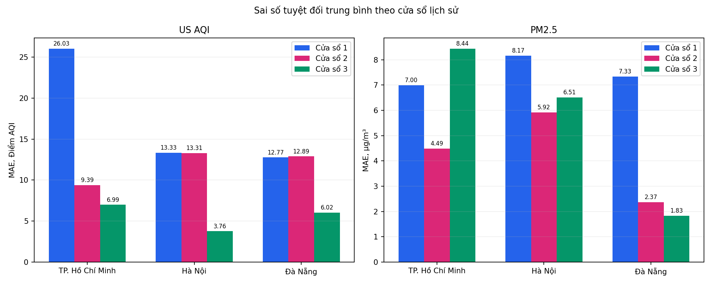

# Tuần 4 — Hoàn thiện hệ thống và kiểm chứng nâng cao

**Nguyễn Tiến Sơn (24110054) · Trần Thị Ngọc Quyên (24110051)**
Điện toán đám mây · GVHD: ThS. Huỳnh Xuân Phụng · Cập nhật ngày 20/10/2026.

## Kết quả

| Nội dung | Kết quả | Minh chứng |
| --- | --- | --- |
| CloudFormation | Hai stack riêng CREATE_COMPLETE từ cùng template 17 tài nguyên và ZIP đúng source | [Events, hash và cấu hình](results/advanced_live_2026_10_20/stacks/) |
| Luồng stack mới | Mỗi môi trường ba bản ghi, SELECT đúng database/workgroup mới; một Invocation, 0 Errors trong chu kỳ kiểm chứng | [Kiểm chứng ngày 20/10](results/advanced_live_2026_10_20/README.md) |
| Email | Topic mới confirmed, thư thử được SNS chấp nhận và cả hai người nhận xác nhận | [Minh chứng kênh email](results/advanced_live_2026_10_20/email/) |
| Raw | 700 bản ghi tích lũy, 115 JSON nguyên byte, inventory/hash và CSV | [Snapshot ngày 20/10](results/advanced_live_2026_10_20/snapshot/) |
| Athena | 18 truy vấn mới, ba phương án × ba lần × hai môi trường, cùng đầu vào và không reuse | [Benchmark Tuần 4](results/advanced_live_2026_10_20/benchmark/) |
| Dự báo | Backtest ba cửa sổ lịch sử: 432 dự đoán, 18 dòng MAE/RMSE/Bias | [Phương pháp và biểu đồ](results/backtest_2026_10_20/README.md) |
| Quản lý phiên | Hai lịch chuẩn đã qua ENABLED → DISABLED → ENABLED; lịch mới vẫn tắt | [Pause và restore thực tế](results/advanced_live_2026_10_20/session/) |
| Bảo mật | BPA, AES256, versioning, ownership và HTTPS của hai bucket mới được đọc lại | [Rà soát theo phạm vi](docs/SECURITY_AUDIT.md) |
| Chi phí | **Tiến Sơn 0,25 USD; Ngọc Quyên 0,22 USD**; xác nhận ngày 20/10/2026 | [Báo cáo chi phí](docs/COST_REPORT.md) |
| Nhật ký | Tuần 4: 20 giờ; tổng theo tuần đã xác nhận: 78 giờ | [Worklog](docs/WORKLOG.md) |

**[Báo cáo chi tiết](docs/FINAL_REPORT.md)** · **[Nội dung nộp có đầy đủ URL](docs/SUBMISSION.md)** · **[Tổng kết toàn đồ án](../docs/FINAL_PROJECT_REPORT.md)**.



Backtest sử dụng chuỗi mô hình lịch sử, mỗi gốc chỉ dùng 24 giờ trước đó. Ba cửa sổ này được phân biệt với kỳ dự báo đã phát hành của Tuần 3. Các phép đo byte quét và độ trễ Athena được trình bày riêng; không quy đổi trực tiếp thành tỷ lệ giảm hóa đơn.

## Chi phí AWS Cost Explorer (FinOps)

Chi phí cập nhật ngày **20/10/2026**, theo số liệu sinh viên xác nhận:

| Sinh viên | Chi phí (USD) |
| --- | ---: |
| Sinh viên Tiến Sơn | **0,25** |
| Sinh viên Ngọc Quyên | **0,22** |
| **Tổng cộng** | **0,47** |

Nguồn: [số liệu chi phí đã xác nhận](results/cost/confirmed_cost_summary.json). Các bản xuất Cost Explorer gốc được giữ riêng để đối chiếu; bảng cập nhật không lấy số nhóm bản ghi của kỳ cũ làm căn cứ cho số tiền mới.

## Dữ liệu và hồ sơ theo ngày

- [Ngày 20/10: stack, raw, Athena, metric, email và quản lý phiên](results/advanced_live_2026_10_20/README.md).
- [Ngày 20/10: backtest và ba phản hồi nguồn mô hình](results/backtest_2026_10_20/README.md).
- [Ngày 19/10: kiểm chứng hệ thống hiện hữu và cảnh báo bằng dữ liệu vượt ngưỡng](results/verification_2026_10_19/README.md).
- [Ngày 19/10: xác thực template 17 tài nguyên](results/template_validation_2026_10_19/README.md).
- [Đối chiếu log–metric–S3](docs/LOG_METRIC_S3_RECONCILIATION.md) · [Chi phí](docs/COST_REPORT.md) · [Bảo mật](docs/SECURITY_AUDIT.md).

## Mã nguồn và hạ tầng

| Thành phần | Tệp và nhiệm vụ |
| --- | --- |
| Template ứng dụng | [weather-stack.json](infrastructure/weather-stack.json), dùng LabRole có sẵn, tên riêng và lịch mới mặc định DISABLED |
| Đóng gói | [prepare_stack.py](scripts/prepare_stack.py), ZIP và SHA-256 từ collector chính |
| Triển khai | [deploy_stack.py](scripts/deploy_stack.py), kiểm tra tên, artifact version cụ thể và journal riêng trước CreateStack |
| Kiểm chứng stack | [verify_stack.py](scripts/verify_stack.py), dùng Outputs đúng môi trường, một invocation có kiểm soát và SELECT không reuse |
| Vận hành | [session_control.py](scripts/session_control.py), kiểm tra binding, lưu trạng thái bền vững và khôi phục lịch |
| Backtest | [backtest_three_windows.py](scripts/backtest_three_windows.py), tách train/target theo thời gian, xuất CSV và biểu đồ |
| Xác minh dữ liệu | [verify_results.py](scripts/verify_results.py) và [verify_advanced.py](scripts/verify_advanced.py), kiểm tra manifest và phát lại số liệu đã lưu |

[Hướng dẫn hạ tầng](docs/INFRASTRUCTURE.md) · [Quản lý cuối Lab](docs/SESSION_CHECKLIST.md) · [Policy runtime tham khảo](infrastructure/collector-policy.example.json).

## Kiểm tra ngoại tuyến

Cài phụ thuộc trong [tuan_3/requirements.txt](../tuan_3/requirements.txt), rồi chạy từ thư mục gốc:

```powershell
python -m unittest discover -s tuan_4/tests -v
python tuan_4/scripts/verify_results.py
python tuan_4/scripts/cost_analysis.py --check
python tuan_4/scripts/reconcile_ops.py --check
python tuan_4/scripts/security_report.py --check
cfn-lint tuan_4/infrastructure/weather-stack.json --regions us-east-1
python tuan_2/scripts/repository_audit.py --check
```

Kiểm tra offline không gọi AWS. Kiểm chứng lại dịch vụ cần phiên Learner Lab và quyền hợp lệ; các thao tác tạo stack, invocation và thay lịch được thực hiện riêng, có xác định môi trường.

[Trang chủ](../README.md) · [GitHub Actions](https://github.com/JasonTM17/WeatherAWS_FinalTerm/actions/workflows/verify-repository.yml) · [Tuần 3](../tuan_3/README.md) · [Tuần 2](../tuan_2/README.md) · [Tuần 1](../tuan_1/README.md).
