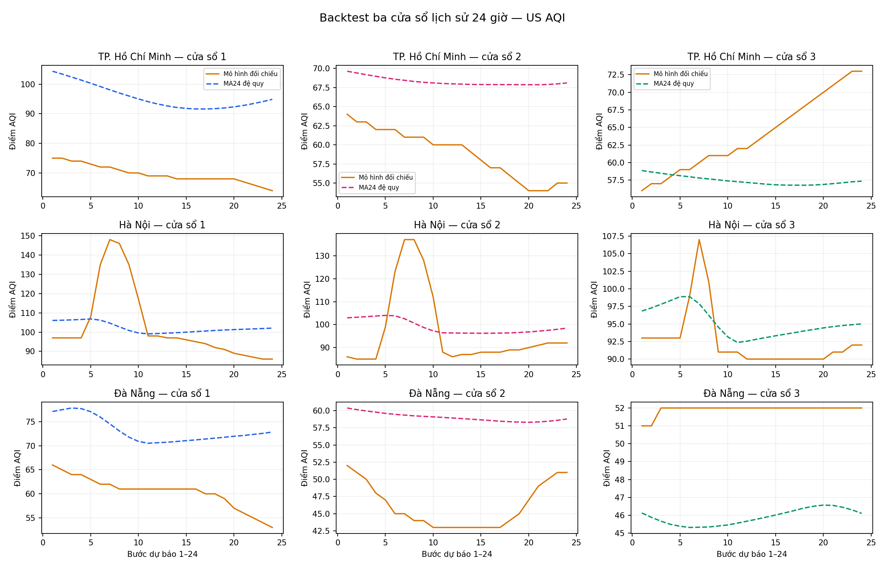
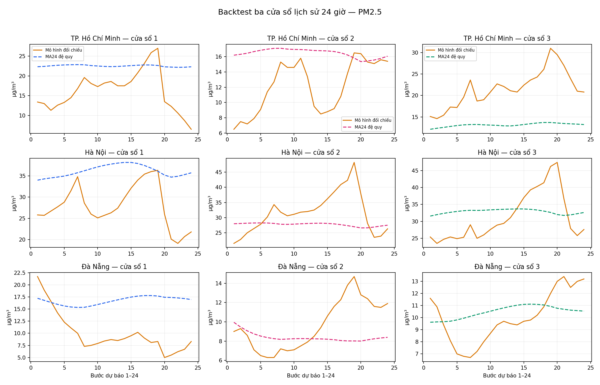

# Backtest ba cửa sổ lịch sử — ngày 20/10/2026

## Phương pháp

Thực hiện theo phương án đánh giá lịch sử đã thống nhất: **ba cửa sổ đích liên tiếp, mỗi cửa sổ 24 giờ**, ba đô thị và hai biến US AQI/PM2.5. Mỗi gốc dự báo chỉ nhận **24 giờ liền trước**, sau đó dự đoán đệ quy 24 bước bằng trung bình trượt MA24 cố định. Giá trị đích của chính cửa sổ đó không được đưa trở lại mô hình.

Phản hồi Open-Meteo/CAMS được lưu trong [model_source](model_source/), kèm URL truy vấn và mốc tải trong [summary.json](summary.json). Bộ lịch sử giữ **519 dòng đô thị–giờ**, lấy phần đã qua mốc cắt chung của cả ba phản hồi. [protocol.json](protocol.json) ghi phương pháp trước khi tải và đánh giá; không lựa chọn lại mô hình dựa trên sai số đích.

Đây là **backtest hồi cứu trên chuỗi mô hình**, không phải ba bản dự báo đã phát hành trong quá khứ, cũng không phải so sánh với trạm quan trắc. Kỳ dự báo phát hành ngày 18/10 và đối chiếu ngày 19/10 vẫn được giữ riêng trong [hồ sơ Tuần 3](../../../tuan_3/results/forecast_followup_2026_10_19/README.md).

## Đầu ra

| Tệp | Nội dung |
| --- | --- |
| [history.csv](history.csv) | Lịch sử đầu vào đủ ba đô thị |
| [predictions.csv](predictions.csv) | **432 dự đoán** = 3 cửa sổ × 3 đô thị × 2 biến × 24 bước; kèm train/target bounds |
| [metrics.csv](metrics.csv) | **18 dòng MAE/RMSE/Bias**, tách theo cửa sổ, đô thị và biến |
| [manifest.json](manifest.json) | Thành viên và SHA-256 của toàn bộ bộ dữ liệu |

Đơn vị AQI là điểm; PM2.5 là µg/m³. Bias = trung bình(dự đoán − giá trị mô hình đối chiếu). MAE/RMSE được tính theo cùng đơn vị của biến.


Hình cho thấy sai số thay đổi giữa đô thị và cửa sổ. MAE AQI của TP. Hồ Chí Minh lần lượt khoảng 26,03; 9,39; 6,99 điểm; MAE PM2.5 tương ứng khoảng 7,00; 4,49; 8,44 µg/m³. Mức cải thiện AQI không kéo theo cải thiện PM2.5 trong cùng cửa sổ, nên báo cáo giữ riêng từng biến và từng kỳ.





Hai hình giữ cả đường mô hình đối chiếu và đường dự đoán MA24. Cửa sổ sau sử dụng những giờ đã hoàn tất trước gốc mới, bao gồm dữ liệu từng làm đích của cửa sổ trước; điều này đúng với đánh giá cuốn chiếu theo thời gian.

## Tái lập và kiểm chứng

```powershell
python -m unittest discover -s tuan_4/tests -p test_three_window_backtest.py -v
python tuan_4/scripts/verify_results.py
```

Bộ xác minh offline tính lại 432 dự đoán và 18 dòng sai số từ history đã lưu. Kiểm thử riêng thay đổi dữ liệu đích để chứng minh dự đoán không đổi, đồng thời từ chối giờ thiếu, giờ trùng và giá trị không hữu hạn. Rà soát độc lập đã tính lại bằng thư viện chuẩn và đối chiếu với ba phản hồi nguồn.

Thu thập một bộ mới, không ghi đè bộ này:

```powershell
python tuan_4/scripts/backtest_three_windows.py --output output/backtest-moi
```

[Báo cáo Tuần 4](../../docs/FINAL_REPORT.md) · [Kiểm chứng AWS và Athena ngày 20/10](../advanced_live_2026_10_20/README.md)
